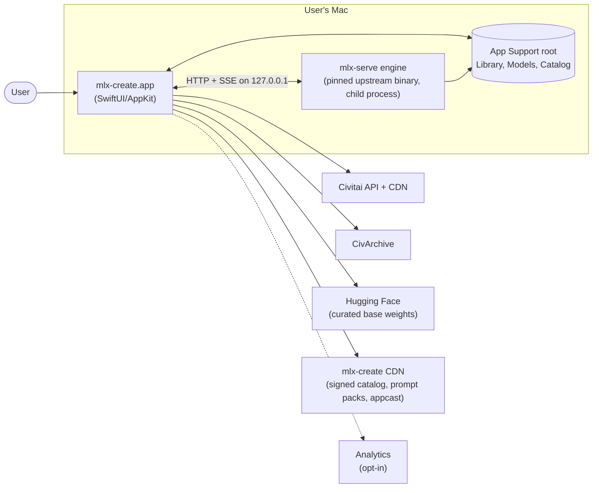
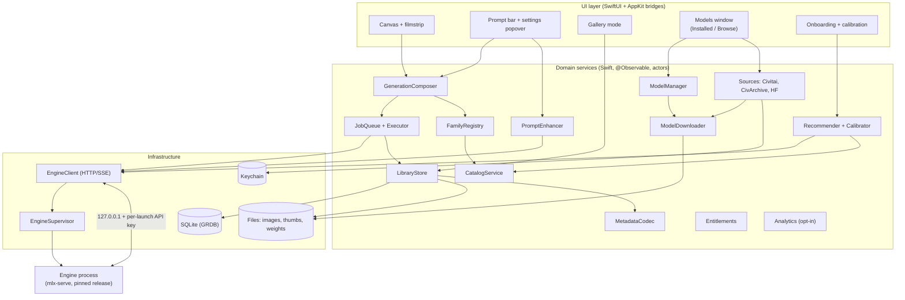
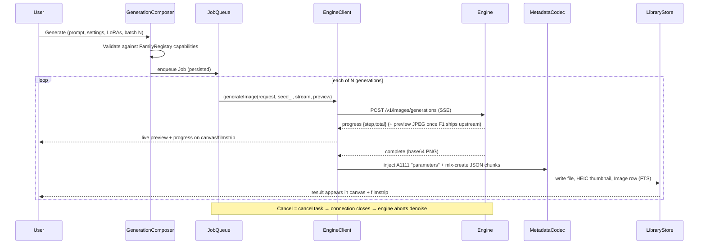
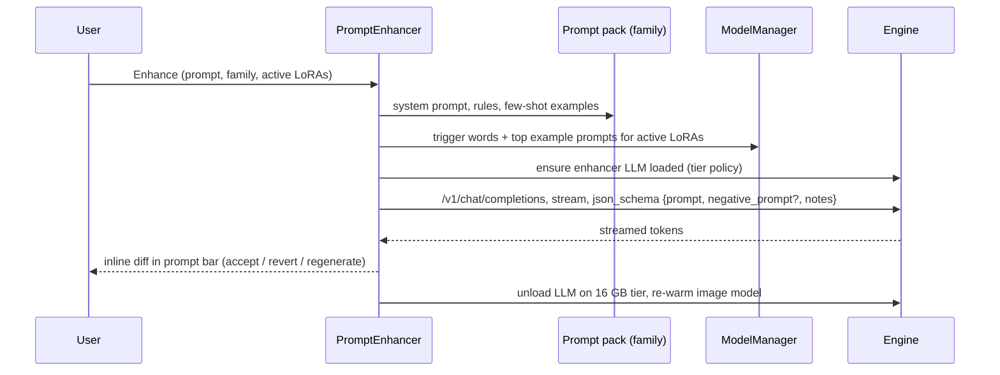
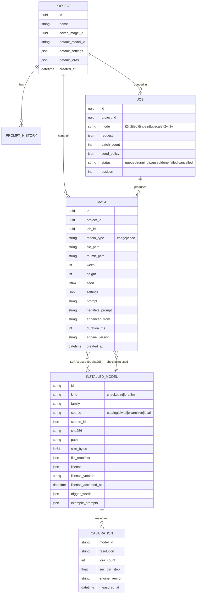

# mlx-create — High Level Design

| | |
|---|---|
| **Status** | Draft for review |
| **Date** | 2026-10-16 |
| **Scope** | Whole product: v1 delivery in detail, later phases at architecture level |
| **Backend reference** | Upstream [ddalcu/mlx-serve](https://github.com/ddalcu/mlx-serve) (MIT). `src/…`, `app/…`, `docs/…` citations refer to commit `1c34059` |

---

## 1. Purpose

mlx-create is a commercial, native macOS app for local image and video generation on Apple Silicon. It aims for the reach of Automatic1111 (full control, LoRAs, community models) in a Mac-native app that runs on hardware-tuned defaults and uses no Python, Electron or cloud.

This document records the agreed product decisions, the system architecture, the split of work between the mlx-serve backend and the native app, the data model, and the phased roadmap. Implementation detail belongs in per-component LLDs; open items are listed in §15.

## 2. Goals and non-goals

### Goals

- **G1:** Native macOS 26.2+ app with a canvas-first generation UI, Projects, and a per-project gallery.
- **G2:** Text-to-image generation in v1, with every mlx-serve control that makes sense for the selected model family (steps, CFG, negative prompt, size, seed, LoRA stack).
- **G3:** A prompt **Enhance** button backed by a local, uncensored LLM that knows how each model family wants to be prompted and what the active LoRAs need.
- **G4:** Preselected models with recommendations tuned to the user's Mac, calibrated on the device itself.
- **G5:** A manager for local checkpoints and LoRAs, and a browser/downloader for Civitai and CivArchive.
- **G6:** No content filtering anywhere in the stack.
- **G7:** An architecture that already accommodates img2img/edit, inpaint, upscale and video, which ship in later phases.

### Non-goals (explicitly out of scope)

- SDXL / SD1.5 / Pony / Illustrious / Flux.1 / Chroma / Wan engines. Only families mlx-serve runs are supported (D5).
- ControlNet and structural conditioning.
- Sampler and scheduler pickers. Each family uses curated defaults (D14).
- Tags, ratings, favorites and smart collections. Projects are the only organising unit (D10).
- Mac App Store distribution, cloud generation, and model training.

## 3. Decision log

Settled during the design interview. Later documents cite these IDs.

| ID | Decision | Rationale / consequence |
|---|---|---|
| D1 | **Commercial product**, direct distribution (Developer ID, notarized DMG) | The App Store would reject uncensored generation and Civitai downloads |
| D2 | **Business model undecided**: pluggable `Entitlements` seam | Paywall boundaries can be added without architectural change |
| D3 | **Neutral creative tool** positioning; no filters; NSFW is opt-in in the browser | Lowers payment-processor and platform risk |
| D4 | **16 GB, any M-series** is the floor; **macOS 26.2+** | Matches mlx-serve's dev baseline (16 GB M4 mini) and the engine binary's 26.2 minimum (`build.zig:24-30`) |
| D5 | **Supported families only**: FLUX.2-klein, Krea-2, Qwen-Image 2.1, Mage-Flow (image); LTX-Video, MiniMax-H3 (video) | No new engine work. The browser filters to compatible LoRAs |
| D6 | **Pinned upstream mlx-serve release binary**, re-signed and bundled. No fork is carried; a GitHub fork exists only to stage upstream PRs | No Zig toolchain or rebase cost. Engine needs are upstreamed (§7.2); bundling a fork is the escape hatch if upstream rejects something v1 can't ship without |
| D7 | **Design for all modes, deliver in phases**; v1 is **text→image only** | Data model, queue and engine API are mode-agnostic from day one |
| D8 | **LoRAs only in v1**; fine-tune import and conversion come later | Avoids building a converter for v1 |
| D9 | Enhancer: **one curated abliterated LLM per RAM tier**, app-managed | Predictable quality, no refusals |
| D10 | **Projects**: each image has exactly one home project. Nothing else organises images | Simple mental model. A project carries default model, settings, LoRAs and prompt history |
| D11 | Enhancer knowledge = **versioned prompt packs + LoRA-aware context** | Packs update without an app release. Trigger words and example prompts are woven in |
| D12 | PNG metadata: **A1111 `parameters` + mlx-create JSON** | Civitai and other tools interoperate. Dropping an image restores its settings |
| D13 | v1 power tools: **batch count + seed controls, persistent queue, live step previews** | X/Y plot, wildcards and styles are out of v1 |
| D14 | **No sampler picker**; curated per-family defaults | Distilled and turbo flow models degrade with off-schedule samplers |
| D15 | Civitai: **anonymous by default, optional API key** (Keychain); NSFW previews blurred until opt-in | |
| D16 | Recommendations = **signed remote catalog + on-device calibration** | Real seconds-per-image estimates on every Mac |
| D17 | Storage is **fully separate** from other tools (own Application Support root, relocatable) | Achieved by launching the engine with `HOME` pointed at our root (§7.4); no engine change |
| D18 | **Canvas-first** main window; the gallery is a separate mode | |
| D19 | **Sparkle** updates + **opt-in anonymous analytics** | |
| D20 | Model licenses **shown, accepted on download**; defaults favour permissive licenses; we never redistribute weights | Some curated weights carry non-commercial licenses |
| D21 | Until the signed catalog exists (D16), a **bundled capability record per verified family** (`families.json`) drives the settings surface (§8.3–8.4) | Only families whose size grid, step default and guidance support were checked against the pinned engine source get a record; other installed models show as unavailable |
| D22 | A1111 `Model hash` is **omitted** until catalog identifiers exist (§8.9); the `mlx-create` chunk carries the engine model id and a `schema_version` | The hash is defined from catalog data that v1 t2i does not have yet |
| D23 | Seeds are app-resolved integers in **0..<2^32** and always sent explicitly (§8.1) | The engine reads `seed` as unsigned and defaults to 42 |
| D24 | The library records the **engine's actual output** (pixel size from the PNG, step count from the last progress event), not the request (§8.2, §8.9). A job with no progress event records its step count as **unknown** (stored as nil; the PNG `parameters` line omits `Steps:`), never the requested count | The engine rounds size to the family grid and may run the checkpoint's own step grid, so the requested count is not evidence of what ran |
| D25 | **FLUX.2 klein accepts multiples of 32 in [256, 1536]** at the pinned engine (upstream `clampFluxDim`, v26.10.2), not a fixed 1024². Krea keeps multiples of 16 in [256, 2048]. The UI reads each family's size grid from its capability record, never a per-family constant | The earlier "fixed 1024²" reading of FLUX was wrong. `families.json` carries the grid; the composer snaps to it |
| D26 | **Krea-2 Turbo is listed in the catalog; the license is accepted at download, per license version.** The app implements no content filtering (D3, G6). The license sheet states in plain language the Krea 2 Community License v1 content-filter clause (§4.2) and the commercial revenue cap (§2.3), and the user accepts both before the install starts. Acceptance records the license id, version and time. A later license version requires fresh acceptance for new installs and leaves installed models alone (D20) | §4.2 requires "reasonable and appropriate Content Filter measures" and §2.3 permits commercial use only under USD 1M trailing twelve-month revenue. Listing the model behind an accept-at-download gate, rather than excluding it, keeps the family available and shows both terms before use |
| D27 | **The signed catalog is the trust root for model file contents.** Each catalog model pins a 40-hex Hugging Face commit and lists every file's path, size and SHA-256. Hugging Face is transport only. The app pins Ed25519 public keys; the loader takes the highest-sequence valid catalog, and a remote catalog never replaces a cache with a lower sequence. Installs stage in `Models/.partial/<install-id>/` and rename into `Weights/<org>/<repo>/` only after every file verifies. The `DOWNLOAD` table is dropped: resume sidecars and a staging manifest hold in-flight state. `INSTALLED_MODEL` gains a per-file manifest and a license version | The HF tree API gives SHA-256 only for LFS files, and the `X-Linked-Etag` header is unsigned and absent for small files, so only a signed per-file manifest covers every file. Sidecars and a manifest already carry in-flight state, so a table would duplicate them |
| D28 | **One app instance per user account.** A second launch activates the running window and exits. The running app holds `Engine/app.lock` (opened `O_CLOEXEC`, `flock` exclusive, non-blocking) for its whole life. The engine is reaped from the pid record only under that lock. The app sends the key only to a child whose `/health` is ok **and** whose pid, checked through libproc, listens on the chosen port; otherwise the launch fails and retries on a fresh port | Chosen over an ownership token in the pid record: simpler, and it also stops the shared library sweep race. Governs R12, R13 (KTD11, KTD12) |
| D29 | The library opens **off the main actor**, behind a loading view. A **user pause persists** across relaunch as a `UserDefaults` flag that Resume clears. The engine-failure hold pauses **in memory only** and writes nothing (KTD14) | Opening the library must not stall launch (R15). A paused queue must stay paused after the app is reopened (R14). An engine-failure hold is not user intent, so a healthy relaunch drains without a Resume press |
| D30 | **Network seams are injected protocols, so tests run without the network.** `ModelTransport` (MCModels), `CatalogTransport` (MCCatalog) and `HubClient` (MCCatalogTool) are injected and supply scripted responses, including interrupted transfers. `ModelDownloader` is an actor; its `ModelTransport` requirements are async where needed and `ModelInstaller` awaits them. The app supplies the URLSession-backed implementations. These protocols join the seams this HLD names (`ModelSource`, `Entitlements`, `ModelFamily`) | Install and catalog tests need scripted replies and interrupted-transfer cases, which `URLProtocol` stubbing makes awkward and process-global. The seams are the ones AGENTS.md allows |

## 4. Constraints and assumptions

- **Hardware:** Apple Silicon M1–M5, 16 GB minimum. On a 16 GB Mac the Metal recommended working set is ≈11.9 GB (`src/server.zig:3593-3597`), so the image model and the enhancer LLM cannot always stay loaded together.
- **Backend behaviour** (verified in upstream mlx-serve at `1c34059`):
  - Media requests are synchronous, one generation at a time, with optional SSE (`src/gen_sse.zig:119`, progress/error events).
  - Closing the connection cancels the job (`src/gen.zig:2718`, `src/diffusion.zig:257`).
  - No batch `n` and no sampler field on the image path.
  - Step previews exist **only for video** (`src/gen.zig:3592-3603`). Image previews depend on upstream PR F1.
  - The image content filter has been removed (`CHANGELOG.md:436`; `--no-safety` is a no-op at `src/main.zig:746`).
  - LoRAs are applied at runtime and stack up to 8. They are named by absolute path, accepted only from loopback, and scales may be negative or above 1 (`src/gen.zig:5297-5345`, `src/lora.zig:1-40`).
- **Upstream velocity:** 663 commits in the last 3 months and CalVer `vYY.M.N` releases. We consume tagged releases only, bump deliberately, and gate each bump on API contract tests.
- **Upstream binary:** every release attaches `mlx-serve-bin-macos-arm64.tar.gz` (binary, dylibs, LICENSE, NOTICE), which upstream's own Homebrew formula pins by version and sha256 (`Formula/mlx-serve.rb:4-6`).
- **Video output:** the server returns raw `rgb8` frames plus `pcm_s16le`, and the client muxes them (`docs/api.md:66`).
- **Civitai API:** public endpoints without auth. A bearer token unlocks gated content. Responses can be SFW-only in restricted regions regardless of the `nsfw` param ([developer.civitai.com reference](https://developer.civitai.com/site/reference/)).

## 5. System context



All generation happens on the Mac. Outbound traffic is limited to model and metadata downloads, catalog/pack/update fetches, and analytics when the user opts in. Prompts and images never leave the machine.

## 6. Architecture overview

The app is a client of a private, localhost-only engine process. All inference stays in the engine. The app owns product state: projects, the queue, metadata, downloads, catalog, enhancer orchestration, and licensing.



### Technology choices

| Concern | Choice | Why |
|---|---|---|
| Language | Swift 6, strict concurrency | Native, matches mlx-serve's app code we reuse |
| UI | SwiftUI-first. AppKit bridges for the gallery grid (`NSCollectionView`) and the zoomable canvas | SwiftUI lazy grids struggle at 10k+ thumbnails |
| State | Observation (`@Observable`), actors for services | |
| Persistence | SQLite via GRDB, with migrations and FTS5 for prompt search | Explicit schema control, fast, debuggable; better fit than SwiftData for a queue + library |
| Image I/O | ImageIO (PNG chunk injection, HEIC thumbnails) | No re-encode when writing metadata |
| Video mux | AVFoundation `AVAssetWriter` (phase 3) | Reuse `VideoGenService.writeMP4` (`app/Sources/MLXServe/Services/VideoGenService.swift:1100`) |
| Updates | Sparkle 2, EdDSA-signed appcast | D19 |
| Signing | Developer ID + hardened runtime + notarization | D1 |
| Build | Xcode project (XcodeGen) with a build phase that fetches the pinned engine tarball (`engine.lock`), verifies its sha256, embeds and re-signs it | No Zig toolchain in our build or CI |

Swift package modules:

- `MCEngine`: supervisor and client
- `MCCatalog`: catalog, families, recommender
- `MCLibrary`: GRDB store, metadata codec
- `MCGeneration`: job queue, executor, composer (depends on `MCEngine`, `MCCatalog`, `MCLibrary`; keeps the store free of engine knowledge and the UI free of queue logic)
- `MCModels`: manager, sources, downloads
- `MCCatalogTool`: `mc-catalog` executable (keygen, build, sign, verify); not linked into the app
- `MCEnhancer`
- `MCApp`: UI

Each module is testable without the UI.

## 7. Backend: pinned upstream mlx-serve

### 7.1 What we use unchanged

| Capability | mlx-serve surface | Evidence |
|---|---|---|
| Image generation | `POST /v1/images/generations`, `stream:true` → SSE `progress` + final base64 PNG | `docs/api.md:62`, `src/gen.zig:2355` |
| Image request fields | `prompt`, `negative_prompt`, `size`, `seed`, `steps` (≤100), `guidance_scale` (family-gated), `lora_paths[]`/`lora_scales[]`, `transparent` (Qwen), `mode`/`image`/`strength`/`ref_images` (phase 2) | `src/gen.zig:593-636, 2356-2420`; `ImageGenService.swift:196-243` |
| Video generation (phase 3) | `POST /v1/video/generations`, rgb8 frames + PCM, `preview` JPEGs on progress | `docs/api.md:66` |
| LLM for enhancer | `/v1/chat/completions` with JSON-schema constrained decoding | `README.md:121` |
| Model lifecycle | `POST /v1/load-model`, `/v1/unload-model`, `/v1/models/rescan`, `--model-dir` (repeatable), `--max-resident-mem auto`, `--max-resident-models`, LRU eviction, memory preflight | `docs/api.md:68-69`, `docs/cli.md:93-98` |
| Health | `GET /health` → `status:"ok"` | `ServerManager.swift:552-564` |
| Cancellation | Client disconnect cancels the denoise loop | `src/gen.zig:2718`, `src/flux.zig:2277` |
| LoRA key formats | diffusers, kohya (`lora_down/up`, `lora_unet_`), PEFT, BFL fused QKV | `src/lora.zig:3-91` |

### 7.2 Upstream requests

We carry no engine patches. Everything the app needs from the engine goes to ddalcu/mlx-serve as a PR, staged on our GitHub fork, and reaches the app only through a tagged upstream release. Anything that can live in the app stays in the app.

| ID | Change | Phase | Fallback until released upstream |
|---|---|---|---|
| F1 | **Image step previews.** Extend `sse.parsePreview` / `StreamCtx` preview to the image engines (FLUX.2, Krea-2, Qwen-Image, Mage-Flow), with a per-family latent→RGB fit (reusing `preview.zig`, `latent_rgb.zig`) | v1 | Step progress bar without preview frames. The client already handles preview events, so they light up on the engine bump that includes F1 (D13) |
| F3 | *(Optional)* `GET /v1/models/{id}/capabilities`: supported fields, size grid, step range, guidance support | v1.x | The catalog carries capabilities (§8.4) |
| F4 | Mask-based inpaint / outpaint for supported image families | Phase 4 | Feature waits |
| F5 | `mlx-serve convert`: single-file community fine-tune → MLX layout + 4/8-bit quantization | Phase 4 | Feature waits |

(F2, a state-root override, was dropped: every engine path derives from `$HOME/.mlx-serve`, so §7.4 overrides `HOME` instead.)

**Escape hatch:** if upstream rejects a change v1 cannot ship without, we build and bundle our fork from source at that point. mlx-serve is MIT, so this stays available.

Non-changes: we use the stock binary with its chat, audio and 3D code. Unused surfaces stay dormant and unreachable from outside: we bind to loopback and require a key.

### 7.3 Pinning and bumps

- **Pin:** `engine.lock` in our repo records upstream version, tarball URL and sha256. A build phase downloads and verifies the tarball, embeds the binary and dylibs in `Contents/MacOS` / `Contents/Frameworks`, fixes install names, and re-signs everything with our Developer ID and hardened runtime for notarization.
- **Bump cadence:** deliberate, not per release. A bump PR updates `engine.lock` and runs the **engine contract suite** (a black-box HTTP test pack exercising every endpoint and field the app uses against tiny fixture models) against the downloaded binary. Green ships in the next app release; red keeps the previous pin.
- **Versioning:** the app bundles exactly one engine build. Engine updates ship only inside app updates through Sparkle; there is no independent engine updater.
- **Attribution:** the app's NOTICE carries mlx-serve's MIT license and the third-party notices shipped in the tarball (`LICENSE`, `LICENSE-APACHE-2.0`, `NOTICE`).
- **Source reference:** no copy of mlx-serve lives in our repo. Read it on GitHub at the pinned tag, or in a throwaway clone.

### 7.4 Engine supervision

`EngineSupervisor`, adapted from `ServerManager.swift`, launches the bundled binary as a child process with `HOME=<AppSupport>/Engine`:

```
HOME=<AppSupport>/Engine MLXC_ENGINE_KEY=<random per launch> \
mlx-serve --serve --host 127.0.0.1 --port <free ephemeral> \
  --api-key-env MLXC_ENGINE_KEY --api-key-strict --model-dir <Models>/Weights \
  --max-resident-mem auto --max-resident-models <tier> --log-level info
```

`--api-key-strict` is required: upstream exempts loopback callers from the key by default. `--api-key-env` keeps the key out of the world-readable argv. Details in `docs/lld/engine.md`.

- **State isolation:** logs, kv-cache, model settings, providers and LAN keys all resolve under `$HOME/.mlx-serve` (`src/cli.zig:207`, `src/main.zig:1136,1158`, `src/kv_disk_cache.zig:3577`, `src/model_settings.zig:222`, `src/server.zig:2157`), so they land in `Engine/.mlx-serve/`. Some media dependencies (e.g. LTX's text encoder, `src/gen.zig:5062`) are only looked up under `$HOME/.mlx-serve/models`, so that path is a symlink to `<Models>/Weights`, which the supervisor recreates at launch (the Models root is relocatable).

- **Readiness:** poll `/health` until `status:"ok"`.
- **Crash handling:** classify the log tail (reuse `summarizeCrash`, which already maps Metal OOM to a friendly message), mark the in-flight job failed and retryable, then restart with exponential backoff (max 3 attempts per 5 minutes, then surface the error).
- **Orphan cleanup:** a PID file under `Engine/` is checked at launch, and stale engine processes are terminated.
- **Shutdown:** terminate on `willTerminate`, with SIGKILL after a grace period.
- LAN sharing and discovery are never enabled.

## 8. App components

### 8.1 EngineClient

A typed async client: `generateImage(_:) -> AsyncThrowingStream<GenEvent>`, `chat(_:schema:)`, `load/unload/rescan`. It speaks SSE (reusing `MediaSSE` from `Services/MediaGenProgress.swift:66`) and cancels by cancelling the Swift task, which closes the connection; the engine treats that as cancellation. It always sends an explicit `seed`, because the engine default is a constant 42.

### 8.2 Generation pipeline and queue

The **JobQueue** is app-owned and persisted in SQLite, so it survives relaunches. It runs one job at a time to match the engine.

- **Job** = one composed request × batch count. The executor expands a job into N **generations**, each a separate engine request with its seed from the job's seed policy: random, fixed, increment from base, or reuse from a selected image.
- The user can reorder, pause, cancel (current or queued), and retry failed jobs. The queue strip in the filmstrip shows placeholders with live progress.
- **Throughput rules:**
  - Keep the active image model resident across consecutive jobs.
  - Pre-warm with `/v1/load-model` when the user changes model in the prompt bar.
  - Don't reorder the user's queue. The engine already reuses an identical LoRA stack between requests (`src/gen.zig:753-757`), so consecutive generations within a job pay the attach cost once.



### 8.3 Settings surface

Controls are driven by the family's capability record (§8.4), so the UI never shows a knob the engine would reject or ignore.

| Control | Shown when | Notes |
|---|---|---|
| Prompt, Enhance ✨ | always | |
| Negative prompt | family supports it | Collapsed by default |
| Size / aspect presets | always | The family size grid from its capability record (D25): FLUX.2 klein multiples of 32 in [256, 1536]; Krea multiples of 16 in [256, 2048] (`src/gen.zig:2366`) |
| Steps | always | Family default, quality presets (Fast / Balanced / Quality), max 100 |
| CFG / guidance | family supports guidance (e.g. klein base, `supportsGuidance()`) | Hidden for distilled turbo models |
| Seed + policy, batch count | always | |
| LoRA stack (≤8) | family accepts LoRAs | Per-LoRA weight slider (−2…2 default, advanced range −20…20 per `src/gen.zig:5754`), trigger-word chips, enable toggle |
| Transparent background | Qwen-Image | `transparent:true` |
| Advanced | always | `cond_gain` / `cond_weights` where supported |

### 8.4 FamilyRegistry and capabilities

A `ModelFamily` record describes how to drive one architecture:

- `id` (e.g. `flux2-klein-4b`, `qwen-image-2.1`)
- `capabilities`: fields, size grid, step defaults and range, guidance, negative prompt, LoRA support, modes
- `loraFingerprint`: key patterns plus tensor shapes, used for compatibility checks
- `civitaiBaseModels`: Civitai `baseModel` labels that map to this family
- `promptPackId`

Families and their mappings come from the signed catalog (§8.5), so new Civitai labels or capability corrections ship without an app release. The family list itself is bounded by what the bundled engine implements; a catalog entry for an unknown engine family is ignored.

### 8.5 Catalog, Recommender and Calibrator

**Catalog** (signed JSON on our CDN, fetched daily, with a bundled fallback copy):

- **Models:** id, family (matches §8.4), source repo (HF), pinned 40-hex commit revision, per-file path, size and SHA-256 (D27), quantization, download bytes, approximate RAM, license (id, name, URL, commercial-use flag, version and a plain-language summary), per-tier default settings, reference timings per chip class.
- **Enhancer models** per RAM tier.
- **Families** (§8.4) and prompt pack versions.
- **Signature and rollback:** Ed25519 via CryptoKit over the exact bytes of `catalog.json`, detached in `catalog.json.sig`, which names a key id from the pinned key list. Each catalog carries `schema_version` and a monotonic `sequence`. The loader takes the highest valid sequence among bundled and cached copies, and rejects a remote copy whose sequence is lower than the cache's (`docs/lld/models.md`).

**Hardware profile:**

| Signal | Source |
|---|---|
| Chip | `sysctl machdep.cpu.brand_string` (as in `src/ane.zig:143-169`) |
| GPU core count | IORegistry |
| RAM | `ProcessInfo.physicalMemory` |
| Usable working set | Metal `recommendedMaxWorkingSetSize` (as in `SystemMemoryInfo.swift`) |
| M5 neural accelerators (NAX) | Detected via the chip brand string |

**Recommender:**

- Classifies each model as comfortable, tight or exceeds against the usable working set. This reuses mlx-serve's fit bands and its **warn, don't block** policy (`MediaModelPicks.swift:11-14`).
- Per capability, picks the largest comfortable model whose estimated latency meets the tier target, plus the matching enhancer.

**Calibrator (two levels):**

1. **Onboarding:** after the starter model downloads, run fixed calibration renders (e.g. 512² and 1024², fixed seed and steps). Compare them to the catalog's reference timings to get a machine speed factor, and use that factor to estimate seconds per image for every catalog model, downloaded or not.
2. **Continuous:** every real generation records seconds-per-step by (model, resolution, LoRA count) and refines the estimates. Estimates are invalidated when the engine version changes.

Seed tiers, taken from mlx-serve's presets in `Services/MediaGen.swift` and finalized by catalog data and calibration:

| Tier | Default image picks | Enhancer |
|---|---|---|
| 16 GB | FLUX.2-klein 4B 4-bit (≈5 GB download, 8 GB RAM); Qwen-Image 2.1 / Turbo 4-bit (≈10–11 GB, tight); Mage-Flow Turbo 8-bit (≈9 GB) | ~4B abliterated, 4-bit, unloaded after each use |
| 24 GB | + FLUX.2-klein 9B 4-bit (16 GB RAM), Mage-Flow Turbo | ~4B, may stay resident |
| 32 GB+ | + Krea-2 Turbo (24 GB RAM), Qwen-Image 2.1 8-bit (≈18 GB) | ~8–12B, resident |
| 48 GB+ (phase 3) | + LTX-Video (24 GB+ RAM), MiniMax-H3 4-bit (26 GB+) | resident |

### 8.6 ModelManager (local checkpoints and LoRAs)

- **Inventory:** every installed checkpoint, LoRA and enhancer LLM, with source, SHA-256, size, family, license and acceptance timestamp, trigger words, example prompts and preview images (cached from Civitai/CivArchive metadata).
- **Compatibility check:** before a LoRA can be attached, the app reads the `.safetensors` header (JSON only, bounded read). It matches key names and tensor **shapes** against each family's fingerprint, so a klein-4B LoRA is distinguished from a klein-9B one. Incompatible LoRAs are greyed out for the current model. The engine's `LoraNoMatch` 400 stays the final authority.
- **Formats:** `.safetensors` only. Pickle formats (`.ckpt`, `.pt`, `.bin`) are rejected because they can execute code.
- **Operations:** rename, delete (with a "used by N images" hint), reveal in Finder, disk usage per category. Imported local `.safetensors` files go through the same fingerprinting.
- **v1 checkpoints** are curated catalog entries downloaded from HF. Community fine-tune checkpoints wait for F5 (phase 4).

### 8.7 Sources and ModelDownloader

| Source | Role | Mechanics |
|---|---|---|
| **Curated (HF)** | Base checkpoints and enhancer LLMs from the catalog | HF API + tree listing (reuse `HFSearchService.swift`) |
| **Civitai** | Browse/search LoRAs for supported families, with versions, previews, trigger words, example prompts and hashes | `GET /api/v1/models` filtered by `types=LORA` and `baseModels` from family mappings; `/api/v1/model-versions/{id}`; `/api/v1/model-versions/by-hash/{sha256}`; downloads via `/api/download/models/{versionId}` with a bearer token when a key is set |
| **CivArchive** | Find models deleted from Civitai by SHA-256 or name, cross-platform search, mirror download links | API integration as done by ComfyUI-LoRA-Manager; endpoint contract to be confirmed in the LLD (§15) |

**Browser UX:**

- Results are filtered to compatible families by default; "show incompatible" is a toggle.
- Each entry shows license and commercial-use flags, which the user accepts at download (D20).
- NSFW items are hidden unless the user opts in, and blurred until revealed (D15).
- Region-restricted SFW-only responses are surfaced honestly ("Civitai limits results in your region").

**ModelDownloader** (an actor; each file moves through `FileDownloader`; reuses `ChunkedDownload.swift` and `DownloadManager.swift`):

- Up to 16 ranged connections with 8 MB minimum chunks, resume from sidecar files, stall detection, and single-stream fallback when the CDN ignores Range.
- Disk-space preflight before starting.
- SHA-256 verification against the source hash, then atomic move into `Models/`.
- `POST /v1/models/rescan` after checkpoint or LLM installs. LoRAs need no rescan because they are passed by path.
- Runs as a background-capable download list with a global concurrency limit (default 3 files).

### 8.8 PromptEnhancer



**Prompt packs** are signed, versioned, per family, and stored under `Catalog/PromptPacks/`. Each pack contains:

- System prompt and style rules: natural-language density, length targets, negative-prompt support, text-rendering rules, aspect and composition hints.
- Few-shot examples.
- Edit-instruction and video variants for later phases.

The initial packs are seeded from mlx-serve's `PromptRewriter.swift` (MIT) and its Qwen dense-text rules, which are adapted from QwenLM's prompt utilities (Apache-2.0, attribution in NOTICE).

**LoRA-aware context:**

- Trigger words are required in the output, and the JSON-schema validation re-inserts any that are missing.
- Up to 3 creator example prompts per active LoRA are supplied as style references.
- Total context is capped by the tier budget.

**Behaviour:**

- Thinking is disabled. The enhancer is never blocking: the user can keep editing, and the result is offered as a diff.
- **Memory policy:** on the 16 GB tier the enhancer and image model are not co-resident. Enhance unloads the LLM afterwards and re-warms the diffusion model in the background, and the UI shows a one-time note about the reload. On 24 GB+ both stay resident under the engine's memory budget.
- **Model choice:** abliterated instruct models from families the engine runs natively (Gemma / Qwen classes). The specific picks per tier are selected by an offline evaluation: blind A/B of generations with and without enhancement, plus a refusal probe. They ship via the catalog.

### 8.9 LibraryStore and MetadataCodec

- **Projects (D10):** a project has a name, a cover, defaults (model, settings, LoRA stack) and its prompt history. Every image has exactly one home project. "Move to project…" reassigns it. The project switcher lives in the toolbar.
- **Gallery mode:**
  - Grid of the current project or all projects, sorted by date.
  - FTS5 prompt search. No tags or ratings (D10).
  - Context actions: reuse settings, reuse seed, move, export (with or without metadata), reveal, delete.
- **MetadataCodec (D12):**
  - **Write:** a PNG `tEXt` chunk `parameters` in A1111 format (prompt; `Negative prompt:`; `Steps, CFG scale, Seed, Size, Model, Model hash, Lora hashes`), plus an `iTXt` chunk `mlx-create` holding the full JSON request (family, engine version, LoRA SHA-256s and scales, enhancer provenance). Chunks are injected into the engine's PNG bytes without re-encoding. Model hash uses the catalog-provided identifier because MLX checkpoints are directories. LoRA hashes use the A1111 AutoV2 form (first 10 hex characters of the SHA-256).
  - **Read:** dropping any PNG onto the canvas parses our JSON first, then A1111 `parameters`, and restores every setting the current families support. Unknown resources are looked up by hash on Civitai/CivArchive and offered for download.
  - Export can strip metadata per item or by default (privacy setting).
- **Thumbnails:** HEIC at 512 px, generated on write.

### 8.10 Entitlements, updates, analytics

- **Entitlements (D2):** `Entitlements.isEnabled(_ feature: Feature) -> Bool`, with features such as batch size cap, queue depth and video. The provider is pluggable: license key with offline grace, subscription, or freemium. Gates are checked in the composer and executor only, never in the engine. The provider choice is open (§15).
- **Updates (D19):** Sparkle 2 with an EdDSA-signed appcast. Catalog and prompt packs update independently (daily, signed).
- **Analytics (D19):**
  - Opt-in at onboarding, off by default, anonymous, through a privacy-first vendor.
  - **Events:** launch, generation completed (family, steps, resolution bucket, duration, tier, chip class), enhancer used, download completed (family, source type), errors by class.
  - **Never sent:** prompts, images, file names, Civitai item IDs or names, API keys.
  - Crash diagnostics via MetricKit, uploaded only when the user opts in.

## 9. Data model



`JOB.mode` and `IMAGE.media_type` already cover the later phases (D7). The v1 executor only accepts `t2i`.

### On-disk layout

```
~/Library/Application Support/mlx-create/
├── Library/                       # relocatable (Settings → Library location)
│   ├── library.sqlite
│   ├── Projects/<project-id>/<yyyy-mm>/<image-id>.png|.mp4
│   └── Thumbnails/<image-id>.heic
├── Models/                        # relocatable (external drive supported)
│   ├── Weights/<org>/<repo>/      # checkpoints + enhancer LLMs (--model-dir)
│   ├── LoRAs/<family>/<sha10>-<slug>.safetensors (+ .json metadata sidecar)
│   ├── .partial/<install-id>/     # staged installs: chunks and resume sidecars (D27)
│   └── .partial/<install-id>.install.json   # staging manifest, beside the staging folder, never inside it (D27)
├── Engine/                        # engine HOME: .mlx-serve/{logs,kv-cache,…}, pid
│   └── .mlx-serve/models → ../../Models/Weights (symlink)
└── Catalog/
    ├── catalog.json(.sig)
    └── PromptPacks/<family>.json(.sig)
```

Nothing is written to `~/.mlx-serve`, and other tools' model folders are not scanned (D17).

## 10. User experience

```
┌──────────────────────────────────────────────────────────────────────┐
│ [Project: Portraits ▾]   ( Canvas | Gallery )   [Qwen-Image 4bit ●]  ⏳2 │  toolbar
├──────────────────────────────────────────────────────────────────────┤
│                                                                      │
│                         current / selected result                    │  canvas: zoom, pan,
│                       (live step preview while running)              │  drop PNG = restore
│                                                                      │
├──────────────────────────────────────────────────────────────────────┤
│ ▢ ▢ ▢ ▢ ▢ ▢ ▢ ▣(62%) ▢(queued) ▢(queued)                              │  filmstrip + queue
├──────────────────────────────────────────────────────────────────────┤
│ a woman reading in a sunlit café, film grain…        ✨  ⚙  ×4  [Generate ⌘↩] │  prompt bar
│ LoRAs: [film-look 0.8 ✕] [+]                                          │
└──────────────────────────────────────────────────────────────────────┘
```

- **Canvas mode:**
  - Canvas: the selected result or the live preview.
  - Filmstrip: the project's recent results plus queue placeholders.
  - Prompt bar, with a **⚙ settings popover** driven by family capabilities (§8.3).
  - Model chip with a fit badge (comfortable/tight) and a seconds-per-image estimate.
- **Gallery mode:** full grid with search. Double-click opens an image in the canvas.
- **Models window:** an *Installed* tab and a *Browse* tab (Curated / Civitai / CivArchive), plus the download list.
- **Onboarding:**
  1. Hardware scan.
  2. Recommended starter set with license acceptance.
  3. Starter downloads.
  4. Calibration render.
  5. Analytics opt-in.
  6. First project.
- **Keyboard first:** ⌘↩ generate, ⌘E enhance, ⌘. cancel, ⌘1/⌘2 Canvas/Gallery, ⌘R reuse settings of the selected image.

## 11. Memory and performance strategy

| Tier | Engine flags | Policy |
|---|---|---|
| 16 GB | `--max-resident-models 1` | One diffusion model resident. The enhancer swaps in and out. LoRA stack ≤ 4 recommended. Warn before tight models |
| 24–32 GB | `--max-resident-models 2` | Diffusion + enhancer co-resident |
| 48 GB+ | `--max-resident-models 3` | Image + enhancer + video model (phase 3) |

- `--max-resident-mem auto` caps everything to the Metal working set. The engine's preflight unloads idle models before a load that wouldn't fit (`docs/cli.md:98`).
- The app never runs inference in its own process, so its own footprint stays small. Thumbnails and the gallery use a bounded `NSCache` with downsampled ImageIO decoding.
- Pre-warm on model selection. Keep loaded while the queue is non-empty, and release after idle (`--idle-evict-secs`, tier-dependent).

## 12. Security and privacy

- The engine is bound to `127.0.0.1` and protected by a random per-launch API key, so other local processes can't drive it. LAN features are off.
- The engine accepts LoRA paths only from loopback (`src/gen.zig:5302`).
- The Civitai API key is stored in Keychain and sent only to `civitai.com`.
- Catalog, prompt packs and appcast are signature-verified. Downloads are hash-verified. Pickle formats are refused.
- Prompts and images never leave the device. Analytics is opt-in and content-free (§8.10).
- Hardened runtime and notarization. No microphone or camera entitlements. Sandboxing is deferred to the LLD (mlx-serve's MAS variant shows the engine can run sandboxed, but App Store distribution is out of scope).

## 13. Phased roadmap

| Phase | Scope | Backend work |
|---|---|---|
| **v1.0** | Text→image on FLUX.2-klein 4B/9B, Qwen-Image 2.1 (+Turbo), Krea-2 Turbo, Mage-Flow. Civitai/CivArchive LoRAs. Enhancer with packs + LoRA context. Projects + gallery + prompt search. Persistent queue, batch and seed policies. Step progress (live previews when F1 lands). A1111 metadata and drop-to-restore. Catalog + calibration. Sparkle, opt-in analytics, Entitlements seam | F1 upstream PR |
| **v1.x** | Img2img variation (`strength`), instruction edit (`mode:edit`, `ref_images`, Qwen / Mage-Flow Edit), transparent PNG | None, already in the engine. F3 optional |
| **v2.0** | Text/image→video (LTX, MiniMax-H3) with AVFoundation mux, video in projects and gallery, video prompt packs | None, already in the engine |
| **v2.x** | Inpaint/outpaint (mask canvas), upscale + hires-fix, community fine-tune import | F4, F5. Upscaler approach decided in the LLD |

## 14. Risks

| Risk | Impact | Mitigation |
|---|---|---|
| **Uncensored quality within supported families.** FLUX.2-klein is weak on NSFW out of the box, and the Civitai LoRA supply for these families is far thinner than for SDXL | Core promise feels partial | Lead with Qwen-Image where it fits. Curate a vetted LoRA shortlist per family in the catalog. Enhancer packs tuned per family. Fine-tune import in v2.x. Revisit D5 if needed |
| Upstream velocity (~200 commits/month) and single-maintainer bus factor | API breakage on bump, stalled or rejected PRs | Deliberate pinned bumps gated by the contract suite; upstream-first PRs; fork-and-bundle escape hatch (§7.2) |
| Payment processors and Civitai ToS vs uncensored use | Lost merchant account or API access | Neutral positioning (D3), no NSFW marketing, NSFW opt-in, honour Civitai rate limits and ToS |
| Model licenses (e.g. non-commercial FLUX.2-klein 9B) | Legal exposure for users and us | Licenses shown and accepted per download, permissive defaults, no redistribution (D20) |
| 16 GB headroom | Swap thrash, OOM, slow enhance | Tier policies (§11), tight-fit warnings, enhancer unload, calibration-backed estimates |
| CivArchive API undocumented or unstable | Broken fallback source | Isolate behind a `ModelSource` protocol, degrade gracefully, cache metadata |
| Civitai regional SFW gating | Confusing empty results | Explicit UI messaging |
| Abliterated enhancer quality | Bad rewrites | Offline A/B evaluation gate before a model enters the catalog |
| macOS 26.2 floor | Smaller addressable market | Accepted (D4) |

## 15. Open questions for LLDs

1. CivArchive API endpoints, auth, and rate limits.
2. Exact Civitai `baseModel` labels for each supported family (catalog data).
3. Enhancer model picks per tier (output of the evaluation in §8.8).
4. Entitlements provider and paywall boundaries (D2).
5. Analytics vendor.
6. App Sandbox on or off for Developer ID builds.
7. Upscaler approach for v2.x (Core ML in-app vs MLX engine).
8. Whether upstream accepts F1, and by which release.

## Appendix A: Reuse map from mlx-serve's Swift app (MIT)

The app code is tightly coupled to the menu-bar app (`ImageGenService` is `@MainActor` and depends on `ServerManager`), so we **copy and adapt** individual files with attribution rather than depend on the target.

| mlx-serve file (`app/Sources/MLXServe/…`) | Becomes | Adaptation |
|---|---|---|
| `Services/ServerManager.swift` | `MCEngine.EngineSupervisor` | Reuse `summarizeCrash` and the SIGTERM→SIGKILL helper; `HOME` override, models symlink, PID file and backoff are new (upstream has none); drop menu-bar/UI state |
| `Services/APIClient.swift`, `Services/MediaGenProgress.swift` (`MediaSSE`) | `MCEngine.EngineClient` | Typed events, preview frames, task cancellation |
| `Services/ImageGenService.swift` (`requestJson`, `decodePngB64`) | `MCEngine` request builders | Pure functions, reused nearly verbatim |
| `Services/ChunkedDownload.swift`, `Services/DownloadManager.swift` | `MCModels.ModelDownloader` (actor) and `MCModels.FileDownloader` | Civitai bearer auth, redirect handling, SHA-256 verification |
| `Services/HFSearchService.swift` | `MCCatalogTool.HubClient` | Catalog-driven repo resolution only |
| `Models/SystemMemoryInfo.swift`, `Services/SystemMetrics.swift`, `Models/MediaModelPicks.swift`, `Services/MediaBundle.swift` | `MCCatalog.HardwareProfile` / `Recommender` | Add chip class, GPU cores, calibration |
| `Services/MediaGen.swift` (`ImageModelPreset`, quality profiles) | Seed data for the catalog | Moved from Swift literals into signed JSON |
| `Services/PromptRewriter.swift` | Seed content for prompt packs | Moved into per-family pack JSON |
| `Services/VideoGenService.swift` (`writeMP4`) | Phase 3 video muxer | Reused for rgb8 + PCM → MP4 |
