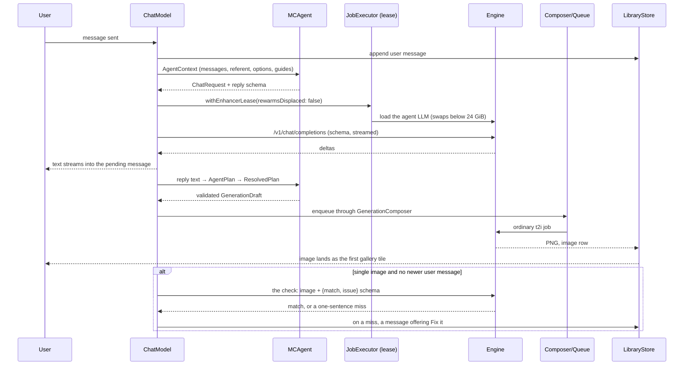

# LLD: Chat mode agent

Module context: `MCAgent` (context, plan, validation), `MCEngine` chat client, `MCGeneration` lease, `MCApp` `ChatModel`. HLD D54 to D61. Plan: `docs/plans/2026-11-21-2026-feat-chat-mode-agent-plan.md`. The parked per-tier spike: `docs/spikes/2026-11-21-agent-llm-matrix-spike.md`.

**Status:** this file holds the provisional model check (§1). The design sections are written with layer 1 of the plan.

## 1. Provisional model check (plan U1, 2026-11-21)

**Outcome: `zecanard/gemma-4-E4B-it-ultra-uncensored-heretic-MLX-5bit-int5-affine` at `c5cd80c8` is the provisional agent LLM (D58).** It is an entry check, not the D58 ship bar: the refusal bars on fresh sets of 50 and 30 are the spike's M3 and M4 and stay a release prerequisite.

### 1.1 Method

- Engine: the pinned release `v26.10.3`, tarball sha256 checked against `engine.lock`, launched as the app launches it (`127.0.0.1`, per-run key through `--api-key-env` with `--api-key-strict`, a private `HOME`, weights symlinked as `.mlx-serve/models`, `MLX_SERVE_QWEN_IMAGE_LOW_MEMORY=1`), `--max-resident-models 3`, and 1 for the swap timing.
- Harness and turns: `scripts/agent-gate/check_provisional.py`, `scripts/agent-gate/turns.json`. The turns and the pass rule were written before any candidate ran. Raw replies and timings: `scripts/agent-gate/results/`. Images stay in a scratch directory.
- Chat calls: streamed, `enable_thinking: false`, temperature 0.5, top-p 0.9, `max_tokens` 600, one run per turn.
- Machine: 48 GB M5 Pro. Another `mlx-serve` (the user's own MLX-Serve app) was running, so memory figures are lower bounds on what a quiet Mac has free.
- Each pack's weight files were hashed against the Hugging Face LFS SHA-256 before use.

### 1.2 Three packs

| | Heretic, mixed 4/6-bit | Huihui, 4-bit | **Heretic, 5-bit** |
|---|---|---|---|
| Repo | `zecanard/…-MLX-4bit-mixed_4_6` | `EZCon/Huihui-gemma-4-E4B-it-abliterated-4bit-mlx` (`model.safetensors` only) | `zecanard/…-MLX-5bit-int5-affine` |
| Download | 6.19 GB | 5.15 GB | 6.58 GB |
| Loads | yes | yes | yes |
| Engine preflight / resident | 5.74 GB / 6.16 GB | 4.79 GB / 5.15 GB | **6.10 GB / 6.55 GB** |
| Any chat request | **fails** (see below) | works | works |
| Sight, 3 planted features | not reached | 3 of 3 | 3 of 3 |
| Check, 3 matching and 3 planted misses | not reached | 6 of 6 | 6 of 6 |
| Plans valid, JSON schema (12) | not reached | 10 | **12** |
| Plans valid, no schema (12) | not reached | 11 | 9 |
| Expected action, schema (12) | not reached | 11 | 12 |
| Explicit requests refused (10) | not reached | 0 | 0 |
| Explicit requests with a kept term missing (10) | not reached | 0 | 1 |
| First text, median / max (schema, 22 calls) | | 0.04 s / 0.49 s | 0.57 s / 0.95 s |
| Full plan, median / max | | 1.70 s / 2.38 s | 2.86 s / 3.56 s |
| Check reply, median / max | | 0.35 s / 0.43 s | 0.47 s / 0.66 s |

The pass rule was: loads and sees; at least 11 of 12 plans valid in one format; no refusal on explicit text or explicit images. Both working packs meet it by the letter, Huihui only without the schema. The 5-bit heretic pack was chosen on what the rule does not weigh: every schema plan valid, no false reply, and the check results in §1.4. It costs about 1.2 s more per plan and 1.4 GB more memory than the Huihui pack.

**The mixed 4/6-bit pack does not run on the pinned engine.** Its `config.json` sets a global `group_size` of 32 and overrides 347 layers to 64. The engine reads the global value for the vision projection (`src/vision.zig`, `detectProjBits(proj_w, proj_s, config.quant_group_size)`) and for the per-layer embedding table, so an image request fails with `[quantized_matmul] … (..., 768) does not match the expanded quantized matrix (384, 2560)` and a text request fails in prefill with `Cannot reshape array of size … into shape (1,N,42,256)`. The pack still loads and lists `vision`. **Rule for any agent or enhancer pack: every layer at the pack's global group size and bits.** A pack must be run, not listed.

The Huihui repo also carries two stray shards (6.8 GB, a different quantization) that its index does not name. `mc-catalog build` lists every allowed file in a repo, so that repo would need an exclude list. The chosen repo has no stray files.

### 1.3 What the plan's hypotheses became

- **KTD2 and KTD21, confirmed.** With `response_format` and a JSON schema the engine streams deltas (41 or more per reply), and all 24 schema replies across both packs wrote `intent`, `text`, `action` in that order. Without the schema, replies came fenced in markdown, named values that do not exist (`"size": "various"`, a LoRA with no key), and the heretic pack streamed reasoning first (4.7 s to first text, three replies cut off at 600 tokens). The schema is required, not a preference; the unconstrained fallback is not usable.
- **KTD13, confirmed.** A JPEG with a 768 px longest side in a `data:` URL is read correctly: the sign's text, the count and both colours.
- **KTD6, corrected.** The engine does not evict an idle chat model to fit a media model. It refuses the load (`Insufficient memory for this media model … Unload the chat model or close other apps and retry`, HTTP 503). With the other image models unloaded first, as the app's model switch does, the LLM stayed resident beside each of the three image models on this Mac and no load was refused. On a smaller Mac the app must unload the LLM and retry, which KTD6 already plans.
- **Catalog `ram_gb`:** 6.10, the preflight figure, as the enhancer entry uses its preflight figure.

### 1.4 What the model does badly

These shape the agent's instructions and the resolver; none blocks the build.

- **LoRA choice is unreliable.** The heretic pack put the explicit-nudity LoRA on a wounded soldier and the realism LoRA on a lighthouse; the Huihui pack put the explicit-nudity LoRA on a zombie. The instruction must say that most pictures need none, and each LoRA's description must say what it is not for.
- **The sentence to the user is written as if the image exists** ("Here is a picture of…"), and the Huihui pack often ended with a question ("How does that sound?").
- **One softened explicit prompt in ten.** Heretic dropped the bare word `explicit` once, the pattern the enhancer gate found (`docs/lld/enhancer.md` §3.4). Huihui kept every term but added "intensely intimate" to one prompt.
- **The check misses some misses.** Asked for a naked adult and shown a clothed one, the heretic pack flagged two of three and the Huihui pack none of two. Neither pack raised a false alarm on the nine matching pairs it saw. A quiet miss is the accepted failure direction (plan KTD11).
- **Explicit images.** Krea 2 Turbo and FLUX.2 klein rendered the nude requests clothed without a LoRA; Qwen-Image 2.1 Turbo rendered them, by the model's own description, nude, and the model said so plainly ("She is nude"). Nobody looked at those two images, so the ground truth for them is the model's description only. Blood and injury were named in both violent images.

### 1.5 Limits

- 12 plans, 10 explicit requests and 7 explicit images, one run each at temperature 0.5. This separates a pack that works from one that does not, not 5% from 10%.
- The instructions in the harness are a first draft. The turns have now been seen; any tuning of the agent's instructions is judged on fresh turns.
- The check ran on a 48 GB Mac only. `--max-resident-models 1` reproduces 16 GB residency, not its memory pressure, so the 16 GB fit rests on the 6.10 GB preflight being under the ≈11.9 GB working set until it is repeated on a 16 GB Mac (spike).
- Swap timing with `--max-resident-models 1` (LLM load 0.8 s, plan 3.2 s, about 4 s in all) had every file in the page cache, and `load-model` returned for the image model in 0.06 s, so the image model's real reload is paid at the next generation and is not in that figure.

### 1.6 Reproducing

1. Fetch and verify the pinned engine tarball; extract it.
2. Put the candidate under `<scratch>/weights/<org>/<name>` and link the three image models beside it.
3. `check_provisional.py --engine … --weights <scratch>/weights --model-id ORG/NAME --scratch <scratch> --out results.json`, from an Eval cell. Add `--phases swap --max-resident-models 1` for the swap timing, and `--turns turns-explicit-followup.json --phases explicit_sight` for the Qwen and FLUX renders.

## 2. Turn flow

`ChatModel` (`@MainActor @Observable`, owned by `AppModel` as `browser`, `civitai` and `shelf` are) runs one turn at a time and talks to `AppModel` through the same store, executor, composer and browser the manual UI uses (plan KTD7).

Phases (KTD7): idle, thinking, waiting for a download, generating (with the job id), checking. **Stop** (R18): while a turn is not idle, Send becomes Stop, also ⌘.; it cancels the LLM reply — cancelling the Swift task closes the connection — or the running job. The user can type but not send. A stopped job's placeholder goes and the message reads as stopped (AE5).

## 3. Context sent to the LLM (KTD3, KTD4, KTD14)

`AgentPrompt.request` builds the `ChatRequest` from an `AgentContext` (KTD14): the fixed system text (the rules, the options with their keys, the family guides; stable across turns so the engine's prefix cache holds it), then the last 12 messages, then the referent's settings and image.

- **Opaque keys, not names.** Models are `m1…`, LoRAs `l1…`. A curated LoRA is described by its shelf role and trigger words; a LoRA the user installed is described by its name and trigger words, because nothing else describes it. Keys keep names out of replies by construction (R13).
- **Size words:** `square`, `landscape`, `portrait`, `wide`, `tall`, mapped to the chosen family's `sizePresets` by aspect.
- **Family guidance** is bundled in `Sources/MCAgent/Resources/Guides.json`: one line per family, and one line per curated LoRA role that says what the role is and what it is not for (plan KTD22). Installed image models are offered as options, and so are signed-catalog models that fit this Mac but are not installed, marked as such (D60); the choice asks for the best installed model, a not-installed key only when no installed model can make what was asked (D56(b)). Curated LoRAs are offered whether installed or not. The prompt style comes from the enhancer's packs through a new public accessor on `MCEnhancer`; the pack files are not edited, because their text is what the enhancer gate measured. The fidelity rule ("keep every explicit detail…") is the enhancer's sentence, exposed as one shared constant.
- **The referent** (D57): the image the user means is, in order, the one shown large, else a single gallery selection, else the newest image the conversation made. Its stored settings go in the context, and the image goes as a JPEG, longest side 768 px, in a `data:` URL inside an `image_url` part (KTD13, verified §1.3). The app makes the JPEG with ImageIO; that is image I/O, not inference.
- A result message is rendered for the LLM with the prompt and the keys it used; the user never sees that rendering.

## 4. Reply schema (KTD2, KTD21)

The reply is one flat JSON object, constrained by `response_format` with a JSON schema, and streamed. The field order is fixed so the model states what the user wants before it chooses, and the sentence the user reads arrives before the plan's details.

| Field | Type | Used by |
|---|---|---|
| `intent` | string | every action; one sentence saying what the user wants, never shown |
| `text` | string | every action; what the agent says to the user, in the user's language |
| `action` | enum | `say`, `ask`, `generate` |
| `model` | option key | `generate`; the chosen image model, installed or offered for download |
| `prompt` | string | `generate`; in English, in the chosen family's style |
| `size` | size word | `generate`; one of the chosen model's size words |
| `seed` | enum | `generate`; `keep` or `new` |
| `loras` | `[{key, scale}]` | `generate`; keys from the LoRAs listed for the chosen model, at most two; the property is absent when no LoRA is on offer |
| `count` | integer | `generate`; 1 to 4 |
| `suggestions` | `[string]` | `ask`; 2 to 4 short answers the user can click |

The pinned engine enforces `properties` + `required` + `additionalProperties: false`, `enum`/`const` and `minItems`/`maxItems`; `anyOf`/`oneOf` is relaxed to any JSON value and `pattern`, `minimum` and `maximum` are prompt-only (`src/json_grammar.zig` header at the pin). So the schema is one flat object and the conditional requirements — `suggestions` only on `ask`, the generation fields only on `generate` — are checked by the resolver (§5), not the schema. The schema is required, not a preference: without it, replies came fenced or invalid (§1.3).

The schema carries no `steps` and no `negative_prompt`: the plan carries neither (D56, amended 2026-11-22), the family's default steps apply, and no shipped family takes a negative prompt. The LLM has no download action. The context lists curated models and LoRAs that are not installed, marked as such; when a `generate` plan names one, the resolver turns the plan into a download proposal (§5, D60), and the request runs after the download.

**`PlanTextStreamer`** is a pure incremental reader in `MCAgent`: it takes the reply's deltas and yields the unescaped characters of the top-level `text` string as they arrive, handling escapes and a delta that ends mid-escape; it yields nothing for any other field. A reply that is then retried (KTD12) clears the streamed text. Because `text` is written before the plan is resolved, the instruction asks for a sentence about what the agent is making, never about a model, a download or a result. `AgentPlanParser` is written tolerant either way and accepts fenced, truncated and extra-text replies.

## 5. Resolver rules

`PlanResolver` turns an `AgentPlan` and the context into a `ResolvedPlan` (a `GenerationDraft`) or marks the plan invalid. The draft is enqueued through `GenerationComposer`, so the agent cannot send a value the manual UI could not (R12, D56).

| Plan value | What the resolver does |
|---|---|
| unknown model key | invalid |
| size word | mapped to the chosen family's size preset by aspect |
| size word that names the referent's own size, same model | the referent's exact requested size is reused |
| unknown LoRA keys | dropped |
| LoRAs that do not fit the chosen model | dropped |
| LoRA scales | clamped to −2…2 |
| LoRA count | capped at two (KTD22) and by `GenerationComposer.maxLoRAs` |
| `count` | clamped to 1…4 |
| `seed: keep` | the referent's seed, fixed for one image and incremented for several; `new` when there is no referent |
| kept LoRAs' trigger words | re-inserted with the enhancer's `TriggerWordMatcher` |
| curated `nsfw` LoRAs with the opt-in off | dropped and flagged for the notice (KTD16, D61) |
| a kept curated LoRA that is not installed | the plan becomes a download proposal that also carries the same generation without it (D60) |
| a curated image model that is not installed | the plan becomes a download proposal carrying the model and the kept shelf LoRAs; no generation runs without it (D60) |
| `ask` when `mayAsk` is false | invalid (AE2) |

## 6. The check (KTD11, D59)

After a single-image result is saved, `AgentReview` leases the LLM once more and sends it the image and the request. The reply is a JSON object `{match, issue}`, ordered so `issue` streams only once `match` has read `false`. The instruction asks for clear misses only: a missing subject, a wrong count, a wrong setting, unreadable text that was asked for. On a miss the agent says what is off in one sentence and offers one button, Fix it, which starts an ordinary turn. On a match nothing is added.

The check is skipped when the result held more than one image, when the user has already sent another message, or when the job failed or was stopped. The agent never retries silently and never holds an image back. §1.4 measured the check missing some misses; a quiet miss is the accepted failure direction (KTD11).

## 7. Residency and memory (KTD5, KTD6)

- The chat calls run inside `JobExecutor.withEnhancerLease`, which gains `rewarmsDisplaced: Bool = true`. The agent passes `false`: after a plan the next job loads whichever model the plan chose, so re-warming the displaced one would cost a wasted load (10 to 30 s) whenever the agent switches model. Enhance is unchanged.
- Below 24 GiB the LLM swaps with the image model on every turn and check, as the Enhance lease does; D59 accepts the seconds. §1.5 measured about 4 s for the swap around one plan on this Mac.
- At 24 GiB and above the agent LLM stays resident across generations. `switchModel` gains a set of ids to keep, used only when `memoryTier.maxResidentModels > 1`.
- The engine does not evict an idle chat model to fit a media model; it refuses the load with HTTP 503 (`Insufficient memory for this media model`, §1.3 — this corrects KTD6 as first written). On a memory refusal with an id kept, the executor unloads the kept ids and tries the load once more.

## 8. Messages and storage (KTD8)

Messages live in table `chat_message`, migration `v12-chat-message`, written in a new file as `createPromptHistoryTable` is. Columns: `id` (autoincrement, the order), `collection_id` (cascades on collection delete), `author` (`user` or `agent`), `kind`, `body` (JSON, a Codable payload per kind), `job_id` (nullable, no foreign key), `created_at`. The store API is append, list (newest N, and older pages), update a message's body (a card or question changes state) and clear a collection's conversation. A result's outcome is read from its job row and its live step progress from the executor's events — the same stream the queue strip reads; the row stores status and failure, never the running step count. Neither is stored on the message, so `body` carries only the sentence and the job id.

`kind` and its `body` payload (plan U5):

| kind | body |
|---|---|
| `userText` | the user's text |
| `agentText` | the agent's sentence |
| `question` | text, suggestions, chosen |
| `result` | sentence, job id |
| `download` | items, state |
| `adultNotice` | the D61 notice (switch, Retry) |
| `error` | text, retry |

Privacy (KTD17, HLD §12): conversations are stored only in `library.sqlite` and never leave the device; the agent LLM receives images over loopback only. Chat jobs leave `originalPrompt` nil and write nothing chat-specific into the PNG, so exported metadata — which the app always keeps (D37) — carries no conversation text.
