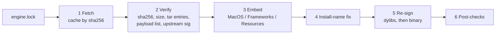
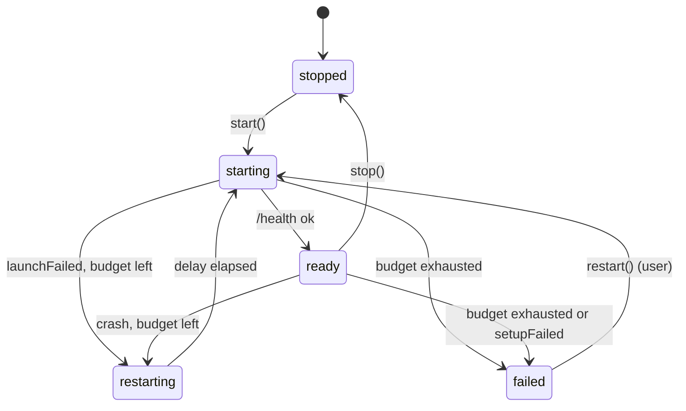

# LLD: Engine packaging and supervision

Module: `MCEngine` (runtime), `scripts/embed-engine.sh` (build). Implements HLD §7.3–7.4 under D6 and D17.

Facts marked **[observed]** were checked against upstream release `v26.10.2` (commit `ccedc6a`, published 2026-10-12) on 2026-10-16. Re-check them on every pin bump. **[verify]** marks things to confirm the first time the phase runs for real.

## 1. Scope

| In scope | Out of scope |
|---|---|
| `engine.lock` format | HTTP/SSE request building (`EngineClient`, HLD §8.1) |
| Build phase: fetch, verify, embed, install-name fix, re-sign | The engine contract suite itself (HLD §7.3); only its gate is described here |
| `EngineSupervisor`: launch environment, `HOME` override, models symlink, PID file, readiness, crash classification, backoff restart, shutdown | Queue retry policy for failed jobs (owned by the queue; this module only reports) |

## 2. Upstream artifact [observed]

Asset `mlx-serve-bin-macos-arm64.tar.gz` (78,894,505 bytes) unpacks to:

```
mlx-serve-macos-arm64/
  mlx-serve                 arm64 Mach-O, hardened runtime, Team ID S77TW432YG, no entitlements
  LICENSE  LICENSE-APACHE-2.0  NOTICE
  lib/libmlx.dylib  libmlxc.dylib  libjaccl.dylib  libllama.dylib
      libwebp.dylib libsharpyuv.dylib  mlx.metallib
```

Linkage that the build phase has to fix:

| Image | Problem |
|---|---|
| `mlx-serve` | Loads `@executable_path/lib/{libllama,libmlxc,libwebp}.dylib`. Inside `Contents/MacOS` that would resolve to `Contents/MacOS/lib/`. `libmlx` is already `@rpath`. The rpaths include four dev-tree paths (`@loader_path/../../lib/{llama,mlx}/lib`, plus `../../../` variants), `@executable_path/lib`, and the correct `@executable_path/../Frameworks` |
| `libwebp.dylib` | Install-name ID is `/opt/homebrew/opt/webp/lib/libwebp.7.dylib` |
| `libsharpyuv.dylib` | Install-name ID is `/opt/homebrew/opt/webp/lib/libsharpyuv.0.dylib` |
| `libmlxc`, `libmlx`, `libwebp` | Inter-dylib references are `@loader_path/…` or `@rpath/…`. These work unchanged once everything sits together in `Contents/Frameworks` |

Upstream's own `MLX-Serve.app` (same release) puts all dylibs **plus `mlx.metallib`** in `Contents/Frameworks`. We cannot copy that: `codesign --strict --deep` rejects an unsigned non-Mach-O file in `Frameworks/` (§4.5). MLX finds `mlx.metallib` only next to `libmlx.dylib`, so we embed `libmlx.dylib` and `mlx.metallib` together in `Contents/Resources/mlx/`, reached through one extra binary rpath (`@executable_path/../Resources/mlx`). Every other dylib stays in `Contents/Frameworks`.

## 3. `engine.lock`

The file sits at the repo root and is JSON, so the build script can read it with `plutil -extract <key> raw` and needs no `jq`. It is the only place the engine version is pinned.

```json
{
  "schema": 1,
  "version": "26.10.2",
  "tag": "v26.10.2",
  "commit": "ccedc6a4820f48e576633062232ed0cba1139616",
  "asset": "mlx-serve-bin-macos-arm64.tar.gz",
  "url": "https://github.com/ddalcu/mlx-serve/releases/download/v26.10.2/mlx-serve-bin-macos-arm64.tar.gz",
  "sha256": "7082424c2d4c3821c1b323e2822aec79502cc82475b01fd2bfcd70d6ccd7ec27",
  "size": 78894505,
  "upstream_team_id": "S77TW432YG",
  "root": "mlx-serve-macos-arm64",
  "executable": "mlx-serve",
  "frameworks": [
    "lib/libjaccl.dylib", "lib/libllama.dylib", "lib/libmlx.dylib", "lib/libmlxc.dylib",
    "lib/libsharpyuv.dylib", "lib/libwebp.dylib", "lib/mlx.metallib"
  ],
  "notices": ["LICENSE", "LICENSE-APACHE-2.0", "NOTICE"],
  "contract_suite": { "result": "pass", "run_at": "2026-10-16" }
}
```

| Field | Purpose |
|---|---|
| `schema` | Format version. The script refuses any value it doesn't know |
| `version`, `tag`, `commit` | `version` must match the first line of `mlx-serve --version` (`mlx-serve 26.10.2`). `commit` is the ref that HLD and LLD source citations point at |
| `url`, `sha256`, `size` | Integrity. The sha256 is the authority. `size` only makes truncated downloads fail with a clear message |
| `upstream_team_id` | Provenance. The build checks upstream's signature before stripping it, so a change of upstream signer becomes a deliberate bump instead of a silent one |
| `root`, `executable`, `frameworks`, `notices` | The expected payload, relative to `root`. Every file in the tarball has to appear in exactly one list. Unknown or missing files fail the build, so a new upstream dylib can't ship unsigned or unlinked |
| `contract_suite` | Written by the bump PR and checked by CI. The `result` must be `pass` before merge (HLD §7.3) |

**Bump procedure:** edit `engine.lock`, run `scripts/embed-engine.sh --refresh-manifest` (fills in `size` and the payload lists from the new tarball, then prints them for review), run the contract suite, set `contract_suite`, and open the PR. Update the pinned-commit note in `AGENTS.md` in the same PR.

## 4. Build phase: `scripts/embed-engine.sh`

The script runs as an XcodeGen `postCompileScripts` run-script on the app target. It runs after resources are copied and before Xcode's final `CodeSign` of the outer bundle, because nested code has to be signed before its container. It sits on the target with `ENABLE_USER_SCRIPT_SANDBOXING = NO`, because it downloads. Declared input: `engine.lock`. Declared output: `$(TARGET_BUILD_DIR)/$(CONTENTS_FOLDER_PATH)/MacOS/mlx-serve`. This keeps incremental builds from re-running it.



Every step uses `set -euo pipefail`. Any failure fails the build with one line saying which check failed and what was expected versus found. There is no fallback to an unverified or previously embedded engine.

### 4.1 Fetch

- Cache: `~/Library/Caches/mlx-create/engine/<sha256>.tar.gz`. The cache is keyed by hash, so a stale or poisoned cache entry fails verification rather than being trusted.
- On a cache miss: `curl -fL --retry 3 --proto '=https' -o <cache>.part <url>`, then `mv` it into place only after step 4.2 passes.
- `MLXC_ENGINE_OFFLINE=1` (CI without network, airplane builds) turns a cache miss into an error rather than a download.

### 4.2 Verify

1. `shasum -a 256` must equal `sha256`, and `stat -f%z` must equal `size`.
2. List the archive with `tar -tvzf` before extracting. Reject any absolute paths, `..` components, symlinks, hard links, or device entries.
3. Extract with `tar -xzf --no-same-owner --no-same-permissions` into `$(DERIVED_FILE_DIR)/engine/<sha256>/`.
4. The set of files under `root` must equal `executable ∪ frameworks ∪ notices`.

`--refresh-manifest` runs step 5 on the new archive before it executes the new binary for `--version`. The lock's payload lists may be stale during a bump, so step 4 is skipped there; the Mach-O set comes from the archive itself.

### 4.3 Embed

Use `ditto` for every copy (it preserves modes and drops quarantine via `--noqtn`):

| Source (under `root`) | Destination in `.app/Contents` |
|---|---|
| `mlx-serve` | `MacOS/mlx-serve` (next to our own `MacOS/mlx-create`) |
| `lib/libmlx.dylib`, `lib/mlx.metallib` | `Resources/mlx/` (together; the metallib must sit next to libmlx, §4.5) |
| other `lib/*.dylib` | `Frameworks/` (flat) |
| `LICENSE`, `LICENSE-APACHE-2.0`, `NOTICE` | `Resources/ThirdParty/mlx-serve/`. The app's `NOTICE` references these (HLD §7.3) |

Before copying, remove any previously embedded engine files, so a dylib dropped by a bump can't linger in an incremental build.

`scripts/embed-engine.sh` writes `engine.lock`'s `version` to `Resources/ThirdParty/mlx-serve/ENGINE_VERSION`. That file is the only runtime source of the pinned version: `AppModel.live()` reads it and passes it to the executor, which records it in each saved image's settings. Under `swift test` the file is absent and the version is nil.

### 4.4 Install-name fix

Run these against the embedded copies. They are rule-driven, not a hard-coded list, so a bump that changes linkage either keeps working or fails loudly.

1. **Binary loads:** every `LC_LOAD_DYLIB` beginning with `@executable_path/lib/` is rewritten by name. `libmlx.dylib` and `mlx.metallib` become `@executable_path/../Resources/mlx/<name>`; every other dylib becomes `@executable_path/../Frameworks/<name>` (`install_name_tool -change`). `@rpath/…` loads stay as they are.
2. **Binary rpaths:** delete every `LC_RPATH` except `@executable_path/../Frameworks` and `@executable_path/../Resources/mlx` (`-delete_rpath`), and add either rpath if it is missing.
3. **Dylib IDs:** any dylib whose ID is an absolute path gets `-id @rpath/<file name>`. Today that means `libwebp` and `libsharpyuv`.
4. **Dylib loads:** any absolute non-system dependency (anything outside `/usr/lib` and `/System`) whose basename is in `Frameworks/` becomes `@loader_path/<basename>`.
5. **Gate:** walk `otool -L` for the binary and every dylib. Every non-system dependency must resolve, through the rules above, to a file in `Frameworks/`. Anything else, such as a leftover `/opt/homebrew` path or a dependency missing from the tarball, fails the build.

`install_name_tool` invalidates the existing signatures, which is expected. Step 5 replaces them.

### 4.5 Re-sign

Signing goes inside-out, using Xcode's resolved identity (`$EXPANDED_CODE_SIGN_IDENTITY`). Debug builds use whatever Xcode resolves, ad-hoc `-` included. Release builds must use Developer ID.

```sh
codesign --force --options runtime --timestamp --sign "$ID" Frameworks/*.dylib
codesign --force --options runtime --timestamp --sign "$ID" \
  --identifier "$PRODUCT_BUNDLE_IDENTIFIER.engine" \
  --entitlements Config/Engine.entitlements MacOS/mlx-serve
```

- `--timestamp` is used only when `CONFIGURATION == Release`, so Debug builds work offline.
- `Engine.entitlements` is an empty dict. Upstream ships without entitlements under hardened runtime [observed], and it loads only its own dylibs, which carry our Team ID after re-signing, so `disable-library-validation` is not needed. Add an entitlement only when a failing case proves it necessary, and record the reason in this file.
- `mlx.metallib` isn't Mach-O and gets no signature of its own. The outer bundle seal (`_CodeSignature/CodeResources`, written by Xcode's final `CodeSign`) covers it. **[verify → 2026-10-16]** With `mlx.metallib` in `Contents/Frameworks/`, the Xcode app `CodeSign` step and `codesign --verify --deep --strict` both fail (`code object is not signed at all`, subcomponent `Frameworks/mlx.metallib`), so this placement is rejected. The placement that passes is `Contents/Resources/mlx/` with `libmlx.dylib` beside it: `codesign --verify --deep --strict` on the built app passes and `--version` runs from the bundle. MLX has no path override in v26.10.2 (searched `libmlx.dylib` and `mlx-serve`). The embed script uses the passing layout; §4.2 and §4.3 still list Frameworks for `libmlx.dylib`/`mlx.metallib` and need a decision.
- Don't use `--deep` for signing. Nested items are signed explicitly so that each one gets the right identifier and entitlements.

### 4.6 Post-checks

1. `codesign --verify --strict` on every embedded Mach-O.
2. `otool -L` gate (rule 4.4.5) re-run on the signed files.
3. The first line of `Contents/MacOS/mlx-serve --version` must be `mlx-serve <version>`. This proves dyld resolves the rewritten loads under hardened runtime [observed: the command prints the version line on the extracted tarball].
4. Release pipeline only (outside Xcode): `codesign --verify --strict --deep` on the `.app`, `xcrun notarytool submit --wait`, `stapler staple`, `spctl -a -vv`.

## 5. `EngineSupervisor`

```swift
public actor EngineSupervisor {
    public init(paths: EnginePaths, tier: MemoryTier)
    public var states: AsyncStream<EngineState> { get }  // replays current state to new subscribers
    public func start() async                              // idempotent
    public func restart() async                            // user "Restart engine"; clears backoff
    public func stop() async                               // SIGTERM, grace, SIGKILL
}

public enum EngineState: Sendable {
    case stopped
    case starting(attempt: Int)
    case ready(EngineEndpoint)                  // baseURL + apiKey; consumed by EngineClient
    case restarting(after: Duration, cause: EngineCrash)
    case failed(EngineCrash)                    // backoff exhausted or non-restartable
}

public struct EngineCrash: Sendable, Error {
    public let kind: CrashKind
    public let message: String                  // plain-language, shown to the user
    public let detail: String                   // summarizeCrash line, for diagnostics
    public let exit: ExitStatus                 // .code(Int32) | .signal(Int32)
}
```

`EngineSupervisor` is copied and adapted from upstream `app/Sources/MLXServe/Services/ServerManager.swift` at the pinned tag. It keeps the MIT header and adds a header naming the upstream path and commit. Only `summarizeCrash`, `isRequestPreviewLine`, and the SIGTERM → wait → SIGKILL helper (`waitForExit`) come over close to verbatim. Upstream has no `HOME` override, PID file or backoff [observed]: it finds orphans by scanning for listeners on its fixed port. Those parts are new code.

### 5.1 Paths

```
<AppSupport>/Engine/                       HOME for the engine
  engine.pid                               §5.4
  .mlx-serve/                              all engine state (logs, kv-cache, settings)
    models -> <Models>/Weights             §5.3
    logs/mlx-serve-<port>.log              engine's own log (default --log-file)
```

`<AppSupport>` is `~/Library/Application Support/mlx-create`. `<Models>` is relocatable (D17), so `EnginePaths` resolves it from settings on every `start()`.

### 5.2 Launch

```
HOME=<AppSupport>/Engine  MLXC_ENGINE_KEY=<key>  PATH=/usr/bin:/bin  TMPDIR=<user tmp>
<bundle>/Contents/MacOS/mlx-serve --serve --host 127.0.0.1 --port <port> \
  --api-key-env MLXC_ENGINE_KEY --api-key-strict \
  --model-dir <Models>/Weights \
  --max-resident-mem auto --max-resident-models <tier> --log-level info
```

- **Environment is built, not inherited.** `Process.environment` is set to exactly the four variables above. Nothing from the app's environment leaks through, `DYLD_*` and `MLX_*` included. Tier flags come from HLD §11. `--idle-evict-secs` gets added once §11 fixes the per-tier values.
- **API key:** 32 bytes from `SecRandomCopyBytes`, base64url-encoded, regenerated on every launch, restarts included. It lives in memory only.
  - `--api-key-env` keeps the key out of argv, because the process table is world-readable [observed in `--help`]. Same-user processes can still read another process's environment, so this protects against other users, not against same-user malware.
  - `--api-key-strict` is **required**. Without it upstream exempts loopback callers from the key [observed in `--help`], and every caller of a `127.0.0.1` engine is loopback. `/health` stays open by design.
- **Port:** bind a socket to `127.0.0.1:0`, read the assigned port, close it, and pass the port. Another process can take the port in the gap; the engine then exits before becoming healthy, which is classified `.launchFailed` (§5.6) and retried with a fresh port.
- **Never passed:** `--lan-share`, `--lan-discover`, `--lan-name` (non-negotiable 4). There is a unit test on the argv builder for this.
- **stdout/stderr:** both go to one `Pipe`, drained into a 64 KiB ring buffer that classification reads (§5.6). It is also forwarded to `os_log` at `.debug`, with privacy `.private`, because the engine echoes request text in `> "…"` preview lines [observed in `isRequestPreviewLine`]. Engine logs never leave the device. Any future diagnostics export must drop preview lines.

### 5.3 Models symlink

`.mlx-serve/models` must point at `<Models>/Weights`, because some media dependencies (for example LTX's text encoder) are looked up only there (HLD §7.4). This runs on every `start()`, before spawning the engine:

| Current state of `.mlx-serve/models` | Action |
|---|---|
| Absent | Create the symlink |
| Symlink to the current `<Models>/Weights` | Nothing |
| Symlink elsewhere, e.g. after the Models root moved | Remove it and recreate. To avoid a window with a dangling link, create a temporary symlink and `rename(2)` it over the old one |
| Real directory or file | **Don't delete it.** Fail with `.setupFailed("Engine folder contains unexpected data at …")`. User data may be inside, and nothing of ours ever creates a real directory there |

If `<Models>/Weights` itself is missing, for example on an unmounted external volume, fail with `.setupFailed` and an actionable message ("Models folder not found at … — reconnect the drive or choose a new location"). Don't launch an engine with no weights.

### 5.4 PID file

`Engine/engine.pid`, written atomically right after a successful spawn:

```json
{ "pid": 41233, "start_time": 1760652000.123456, "port": 53117, "exe": "/Applications/mlx-create.app/Contents/MacOS/mlx-serve" }
```

`start_time` is the process start time from `proc_pidinfo(PROC_PIDTBSDINFO)` (`pbi_start_tvsec`/`tvusec`).

At `start()`, before spawning, check for a stale engine:

1. If the file is absent or unparsable, delete it and continue.
2. If `kill(pid, 0)` fails with `ESRCH`, the engine is gone: delete the file and continue.
3. Kill the process only when its **start time and executable path both match** (`proc_pidpath`). This guards against PID reuse. A matching executable path alone isn't enough, because a second copy of the app could legitimately be running.
4. Killing means SIGTERM, then a wait of up to 10 s, then SIGKILL followed by another wait. Large resident models can take seconds to tear down [observed in `ServerManager` comments].
5. Delete the file.

On a clean `stop()`, delete the file after the child exits. Single-instance enforcement of the app itself isn't this module's job. If two app instances race, step 3 means neither kills an engine that isn't its own.

### 5.5 Readiness

Poll `GET /health` every 250 ms. The engine is ready when the response is `200` with `status:"ok"`.

- Give up after 60 s [verify the cold-start time on 16 GB], or as soon as the child exits. Either way the outcome is `.launchFailed`.
- On success: publish `.ready(endpoint)` and record `readySince`.

The supervisor doesn't warm models. The queue calls `/v1/load-model` through `EngineClient`.

### 5.6 Crash classification

Any child exit that `stop()` didn't request is a crash. `classify(logTail:exit:phase:) -> CrashKind` is a pure function:

```swift
enum CrashKind { case outOfMemory, killedBySystem, missingWeights, launchFailed, setupFailed, unknown }
```

Rules are evaluated top to bottom on the ring-buffer tail, with request preview lines excluded:

| Kind | Evidence | User message (plain language) | Restart? | In-flight job |
|---|---|---|---|---|
| `setupFailed` | Raised before spawning (§5.3) | Specific path problem and the fix | No → `.failed` | n/a |
| `launchFailed` | Exit before `/health` was ever ok, e.g. `Library not loaded`, address in use, a timeout | "The engine couldn't start." plus the `summarizeCrash` line in detail | Yes (counts toward backoff) | n/a |
| `outOfMemory` | A line containing `Insufficient memory to load model`, `kIOGPUCommandBufferCallbackErrorOutOfMemory`, or `[METAL]` with "Insufficient Memory" | `summarizeCrash` already produces the friendly text. Add a tier hint: "Try a smaller model or fewer LoRAs." | Yes | Failed, **retryable** |
| `killedBySystem` | Exit by signal `SIGKILL` that we didn't send (jetsam under memory pressure) | "macOS stopped the engine because memory ran low." | Yes | Failed, retryable |
| `missingWeights` | `MISSING WEIGHT` | "Model files are incomplete — repair the download in Models." | Yes | Failed, **not** retryable until the model is repaired |
| `unknown` | Anything else | "The engine stopped unexpectedly." plus the detail line | Yes | Failed, retryable |

`detail` is always `summarizeCrash(logTail, exitCode:)` as ported. The OOM strings come from upstream's matcher [observed]. Upstream messages are not stable, so each rule gets a fixture test, built from real crash tails captured during smoke tests, and the fixtures are refreshed on every bump.

The executor fails the in-flight job when its connection drops, and reads the crash kind from the supervisor (`EngineGate.currentCrash()`) to choose the failure. The supervisor does not track jobs. Retrying is the queue's decision, and the supervisor never replays a request.

### 5.7 Backoff restart



- **Budget:** at most 3 automatic restarts in any sliding 5-minute window (HLD §7.4). Each restart's timestamp is kept, and timestamps older than 5 minutes are dropped.
- **Delay:** 1 s, then 4 s, then 16 s, by restart index within the window. If the budget is spent, the state goes to `.failed(lastCrash)` instead.
- **Reset:** reaching `.ready` and staying up for 5 minutes clears the window. A user `restart()` clears it immediately.
- `stop()` during `.restarting` cancels the pending restart.
- Each restart repeats all of §5.2–5.5 with a fresh key and a fresh port. The new endpoint is announced in `.ready`, and `EngineClient` must not cache the old one.

### 5.8 Shutdown

- On quit, the app delegate's `applicationShouldTerminate` returns `.terminateLater` and calls `AppModel.shutdown()`. That cancels the app's long-lived tasks, waits for `stop()` for at most 3 s, then replies to AppKit.
- `stop()` cancels the readiness poll and any pending restart, sends SIGTERM, waits 3 s, then sends SIGKILL and deletes the PID file. The grace wait does not depend on the caller's cancellation, so a stop from a cancelled task still gets its full window. A stop during a stale-engine reap spawns nothing: the launch returns `.cancelled` before it spawns, and a readiness wait that is cancelled retires the child it spawned.
- If the app itself dies without terminating cleanly, §5.4 catches the orphan on the next launch.

### 5.9 Smoke-test record (2026-10-16, `v26.10.2`)

Run by hand with the §5.2 flags and `HOME=/tmp/mc-home`. `mlx-serve-bin-macos-arm64.tar.gz` sha256 `7082424c2d4c3821c1b323e2822aec79502cc82475b01fd2bfcd70d6ccd7ec27` matched the release digest.

- **HOME override works.** The engine wrote only `$HOME/.mlx-serve/logs/mlx-serve-<port>.log`. After a health check and a generation, nothing under the real `~/.mlx-serve` (outside `models/`) had a recent mtime. Listener was `127.0.0.1` only.
- **`/health` is open.** It returned 200 `{"status":"ok"}` both with and without the key, even with `--api-key-strict`. This matches §5.2 ("`/health` stays open by design"). Strictness on authenticated routes (401 on a missing or wrong key) is **not yet tested**.
- **Generation works.** `POST /v1/images/generations` with `ddalcu/Krea-2-Turbo` (mixed 4/8-bit), 512×512, explicit `seed: 7`, returned a valid 512×512 PNG in `data[0].b64_json` in about 8.5 s. The model was discovered through `--model-dir` on a folder containing only a symlink to the weights.
- **Memory preflight rejects the request** with a JSON error `type:"out_of_memory"` (HTTP status not recorded) when free memory is too low. Observed: Krea-2 Turbo needs about 14.7 GB peak and about 17.6 GB free (log line `[preflight] media peak … available …`). The app must map this to a plain-language message (AGENTS.md → Errors users see). Don't pass `--skip-mem-preflight`.
- **Gotcha:** the tarball extracts to `mlx-serve-macos-arm64/` with `mlx-serve` next to `lib/`. The binary runs in place from there.
- **Auth verified (U3 lifecycle smoke, `EngineSupervisorTests`).** A request without the key to `/v1/models` returned **401** under `--api-key-strict`. `ps -o command=` for the engine showed no key in argv: the key is delivered only through `--api-key-env` in the environment. The same run confirmed start to `.ready`, `stop()` leaving no listener and no PID file, and `kill -9` giving `.restarting` then `.ready` on a new port and key.

## 6. Tests

Permanent tests cover behaviour only (`AGENTS.md` → Verification):

| Test | What it pins |
|---|---|
| Crash classifier fixtures | Each `CrashKind` from a real captured log tail. Preview lines containing error words never decide the classification |
| Backoff policy (pure, injected clock) | 3 restarts within 5 min → `.failed`; the window slides; reset after 5 min ready; `restart()` clears the budget |
| PID-file decision (pure, over a fake process table) | Kill only when pid, start time and executable path all match; PID reuse is left alone |
| Symlink reconciliation (temp dir) | All four rows of §5.3, including "real dir is never deleted" |
| Argv/env builder | Loopback host, `--api-key-env`, `--api-key-strict`, no `--lan-*`, no inherited env |
| Fake-engine supervisor (default run) | The key reaches the child by environment, never argv; a killed engine restarts with a new key; stop and restart during a stale-engine reap leave no live child |

Smoke test, against the real engine (`AGENTS.md`):

1. Build the app.
2. Launch it, then check `ps -o command` shows no key in argv and `curl 127.0.0.1:<port>/v1/models` without the key returns 401.
3. Generate one image with FLUX.2-klein 4B.
4. `kill -9` the engine and watch the restart.
5. `kill -9` the app, relaunch, and confirm the orphan is reaped through the PID file.

Engine bumps additionally run the contract suite (HLD §7.3).

## 7. Open items

1. **[verify]** Notarization accepts the `Resources/mlx/` layout (a signed `libmlx.dylib` plus an unsigned `mlx.metallib` data file in Resources) (§4.5).
2. **[verify]** Cold-start time to `/health` on a 16 GB machine, used to tune the 60 s readiness timeout.
3. `--idle-evict-secs` per tier is pending HLD §11.
