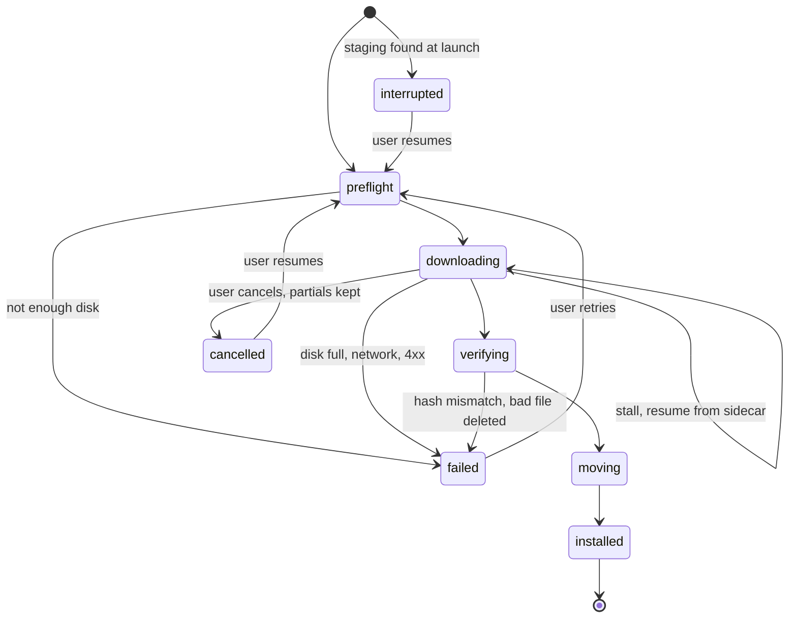

# LLD: Catalog, signing and model install

Modules: `MCCatalog` (catalog schema, signature, loader), `MCCatalogTool` (`mc-catalog`: keygen, build, sign, verify), `MCModels` (downloader and installer, U4 and U5). Implements HLD §8.5, §8.7 and §9 under D20, D26 and D27. Decisions KTD1 to KTD10 and KTD21 of `docs/plans/2026-10-16-1710-feat-model-install-and-hardening-plan.md` are the source for the rules below.

## 1. Scope

| In scope | Out of scope |
|---|---|
| Catalog schema v1, validation, Ed25519 signature, pinned keys | Engine supervision (`docs/lld/engine.md`) |
| Loader precedence, rollback rule, daily ETag refresh | Prompt packs, enhancer models, Civitai and CivArchive sources |
| Download and staging protocol, install state machine, error mapping | Removing, updating or repairing installed models |
| Signing procedure, key rotation and compromise response | Production key custody (owner action, release prerequisite) |

## 2. Catalog file

`Catalog/catalog.json` (cached) and the bundled `Resources/catalog.json` share one format. The signature file sits beside it (§4).

```json
{
  "schema_version": 1,
  "sequence": 1,
  "issued_at": "2026-10-16T00:00:00Z",
  "models": [
    {
      "id": "krea-2-turbo-mixed-4-8",
      "family": "krea-2-turbo",
      "name": "Krea 2 Turbo",
      "quantization": "mixed 4/8-bit",
      "repo": "ddalcu/Krea-2-Turbo-MLX-Serve-mixed-4-8",
      "revision": "db7840abe3c7f7c5c5ef4de049f334d16852d19f",
      "download_bytes": 0,
      "ram_gb": 17.6,
      "license": {
        "id": "krea-2-community-license",
        "name": "Krea 2 Community License Agreement",
        "url": "https://krea.ai/krea-2-licensing",
        "commercial_use": true,
        "version": "1 (June 22, 2026)",
        "summary": "Commercial use is allowed only while your company's total revenue, including affiliates, is under US$1,000,000 on a trailing twelve-month basis (section 2.3). Above that you need an enterprise license from Krea before any commercial use. Any deployment must run reasonable and appropriate content filtering to detect and mitigate harmful content (section 4.2). mlx-create applies no content filter of its own, so the filter is your responsibility."
      },
      "files": [
        { "path": "config.json", "size": 28, "sha256": "64 lowercase hex characters" }
      ]
    }
  ]
}
```

Field rules:

- `schema_version` must be `1`. Any other value rejects the whole catalog.
- `sequence` is a monotonic integer. `mc-catalog build` sets it to the previous bundled value plus one.
- `repo` is `org/name`, and each segment is `[A-Za-z0-9._-]+`. `..`, `a/b/c` and absolute forms are rejected.
- `revision` is a 40-character lowercase hex Hugging Face commit. Nothing else is fetched by branch name.
- `files[].path` is a relative `/`-separated path with no leading `/`, no empty segment and no `..` segment. Every path must pass `WeightFilePolicy.check` (KTD21). Duplicate paths within a model are rejected.
- `files[].sha256` is 64 lowercase hex characters. For LFS files it is the tree API's `lfs.oid`. For small non-LFS files it is computed by `mc-catalog build` from a download of the file at the pinned commit (KTD1).
- `download_bytes` equals the sum of `files[].size`.
- `ram_gb` is the engine's measured preflight need for Krea (17.6, `docs/lld/engine.md` §5.9). For klein 4B it is the HLD figure of 8, to be measured in U7.
- `license.commercial_use` is a boolean. `license.summary` is the text the license sheet shows (KTD10). For Krea it names the content-filter clause (§4.2) and the USD 1M trailing-revenue cap (§2.3), per D26.
- `family` must match a `FamilyRegistry` record id (`families.json`). A catalog entry for an unknown family is ignored by the app, not rejected by the loader (HLD §8.4).
- Model `id` values are unique within a catalog.

## 3. Verification order

1. Read `catalog.json` and `catalog.json.sig` as bytes.
2. Parse the signature file: `{"schema": 1, "key_id": "...", "algorithm": "ed25519", "signature": "<base64>"}`. A missing, malformed or unknown-schema file rejects the candidate.
3. Look up `key_id` in the pinned key list. An unknown id rejects the candidate.
4. Verify the Ed25519 signature over the exact bytes of `catalog.json` with CryptoKit. Any byte change rejects the candidate. The loader never re-encodes before verifying.
5. Parse and validate the schema (§2). Any failure rejects the candidate.

Only a candidate that passes all five steps counts as valid.

## 4. Signing and pinned keys (KTD2)

- Algorithm: Ed25519 via CryptoKit, no new dependency. The Sparkle key is not reused.
- Key id: `ed25519-` followed by the first 16 hex characters of the SHA-256 of the raw 32-byte public key.
- Pinned list: `Sources/MCCatalog/Catalog/PinnedKeys.swift` holds public keys with their ids and an `isDevelopment` flag. Tests supply their own keys through the verification API, so the production list is only read by the app and by `mc-catalog verify`.
- Private keys never enter the repository. The development key lives at `~/.config/mlx-create/dev-catalog.key` with mode `0600`.
- `mc-catalog sign` refuses a key whose public half is not in the pinned list, so a catalog that the app cannot verify is never produced.

**Rotation.** Ship a release that pins the successor key first. Only after that release is in users' hands, sign catalogs with the successor. Keep the predecessor pinned until its last catalog is superseded.

**Compromise.** Ship a release that drops the compromised key from the pinned list and pins a fresh key. Re-sign the bundled catalog with the fresh key and raise `sequence`. Remote catalogs signed by the compromised key remain valid to older builds until a new sequence supersedes them, so the compromised key is also rotated at the CDN. Revoking a key that was never used to sign a shipped catalog needs only the release.

**Release gate.** A Release build may pin the development key only while no catalog URL is configured. `mc-catalog verify --release --catalog-url <url>` fails when the pinned list contains a development key and the URL is non-empty. `MLXC_CATALOG_URL` is empty by default in `project.yml` (KTD4).

## 5. Loader and freshness (KTD3, KTD4, R8, R9)

Sources, in precedence order for equal validity: cached, then bundled.

1. **Bundled.** `Resources/catalog.json` and `.sig`, read through `Bundle.module`. It must verify, or the loader throws. This is the only case where the loader reports a failure to the caller.
2. **Cached.** `~/Library/Application Support/mlx-create/Catalog/catalog.json` and `.sig`, plus `refresh.json` (`{"etag": "...", "checked_at": "<ISO 8601>"}`).
3. **Remote.** `<catalog URL>/catalog.json` and `.sig`. Used only when a URL is configured.

`current()` returns the valid candidate with the highest `sequence`. On equal sequence the cache wins, because it is the most recent fetch. An invalid candidate is ignored silently, so a missing, malformed or wrongly signed cache falls back to the bundle.

**Refresh rules.**

- No URL configured: no request is made.
- `checked_at` less than 24 hours ago: no request is made.
- Otherwise a conditional GET with `If-None-Match` set to the stored ETag.
- `304`: keep the cache and update `checked_at`.
- `200`: fetch `catalog.json.sig`, verify the pair, then apply the rollback rule.
  - Invalid signature or schema: the cache stays byte-identical.
  - `sequence` lower than the cached `sequence`: rejected as rollback, cache unchanged.
  - `sequence` equal or higher: replace the cache. Each file is written to a temporary name in `Catalog/` and renamed over the old one. The order is `catalog.json` then `.sig`. A crash between the two renames leaves a mismatched pair, which fails verification and falls back to the bundle.
- Network error or timeout: nothing changes, and nothing is thrown to the caller. The refresh runs off the UI path (KTD3).

The refresh outcome is a value (`skippedFresh`, `skippedNoURL`, `notModified`, `replaced(sequence)`, `rejected(reason)`, `failed`) so tests can assert it. The public API never throws from refresh.

## 6. Network posture (KTD20, R11)

- Catalog and download requests use an ephemeral `URLSession` configuration: `httpShouldSetCookies = false`, cookie accept policy `never`, no shared cache.
- The only additional header is `User-Agent: mlx-create/<version>`, plus `If-None-Match` for catalog refresh and `Range` for download resumes.
- Requests carry no prompts, images, file names, Civitai identifiers or user identifiers. Hugging Face necessarily learns which repo and revision is fetched.

## 7. Download protocol (KTD5, KTD6, KTD8)

Requests follow the pinned revision: `https://huggingface.co/<repo>/resolve/<revision>/<path>`.

- **Redirects.** The `302` to the CDN is followed on every request, including every resume. The CDN location is time-signed and goes stale, so it is never stored.
- **ETag.** The sidecar stores the size and the ETag of the final post-redirect response, not `X-Linked-Etag`. The `X-Linked-Etag` header carries the SHA-256 on the redirect; the CDN response carries a different ETag. Verified against the klein 4B repo.
- **If-Range.** The CDN does not honor `If-Range`; a wrong `If-Range` still returns `206`. Resume therefore sends a plain `Range` header, and the client compares the ETag of the response with the sidecar before writing any byte. On mismatch it discards the partial file and restarts that file.
- **Content-Range.** A `206` whose total length differs from the catalog `size` fails the install, because the server file is not the one that was signed.
- **Verification.** SHA-256 over the finished file is the final guard, computed by a sequential read. A mismatch deletes the file and fails the install.
- **Concurrency.** Up to 16 connections per install, 8 MB minimum chunks, one resume sidecar per chunk, stall detection, and a single-stream fallback on a `200` reply (upstream `ChunkedDownload` planning).

**Staging and publish (KTD5).**

- Downloads go to `Models/.partial/<install-id>/`, outside `Weights/`, so an engine rescan never sees partial files.
- After every file verifies, the folder is renamed to `Weights/<org>/<repo>/` on the same volume. An existing destination is never overwritten, so the rename fails and the install reports it.
- Only `.safetensors` and allowlisted files are ever written (R6, KTD21).

**Disk (KTD8).** Required space is the remaining bytes plus 1 GiB, read from the Models volume's important-usage capacity. Insufficient space refuses the install before the first byte is requested, and the message states the needed and available space (R7). A write error from a full disk mid-download fails the install and keeps the partials.

## 8. Install state machine



`interrupted` is what a staged install becomes after relaunch. Nothing continues until the user asks (R4): the app lists interrupted installs and waits.

Install acceptance (R3, KTD10): the user accepts the model's current `license.version` before `preflight` starts. Acceptance is stored with the license id, version and time in `installed_model` (KTD9). A later license version requires fresh acceptance for new installs only.

## 9. Error mapping

| Condition | Install state | User-visible result | Partials |
|---|---|---|---|
| Free space below remaining bytes plus 1 GiB | `failed` before any request | Needed and available space in GB | None written |
| Network loss, stall, timeout | `downloading` | Retry offered; resumes from sidecar | Kept |
| `4xx` from Hugging Face | `failed` | Repo or revision not available | Kept |
| `206` ETag differs from sidecar | `downloading` (restarts that file) | None; transparent | That file discarded |
| `206` total length differs from catalog `size` | `failed` | File does not match the signed catalog | Kept for inspection |
| Full disk mid-download | `failed` | Disk full; space needed | Kept |
| SHA-256 mismatch | `failed` | File failed verification; retry starts over | Bad file deleted |
| Destination exists at publish | `failed` | Model already present | Kept |
| Catalog signature or schema invalid | none (catalog fallback) | None | Not applicable |
| Remote catalog rollback | none | None | Not applicable |

## 10. Hand-placed folders

The engine scans `Weights/` for any folder that holds a model. Folders placed there by hand are not hashed against the catalog and never become `installed_model` rows. The Models screen shows them as unverified local files. They keep working in the engine, so the app does not hide or block them (plan non-goal: adoption by hashing).

## 11. Verification

- `swift test --filter MCCatalogTests` covers signature, loader precedence, rollback, refresh and validation.
- `mc-catalog build --source catalog/models.src.json --out Sources/MCCatalog/Resources/catalog.json` resolves each entry's `ref` to a commit, reads the tree, and hashes files (LFS `oid`, or a download of small non-LFS files up to 1 MiB). It prints the diff against the previous catalog and the files `WeightFilePolicy` dropped. It downloads no weights.
- `mc-catalog sign <catalog.json> --acknowledge-diff` signs with `~/.config/mlx-create/dev-catalog.key` and refuses unless the key is pinned and the diff was reviewed.
- `mc-catalog verify <catalog.json> [--release --catalog-url URL]` checks the signature against `PinnedKeys` and validates the schema. With `--release` and a non-empty URL it fails when a development key is pinned. Project.yml runs this gate before every Release build.
- `swift test --filter MCCatalogToolTests` covers the builder, signing, the release gate and the bundled catalog.
