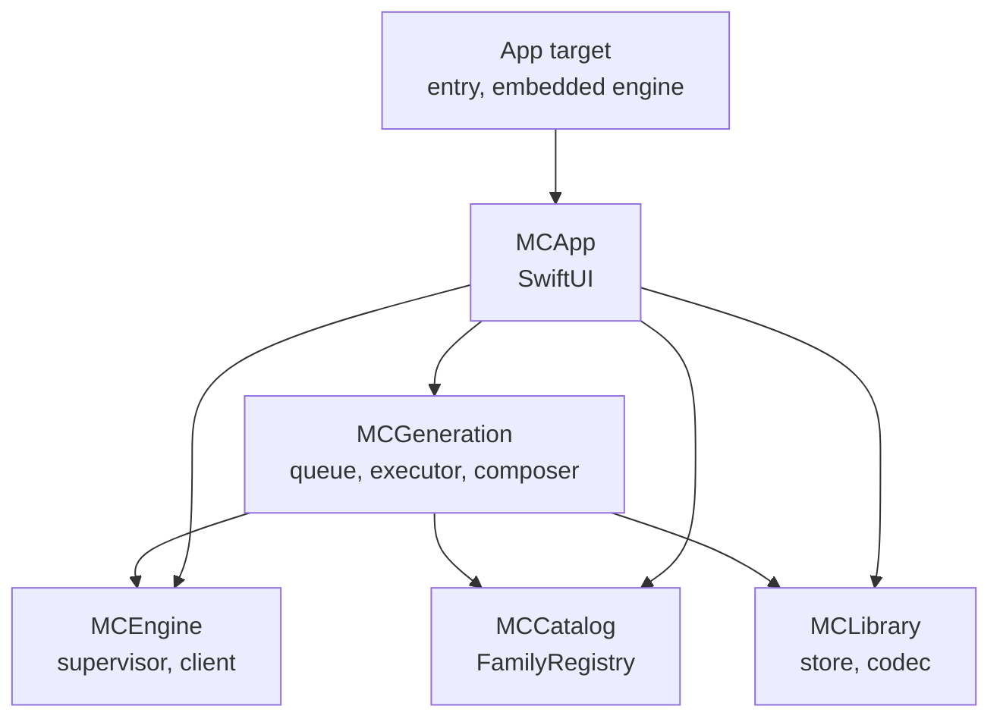
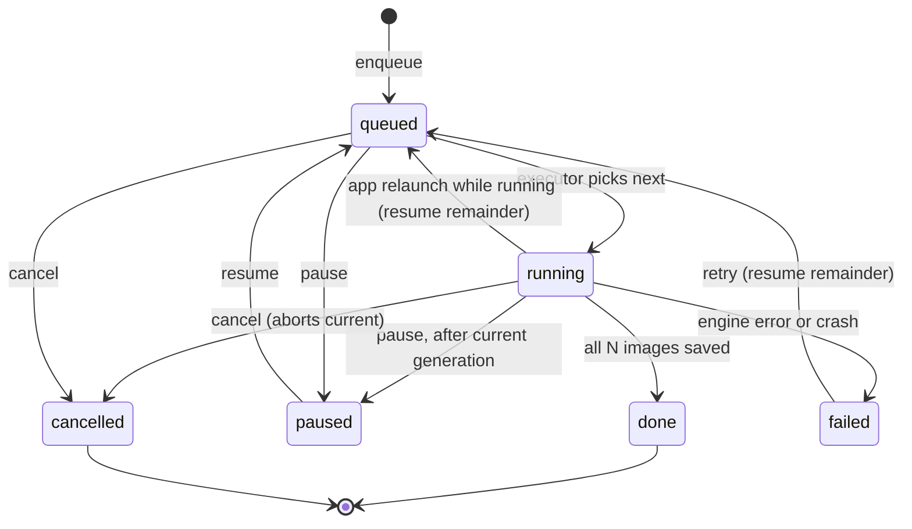
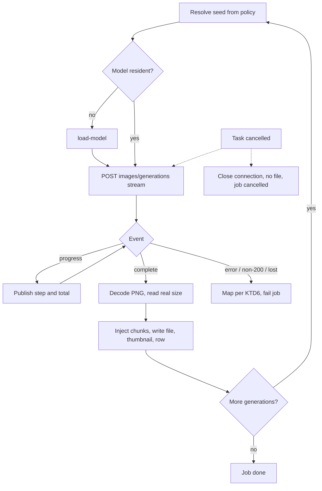

# Text-to-Image Generation Core - Plan

## Goal Capsule

- **Objective:** A user types a prompt, presses Generate, and gets an image saved in their library with the settings that made it, using only models already installed on their Mac and with nothing leaving the machine.
- **Means:** One vertical slice from app launch to saved result, on the pinned upstream engine (KTD1, KTD3).
- **Authority:** `docs/HLD.md` decisions D1–D20 and `AGENTS.md` non-negotiables win over this plan. `docs/lld/engine.md` owns engine packaging and supervision. This plan owns everything else here. Where this plan and the HLD disagree, update the HLD decision log first (`AGENTS.md`).
- **Execution profile:** Greenfield Swift 6, strict concurrency, macOS 26.2+. Pure logic goes test-first. Scaffold, embed and supervisor work goes smoke-first against the real engine.
- **Stop conditions:** Stop and ask before downloading weights, before relaxing any engine-privacy flag, and if the pinned engine's behavior contradicts a Key Technical Decision.
- **Finish:** The implementer runs the end-to-end smoke in the Verification Contract and ships the work.

---

## Product Contract

### Summary

The plan builds text-to-image generation end to end: scaffold and engine supervision, a typed engine client, capability-driven settings, a persistent one-at-a-time queue with batch and seed policies, a saved library with A1111 and mlx-create metadata, and the canvas, filmstrip and prompt bar that drive it. Models are whatever is already installed in the weights folder. Progress is a step bar.

### Problem Frame

The repo has a complete HLD and one LLD but no code, so the app cannot make a single image. Every later feature (model downloads, LoRAs, the enhancer, the gallery, calibration) assumes a working generation core, and the engine's real behavior has only been smoke-tested by hand (`docs/lld/engine.md` §5.9). Building the core first also tests the HLD against the pinned engine. Reading the engine source at `v26.10.2` already turned up several places where the HLD's mental model is too simple: seed range, size normalization, error shapes (KTD2, KTD6).

### Key Decisions

- **Scaffold and engine supervisor are part of this plan.** Nothing can generate without them, and the supervisor LLD has no code yet. Chosen over treating them as a separate earlier plan. Governs R12, R13. (session-settled: user-approved — chosen over a separate scaffold plan: the call-out was shown and confirmed)
- **Models are whatever is installed in the weights folder.** No catalog, downloader or recommender. Chosen over pulling model management into this plan. Governs R10, R11. (session-settled: user-approved — chosen over building catalog-backed model selection)
- **Progress is a step bar with no live preview.** Preview frames wait for upstream F1; the client ignores a `preview` field if one appears and renders nothing from it. Governs R5. (session-settled: user-approved — chosen over blocking on F1 or carrying an engine patch)
- **A built-in capability record per verified family stands in for the signed catalog.** The UI is capability-driven from day one. Governs R9, R10. (session-settled: user-approved — chosen over hard-coded per-screen knobs)

### Requirements

**Generation**

- R1. Pressing Generate with a non-empty prompt produces an image through the engine and stores it in the library.
- R2. Batch count N produces N images from N separate engine requests. Seed policy is one of random, fixed, increment from a base, or reuse from a selected image, and every request carries an explicit seed.
- R3. Jobs run one at a time in a persisted queue that survives relaunch. The user can reorder queued jobs, pause, cancel (running or queued) and retry failed jobs.
- R4. Cancelling a running job stops the engine's work and saves no partial image. Images the job already finished stay.
- R5. The running generation shows step progress. A `preview` field in a progress event, if the engine ever sends one, is ignored without error.
- R6. Prompt, batch count and the settings below can be reused from any saved image (⌘R).

**Settings from capabilities**

- R7. The settings popover shows only controls the selected model's capability record supports: size choices from the family grid, steps, guidance, negative prompt.
- R8. Sizes the family cannot produce are never offered. Whatever size the engine actually returned is what the library records.
- R9. A model whose family has no capability record is listed as unavailable with the reason, and cannot be selected for generation.

**Models and engine**

- R10. The model picker lists the image models the engine discovers in the weights folder. With none installed, the canvas explains where to put weights and offers Reveal in Finder.
- R11. Changing the selected model warms it in the engine before the next job needs it.
- R12. The app launches its engine privately and supervises it per `docs/lld/engine.md` (loopback only, per-launch key, isolated `HOME`, crash restart with backoff).
- R13. Engine and generation failures reach the user as actionable plain-language messages, and the failed job can be retried when retrying can help.

**Library and metadata**

- R14. Each saved image has a PNG in the library layout, a 512 px HEIC thumbnail and a database row in the default project.
- R15. The PNG carries an A1111 `parameters` text chunk and an `mlx-create` JSON chunk, written without re-encoding the image. Reading them back restores the settings that made the image.
- R16. The row records the engine's actual output: real pixel size and the step count the engine ran.

**Constraints**

- R17. No prompt filtering, output classification or refusal path exists anywhere (D3). No inference runs in the app process. Prompts and images never leave the device.

### Success Criteria

- On this Mac, a 2-image batch from an installed model finishes, shows both results in the filmstrip, and each PNG's metadata restores its settings with ⌘R.
- Killing the engine mid-job fails or resumes the job visibly, and a relaunch after `kill -9` of the app resumes the queue.
- The smoke evidence in the Verification Contract exists and shows no engine key in `ps` output.

### Scope Boundaries

Outside this plan, not planned work:

- Model download, catalog, recommender, calibration, license acceptance flow (D16, D20).
- LoRAs, the enhancer, prompt packs, transparent output, `cond_gain` controls.
- Gallery mode, project switching, prompt search, drop-onto-canvas restore, zoomable AppKit canvas.
- Any mode other than `t2i` (D7), video, upscale.
- Sparkle, analytics, notarization pipeline.

#### Deferred to Follow-Up Work

- Live previews: decode and render preview frames on the engine bump that includes F1 (`docs/HLD.md` §7.2).
- FTS5 prompt search and prompt history table: land with the gallery.
- Drop-onto-canvas restore: the codec read path is built here, the drop target is not.
- Fit badges and seconds-per-image estimates on the model chip: need the recommender and calibrator.

#### Considered, not built

- `Entitlements` gates: no gated feature exists yet. Add the seam with the first paywalled feature (D2).
- Automatic retry of failed generations: the failure classes that matter (OOM, bad weights) do not self-heal. Retry stays user-initiated (R13). Evidence that would change this: transient 5xx observed in the smoke runs.
- `Model hash` in the A1111 chunk: the HLD defines it from catalog identifiers, which do not exist yet. The mlx-create chunk carries the model id.
- Reading A1111-only PNGs made by other tools: nothing in this plan consumes them. The reader lands with drop-onto-canvas restore, and the read path here covers the `mlx-create` chunk only.
- Measured-memory availability check per family (hide a model that cannot fit this Mac): needs recorded peak figures per family and belongs with the recommender. Until then the out-of-memory message from KTD6 is the user's signal.
- Supervisor `/health` polling to detect a wedged engine mid-generation: no hang has been observed, and the user can cancel. Evidence that would change this: a hang in the smoke runs.

---

## Planning Contract

### Key Technical Decisions

- KTD1. **Typed SSE client over `POST /v1/images/generations` with `stream:true`.** The non-streaming form has no progress, and the streaming form ends in the same base64 PNG. Cancellation is Swift task cancellation, which closes the connection; the engine aborts on disconnect (`docs/HLD.md` §8.1). Request body mirrors upstream `ImageGenService.requestJson` for the t2i fields only.
- KTD2. **Seeds are app-resolved integers in `0..<2^32`.** The engine reads `seed` as an unsigned integer and defaults to 42 when it is absent, so "random" must be resolved before sending (upstream `ImageGenService` does the same, over the same range).
- KTD3. **Record the engine's truth, not the request.** The engine silently normalizes `size` to the family grid and may run the checkpoint's own step grid instead of the requested steps. The row stores pixel size read from the PNG header and `total` from the last `progress` event. `steps` is omitted from the request unless the user changed it, so the engine's per-model default applies (`steps: 0` means default upstream).
- KTD4. **Queue progress is derived, not stored.** A job's remaining work is `batch_count` minus its saved image rows, so relaunch recovery and cancel need no counter that can drift. A job running at crash time returns to `queued` and resumes the remainder; the interrupted generation is discarded. Increment-policy seeds use `base + saved_count`, so a resume continues the sequence.
- KTD5. **Pause finishes the current generation, then holds.** Cancel is the only immediate abort. Reorder applies to queued jobs only. This keeps one rule for the engine: a started request either completes or is cancelled.
- KTD6. **Failure mapping is by HTTP status and `error.type`, then message text.** Upstream returns `{"error":{"message","type","param","code"}}` with 503 and `type` of `out_of_memory`, `model_not_loaded` or `no_model`, and plain `{"error":{"message"}}` for 400s. A streamed failure after a 200 arrives as an SSE `error` event with only `message`. Connection loss is classified by the supervisor's crash kind (`docs/lld/engine.md` §5.6). Upstream messages are not stable, so each rule gets a fixture from a captured response and fixtures refresh on every pin bump.
- KTD7. **Library writes are atomic per image.** Write PNG with chunks to a temp file in the library volume, rename into place, write the thumbnail, then insert the row in one transaction. A failure before the row insert removes the files, so a saved image never lacks a row and a row never lacks a file.
- KTD8. **`MCGeneration` is a new module** holding queue, executor and composer, depending on `MCEngine`, `MCCatalog` and `MCLibrary`. The HLD's module list has no home for them: putting them in `MCLibrary` would make the store depend on the engine, and `MCApp` holds UI that tests should not need. Update HLD §6 in U1.
- KTD9. **Executor tests inject a stub `URLSession` configuration into `EngineClient`**, not a new protocol. The HLD names three seams (`ModelSource`, `Entitlements`, `ModelFamily`) and none fits. A real local socket test covers the one thing a stub cannot show: that cancelling closes the connection.
- KTD10. **Capability records are a bundled JSON resource shaped like the future catalog's family entries**, loaded by `FamilyRegistry`. Only families whose size grid, step default and guidance support are verified against the pinned source get a record (U5). Other installed models appear as unavailable (R9).
- KTD11. **Model ids are the engine's registry ids** from `GET /v1/models`, never filesystem paths. The smoke run found `ddalcu/Krea-2-Turbo` for a symlink at `Weights/ddalcu/Krea-2-Turbo-MLX-Serve-mixed-4-8`.

### High-Level Technical Design

Module dependencies (HLD §6 owns the full component picture; this shows what this plan adds):



Job lifecycle (KTD4, KTD5). Recovery edges are the ones a reader would not guess:



One generation inside the executor:



### Output Structure

```
Package.swift                         # five library targets + tests, GRDB pin
project.yml                           # XcodeGen: app target, embed script phase
engine.lock                           # docs/lld/engine.md §3
Config/Engine.entitlements
scripts/embed-engine.sh
App/MLXCreateApp.swift
Sources/MCEngine/                     # supervisor, client, request/event types
Sources/MCCatalog/                    # FamilyRegistry + Resources/families.json
Sources/MCLibrary/                    # GRDB store, migrations, MetadataCodec, thumbnails
Sources/MCGeneration/                 # JobQueue, Executor, SeedPolicy, Composer
Sources/MCApp/                        # AppModel, views
Tests/MCEngineTests/  MCCatalogTests/  MCLibraryTests/  MCGenerationTests/  MCAppTests/
```

The per-unit file lists are authoritative.

### Assumptions

None. The call-outs were confirmed before research. Open items are in Outstanding Questions.

### Dependencies and Prerequisites

- XcodeGen is not installed on this Mac (Xcode 27.1 and Swift 6.4 are). Install version 2.46.0 or newer before U1.
- GRDB pinned at `7.11.1` (current release at planning time).
- Engine tarball (about 79 MB, sha256 in `engine.lock`) needs network at first build.
- The real-engine smoke needs memory headroom: Krea-2 Turbo wants about 17.6 GB free (14.7 GB peak) per the recorded preflight, so unload other local models first.

### Risks

| Risk | Impact | Mitigation |
|---|---|---|
| Upstream error text and shapes drift on a bump | Users see raw engine text instead of an actionable message | KTD6 fixtures plus the engine contract suite on every bump (HLD §7.3) |
| Engine request blocks for minutes at large sizes | A client timeout kills a healthy render | Byte-silence timeout of 24 h like upstream's `streamGeneration`; user cancel is the stop |
| `kill -9` of the app mid-write leaves a temp file | Orphan files in the library | KTD7 temp-then-rename; the store sweeps `*.partial` in its library folder at launch |
| Prompt text appears in engine log preview lines | Prompts persist in `Engine/.mlx-serve/logs` on disk | Already local-only (LLD §5.2); executor never logs prompts, supervisor forwards engine output at `os_log` `.private` |
| Swift 6 strict concurrency vs `URLSession.bytes` and GRDB | Slow bring-up | Services are actors; UI types hold `@MainActor`; no domain service is `@MainActor` (`AGENTS.md`) |

---

## Implementation Units

### Phase 1: Foundations

### U1. Project scaffold and workspace conventions

- **Goal:** A repo that builds an empty SwiftUI app with five empty library targets, passing a trivial test run, with commands recorded for the next agent.
- **Requirements:** R12, R17.
- **Dependencies:** XcodeGen installed.
- **Files:** `Package.swift`, `project.yml`, `engine.lock`, `App/MLXCreateApp.swift`, `.gitignore`, `AGENTS.md` (Commands section), `docs/HLD.md` (§6 module list adds `MCGeneration`, KTD8).
- **Approach:**
  1. Package targets and test targets per Output Structure; Swift 6 language mode and strict concurrency on all of them; macOS 26.2 deployment.
  2. `project.yml` defines the app target, links the package products, and reserves the postCompile script slot that U2 fills.
  3. `engine.lock` copies the JSON in `docs/lld/engine.md` §3.
  4. `.gitignore` additions: Xcode project output, `.build`, local engine extraction and reference clones.
  5. Record the real build, test and generate commands in `AGENTS.md` under a new Commands section.
  6. Add decision-log entries to `docs/HLD.md` before code lands: the capability-record stand-in for the signed catalog (§8.5), the deferred `Model hash` (§8.9), seeds in `0..<2^32`, and recorded size and steps coming from the engine's output (§8.2). Cite them in the commits, per `AGENTS.md`.
- **Execution note:** Packaging work, so prove it with a build and a launch, not unit tests.
- **Patterns to follow:** `docs/lld/engine.md` §3 and §4.2 for `engine.lock`; `AGENTS.md` language conventions.
- **Test expectation:** none -- scaffolding with no behavior.
- **Verification:** The app builds and shows an empty window; `swift test` runs and reports zero failures across all five test targets.

### U2. Engine embed build phase

- **Goal:** Every app build embeds the pinned, verified, re-signed engine so U3 and the smoke run launch the bundled binary.
- **Requirements:** R12.
- **Dependencies:** U1.
- **Files:** `scripts/embed-engine.sh`, `Config/Engine.entitlements`, `project.yml`.
- **Approach:** Implement `docs/lld/engine.md` §4 as written: fetch by sha256, verify (size, tar entries, payload equals lock lists, upstream Team ID), embed into `MacOS/`, `Frameworks/`, `Resources/ThirdParty/mlx-serve/`, rule-driven install-name fixes, inside-out re-sign, post-checks. Plan deltas:
  1. Resolve the LLD's `[verify]` item on `mlx.metallib` in `Frameworks/` using `codesign --verify --strict --deep` on the built app. Record the result in the LLD. Notarization itself is outside this plan.
  2. Make the script runnable by hand (`--refresh-manifest` and a check-only mode) so the harness smoke in U3 can use the same extraction.
- **Execution note:** Smoke-first. Break each check on purpose once and confirm the build fails with the one-line message.
- **Patterns to follow:** LLD §4.1–§4.6 and its failure-message rule.
- **Test scenarios:**
  - Happy path: a clean build produces `Contents/MacOS/mlx-serve`, and its `--version` first line is `mlx-serve 26.10.2`.
  - Error: a tarball whose sha256 differs from the lock fails before extraction.
  - Error: an extra file in the tarball payload fails the build naming that file.
  - Integration: `otool -L` over the binary and every embedded dylib shows no `/opt/homebrew` path after the fixes.
  - Integration: a second incremental build with an unchanged lock does not re-run the script.
- **Verification:** `codesign --verify --strict` passes on every embedded Mach-O, and the engine starts from inside the built bundle.

### U3. EngineSupervisor and memory tier

- **Goal:** The app starts, watches, restarts and stops a private engine, and publishes `EngineState` for the client and queue.
- **Requirements:** R12, R13, R17.
- **Dependencies:** U1, U2.
- **Files:** `Sources/MCEngine/EngineSupervisor.swift`, `EnginePaths.swift`, `EngineLaunch.swift` (argv/env builder), `ModelsSymlink.swift`, `PidFile.swift`, `CrashClassifier.swift`, `BackoffPolicy.swift`, `MemoryTier.swift`, `Tests/MCEngineTests/CrashClassifierTests.swift`, `BackoffPolicyTests.swift`, `PidFileTests.swift`, `ModelsSymlinkTests.swift`, `EngineLaunchTests.swift`, `Tests/MCEngineTests/Fixtures/`.
- **Approach:** Implement `docs/lld/engine.md` §5 and its §6 test table. Plan deltas:
  1. `MemoryTier` maps `ProcessInfo.physicalMemory` to the HLD §11 tiers (16 GB → 1, 24–32 GB → 2, 48 GB+ → 3 resident models). Chip class and GPU cores belong to the later `HardwareProfile`.
  2. `EnginePaths` takes the executable URL as input, so the harness can run the extracted tarball binary outside a bundle.
  3. Copy and adapt `summarizeCrash`, `isRequestPreviewLine` and `waitForExit` from upstream `ServerManager.swift` at the pinned tag with the MIT header and a path-and-commit note (`AGENTS.md`).
  4. The crash fixtures come from real captured tails, including the OOM response recorded in LLD §5.9.
- **Execution note:** Test-first for `CrashClassifier`, `BackoffPolicy`, `PidFile` decisions and the argv builder; smoke-first for the process lifecycle.
- **Patterns to follow:** LLD §5.2 launch contract; upstream `ServerManager.swift` helpers.
- **Test scenarios:** the LLD §6 table, plus:
  - Happy path: tier mapping returns 1, 2, 3 for 16, 32 and 64 GB inputs and the boundary values between.
  - Integration: `start()` against the extracted engine reaches `.ready`; `stop()` leaves no listener and no PID file.
  - Integration: a request without the key to a non-`/health` route returns 401, and `ps -o command` for the engine shows no key. This closes the item LLD §5.9 marks as untested.
  - Integration: `kill -9` of the engine yields `.restarting` then `.ready` with a new port and key.
- **Verification:** All five bullets of the LLD §6 smoke test pass except the generation step, which U7 covers. Record the 401 result in LLD §5.9.

### Phase 2: Generation core

### U4. EngineClient and request/event types

- **Goal:** A typed client that turns a validated t2i request into a stream of progress events and one PNG, and that turns every failure into a typed error.
- **Requirements:** R1, R2, R4, R5, R11, R13, R16, R17.
- **Dependencies:** U3 (endpoint and key).
- **Files:** `Sources/MCEngine/EngineClient.swift`, `ImageRequest.swift`, `GenEvent.swift`, `SSELineParser.swift`, `EngineError.swift`, `Tests/MCEngineTests/ImageRequestTests.swift`, `SSEParsingTests.swift`, `EngineErrorMappingTests.swift`, `EngineClientStreamTests.swift`, `EngineClientCancelTests.swift`, `Tests/MCEngineTests/Fixtures/`.
- **Approach:**
  1. `ImageRequest` is a pure value carrying model id, prompt, optional negative prompt, size, optional steps, optional guidance and seed. Its body builder emits only fields that are set, plus `stream:true`, adapted from upstream `ImageGenService.requestJson` for t2i only (KTD1). Seed is required by type (KTD2).
  2. `generateImage(_:) -> AsyncThrowingStream<GenEvent>` with `.progress(step:total:stage:)` and `.completed(png:)`. A `preview` field in an event is not decoded (R5). Reuse upstream `MediaSSE` event classification, adapted.
  3. The SSE reader does not assume `complete` is the last line and treats a stream that ends without it as a lost connection.
  4. `load`, `unload`, `rescan` and `models()` (the `GET /v1/models` list used by U5) share the key header and error mapping. Confirm the accepted key header form against the running engine in this unit.
  5. `EngineClient` takes a `URLSessionConfiguration` so tests can stub it (KTD9), and always reads the current endpoint from the supervisor state so a restart never leaves a stale port (LLD §5.7).
  6. Error mapping follows KTD6, producing user-facing text with the engine message as detail.
  7. Request timeout is a byte-silence timeout of 24 hours; stopping is by cancellation.
- **Execution note:** Test-first. Capture one real SSE stream and the real OOM, 400 and 401 bodies from the engine into `Fixtures/` before writing the parsers.
- **Patterns to follow:** upstream `APIClient.streamGeneration` and `APIError.errorDetail`; `docs/HLD.md` §8.1.
- **Test scenarios:**
  - Happy path: a fixture stream of 4 progress events and a `complete` event yields 4 progress events and the decoded PNG bytes.
  - Happy path: the body for a minimal request contains `model`, `prompt`, `seed`, `size`, `stream` and omits `steps`, `negative_prompt` and `guidance_scale`.
  - Happy path: a request with steps, guidance and a negative prompt includes all three.
  - Edge case: a progress event that carries a `preview` field is accepted and yields the same progress as one without it.
  - Edge case: a progress event with `total` of 0 or missing does not divide by zero in the progress fraction.
  - Error: HTTP 503 with `type:"out_of_memory"` maps to the memory error; `model_not_loaded` and `no_model` map to their own errors.
  - Error: HTTP 400 with a bare message maps to a request error carrying that message.
  - Error: an SSE `error` event after a 200 maps to a generation error with its message.
  - Error: a stream that ends without `complete` maps to a lost-connection error.
  - Integration: cancelling the consuming task makes a local socket test server observe the connection closed within a short bound.
- **Verification:** Against the real engine, one 512² request streams progress and returns a PNG the codec in U6 can open; a wrong key yields the typed 401 error.

### U5. FamilyRegistry and installed image models

- **Goal:** The app knows which installed models it can drive and which controls each one supports.
- **Requirements:** R7, R8, R9, R10, R11.
- **Dependencies:** U4.
- **Files:** `Sources/MCCatalog/FamilyRegistry.swift`, `ModelFamily.swift`, `Resources/families.json`, `Sources/MCGeneration/InstalledModels.swift`, `Tests/MCCatalogTests/FamilyRegistryTests.swift`, `Tests/MCGenerationTests/InstalledModelsTests.swift`, fixtures of `GET /v1/models` output.
- **Approach:**
  1. `ModelFamily` carries only what v1 reads: id, size grid, step default and range, guidance support, negative-prompt support. LoRA fingerprints, Civitai labels and prompt pack ids join with the features that use them.
  2. Before writing each record, verify its size grid, step default and guidance support against the engine source at the pinned tag, then seed only verified families (KTD10). Krea-2 Turbo and FLUX.2-klein are the first candidates (`AGENTS.md`: FLUX fixed at 1024², Krea multiples of 16 in [256, 2048]).
  3. `InstalledModels` reads `GET /v1/models`, keeps entries the engine identifies as image models, and matches each to a family. Which `/v1/models` fields identify an image model and its architecture is not established in the research. Inspect a real response in this unit and record the fields used.
  4. Unmatched image models are returned as unavailable with a reason (R9). Rescan runs at launch, and again when the model picker opens or the empty state is shown, so weights the user just copied in appear without a relaunch (R10).
  5. Size handling: a family exposes a fixed list of size presets drawn from its verified grid, and the UI offers only those (no free numeric entry). The composer never sends a size outside the list (R8). If a size outside the list ever reaches the composer, it rounds up to the grid the way the engine does and the request shows the rounded size.
- **Execution note:** Capture the real `/v1/models` JSON for Krea-2 Turbo and Qwen-Image 2.1 (both on disk) as fixtures first.
- **Patterns to follow:** `docs/HLD.md` §8.3–8.4; upstream `APIClient.parseModelInfo`.
- **Test scenarios:**
  - Happy path: Krea's presets (512², 768², 1024², 1024×768, 768×1024) are all multiples of 16 within [256, 2048]; a composer input of 1000×1000 rounds up to 1008×1008.
  - Edge case: the klein record's presets match the grid verified in the engine source (`clampFluxDim` honors multiples of 32 in [256, 1536] at the pinned tag, which is wider than the "fixed 1024²" in `AGENTS.md`). Record the finding in the HLD when the record is written.
  - Happy path: a model whose family disables guidance reports the control as hidden.
  - Edge case: an image model with no matching family is listed unavailable with a reason and cannot be selected.
  - Edge case: a non-image model in `/v1/models` is excluded.
  - Edge case: empty `/v1/models` yields an empty list, which drives the R10 empty state.
- **Verification:** Against the real engine, Krea-2 Turbo is listed as available with its capabilities.

### U6. LibraryStore and MetadataCodec

- **Goal:** Saved images land on disk and in the database atomically, carrying metadata that restores their settings.
- **Requirements:** R6, R14, R15, R16, R17.
- **Dependencies:** U1 (independent of U3–U5).
- **Files:** `Sources/MCLibrary/LibraryStore.swift`, `Migrations.swift`, `Records.swift`, `LibraryPaths.swift`, `MetadataCodec.swift`, `PNGChunks.swift`, `Thumbnails.swift`, `Tests/MCLibraryTests/LibraryStoreTests.swift`, `MetadataCodecTests.swift`, `PNGChunksTests.swift`, `ThumbnailTests.swift`.
- **Approach:**
  1. GRDB with explicit migrations for `project`, `job` and `image` per `docs/HLD.md` §9, using only the fields v1 writes. A default project exists after first launch. `job.mode` and `image.media_type` stay in the schema (D7).
  2. On-disk layout per HLD §9. The library root is a parameter so it stays relocatable.
  3. `saveImage` follows KTD7 and sweeps `*.partial` files at launch.
  4. `MetadataCodec` writes the A1111 `parameters` `tEXt` chunk (prompt, `Negative prompt:`, then `Steps`, `CFG scale` when guidance applies, `Seed`, `Size`, `Model`) and an `iTXt` `mlx-create` chunk: a JSON object with `schema_version: 1` read before any other field, then the full request, family, engine version and the actual size and steps (R16). Chunks insert before `IDAT` without touching image data. `Model hash` is omitted (Scope Boundaries). The read path covers the `mlx-create` chunk and returns the settings it holds.
  5. Thumbnails are HEIC at 512 px through ImageIO (`docs/HLD.md` §8.9).
  6. Queries needed by the UI: a project's recent images, and one image's settings for ⌘R.
- **Execution note:** Test-first for the codec and chunk writer.
- **Patterns to follow:** `docs/HLD.md` §8.9 and D12; PNG spec chunk ordering and CRC.
- **Test scenarios:**
  - Happy path: write then read returns identical settings for a request with every optional field set.
  - Happy path: the `parameters` text matches the A1111 line format for a known input, byte for byte.
  - Edge case: a prompt containing newlines, colons and non-ASCII text survives the round trip.
  - Edge case: a chunk with an unknown `schema_version` is reported as unreadable rather than half-restored.
  - Edge case: reading a PNG with no chunks returns nothing, without error.
  - Integration: the chunk-injected PNG decodes with ImageIO, and its `IDAT` bytes equal the engine's original.
  - Integration: every chunk written has a valid CRC (re-parse with the chunk reader).
  - Error: a failure injected before the row insert leaves no PNG, no thumbnail and no row.
  - Error: a leftover `*.partial` file is removed on the next launch.
  - Integration: migrations apply to an empty database and a second launch applies none.
- **Verification:** A real engine PNG saved through the store opens in Preview with the metadata visible in an inspector, and the HEIC thumbnail exists at 512 px on its long side.

### U7. JobQueue, Executor, SeedPolicy and Composer

- **Goal:** Enqueued jobs run one at a time against the engine, resume correctly after any interruption, and save their results.
- **Requirements:** R1, R2, R3, R4, R5, R8, R11, R13, R16, R17.
- **Dependencies:** U3, U4, U5, U6.
- **Files:** `Sources/MCGeneration/JobQueue.swift`, `Executor.swift`, `SeedPolicy.swift`, `GenerationComposer.swift`, `QueueSnapshot.swift`, `Tests/MCGenerationTests/SeedPolicyTests.swift`, `JobQueueTests.swift`, `ExecutorTests.swift`, `GenerationComposerTests.swift`.
- **Approach:**
  1. `GenerationComposer` validates a request against the family record, snaps size to the legal grid, and enqueues a persisted `job` (R7, R8).
  2. `SeedPolicy` is a pure function from policy, base, saved count and selected-image seed to a seed in `0..<2^32` (KTD2, KTD4). Fixed and reuse-from-image give the same seed for every generation of the job.
  3. `JobQueue` is an actor over the store implementing the lifecycle diagram, KTD4 recovery at startup, and KTD5 pause and reorder rules.
  4. `Executor` follows the per-generation flowchart. It loads the model when it is not resident, streams events into a published `QueueSnapshot`, and saves through U6. When the connection drops during a job, it fails that job, reads the crash kind from the supervisor (`EngineGate.currentCrash()`), and marks the job retryable per the LLD §5.6 table (`missingWeights` is not retryable).
  5. The executor logs no prompt text.
  6. Model changes in the picker call `load` ahead of time (R11). v1 keeps one image model resident: before loading a model different from the resident one, the executor calls `unload` on the previous one, so a switch never asks the engine's free-memory preflight to hold two. On an `out_of_memory` failure it unloads every resident model before marking the job retryable, so Retry runs against freed memory. Whether the engine's preflight counts evictable models is unverified; the smoke run records what happens.
- **Execution note:** Test-first for `SeedPolicy`, the queue state machine and recovery, with the stubbed session from KTD9.
- **Patterns to follow:** `docs/HLD.md` §8.2; the lifecycle and flowchart above.
- **Test scenarios:**
  - Happy path: a job with batch 3 and increment from 100 sends seeds 100, 101, 102 and saves 3 rows.
  - Happy path: random policy produces distinct seeds in range; fixed repeats one seed for all N.
  - Happy path: reuse-from-image sends the selected image's seed.
  - Edge case: relaunch with a `running` job that has 2 of 4 images saved resumes at generation 3, and an increment job continues at `base + 2`.
  - Edge case: two jobs enqueued at once never have two engine requests in flight.
  - Edge case: pausing a running job lets the current generation finish and starts nothing after it.
  - Edge case: reorder moves a queued job, and attempting to move the running job is rejected.
  - Error: cancel during generation 2 of 4 closes the request, keeps image 1, saves no partial image, and ends the job `cancelled`.
  - Error: a 503 `out_of_memory` unloads every resident model, fails the job with the memory message, and Retry resumes the remainder.
  - Edge case: switching from model A to model B calls `unload` for A before `load` for B.
  - Error: engine crash classified `missingWeights` fails the job as not retryable.
  - Error: a stream that ends without `complete` fails the job and saves nothing.
  - Integration: with a real stubbed `EngineClient`, a saved image's row records the PNG's actual size and the last progress `total`, even when the request asked for a different size and steps (R16).
- **Verification:** Against the real engine at 512²: a batch of 2 saves 2 files and rows; cancelling mid-run leaves 1; `kill -9` of the app mid-batch and relaunch completes the remainder.

### Phase 3: App

### U8. AppModel, canvas, filmstrip and prompt bar

- **Goal:** The user can generate, watch, cancel and reuse results from the canvas-first window.
- **Requirements:** R1, R3, R5, R6, R7, R9, R10, R13, R17.
- **Dependencies:** U3–U7.
- **Files:** `App/MLXCreateApp.swift`, `Sources/MCApp/AppModel.swift`, `MainWindow.swift`, `CanvasView.swift`, `FilmstripView.swift`, `PromptBar.swift`, `SettingsPopover.swift`, `ModelChip.swift`, `EmptyModelsView.swift`, `EngineStatusBanner.swift`, `Tests/MCAppTests/AppModelTests.swift`, `SettingsPopoverStateTests.swift`.
- **Approach:**
  1. `AppModel` owns the supervisor, client, queue, executor and store, and starts the engine at launch. `@MainActor` stays on UI types only.
  2. Main window follows `docs/HLD.md` §10 for the v1 parts: toolbar (default project name, model chip), canvas, filmstrip, prompt bar. Project switcher, gallery toggle and fit badges are out of scope.
  3. Canvas shows the selected result, or the running generation's step bar. The step bar uses the `total` from the engine's progress events, and shows `Default` in the steps field when the user has not set steps. It scales to fit with basic zoom; the AppKit zoomable canvas is deferred.
  4. Filmstrip shows the default project's recent images plus queue placeholders with progress. A queued placeholder's context menu (also reachable from the keyboard) offers Move Up, Move Down, Cancel and, once failed, Retry. After Pause, the queue header reads "Pausing…" until the current generation finishes, then "Paused" with Resume.
  5. The prompt bar carries the prompt and the `×N` batch stepper (HLD §10). The settings popover carries seed policy with its seed field, size presets, steps, guidance and negative prompt, each only where the model's capabilities allow (R7); batch and seed sit where HLD §8.3 lists them. The model chip menu lists available models as selectable rows and unavailable ones as disabled rows below a separator, each with its reason (R9). On launch the last-used available model is selected, else the first available in registry order.
  6. Canvas states: `noModels` (zero installed image models) shows the weights folder path with Reveal in Finder (R10); `onlyUnavailable` lists each installed model with its reason and no Reveal action; models available but no images yet shows the hint "Type a prompt and press ⌘↩" and hides the filmstrip.
  7. `EngineStatusBanner` covers four engine states in one line each: starting, warming model, restarting, failed. Generate stays enabled while starting, warming or restarting (the job queues and the banner says it waits for the engine); it is disabled only for failed and `noModels`. Job failures use the table below, with the engine message as detail.
  8. Shortcuts: ⌘↩ generate. ⌘. cancels the running job, or the selected queued placeholder when nothing runs. ⌘R reuses the settings of the selected saved image and is disabled when the selection is a placeholder or empty; it replaces the prompt bar contents.
  9. Every control and placeholder carries a VoiceOver label that includes its state ("queued", "step 3 of 8", "failed, retry available"), and the step bar is exposed as a progress indicator with a value.

  | Failure class (KTD6) | Message gist | Retry |
  |---|---|---|
  | `out_of_memory` | Not enough memory; other models were unloaded, retry (or close other apps) | yes |
  | `model_not_loaded`, `no_model` | Model is not ready | yes |
  | `missingWeights` | Model files are missing; Reveal in Finder | no |
  | Lost connection or engine crash | Engine stopped | yes |
- **Execution note:** UI state logic is unit-tested; the surface itself is verified by launching the app and capturing screenshots (the `drive-macos-gui-app-for-screenshots` skill covers driving a native SwiftUI app).
- **Patterns to follow:** `docs/HLD.md` §10 layout and keyboard list; `AGENTS.md` (SwiftUI first, no `@MainActor` on domain services).
- **Test scenarios:**
  - Happy path: `AppModel` generate with a stubbed engine yields placeholder, progress, then a selected result.
  - Happy path: ⌘R on a saved image repopulates prompt, seed policy as fixed with that seed, size, steps and model.
  - Edge case: switching to a family without guidance hides the guidance control and clears its value from the next request.
  - Edge case: Generate is disabled for an empty or whitespace prompt.
  - Edge case: with zero image models, state is `noModels` and Generate is disabled.
  - Error: an engine `.failed` state shows the banner message and keeps queued jobs.
  - Error: cancelling shows the job as cancelled with its finished images retained.
- **Verification:** Launch the built app, generate a batch of 2, cancel a third, and capture screenshots of the canvas with progress, the filmstrip with a queued placeholder, the settings popover for Krea, and the empty-models state.

---

## Verification Contract

| Gate | Applies to | Proof |
|---|---|---|
| Package tests | U3–U8 | `swift test` passes in all test targets |
| App build | U1, U2, U8 | `xcodegen generate` then an Xcode build of the app scheme succeeds with the engine embedded |
| Embed checks | U2 | `codesign --verify --strict` on every embedded Mach-O, `otool -L` gate, `mlx-serve --version` first line |
| Supervisor smoke | U3 | Steps 1–5 of `docs/lld/engine.md` §6 except generation; 401 and no key in `ps` |
| Engine contract smoke | U4–U7 | Real streamed generation at 512², the same fixed seed sent twice with its two outputs compared and the result recorded, and real OOM and invalid-size responses captured as fixtures |
| End-to-end smoke | U8 | Generate batch 2, cancel mid-run, `kill -9` the engine, `kill -9` the app, relaunch; each outcome observed and recorded |

Smoke model: Krea-2 Turbo, the only image model on this Mac, at 512×512 with other local models unloaded. `AGENTS.md` names FLUX.2-klein 4B (about 5 GB) as the smallest smoke model, but it is not installed and downloading weights needs the user's approval, so this plan uses Krea-2 Turbo for its gates and records that `AGENTS.md`'s model is untested here. If the user approves the klein download, run the Engine contract smoke on it too.

## Definition of Done

- All requirements R1–R17 are met and each has at least one test scenario or smoke observation behind it.
- Every unit's Verification holds on this Mac, and the end-to-end smoke is recorded in the PR or `docs/lld/engine.md` §5.9.
- `AGENTS.md` carries the real build and test commands, and `docs/HLD.md` §6 lists `MCGeneration`.
- `docs/lld/engine.md` records the 401 result (U3) and the `mlx.metallib` check (U2).
- No throwaway harness, extracted tarball, `/tmp` home or fixture capture script remains in the repo.
- The engine's key never appears in argv, logs or the database.

## Documentation Plan

- `AGENTS.md`: Commands section (U1).
- `docs/HLD.md` §6: add `MCGeneration` (U1). §8.2: one note that seeds are `0..<2^32` and that recorded size and steps come from the engine's output (KTD2, KTD3), so later readers do not re-derive them from the request.
- `docs/lld/engine.md` §5.9 and §4.5: results from U3 and U2.

## Outstanding Questions

### Deferred to Implementation

- Which fields in `GET /v1/models` identify an image model and its architecture (U5 records them from a real response).
- The exact auth header form the engine accepts with `--api-key-strict` (U4 confirms it against the running engine).
- Verified size grid, step default and guidance support for Qwen-Image 2.1, Mage-Flow and klein 9B. They stay unavailable until verified (KTD10).
- Whether the user wants the FLUX.2-klein 4B download for the smoke runs (`AGENTS.md`): asked at U7, not before. The default above stands without an answer.
- Whether the engine's free-memory preflight counts evictable resident models (U7 smoke records it).

## Sources and Research

- Upstream `ddalcu/mlx-serve` at `v26.10.2`:
  - `docs/api.md` for endpoint list and the media SSE contract.
  - `src/gen.zig` image handler for size normalization, `seed` and `steps` parsing, and `sendError`'s `{"error":{"message"}}` body.
  - `src/server.zig` `sendErrorResponse` and the 503 `out_of_memory`, `model_not_loaded`, `no_model` cases.
  - `src/gen_sse.zig` for the `progress` and `error` event shapes.
  - `app/Sources/MLXServe/Services/ImageGenService.swift`, `APIClient.swift` (`streamGeneration`, `errorDetail`, `parseModelInfo`) and `MediaGenProgress.swift` (`MediaSSE`) as the adaptation sources.
- `docs/lld/engine.md` §5.9 for the recorded Krea-2 Turbo smoke (512², 8.5 s, about 17.6 GB free needed).
- `docs/HLD.md` §8.1, §8.2, §8.3, §8.4, §8.9, §9, §10 and §11.
