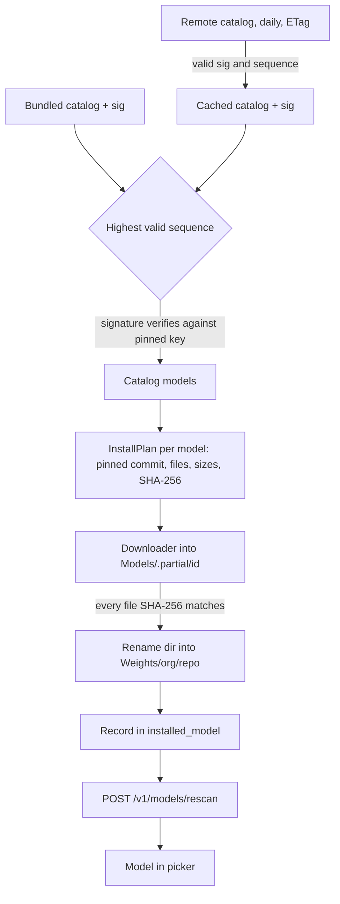
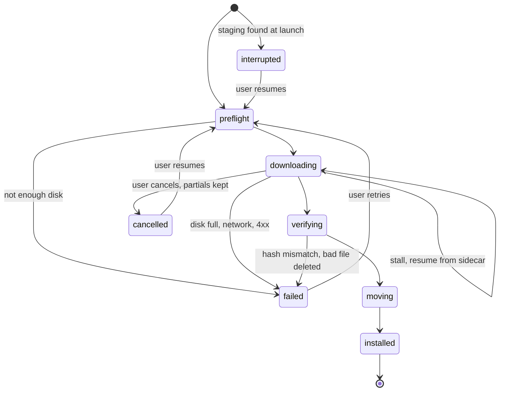
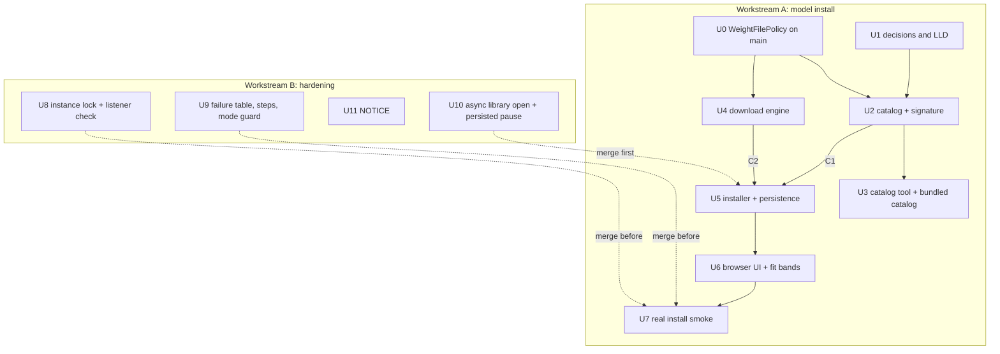

# Model Install and Generation Hardening - Plan

## Goal Capsule

- **Objective:** A person who has just installed the app can pick a supported image model inside it, accept its license, watch it download and verify, and generate with it, without touching Finder. The generation core they land on no longer has the known launch, queue and reporting faults from the t2i review.
- **Means:** A signed catalog and a resumable, hash-verified downloader feed the existing engine through its weights folder (KTD1, KTD2, KTD5). Hardening ships as small independent fixes in separate lanes (KTD13).
- **Authority:** `docs/HLD.md` decisions and `AGENTS.md` non-negotiables win over this plan. `docs/lld/engine.md` owns engine supervision. Where this plan changes a decision, the HLD decision log is updated first, as the first commit of the lane that needs it (U1, U8, U9, U10).
- **Execution profile:** Swift 6, strict concurrency, macOS 26.2+. Pure logic (signature, fit bands, chunk planning, failure tables) goes test-first. Downloader and supervisor work is proven against a local Range-capable server and the real engine. Two workstreams run in parallel in separate git worktrees (Parallel Execution Plan).
- **Stop conditions:** Stop and ask before downloading real weights (the U7 smoke needs about 5 GB and a disk check), before using a production signing key, and if the pinned engine rejects the klein 4B repo layout.
- **Finish:** The implementer runs the verification in the Verification Contract, then opens the PRs in the merge order given under Parallel Execution Plan.

---

## Product Contract

### Summary

Workstream A adds model install: a signed catalog with a bundled fallback, a resumable downloader that verifies every file against a SHA-256 in the catalog, a license-acceptance step, a model browser with fit bands, and an engine rescan after install. Workstream B fixes eight known faults in the generation core (second-instance engine reaping, port readiness, pause persistence, main-thread library open, duplicated out-of-memory handling, step recording, mode guard, missing NOTICE). The workstreams share no files except named seams, so they can be built at the same time.

### Problem Frame

The t2i slice only runs models already sitting in the weights folder, so a new user cannot generate anything and the smallest supported model (FLUX.2-klein 4B) cannot be smoke-tested without hand-placing files. The review of that slice also left defects the next features would build on, and install adds long-lived state (partial downloads, a new table) that makes two of them worse: a second app instance deleting the first one's in-flight files, and a library open that grows with disk contents.

### Key Decisions

- **Krea-2 Turbo is listed in the catalog, and the user accepts its license at download.** Chosen over leaving it out. Its license (v1, 2026-06-22) requires "reasonable and appropriate Content Filter measures" (section 4.2) and caps commercial use under 1M USD trailing revenue (section 2.3), and the HLD says no filtering anywhere. The app implements no filtering; the license sheet states both terms in plain language. Needs HLD decision D26 before code. Governs R3. (session-settled: user-directed — chosen over excluding Krea until the license is resolved: user chose to list it with acceptance at download)
- **A second app launch brings the first window forward and exits, enforced by an advisory lock.** Chosen over an ownership token in the pid record. Governs R12. (session-settled: user-directed — chosen over allowing two instances with per-instance ownership: simpler, and also stops the shared library sweep race)
- **A paused queue stays paused across relaunch, stored in `UserDefaults`.** Chosen over SQLite and over not persisting. Governs R14. (session-settled: user-directed — chosen over a DB column: avoids a second migration colliding with the install table)
- **Unknown steps are stored as unknown; a job with a mode the executor cannot run fails with a message.** Chosen over failing jobs that report no progress. Governs R17, R18. (session-settled: user-directed — chosen over failing valid generations that emit no progress events)
- **Ship a dev signing key and a build-configured catalog URL now; the production key and URL are release prerequisites.** Chosen over a bundled-only catalog. Governs R8, R9. (session-settled: user-directed — chosen over deferring network catalog updates)
- **Both workstreams are planned as parallel lanes with explicit file ownership.** Chosen over a serial order. Governs R20. (session-settled: user-directed — chosen over serial execution)

### Requirements

**Browse and install**

- R1. The app lists the catalog's models with family, quantization, download size, approximate RAM, license name and a fit band for this Mac.
- R2. A model whose fit band is `exceeds` can still be installed after a visible warning (HLD section 8.5: warn, don't block).
- R3. Install requires explicit acceptance of that model's license (D20). The acceptance records license id, license version and time. A license sheet for a model with a content-filter clause or a revenue cap names that term in plain language.
- R4. A download survives cancel, quit, crash and network loss and continues from the bytes already on disk. It never starts by itself after a relaunch.
- R5. Every file of a model is verified against the SHA-256 in the signed catalog before the model is visible to the engine. One mismatch fails the install and leaves nothing in `Weights/`.
- R6. A model appears in `Weights/` complete and in one atomic step. Only `.safetensors` weight files are ever written (AGENTS non-negotiable 6).
- R7. When free disk space cannot hold the remaining bytes plus headroom, the install is refused before the first byte is requested, and the message states needed and available space.
- R8. A catalog is used only when its signature verifies against a pinned key. A remote catalog replaces the cached one only when its sequence is not lower than the cached sequence. The loader picks the highest-sequence valid catalog among bundled and cached, and falls back to the bundled one when nothing else verifies. First launch works offline.
- R9. The catalog is refreshed at most once a day, never blocks the UI, and a failed refresh is silent.
- R10. After an install finishes the model appears in the picker and can generate, without restarting the app or the engine.
- R11. Catalog and download requests carry no prompts, images, file names, Civitai identifiers or user identifiers (AGENTS non-negotiable 7).

**Hardening**

- R12. Launching a second instance never touches the running instance's engine, library files or queue. It brings the first window forward and exits.
- R13. The engine API key and prompts are sent only to the engine process the app spawned, never to another listener on the same port.
- R14. A paused queue is still paused after relaunch, and the header says so.
- R15. Opening the library at launch does not run on the main thread.
- R16. An out-of-memory condition produces one user message and one retry rule whether it arrives as an engine 503 or as an engine crash.
- R17. Recorded step counts come from engine progress events. When none arrived, the count is unknown and PNG metadata omits `Steps`.
- R18. A job whose mode the executor does not run (anything but `t2i`) is marked failed with a plain message before any engine call, and the queue does not spin on it.
- R19. The app bundle carries a `NOTICE` with the upstream mlx-serve MIT attribution and a pointer to the bundled third-party notices.

**Delivery**

- R20. The two workstreams touch disjoint files except the seams in the Parallel Execution Plan, so each lane can be built, tested and merged independently.

### Success Criteria

- On a Mac with no models installed, the user reaches a saved FLUX.2-klein 4B image through browse, accept, download and Generate, in-app only (U7 smoke).
- After the hardening lanes merge, none of the eight defects reproduces from the scenarios written in U8 to U11.

### Scope Boundaries

**Deferred to Follow-Up Work**

- Catalog entries for Qwen-Image 2.1, Mage-Flow and FLUX.2-klein 9B. Each needs its license read at the pinned commit first. The catalog format supports them.
- Model management: remove, update and repair an installed model.
- LoRA download, Civitai and CivArchive, the enhancer LLM, calibration timings, prompt packs, NSFW blur.
- Persisting `heldByEngineFailure` across relaunch.

**Non-goals, considered and not built**

- A `ModelSource` protocol. The HLD names the seam, but there is one source today. Add it with the second source (Civitai).
- Hugging Face token support. Both catalog repos are public and ungated. Gated repos would change that.
- A `DOWNLOAD` table. Staging manifests and resume sidecars already hold in-flight state, and a table would duplicate them. HLD section 9 is amended (D27).
- Writing the pid record before spawn, to close the orphan-engine window between spawn and write. The window is milliseconds and the failure shows up as visible memory pressure. Evidence that would change the call: an observed orphan engine.
- Auto-resuming downloads on launch. Unrequested network traffic after relaunch breaks the privacy posture, so the app lists interrupted installs and waits for the user.
- An install queue. One install runs at a time and the other Install controls are disabled (KTD7). Evidence that would change the call: users start several installs back to back.
- Adopting hand-placed model folders into `installed_model` by hashing them against the catalog. They show as unverified local files and keep working in the engine.
- Single-stream downloads in place of the 16-connection port. HLD section 8.7 specifies the chunked downloader, the upstream code is proven, and multi-gigabyte installs are where a single stream hurts.

### Open Questions

**Release prerequisites (owner action, not blocking implementation)**

- Production catalog signing key and where its private half lives. The dev key is replaced before release by editing the pinned key list and re-signing the bundled catalog.
- Production catalog URL, set through the build configuration (KTD4).
- A legal read of the Krea 2 Community License against D1 and D3, because section 9.1 terminates the license automatically on breach. This does not change the plan.

**Deferred to implementation**

- The exact libproc calls for the listener-ownership check (KTD11).
- The klein 4B memory figure. The HLD says 8 GB RAM, unmeasured here. U7 measures it and updates the catalog.
- Whether `ImageSettings` is stored as JSON only (so the `steps` change needs no migration) or also in a column. U9 checks.

---

## Planning Contract

### Key Technical Decisions

- KTD1. **The signed catalog is the trust root for file contents.** For each model it carries the Hugging Face repo, a pinned commit, and every file's path, size and SHA-256. Hugging Face is transport only at download time. Chosen over trusting the `X-Linked-Etag` header at download time, which is unsigned, and absent for small non-LFS files (verified: the tree API gives SHA-256 only for LFS files). For those small files the hash comes from the build-time download in `mc-catalog build`, so U3 prints a diff of added and changed file hashes against the previous catalog and the maintainer reviews it before `sign`. Governs R5.
- KTD2. **Catalog signatures are Ed25519 over the exact bytes of `catalog.json`, detached in `catalog.json.sig`.** The sig file names a key id. The app pins a list of keys. Rotation means shipping a release that pins the successor key before any catalog is signed with it; a compromised key is removed by a release that drops it from the list. The LLD records this procedure. The catalog carries `schema_version` and a monotonic `sequence`. The loader takes the highest-sequence valid catalog among bundled and cached, and a remote catalog with a lower sequence than the cache is rejected, which stops rollback of the cache to an old file list. Deleting the cache needs local write access and falls back to the bundled catalog; that is out of scope. `repo` must be `org/name` with segments of `[A-Za-z0-9._-]` and `revision` must be a 40-character hex commit, or the catalog is rejected. CryptoKit, no new dependency. The Sparkle key is not reused. Governs R8.
- KTD3. **Catalog freshness.** Refresh when the cached copy is older than 24 hours, with a conditional GET (ETag). Network or signature failure keeps the cached copy. The refresh runs off the UI path. Governs R9.
- KTD4. **Catalog URL is a build setting** (`project.yml`, exposed through Info.plist). When unset, no remote fetch happens and the bundled catalog is used. Governs R8, R9, release prerequisites.
- KTD5. **Install in a staging directory, then rename the directory.** Files download to `Models/.partial/<install-id>/`, which is outside `Weights/` so engine rescan never sees partials. After every file verifies, the folder is renamed to `Weights/<org>/<repo>/` (same volume, atomic). An existing destination is never overwritten. Governs R5, R6.
- KTD6. **Downloader is a port of upstream `ChunkedDownload` planning with safety additions.** Keep: up to 16 connections, 8 MB minimum chunks, per-chunk resume sidecar, stall detection, single-stream fallback on a 200 reply. Add: requests use `resolve/<pinned commit>/<path>`, and every resume re-requests the resolve URL and follows the fresh redirect (the CDN location is time-signed and goes stale). The sidecar stores the size and the ETag of the final post-redirect response, not `X-Linked-Etag`, which differs from it (verified against the klein 4B repo: the 302 carries `x-linked-etag` with the SHA-256, the CDN 206 carries a different ETag). Resume sends a plain `Range` header. Hugging Face's CDN does not honor `If-Range` (a wrong `If-Range` still returned 206), so the client compares the response's ETag with the sidecar before writing a byte, and discards the partial and restarts the file on a mismatch. SHA-256 over the finished file is the final guard, and it is computed by a sequential read. A `Content-Range` total that differs from the catalog size fails the install, because the server file is not the one that was signed. Attribution headers follow AGENTS reuse rules. Governs R4, R5.
- KTD7. **One model install runs at a time; other Install controls are disabled with a one-line reason while one is active.** There is no install queue. Within an install, total connections stay at or under 16. Governs R4.
- KTD8. **Disk preflight is a hard stop.** Required space is remaining bytes plus 1 GiB, read from the Models volume's important-usage capacity. A write error from a full disk mid-download fails the install and keeps the partials. Governs R7.
- KTD9. **Installed models are recorded in `library.sqlite`.** Migration `v3-installed-model` adds `installed_model` (model id, family, repo, revision, catalog sequence, per-file manifest as JSON, license id, license version, accepted-at, installed-at). Queries live in a new file, with a single registration line in the migrator. Pause persistence does not use this migrator (KTD14), so no second migration competes. Governs R3, R5.
- KTD10. **License acceptance binds to a license version.** The catalog's `license.version` is stored on acceptance. A later version requires fresh acceptance for new installs and leaves existing installs alone. The sheet shows the catalog's `license.summary`, link, and commercial-use flag. For Krea the catalog summary states the content-filter clause and the revenue cap. Governs R3.
- KTD11. **Spawned-child ownership check before ready.** After `/health` answers ok, the supervisor confirms through libproc that the child pid has a listening socket on the chosen port. If another process owns it, the supervisor treats the launch as failed and retries on a new port. The key is never sent before this check. The health probe carries no key. Governs R13.
- KTD12. **Single instance by advisory lock.** `Engine/app.lock` is opened with `O_CLOEXEC` and `flock`ed exclusively before the library opens, and held for the process lifetime. Without close-on-exec an engine that outlives a crashed app would inherit the descriptor and hold the lock, so no later launch could start or reap it. A failed lock activates the running instance's window and terminates. Reaping a stale engine from the pid record then only happens under the lock, so it cannot hit a live sibling. Governs R12.
- KTD13. **Lanes own files; seams are named.** See Parallel Execution Plan. Governs R20.
- KTD14. **Pause persists only when the user asks for it.** `AppModel.pauseQueue` writes a `UserDefaults` flag and `AppModel.resumeQueue` clears it, through the existing defaults seam. The engine-failure hold in `AppModel` keeps pausing the queue in memory without writing the flag, because `heldByEngineFailure` is not persisted and a relaunch with a healthy engine must drain. `AppModel.start` reads the flag once before the first drain. `JobQueue` stays free of `UserDefaults`. Governs R14.
- KTD15. **One failure table for out-of-memory.** User copy, retryability and unload behavior for the crash path and the 503 path come from a single definition, and a test iterates both enums to assert agreement. The crash path needs no unload, because the engine restarts empty. Governs R16.
- KTD16. **`ImageSettings.steps` becomes optional.** `MetadataCodec` omits `Steps:` when nil. Existing files with a step count decode unchanged. D24 is clarified in the HLD. Governs R17.
- KTD17. **The executor rejects non-t2i jobs at the top of `run`** by moving them to failed with a typed error, never by returning and leaving the job queued (that would loop). `enqueueJob` gains a `mode` parameter defaulting to `t2i`, which D7 already implies. Governs R18.
- KTD18. **`MCModels` is pure at the code level.** Its downloader imports Foundation and CryptoKit, plus `WeightFilePolicy` from the existing `MCCatalog` target (U0). It takes an `InstallPlan` value and emits `InstallEvent` values. The installer takes plans, an acceptance token and two injected closures (`record`, `onInstalled`) and does not import `MCLibrary`. `MCApp` maps a catalog model to a plan and writes the `installed_model` row inside `record`, so the downloader and catalog lanes never wait on each other. The target declares `MCCatalog` as its only package dependency. Governs R20.
- KTD21. **`WeightFilePolicy` is an allowlist.** It admits `.safetensors` weights, `.json` files, `chat_template.jinja`, and files named `LICENSE` or `NOTICE`, and rejects everything else, including `.ckpt`, `.pt`, `.bin`, `.pth`, `.pkl`, `.pickle`, `.joblib`, `.npz`, `.gguf` and `.py`. Both the catalog loader (when validating a catalog) and the downloader call it, so a signed catalog cannot carry a disallowed file and the two cannot drift. It lands first as U0, in the existing `MCCatalog` target. Governs R6.
- KTD19. **Fit band rule is upstream's usable-working-set rule.** `exceeds` if need exceeds usable; `tight` if need exceeds 0.85 times usable; otherwise `comfortable`. Usable comes from the Metal recommended working set, read in the app layer and passed in. When it is unavailable the band is `unknown` and no badge shows. The catalog's RAM field for Krea is the engine's measured preflight need (17.6 GB, `docs/lld/engine.md` section 5.9), not the HLD's 24 GB. Governs R1, R2.
- KTD20. **Network posture.** Catalog and download traffic use an ephemeral session with no cookies, a fixed `mlx-create/<version>` user agent and no identifiers. Hugging Face necessarily learns which repo is fetched. Governs R11.

### High-Level Technical Design

Trust chain from catalog to engine. A failure at any gate leaves `Weights/` untouched.

Install lifecycle. `interrupted` is what a staged install becomes after relaunch; it only continues when the user asks.

### Parallel Execution Plan

Six lanes, each in its own git worktree branched from the same base: `main` at `471932b` plus the U0 commit. Hardening lanes are short and merge first, so the install lane that touches `AppModel` rebases onto a settled file.

| Lane | Units | Owns (only this lane edits) | Starts |
|---|---|---|---|
| A-catalog | U1, U2, U3 | `Sources/MCCatalog/**` new files (except `FitBand.swift`) and `Resources/`, `catalog/`, `Sources/MCCatalogTool/**`, `Tests/MCCatalogTests/**` (except `FitBandTests.swift`), `docs/lld/models.md`, HLD rows D26, D27 | now |
| A-download | U4 | `Sources/MCModels/**` downloader files, `Tests/MCModelsTests/**` | now |
| A-app | U5, U6, U7 | `Sources/MCModels/` installer files, `Sources/MCApp/Models/**`, `Sources/MCCatalog/FitBand.swift`, `Tests/MCCatalogTests/FitBandTests.swift`, `LibraryStore+InstalledModels.swift`, UI edits in `Sources/MCApp/` | U5 after checkpoints C1 and C2; U6 view layer after C1 |
| B-engine | U8 | `Sources/MCEngine/EngineSupervisor.swift` (launch, reap, readiness regions), `PidFile.swift`, `EnginePaths.swift`, new `InstanceLock.swift`, `docs/lld/engine.md`, HLD row D28 | now |
| B-queue | U9, U11 | `Executor.swift`, `FailureMapping.swift`, `CrashClassifier.swift`, `EngineError.swift`, `EngineSupervisor.swift` OOM-copy lines only, `MetadataCodec.swift`, `Models.swift`, `LibraryStore.swift` (`enqueueJob` only), `NOTICE`, HLD D24 note | now |
| B-app | U10 | `LibraryStore.swift` init/open region, `AppModel.swift` (`live`, `init`, `start`, pause methods), `App/MLXCreateApp.swift` launch state, HLD row D29 | now |

Contract checkpoints that let A-app start without waiting for whole units:

- **C1.** The `Catalog` and `CatalogModel` types compile in `MCCatalog` (first commit of U2).
- **C2.** `InstallPlan`, `InstallEvent` and the `ModelDownloader` entry point compile in `MCModels` (first commit of U4). `InstallEvent` carries bytes done, bytes total, current file and phase, and `ModelDownloader` returns an `AsyncStream<InstallEvent>`.

Seams, where two lanes edit the same file in different regions. Each pair merges with a trivial textual resolution, and the later lane to merge resolves it:

| File | Lanes | How they stay apart |
|---|---|---|
| `Package.swift` | A-catalog (tool target), A-download (`MCModels` and `MCModelsTests` targets), A-app (adds `MCModels` to the `MCApp` dependency list) | Each edits its own target block |
| `Sources/MCEngine/EngineSupervisor.swift` | B-engine (launch, reap, readiness), B-queue (OOM copy at the failure-message switch) | Region-disjoint hunks |
| `App/MLXCreateApp.swift` | B-engine (one lock call at top of `init`), B-app (launch state below it), A-app (browse entry point, if one is needed) | B-engine's edit is one call; B-app merges before A-app |
| `Sources/MCApp/AppModel.swift` | B-app (`live`, `init`, `start`, pause), A-app (one new property, catalog bootstrap, installed-state hooks) | B-app merges first |
| `Sources/MCLibrary/LibraryStore.swift` | B-queue (`enqueueJob` and the unreadable placeholder), B-app (init and open), A-app (one migrator registration line) | Three disjoint regions; installed-model queries live in a new file |
| `docs/HLD.md` decision table | all lanes append | Decision IDs are pre-allocated: D26 Krea, D27 catalog trust and install layout, D28 single instance, D29 persisted pause. D24 gets a clarification by B-queue |
| `project.yml` | A-catalog (catalog URL setting), B-queue (NOTICE resource) | Additive |

Merge order: U11, U9, U8, U10 in that order. A-catalog and A-download merge in any order once green, before or after the hardening lanes. A-app merges last, after U10.

### Output Structure

    catalog/
      models.src.json                    human-edited repo list, license data, RAM figures
    Sources/
      MCCatalog/
        Catalog/Catalog.swift            schema types
        Catalog/CatalogSignature.swift   Ed25519 verify, pinned keys
        Catalog/CatalogStore.swift       bundled + cached + remote loader
        FitBand.swift
        WeightFilePolicy.swift           allowlist (U0)
        Resources/catalog.json           bundled, signed
        Resources/catalog.json.sig
      MCCatalogTool/                     executable mc-catalog (keygen, build, sign, verify)
      MCModels/
        InstallPlan.swift, Chunking.swift, ResumeSidecar.swift, PositionalFile.swift,
        FileDownloader.swift, Sha256File.swift, DiskSpace.swift, InstallStaging.swift,
        ModelDownloader.swift
        ModelInstaller.swift, LicenseAcceptance.swift
      MCLibrary/LibraryStore+InstalledModels.swift
      MCEngine/InstanceLock.swift
      MCApp/Models/                      ModelBrowserModel, ModelBrowserView, LicenseSheet, InstallRow
    Tests/MCModelsTests/                 incl. Fixtures/range_server.py
    docs/lld/models.md
    NOTICE

### Risks and Dependencies

| Risk | Effect | Mitigation |
|---|---|---|
| Krea license terms conflict with D1 and D3 (content filter, revenue cap, automatic termination) | Legal exposure | Plain-language sheet (KTD10), D26 states the app implements no filtering and the user accepts the terms, legal read as a release prerequisite |
| Hugging Face's CDN ignores `If-Range` (verified) and returns a different ETag from the 302's `x-linked-etag`; behavior under URLSession redirects is not yet observed | A resume could splice stale bytes or restart every file from zero | KTD6 compares the post-redirect ETag on the client and rechecks every hash; U4 covers a redirecting fixture; U7 proves resume against the real host |
| A same-user process could bind the engine's port after the engine dies, before the app relaunches the engine | The next key-bearing request would reach it | The check runs on every launch, and each relaunch picks a new port; a same-user attacker is out of scope per `docs/lld/engine.md` section 5.2 |
| The Models root is relocatable (D17), so partials left under the old root are not found after a move | Stranded partials | The interrupted-install scan covers the current root only; relocation is deferred to model management |
| The listener-ownership check depends on libproc behavior for same-user children | False "foreign listener" results | Deferred detail verified in U8 against the fake engine and the real binary |
| Catalog URL and production key absent at first release candidate | App ships with bundled catalog only | Explicit release prerequisites, bundled-only path is real and tested (U2) |
| The klein 4B repo layout (`Runpod/FLUX.2-klein-4B-mflux-4bit`) loads in upstream's app; the pinned engine is not yet proven on it here | Install succeeds but the model is unavailable | U7 smoke loads and generates before the catalog entry is accepted |
| Hugging Face changes or removes a pinned repo | Installs 404 | Pinned commit plus actionable 404 message; catalog update is the repair |
| `Models/.partial` is not swept by `LibraryStore.sweepPartials` | Orphaned partials fill disk | U4 owns its own staging scan; U5 lists leftovers as interrupted |

---

## Implementation Units

| Unit | Title | Lane | Depends on |
|---|---|---|---|
| U0 | Shared `WeightFilePolicy` allowlist, committed to `main` before lanes branch | pre-lane | none |
| U1 | HLD and LLD decisions for model install | A-catalog | none |
| U2 | Catalog schema, signature verification, loader | A-catalog | U0 |
| U3 | Catalog tool and bundled signed catalog | A-catalog | U0, U2 |
| U4 | Download engine | A-download | U0 |
| U5 | Installer, license acceptance, installed-model persistence | A-app | C1, C2 |
| U6 | Fit bands and model browser UI | A-app | C1, U5 |
| U7 | Real install smoke and docs | A-app | U3, U5, U6, U8, U9, U10 |
| U8 | Single instance lock and listener ownership check | B-engine | none |
| U9 | One failure table, unknown steps, mode guard | B-queue | none |
| U10 | Async library open and persisted pause | B-app | none |
| U11 | NOTICE | B-queue | none |

### U0. Shared WeightFilePolicy

**Goal:** One allowlist that the catalog loader, the catalog tool and the downloader all call, in place before the lanes branch, so no lane waits on another.

**Requirements:** R6.

**Dependencies:** none.

**Files:** `Sources/MCCatalog/WeightFilePolicy.swift`, `Tests/MCCatalogTests/WeightFilePolicyTests.swift`.

**Approach:** A pure function from a relative file path to allowed or rejected with a reason, per KTD21. Compare the extension case-insensitively and match the exact names `chat_template.jinja`, `LICENSE` and `NOTICE`.

**Execution note:** Test-first.

**Test scenarios:**
- `model.safetensors`, `config.json`, `tokenizer/tokenizer.json`, `chat_template.jinja`, `LICENSE` and `NOTICE` are allowed.
- `model.bin`, `x.ckpt`, `y.pt`, `z.pth`, `a.pkl`, `b.pickle`, `c.joblib`, `d.npz`, `e.gguf`, `f.py` and `README.md` are rejected.
- `Model.SAFETENSORS` is allowed and `model.safetensors.bin` is rejected.
- A path with no extension and any other name is rejected.

**Verification:** `swift test --filter WeightFilePolicyTests` passes and the commit is on `main` before any lane branches.

### U1. HLD and LLD decisions for model install

**Goal:** Record the decisions this plan changes before any code, per `AGENTS.md`.

**Requirements:** R3, R5, R8.

**Dependencies:** none.

**Files:** `docs/HLD.md` (decision rows D26, D27; section 8.5 catalog fields; section 9 data model and on-disk layout), `docs/lld/models.md` (new), `AGENTS.md` (Commands, once U3 and U4 exist).

**Approach:**
1. Add D26: Krea-2 Turbo is listed; the app implements no filtering; the license sheet states the revenue cap and content-filter clause; acceptance is per license version.
2. Add D27: catalog is the trust root with a pinned commit and per-file SHA-256; directory-level staging under `Models/.partial/`; `DOWNLOAD` table replaced by sidecars and a staging manifest; `INSTALLED_MODEL` gains a per-file manifest and license version.
3. Write `docs/lld/models.md`: catalog schema, signing, the key rotation and compromise procedure from KTD2, loader precedence, download protocol including the post-redirect ETag rule and the `Content-Range` rule, staging layout, install state machine, error mapping table, how the engine's model-dir scan still sees folders placed by hand (shown to the user as unverified local files, never as installed), privacy posture (KTD20).

**Test expectation:** none -- documentation.

**Verification:** The decision rows exist before the first code commit of U2 to U7 in the branch history, and the LLD matches KTD1 to KTD10.

### U2. Catalog schema, signature verification, loader

**Goal:** `MCCatalog` can decide which catalog to trust, from bundled, cached and remote sources.

**Requirements:** R1, R8, R9, R11.

**Dependencies:** U0. First commit exposes C1.

**Files:** `Sources/MCCatalog/Catalog/Catalog.swift`, `CatalogSignature.swift`, `CatalogStore.swift`; `Tests/MCCatalogTests/CatalogSignatureTests.swift`, `CatalogStoreTests.swift`, `Tests/MCCatalogTests/Fixtures/`; `project.yml` (catalog URL setting).

**Approach:**
1. Schema: `schema_version`, `sequence`, `issued_at`, and per model: id, family, name, quantization, repo, revision, files (path, size, sha256), download bytes, approximate RAM, license (id, name, url, commercial-use flag, version, summary).
2. Verification takes the pinned key list as a parameter, so tests supply their own keys. The production list is a constant in the target.
3. Loader order: bundled, then cached from `Catalog/`, then remote. The highest valid sequence wins, and a remote catalog with a sequence lower than the cache's is rejected. Cache writes are atomic and only after verification. Catalog validation runs every file path through `WeightFilePolicy` and rejects any catalog that names a disallowed file.
4. Remote fetch uses the ephemeral session of KTD20, skips when the cache is under 24 hours old, and swallows failure.
5. `FamilyRegistry` stays the capability source. The catalog's `family` links to it.

**Execution note:** Test-first for signature and rollback rules.

**Patterns to follow:** `FamilyRegistry.bundled()` resource loading (`Sources/MCCatalog/FamilyRegistry.swift`), atomic temp-then-rename in `ModelsSymlink.reconcile`, stub transport style in `Tests/MCEngineTests`.

**Test scenarios:**
- A catalog signed by a pinned key loads and exposes its models.
- Flipping one byte of `catalog.json` after signing is rejected with a signature error.
- A signature naming an unknown key id is rejected.
- A missing or malformed `.sig` is rejected and the loader falls back to the cache, then the bundle.
- A remote catalog with a lower `sequence` than the cached one is rejected as a rollback and the cache is untouched; an equal sequence is accepted.
- An unsupported `schema_version` is rejected and the previous catalog stays in use.
- A model file path that is absolute, contains `..`, or is rejected by `WeightFilePolicy` rejects the whole catalog.
- A `repo` such as `../x` or `a/b/c`, or a `revision` that is not 40 hex characters, rejects the whole catalog.
- Remote reply 304 keeps the cache; 200 with a valid signature replaces it atomically; 200 with a bad signature leaves the cache byte-identical; a network error leaves it untouched and throws nothing to the caller.
- A cache younger than 24 hours triggers no request.
- With no URL configured, no request is made and the bundled catalog is used. These scenarios load a small signed fixture catalog from `Tests/MCCatalogTests/Fixtures/` standing in for the bundle; U3 replaces it with the real `Resources/catalog.json`.
- Requests carry no cookies and no identifying headers beyond the fixed user agent.

**Verification:** `swift test --filter MCCatalogTests` passes. C1 types are importable from another target.

### U3. Catalog tool and bundled signed catalog

**Goal:** A repeatable way to produce, sign and verify the catalog, and a first signed catalog for klein 4B and Krea-2 Turbo.

**Requirements:** R1, R5, R8.

**Dependencies:** U0, U2.

**Files:** `Package.swift`, `Sources/MCCatalogTool/` (executable `mc-catalog`), `catalog/models.src.json`, `Sources/MCCatalog/Resources/catalog.json`, `Sources/MCCatalog/Resources/catalog.json.sig`, `Sources/MCCatalog/Catalog/PinnedKeys.swift`, `Tests/MCCatalogToolTests/`, `.gitignore`.

**Approach:**
1. Subcommands: `keygen` (writes the private key to `~/.config/mlx-create/dev-catalog.key` with mode 0600, never inside the repo, prints the public key and key id), `build` (reads `models.src.json`, resolves each repo's commit, lists the tree at that commit, takes size and SHA-256 from LFS entries and downloads then hashes the small non-LFS files, then prints the added and changed file hashes against the previous catalog for review), `sign`, `verify`. `sign` refuses to run until `build`'s diff has been acknowledged with a flag.
2. The tool keeps only files that pass `WeightFilePolicy` (from `MCCatalog`) and drops everything else, including `.bin`, `.ckpt` and `.pt`.
3. Output is deterministic (sorted keys) and the `sequence` increments from the previous bundled value.
4. The dev public key goes into `PinnedKeys.swift` with its key id. A Release build fails `mc-catalog verify` when the pinned list contains the dev key id and a catalog URL is configured, so a dev-signed catalog can never be fetched by a shipped app. Until a production key is pinned, the Release build leaves the catalog URL empty and only the bundled catalog loads.
5. Seed entries: `Runpod/FLUX.2-klein-4B-mflux-4bit` (Apache-2.0, 8 GB RAM per HLD, to be measured) and `ddalcu/Krea-2-Turbo-MLX-Serve-mixed-4-8` (license `other`, 17.6 GB engine preflight need).

**Patterns to follow:** `scripts/embed-engine.sh` hash-then-trust flow.

**Test scenarios:**
- `build` against a recorded HF tree fixture uses the LFS `lfs.oid` for large files and hashes fixture bytes for non-LFS files.
- A fixture tree containing `pytorch_model.bin` yields a catalog without it.
- Two builds from the same inputs are byte-identical.
- `sign` then `verify` succeeds; `verify` with the wrong public key fails.
- A second `build` raises `sequence` by one, and prints a changed-hash entry when a fixture file's bytes change.
- `sign` without the diff acknowledgement is refused.
- With the dev key id pinned and a catalog URL set, the release verification step fails; with the URL empty it passes.
- The bundled `catalog.json` in `Resources/` verifies against `PinnedKeys` (a permanent test, so a stale signature breaks CI).

**Verification:** `swift run mc-catalog verify Sources/MCCatalog/Resources/catalog.json` exits 0. `build` ran once against the real Hugging Face tree API (JSON metadata only, no weights).

### U4. Download engine

**Goal:** Fetch a set of files into a staging directory with resume, verify each against a known SHA-256, and publish the folder atomically.

**Requirements:** R4, R5, R6, R7, R11.

**Dependencies:** U0. First commit exposes C2.

**Files:** `Package.swift` (`MCModels` target and `MCModelsTests`), `Sources/MCModels/InstallPlan.swift`, `Chunking.swift`, `ResumeSidecar.swift`, `PositionalFile.swift`, `FileDownloader.swift`, `Sha256File.swift`, `DiskSpace.swift`, `InstallStaging.swift`, `ModelDownloader.swift`; `Tests/MCModelsTests/`, `Tests/MCModelsTests/Fixtures/range_server.py`.

**Approach:**
1. `InstallPlan`: install id, destination relative path, files (relative path, size, SHA-256, URL). `ModelDownloader` returns an `AsyncStream<InstallEvent>`; `InstallEvent` carries bytes done, bytes total, current file and phase (C2).
2. Port chunk planning, sidecar, positional writes and stall handling from upstream `ChunkedDownload.swift` at the pinned tag, with the KTD6 additions. Add MIT attribution headers.
3. The downloader checks every plan path with `WeightFilePolicy` (U0) before any request.
4. Every destination path is resolved inside the staging directory. Anything that escapes is rejected before the network.
5. Verification reads each finished file once. A mismatch deletes that file and its sidecar.
6. Publish by creating the `<org>` parent and renaming the staging directory. If the destination exists, fail without touching it.
7. The preflight takes the available-bytes figure from an injectable provider.

**Execution note:** Pure pieces (chunk plan, sidecar validity, path policy) test-first. Network behavior goes through the local Range server fixture, gated on `/usr/bin/python3` like the existing fake-engine tests.

**Patterns to follow:** `EngineSupervisorFakeEngineTests` for gated external-process fixtures; temp-then-rename in `LibraryStore` and `ModelsSymlink`.

**Test scenarios:**
- A three-file plan against the Range server completes; progress rises monotonically to the plan total; every hash verifies; the destination does not exist at any point before the final rename.
- A hash mismatch in one file fails with the file's path, deletes the bad file, and never creates the destination.
- Cancelling at about 40 percent keeps the partial and sidecar; a second run fetches only the remaining bytes (server counts bytes served) and ends with a matching hash.
- The server file changes between runs: the resumed response's ETag differs from the sidecar's, the partial is discarded before any byte is written, and the final hash matches the new content. The fixture ignores `If-Range`, like Hugging Face's CDN.
- A fixture that answers the resolve URL with a redirect carrying a different ETag than the final response: the sidecar stores the final response's ETag, and a resume after an interrupt fetches only the remaining bytes.
- A server that ignores Range and replies 200 to everything completes through the single-stream path.
- A `Content-Range` total that disagrees with the plan size fails the install with an error naming the file and both sizes, and does not fall back to single-stream.
- A connection that stalls past the timeout resumes from the sidecar and gives up with `stalled` after the retry bound.
- Available space below remaining plus 1 GiB throws `insufficientDisk(needed:available:)` before the first request.
- A simulated full-disk write error fails the install and keeps the partials.
- Plan paths `../x`, `/etc/x` and a path that resolves outside staging are rejected before any request.
- `model.bin`, `x.ckpt` and `y.pt` in a plan are rejected before any request; `model.safetensors`, `config.json` and `tokenizer.json` pass.
- A destination that already exists makes publish fail and leaves the existing folder byte-identical.

**Verification:** `swift test --filter MCModelsTests` passes with `python3` present.

### U5. Installer, license acceptance, installed-model persistence

**Goal:** Orchestrate installs end to end: license gate, one active install, downloader, record, engine rescan.

**Requirements:** R3, R4, R5, R10, R11.

**Dependencies:** C1 (U2), C2 (U4). Needs U4's implementation to pass its integration scenarios.

**Files:** `Sources/MCModels/ModelInstaller.swift`, `LicenseAcceptance.swift`, `Sources/MCLibrary/LibraryStore+InstalledModels.swift`, `Sources/MCLibrary/LibraryStore.swift` (one migrator line, `v3-installed-model`), `Sources/MCApp/AppModel.swift` (one property, bootstrap, the catalog-to-plan mapping and the `record` closure), `Package.swift` (`MCModels` added to the `MCApp` dependencies), `Tests/MCModelsTests/ModelInstallerTests.swift`, `Tests/MCLibraryTests/InstalledModelTests.swift`.

**Approach:**
1. `ModelInstaller` is an actor with one active install (KTD7). A second `install` call while one is active throws `installInProgress`. It exposes a snapshot stream.
2. `install` requires an acceptance token naming license id and version (KTD10). Without one it throws before any request.
3. Plan building lives in `MCApp`, not here: catalog files map to `InstallPlan` with URLs `https://huggingface.co/<repo>/resolve/<revision>/<path>`. The installer takes the plan.
4. On success: call the injected `record` closure (`MCApp` writes the `installed_model` row, KTD9), then the injected `onInstalled` closure (`AppModel` supplies the existing rescan-and-refresh path). A failing `onInstalled` never fails the install; a failing `record` fails it.
5. On launch, scan `Models/.partial/*` for staging manifests and report each as `interrupted`. Never auto-resume (scope boundary).
6. A destination folder present without a record is reported as `present`, shown to the user as "Unverified local files", never as installed, and never overwritten. Installing that model fails with a message naming the folder.
7. Map failures to plain-language messages: offline, 403 or 404 on a pinned file, insufficient disk, hash mismatch, stalled.

**Execution note:** Use the Range server from U4 for the integration scenarios and a stub engine client for the rescan callback.

**Patterns to follow:** `Executor` event and failure mapping style (`Sources/MCGeneration/FailureMapping.swift`), `InstalledModels.refresh` for the post-install path.

**Test scenarios:**
- `install` without an acceptance token throws `licenseNotAccepted` and makes no request.
- An accepted install ends with a row holding the per-file manifest, revision, catalog sequence, license id, license version and accepted-at, and the rescan closure runs once and only after the row exists.
- The rescan closure throws: the install is still `installed`.
- A refreshed catalog bumps `license.version`: the recorded install is untouched; a new install of that model needs a new acceptance.
- Installing a model that already has a record and folder is a no-op.
- A folder present in `Weights/` with no record is reported as `present`, never `installed`, with no download and no overwrite, and an install of that model fails with the folder named.
- A second `install` while one is active throws `installInProgress`; cancelling the running install keeps partials and a later install of the same model resumes.
- A staging directory found at launch is reported `interrupted` and no request is made until the user resumes.
- Each failure class maps to its own message, and the disk message carries needed and available amounts.
- Migration `v3-installed-model` applies on a database with `v2` data and leaves jobs and images intact.

**Verification:** `swift test --filter MCModelsTests` and `--filter MCLibraryTests` pass.

### U6. Fit bands and model browser UI

**Goal:** The user can browse, read the license, install, watch progress, and then use the model, all in the main window.

**Requirements:** R1, R2, R3, R10.

**Dependencies:** C1 for the view layer; U5 for live state.

**Files:** `Sources/MCCatalog/FitBand.swift`, `Sources/MCApp/Models/ModelBrowserModel.swift`, `ModelBrowserView.swift`, `LicenseSheet.swift`, `InstallRow.swift`, `Sources/MCApp/EmptyModelsView.swift`, `ModelChip.swift`, `ViewState.swift`, `Tests/MCCatalogTests/FitBandTests.swift`, `Tests/MCAppTests/ModelBrowserTests.swift`.

**Approach:**
1. `FitBand` is a pure function of needed GB and usable GB (KTD19). The app layer reads the Metal working set and passes it in.
2. `ModelBrowserModel` (`@Observable`) combines catalog models, engine-installed models, installer snapshots and fit bands into rows.
3. The browser is reachable from the model chip ("Browse models") and from the empty-models canvas, which no longer tells the user to place folders by hand.
4. Install opens the license sheet. Confirm stays disabled until the acceptance control is checked. The sheet shows the catalog's license summary, link and commercial flag.
5. Rows show bytes and fraction while installing, Cancel and Resume, and a plain-language failure with Retry. While one install is active, every other row's Install control is disabled with a one-line reason (KTD7).
6. A row backed by an `installed_model` record reads Installed. A folder in `Weights/` without a record reads "Unverified local files" and offers no Install. After an install, the picker lists the model through the existing refresh.

**Patterns to follow:** `ModelChip` and `ModelSelection` row types, `AppHarness` in `Tests/MCAppTests/Support`.

**Test scenarios:**
- Fit bands with a 11.9 GB working set: 8 GB is `comfortable`; 10.2 GB is `tight` (above 0.85 times 11.9 = 10.115); 11.9 GB is `tight`; 12 GB is `exceeds`; an unknown working set gives `unknown`.
- A catalog of two models, one with an `installed_model` record and engine-reported, one with neither, produces one `installed` row and one `available` row. A third folder with no record produces an `unverified` row with no Install control.
- An `exceeds` row still offers Install and shows a warning.
- Install on a row opens the license sheet; Confirm is disabled until the checkbox is set; confirming starts the install exactly once.
- A model whose catalog summary names a revenue cap and content-filter clause shows that summary in the sheet (the test asserts the catalog field is rendered, not specific wording).
- A failed install shows the mapped message and Retry; Retry starts the install again from the partials.
- While one install is active, the Install controls on all other rows are disabled and show the reason.
- With zero installed models the canvas offers Browse models.
- After a stub `installed` event and rescan, the model is selectable in the picker.

**Verification:** `swift test --filter MCCatalogTests` and `MCAppTests` pass. Launch the app and drive the browser end to end with a local Range server and a locally signed test catalog; capture the window with `screencapture -l <window id>` per the environment notes.

### U7. Real install smoke and docs

**Goal:** Prove the whole path against Hugging Face and the pinned engine, and leave the docs matching reality.

**Requirements:** R4, R5, R10, R12, R13, and the success criteria.

**Dependencies:** U3, U5, U6, and the hardening lanes merged.

**Files:** `docs/lld/models.md` (measured results), `AGENTS.md` (Commands: catalog tool, key location, `MCModelsTests` fixture requirement), `Sources/MCCatalog/Resources/catalog.json(.sig)` (RAM figure for klein 4B if measured differently).

**Approach:**
1. Ask the user before downloading. Check free disk for about 5 GB plus headroom and free memory first.
2. From a clean `Weights/`, browse, accept, install klein 4B, interrupt it once mid-download, resume, let it finish.
3. Confirm the rescan lists the model, generate one image, check metadata and the library row.
4. Record peak memory during generation and update the catalog RAM figure if it differs from 8 GB.
5. Launch a second app instance during generation and confirm the first keeps running.
6. Do not download Krea (about 15 GB, 17.6 GB free memory needed). Its catalog entry is covered by signature and plan tests only, until the user chooses to try it.

**Test expectation:** none -- manual smoke on the real system.

**Verification:** An image exists from a model the app installed itself, the `installed_model` row holds a manifest, resume skipped completed bytes, and the measurements are written to the LLD.

### U8. Single instance lock and listener ownership check

**Goal:** A second launch cannot disturb the running app, and the app never talks to a foreign listener on the engine's port.

**Requirements:** R12, R13.

**Dependencies:** none.

**Files:** `Sources/MCEngine/InstanceLock.swift` (new), `Sources/MCEngine/EngineSupervisor.swift` (launch, reap and readiness regions), `Sources/MCEngine/PidFile.swift`, `Sources/MCEngine/EnginePaths.swift`, `App/MLXCreateApp.swift` (one call at the top of `init`), `docs/lld/engine.md`, `docs/HLD.md` (D28), `Tests/MCEngineTests/InstanceLockTests.swift`, `Tests/MCEngineTests/EngineSupervisorFakeEngineTests.swift`.

**Approach:**
1. First commit: D28 in the HLD and the LLD update (single-instance lock, readiness ownership).
2. `InstanceLock` opens `Engine/app.lock` with `O_CLOEXEC`, acquires it exclusively and non-blocking, keeps the descriptor open for the process lifetime, and reports failure so the app can activate the running instance and quit (KTD12).
3. Reaping a recorded engine stays, and now only runs when the lock is held, so a live sibling's engine is never in scope.
4. After `/health` returns ok, verify with libproc that the spawned pid has a listening socket on the chosen port. On mismatch, kill the child, mark the launch failed, and retry on a fresh port. The health probe sends no key (KTD11).
5. Make port selection injectable so a test can force a collision.

**Execution note:** Characterize the current ready path with the fake engine first, then add the foreign-listener scenario.

**Patterns to follow:** `PidReap.decide` seam with a fake probe (`PidFileTests`), fake-engine scripts in `EngineSupervisorFakeEngineTests`.

**Test scenarios:**
- A second `InstanceLock` acquire while the first is held fails; after release it succeeds.
- The lock is released when the holding process exits (a child process holds it, is killed, and a new acquire succeeds).
- The lock descriptor has `FD_CLOEXEC` set, and an engine child spawned through `EngineSupervisor` does not keep the lock after its parent exits: kill the parent process, leave the child running, and a new acquire succeeds.
- A stale pid record with a dead engine is reaped under the lock; a recorded live engine from a crashed previous app is still reaped when the lock is free.
- A fake child that never binds, with a foreign listener answering `{"status":"ok"}` on the chosen port, does not reach `ready`; the supervisor restarts on a new port; the foreign listener records no request carrying an `Authorization` header.
- A fake child that binds normally reaches `ready`.
- A child that exits during readiness still follows the `launchFailed` path.

**Verification:** `swift test --filter MCEngineTests` passes. With the app running, launching a second copy raises the first window and exits, and the first copy's in-flight job completes.

### U9. One failure table, unknown steps, mode guard

**Goal:** One out-of-memory definition, honest step recording, and a safe answer to unsupported modes.

**Requirements:** R16, R17, R18.

**Dependencies:** none.

**Files:** `Sources/MCEngine/CrashClassifier.swift`, `Sources/MCEngine/EngineError.swift`, `Sources/MCEngine/EngineSupervisor.swift` (failure-message switch only), `Sources/MCGeneration/FailureMapping.swift`, `Sources/MCGeneration/Executor.swift`, `Sources/MCLibrary/Models.swift`, `Sources/MCLibrary/MetadataCodec.swift`, `Sources/MCLibrary/LibraryStore.swift` (`enqueueJob` mode parameter and the unreadable placeholder only), `docs/HLD.md` (D24 note), tests in `Tests/MCEngineTests`, `Tests/MCGenerationTests`, `Tests/MCLibraryTests`.

**Approach:**
1. First commit: D24 clarified (no progress event means unknown).
2. Define the out-of-memory message, retryability and unload behavior once (KTD15). `CrashKind`, `EngineError` and the supervisor's message switch read it.
3. `ImageSettings.steps` becomes `Int?` (KTD16). Find every consumer with the language server's references before changing it. `MetadataCodec` omits `Steps:` when nil. The Executor stops falling back to the request's step count.
4. `Executor.run` checks the job's mode first and fails non-t2i jobs with a typed error (KTD17).

**Execution note:** Test-first for the agreement test and the mode guard.

**Patterns to follow:** existing parametrized cases in `CrashClassifierTests` and `FailureMappingTests`.

**Test scenarios:**
- For every out-of-memory input (503 `out_of_memory`, connection loss classified as OOM, preflight marker), the message and retryable flag are identical, asserted across both enums.
- A mid-generation engine crash classified as OOM fails the job with that message and marks it retryable.
- A job finishing with no progress events stores `steps == nil` and the PNG `parameters` text has no `Steps:`.
- A job whose last progress event reports 6 steps against a request of 4 stores 6 (existing case keeps passing).
- An image file written before this change, with an integer step count, decodes and restores unchanged.
- A queued row with mode `i2i` is moved to failed with the unsupported-mode message, the engine stub receives zero requests, and `drain` returns instead of spinning.

**Verification:** `swift test` passes for `MCEngineTests`, `MCGenerationTests`, `MCLibraryTests`.

### U10. Async library open and persisted pause

**Goal:** Launch no longer blocks on the library, and pause means pause.

**Requirements:** R14, R15.

**Dependencies:** none.

**Files:** `Sources/MCLibrary/LibraryStore.swift` (open path), `Sources/MCApp/AppModel.swift`, `App/MLXCreateApp.swift`, `docs/HLD.md` (D29), `Tests/MCLibraryTests/LibraryStoreTests.swift`, `Tests/MCAppTests/`.

**Approach:**
1. First commit: D29 in the HLD.
2. Add an async open that runs directory creation, migrations, the partial sweep and default-project creation off the main actor. Keep the synchronous initializer for existing tests.
3. `AppModel.live` becomes async. `MLXCreateApp` holds a launch state (loading, ready, failed) and shows a minimal loading view until the model is ready. The `InstanceLock` call from U8 stays above it.
4. `AppModel.pauseQueue` writes the paused flag to `UserDefaults` and `AppModel.resumeQueue` clears it (KTD14). `AppModel.start` reads the flag and pauses the queue before the first drain. The engine-failure hold in `AppModel.apply(.failed)` pauses in memory and writes nothing.
5. Header state derives from the restored flag.

**Patterns to follow:** the defaults seam in `AppModel.init`, `AppHarness` for relaunch simulation.

**Test scenarios:**
- The async open creates the schema and removes a stray `.partial` file under the library root, and its body does not run on the main actor.
- Pause with two queued jobs, then build a new `AppModel` on the same database and defaults: no engine request is made, the header reads paused, both jobs stay queued.
- Resume after that relaunch clears the stored flag and runs the jobs in order.
- An engine failure pauses the queue, the app quits and relaunches with a healthy engine, and the queue drains without a Resume press (the stored flag is absent).
- A fresh install with no stored flag drains normally at start.
- A job that was `running` at quit is requeued on relaunch when the queue was not paused (existing behavior stays).

**Verification:** `swift test` passes for `MCLibraryTests`, `MCGenerationTests`, `MCAppTests`. Launching the app shows the window without a stall, and a paused queue survives a quit.

### U11. NOTICE

**Goal:** Ship the required attribution.

**Requirements:** R19.

**Dependencies:** none.

**Files:** `NOTICE` (new), `project.yml` (resource entry).

**Approach:**
1. Write the MIT attribution for upstream mlx-serve files ported into `Sources/` and a pointer to `Resources/ThirdParty/mlx-serve/` notices that `scripts/embed-engine.sh` already copies.
2. Add the file to the app target's resources. The Apache-2.0 QwenLM section lands with the prompt-rewriter port (deferred).

**Test expectation:** none -- static file; verified by inspecting the built bundle.

**Verification:** A Debug build contains `NOTICE` in the app's `Resources`.

---

## Verification Contract

| Gate | Command or action | Applies to |
|---|---|---|
| Library tests | `swift test` (Swift Testing, all targets) | every unit |
| Focused runs | `swift test --filter MCCatalogTests`, `MCModelsTests`, `MCEngineTests`, `MCGenerationTests`, `MCLibraryTests`, `MCAppTests` | matching units |
| Range-server tests | need `/usr/bin/python3`; skipped without it, like existing fake-engine tests | U4, U5 |
| Real-engine tests | set `MLXC_ENGINE_BIN` to the extracted binary from `scripts/embed-engine.sh --extract DIR` | U8 |
| App build | `xcodegen generate`, then `xcodebuild -project MLXCreate.xcodeproj -scheme MLXCreate -configuration Debug -derivedDataPath build build` | U6, U8, U10, U11 |
| Catalog check | `swift run mc-catalog verify Sources/MCCatalog/Resources/catalog.json` | U2, U3 |
| UI drive | run the app, capture with `screencapture -l <window id>`, HID via the `/tmp/hid` CGEvent tool; the window can open on another display or Space | U6, U8, U10 |
| Real download smoke | U7 steps, after asking the user and checking disk | U7 |

## Definition of Done

**Global**

- Every requirement R1 to R20 is covered by a unit and its scenarios pass.
- HLD rows D26 to D29 and the D24 note exist, and each landed before the code of its lane.
- `docs/lld/models.md` exists and `docs/lld/engine.md` reflects the lock and readiness check.
- `AGENTS.md` Commands lists the catalog tool and the new test prerequisites.
- No throwaway scripts, scratch fixtures or abandoned experiments remain in the diff.
- The production key, catalog URL and Krea legal read are listed in the release notes for the owner. A Release build never combines the dev key id in `PinnedKeys` with a configured catalog URL (U3).
- The PRs follow the merge order, and the Unapplied review findings list of the earlier t2i work now shows these items closed.

**Per unit**

| Unit | Done when |
|---|---|
| U0 | `WeightFilePolicy` allowlist tests pass and the commit is on `main` before lanes branch |
| U1 | D26, D27 and the LLD match KTD1 to KTD10 and KTD21 |
| U2 | Rollback, tamper and fallback scenarios pass; C1 importable |
| U3 | Bundled catalog verifies; tool tests pass; first signed catalog lists both models |
| U4 | Resume, fallback, preflight and confinement scenarios pass; C2 importable |
| U5 | License gate, record and rescan order proven; migration preserves data |
| U6 | Browser works end to end against a local server and test catalog |
| U7 | A model the app installed generated an image; measurements recorded |
| U8 | Second launch leaves the first instance running; foreign-listener test passes |
| U9 | OOM agreement test, nil steps and mode guard pass |
| U10 | Launch is off-main; pause survives relaunch |
| U11 | `NOTICE` is in the bundle |

---

## Sources and Research

- Upstream mlx-serve at `v26.10.2` (`ccedc6a`): `ChunkedDownload.swift` (chunk plan, sidecar, positional writes, stall and range fallback), `DownloadManager.swift` (tree listing and file allowlist), `MediaGen.swift` (repos `Runpod/FLUX.2-klein-4B-mflux-4bit`, `ddalcu/Krea-2-Turbo-MLX-Serve-mixed-4-8`), `SystemMemoryInfo.swift:33-37` (fit rule). Upstream does no hash, revision or disk checks, so KTD1, KTD6 and KTD8 are new code.
- Hugging Face tree API: per-file SHA-256 exists only for LFS entries (`lfs.oid`); non-LFS entries carry a git SHA-1 only (verified on the klein 4B repo). A live probe on 2026-10-16 showed the resolve URL answering 302 with `x-linked-etag` (the SHA-256) and the CDN answering 206 with a different ETag, and the CDN ignoring a wrong `If-Range`. Behavior under URLSession redirects and on a real interrupted download is proven by U4's fixtures and U7.
- Krea 2 Community License v1 (2026-06-22) sections 2.3, 3.1, 4.2, 9.1, read from the `ddalcu` repo.
- Repo facts: `docs/HLD.md` decisions D16, D17, D20, D21, D24 and sections 8.5, 8.7, 9, 11; `docs/lld/engine.md` sections 5.3, 5.5, 5.9; `Sources/MCGeneration/InstalledModel.swift:28-57`; `Sources/MCApp/AppModel.swift:115-144, 224-241, 305-316`; `Sources/MCEngine/EngineSupervisor.swift:155-206, 223-232, 318-349, 368-399`; `Sources/MCGeneration/Executor.swift:105-206`; `Sources/MCLibrary/LibraryStore.swift:16-85`.
- The HLD cites upstream commit `1c34059`; `engine.lock` and the LLD pin `ccedc6a`. This plan uses `ccedc6a`.
