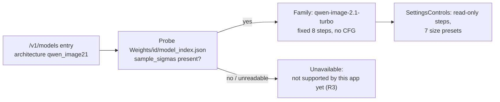

# Qwen-Image 2.1 Turbo Support - Plan

## Goal Capsule

**Objective:** A user can install Qwen-Image 2.1 Turbo from the Models browser, accept its license, select it, and generate an image, with controls that match what the model honors.

**Means:** Add one verified family record plus a signed catalog entry, and teach the family model that Turbo's step count is fixed by the checkpoint (KTD1, KTD2).

**Authority:** `docs/HLD.md` decisions outrank this plan. The pinned engine (v26.10.2) is stock and unchanged. Where the plan and the engine disagree, the engine source at the pinned tag wins.

**Stop conditions:** Stop and ask if the work seems to need an engine patch or bump, a content filter, or a non-`.safetensors` weight. Stop if the real-engine smoke run shows Turbo honors a control this plan hides.

## Product Contract

### Summary

mlx-create gains Qwen-Image 2.1 Turbo, an 8-step distilled text-to-image model that the pinned engine already runs. The 4-bit pack (`ddalcu/Qwen-Image-2.1-Turbo-MLX-Serve-4bit`, 10.5 GB on disk, multi-file with subfolders) is offered in the Models browser.

### Problem Frame

Upstream mlx-serve's own app offers this model. mlx-create does not, because `families.json` has no record for the `qwen_image21` architecture, so an installed Qwen pack shows as "not supported by this app yet" (D21). Turbo and plain Qwen-Image 2.1 report the same engine architecture, so a record keyed on architecture alone would mislabel plain Qwen as Turbo.

### Requirements

**Model support**
- R1. The Models browser lists Qwen-Image 2.1 Turbo 4-bit as an installable model from the signed catalog, pinned to a commit with per-file SHA-256 (D27).
- R2. An installed Turbo pack is selectable and generates through the existing t2i path with no engine change.
- R3. A pack with the `qwen_image21` architecture and no `sample_sigmas` grid (plain Qwen-Image 2.1) stays unavailable with the existing "not supported by this app yet" reason.

**Controls**
- R4. The settings popover shows steps as read-only "8 steps, set by the model" for Turbo. No step count is sent, and no steps value is stored as requested.
- R5. CFG and negative prompt are hidden for Turbo.
- R6. The size menu offers 1024×1024, 768×768, 512×512, 832×1248, 1248×832, 1344×768 and 768×1344, snapped to a multiple of 16 in [256, 2048].

**License and fit**
- R7. The install flow shows the Qwen Research License, states that commercial use is not allowed, and requires acceptance before download (D20, D26).
- R8. The catalog `ram_gb` is the pinned engine's staged-plan preflight need, computed from the pack's file sizes (`rest + max(text_encoder, 4 GiB)`, `qwenImagePeakBytesForStaging` in `src/gen.zig` at v26.10.2), so it is right for the 16 GB Macs the pack targets. It is not upstream's estimate and not a peak measured on a larger Mac.

### Scope Boundaries

- Plain Qwen-Image 2.1, the 8-bit pack, transparent PNG, img2img, editing, LoRAs and image previews are out of scope.
- No engine change or bump, no per-screen hard-coded knobs (UI stays driven by family records, HLD §8.3).

#### Deferred to Follow-Up Work

- Plain Qwen-Image 2.1 family (guidance, negative prompt, 40-step default).
- Qwen-Image 2.1 Turbo 8-bit pack (about 18 GB, same recipe).

### Key Decisions

- **Ship Turbo with its license shown, not hidden.** The license is research and evaluation only. The license sheet says so plainly, and a legal read is a release prerequisite beside the Krea one. Governs R7. (session-settled: user-approved, chosen over holding the entry out of the bundle: the sheet makes the restriction visible before download.)
- **4-bit only.** It is the pack that fits a 16 GB Mac. Governs R1, R8. (session-settled: user-approved, chosen over also shipping 8-bit: the 8-bit pack follows later.)

### Dependencies

- Hugging Face repo `ddalcu/Qwen-Image-2.1-Turbo-MLX-Serve-4bit` (non-gated, reachable at plan time).
- The dev catalog signing key at `~/.config/mlx-create/dev-catalog.key` to re-sign the bundled catalog. The production key and catalog URL remain release prerequisites.

## Planning Contract

### Key Technical Decisions

- KTD1. Turbo is told apart from plain Qwen by the pack's own `sample_sigmas` list in `model_index.json`, read from `Weights/<engine model id>/`. The engine's `/v1/models` meta carries no such signal: both packs report `qwen_image21` (`Tests/MCEngineTests/Fixtures/Client/models-qwen-image21.json`). The engine uses the same key to decide the step count (`parseSampleSigmas`, `resolveSteps` in `src/qwen_image.zig` at v26.10.2). `WeightFilePolicy` already allows `.json`, so the file is in the installed pack. (session-settled: user-approved, chosen over keying on repo name or model id: names are not evidence and a renamed or hand-placed pack would break.)
- KTD2. `ModelFamily` keeps `steps` as a plain `StepsCapability` and gains `stepsAreFixed: Bool`, decoded with a `false` default so existing records are unchanged. The Turbo record sets `steps` to `{ defaultSteps: 8, min: 8, max: 8 }` and `stepsAreFixed: true`. A fixed family sends no `steps`, hides the stepper, shows the read-only line, and clears any carried value. D24 already records the engine's actual step total from the last progress event, so the saved metadata shows 8 regardless of what the request carried.
- KTD3. The Turbo family record has `guidance: null` and `supportsNegativePrompt: false`, mirroring upstream (`supportsGuidance` is true only for undistilled Qwen, `MediaGen.swift` at the pinned tag).
- KTD4. The family is appended last in `families.json`. `ModelSelection.defaultModelID` picks the first family in registry order, so the launch default does not change.
- KTD5. The registry matches on architecture plus optional checkpoint traits. A family may require a trait (here, a non-empty `sample_sigmas`). The probe reads one small JSON file per Qwen-architecture model during `InstalledModels.refresh`; other architectures are never probed.

### High-Level Technical Design

> Directional only; it shows data flow, not code.

### Risks & Dependencies

- **Model id equals the folder path under `Weights/`.** This is inferred from the install layout (`Weights/<org>/<repo>`) and the Krea fixture id. The smoke run (U6) confirms it. A mismatch leaves Turbo unavailable, which fails safe.
- **License.** Research-only terms are a commercial exposure for the product. R7 and the legal read cover it.
- **RAM.** Upstream estimates 13 GB. The engine loads Qwen's text encoder per request on small machines and keeps it resident on large ones, so a figure measured in the app on this 48 GB Mac overstates the 16 GB need (klein already measured 8.9 against a catalog 8.0). R8 therefore uses the computed staged-plan need, confirmed in U6 by a standalone engine run with `MLX_SERVE_QWEN_IMAGE_LOW_MEMORY=1`.
- **Catalog signing.** The bundled `catalog.json` must be rebuilt and re-signed, and its sequence rises by one. A stale signature fails `mc-catalog verify`.

## Implementation Units

### U1. Record the decision in the HLD

**Goal:** The HLD decision log owns the new family and the fixed-steps rule before any code changes (AGENTS: update the HLD first).

**Requirements:** R1, R3, R4, R7.

**Files:** `docs/HLD.md`, `docs/lld/models.md`.

**Approach:** Add a decision at the next unused D-number covering KTD1 and KTD2 and the research-only license. Update D5's family list wording, HLD §8.3's Steps row (a fixed form), §8.5's 16 GB row, and the family-detection note in the models LLD. Cite KTD numbers; do not copy this plan.

**Test expectation:** none -- documentation.

**Verification:** The new D-entry exists and the §8.3 Steps row names the fixed form.

### U2. Fixed-step capability and checkpoint-trait matching

**Goal:** The family model can express a fixed step count, and the registry can require a checkpoint trait.

**Requirements:** R3, R4, R6.

**Dependencies:** U1.

**Files:** `Sources/MCCatalog/ModelFamily.swift`, `Sources/MCCatalog/FamilyRegistry.swift`, `Sources/MCCatalog/Resources/families.json`, `Tests/MCCatalogTests/ModelFamilyRecordTests.swift`, `Tests/MCCatalogTests/FamilyRegistryTests.swift`.

**Approach:** Per KTD2 and KTD5. Existing records must keep decoding unchanged. Add the `qwen-image-2.1-turbo` record (KTD3, KTD4) with architecture `qwen_image21`, the R6 presets, default 1024×1024, grid multiple 16 in [256, 2048].

**Test scenarios:**
- Existing Krea and klein records decode and behave as before (adjustable steps, same ranges).
- Architecture `qwen_image21` with the trait resolves to the Turbo family.
- Architecture `qwen_image21` without the trait resolves to no family.
- A non-Qwen architecture never needs a trait to resolve.
- Every Turbo size preset lies on its grid, and `normalize` snaps 1000×1000 to 1008×1008 and clamps above 2048.

**Verification:** `swift test --filter MCCatalogTests` passes.

### U3. Probe the checkpoint at model refresh

**Goal:** `InstalledModels.refresh` classifies Qwen packs as Turbo or unsupported from the pack on disk.

**Requirements:** R2, R3.

**Dependencies:** U2.

**Files:** `Sources/MCGeneration/InstalledModel.swift`, `Sources/MCApp/AppModel.swift`, `Tests/MCGenerationTests/InstalledModelsTests.swift`.

**Approach:** `InstalledModels` takes the Weights root (the app already holds it in `AppModel`, `weightsPath`). For an entry whose architecture has a trait-requiring family, read `<root>/<entry.id>/model_index.json` and extract whether `sample_sigmas` is a non-empty array. Treat a missing, unreadable or malformed file as trait absent. Keep `InstalledModel.make` pure by passing the probe result in. Do not read the file for other architectures.

**Test scenarios:**
- Qwen entry plus a folder whose `model_index.json` has a non-empty `sample_sigmas` gives an available Turbo model.
- Same entry with no `sample_sigmas` key gives unavailable with the existing not-supported reason.
- Missing folder, missing file, and malformed JSON each give unavailable, never a crash.
- The existing plain-Qwen fixture test still passes unchanged.
- Krea and klein entries are not probed (no file access).

**Verification:** `swift test --filter MCGenerationTests` passes.

### U4. Fixed steps through composer, selection and settings

**Goal:** A fixed-step family never sends or stores a requested step count, and the popover shows the model-set line.

**Requirements:** R4, R5, R6.

**Dependencies:** U2.

**Files:** `Sources/MCGeneration/GenerationComposer.swift`, `Sources/MCApp/Model/ModelSelection.swift`, `Sources/MCApp/ViewState.swift`, `Sources/MCApp/SettingsPopover.swift`, `Tests/MCGenerationTests/ComposerTests.swift`, `Tests/MCAppTests/SettingsPopoverStateTests.swift`.

**Approach:** The composer drops `draft.steps` for a fixed family (KTD2). `ModelSelection.fit` clears steps for it. `SettingsControls`/`stepsSection` render "8 steps, set by the model" read-only. ⌘R reuse of an image from a fixed family yields a draft with no steps. Switching from an adjustable family clears a carried steps value.

**Test scenarios:**
- Enqueue a Turbo draft with `steps: 20`: the job request has `steps == nil`.
- `fit` on a carried `steps: 12` for Turbo returns nil; for Krea it still returns 12.
- Turbo controls expose no guidance and no negative prompt, and seven size presets.
- Switching from Krea (steps 6) to Turbo then back to Krea does not resurrect 6 on Turbo.
- ⌘R reuse of a Turbo image sends no steps.

**Verification:** `swift test --filter MCAppTests --filter MCGenerationTests` passes. The popover shows the read-only line (smoke, U6).

### U5. Catalog entry, license copy and re-signed bundle

**Goal:** The signed bundled catalog offers Turbo 4-bit with an accurate research-only license.

**Requirements:** R1, R7, R8.

**Dependencies:** U2.

**Files:** `catalog/models.src.json`, `Sources/MCCatalog/Resources/catalog.json`, `Tests/MCCatalogToolTests/CatalogToolTests.swift` (`BundledCatalogTests` pins the bundled model list at line 253; extend it to `["flux2-klein-4b-mflux-4bit", "krea-2-turbo-mixed-4-8", "qwen-image-2.1-turbo-4bit"]`).

**Approach:** Add an entry: id `qwen-image-2.1-turbo-4bit`, family `qwen-image-2.1-turbo`, repo `ddalcu/Qwen-Image-2.1-Turbo-MLX-Serve-4bit`, `ref: main`, `commercial_use: false`. Write the license `id`, `name`, `url`, `version` and `summary` from the pack's own `LICENSE` text at the pinned commit, not from memory; the summary states research and evaluation only, no commercial use. Set `ram_gb` to the computed staged-plan need (R8): `rest` is every cataloged file outside `text_encoder/` (about 4.87 GB: transformer shards, VAE, tokenizer and configs) and the text encoder is about 5.68 GB, which exceeds the 4 GiB transient, so the need is about 10.6 GB. Recompute it from the built entry's exact file sizes and use the same unit as the existing entries (check how Krea's 17.6 was derived). Run `mc-catalog build` then `sign` with the dev key, and review the diff lines before `--acknowledge-diff`. The builder drops `.DS_Store`, `.gitattributes`, `README.md` and `sample.jpg` by policy; confirm the dropped list is exactly those four. Confirm the catalog validates the nested `processor/`, `scheduler/`, `transformer/`, `text_encoder/` and `vae/` paths.

**Test scenarios:**
- `mc-catalog verify` accepts the re-signed bundle.
- The built entry lists `model_index.json`, both transformer shards, the text encoder and VAE, each with a 64-hex SHA-256 and non-zero size.
- No `.jpg`, `.md`, `.gitattributes` or `.DS_Store` path appears in the entry.
- The license sheet shows "This license does not allow commercial use." for this entry (existing `commercialUse: false` branch).

**Verification:** `swift run mc-catalog verify Sources/MCCatalog/Resources/catalog.json` passes, and `swift test --filter MCCatalogToolTests --filter MCCatalogTests` passes.

### U6. Real-engine smoke and RAM confirmation

**Goal:** Install, select and generate with the real pinned engine, and confirm the cataloged RAM figure matches what the engine reports.

**Requirements:** R2, R4, R5, R6, R8.

**Dependencies:** U3, U4, U5.

**Files:** `catalog/models.src.json`, `Sources/MCCatalog/Resources/catalog.json` (RAM figure and re-sign).

**Approach:** Ask the user immediately before the 10.5 GB download (AGENTS). Build and run the app (`xcodegen generate`, then the Debug `xcodebuild`). Install Turbo from the Models browser, accept the license, generate at 1024×1024 and one non-square size. Confirm the model id maps to `Weights/<id>` (the Risks entry), the popover shows the read-only steps line, the saved image's metadata records 8 steps (D24), and the library row exists. This in-app run is the functional smoke only; it is not the RAM source. For RAM, run the bundled engine standalone against the installed pack with `MLX_SERVE_QWEN_IMAGE_LOW_MEMORY=1` (same launch flags as the engine smoke in `docs/lld/engine.md` §5.9), record the preflight need it reports and its peak, and compare with the computed `ram_gb`. If they differ, set `ram_gb` to the engine-reported need, rebuild and re-sign. Quit normally and check `pgrep mlx-serve` shows no stray engine.

**Test expectation:** none -- throwaway smoke, no permanent test added.

**Verification:** An image is written with a PNG `parameters` line and an `mlx-create` chunk, the library row shows 8 steps, and the signed catalog's `ram_gb` matches the engine-reported staged need.

## Verification Contract

- Library tests: `swift test` (all targets green).
- Catalog: `swift run mc-catalog verify Sources/MCCatalog/Resources/catalog.json`.
- App build: `xcodegen generate`, then `xcodebuild -project MLXCreate.xcodeproj -scheme MLXCreate -configuration Debug -derivedDataPath build build`.
- Real engine: the U6 smoke with the downloaded pack. Tests alone do not close this plan.

## Definition of Done

- R1-R8 hold and are observed: R1, R7 and R8 in the catalog and license sheet, R2 and R4-R6 in the smoke run, R3 in a unit test.
- `swift test`, `mc-catalog verify` and the Debug build pass.
- The HLD decision log and models LLD name the new family, the fixed-step rule and the license.
- The Krea-style release prerequisites list adds a legal read of the Qwen Research License, in the same place the Krea one is recorded.
- No scaffolding, throwaway scripts or stray downloads are left behind. The 10.5 GB pack stays in app support only if the user keeps it.

## Sources

- Upstream presets and capability flags: `app/Sources/MLXServe/Services/MediaGen.swift` at v26.10.2 (`qwenImage21Turbo_4bit`, `stepsAreFixed`, `supportsGuidance`, `qwenImageResolutions`).
- Engine step resolution: `src/qwen_image.zig` (`resolveSteps`, `parseSampleSigmas`) at v26.10.2.
- Pack contents and `sample_sigmas`: Hugging Face `ddalcu/Qwen-Image-2.1-Turbo-MLX-Serve-4bit` (`model_index.json`, tree listing).
- Governing decisions: D5, D20, D21, D24, D25, D26, D27 in `docs/HLD.md`.
