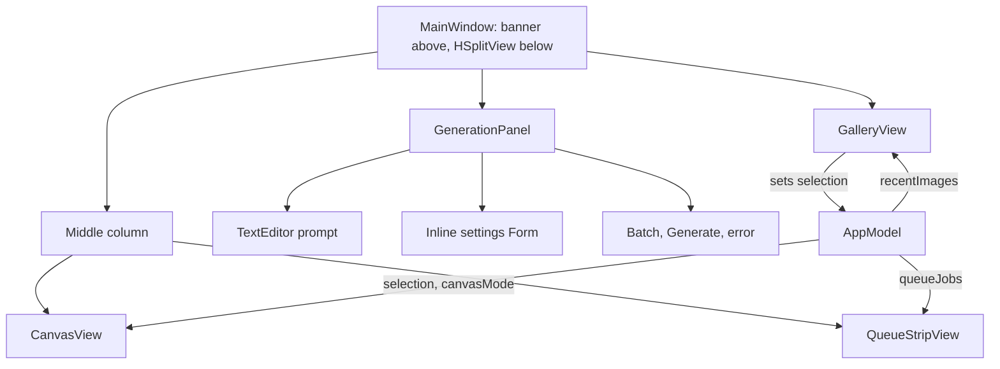

# Three-Panel Main Layout - Plan

## Goal Capsule

- **Objective:** A user can write a prompt, adjust every generation setting, watch the result and the queue, and browse past images without opening a popover or leaving the window's single view.
- **Means:** Three side-by-side panels replace the stacked canvas, filmstrip and prompt bar (KTD1).
- **Authority:** `docs/HLD.md` is the source of truth. Product Contract requirements win on behavior, KTDs win on mechanism.
- **Stop conditions:** Stop and ask if the HLD update in U1 reveals a conflict with another `D*` decision beyond D18, or if SwiftUI split panes cannot hold the minimum widths in R1 without clipping controls.
- **Execution profile:** UI change plus a small model refactor. Prove it by running the built app, not by view tests.

## Product Contract

### Summary

The main window becomes three vertical panels. The left panel holds a multi-line prompt and the generation settings, always visible. The middle panel shows the main image above the queue. The right panel is the gallery of finished images, as a scrolling grid.

### Problem Frame

Today the prompt bar sits under a horizontal filmstrip that mixes finished images with queue placeholders, and the settings live in a ⚙ popover. Writing a long prompt in a one-to-four-line field is cramped, the settings are hidden until opened, and finished images compete with queued jobs for the same strip.

### Requirements

**Layout**

- R1. The main window shows three panels side by side, left to right: generation, canvas and queue, gallery. Dividers between them are draggable, and each panel keeps a minimum width at which its controls are not clipped.
- R2. The window's minimum size grows as needed to satisfy R1. The engine banner and toolbar (project name, model chip) stay where they are.

**Left panel: generation**

- R3. The prompt is a multi-line text area that takes the available height above the settings.
- R4. The settings are shown inline in the panel, with no popover or toggle: seed policy with its field, size, steps, CFG scale and negative prompt. Each appears only where the selected family allows it, as today.
- R5. The ×N batch stepper, the Generate button (⌘↩) and the error line sit at the bottom of the panel.
- R6. When the panel is shorter than its content, it scrolls rather than clipping a control.
- R7. When no model can run, the settings area shows the existing "Choose an available model to see its settings." message.

**Middle panel: canvas and queue**

- R8. The selected image, the running step bar and the existing canvas states (no models, only unavailable models, empty hint) fill the top of the panel.
- R9. Below the canvas, a horizontal queue strip shows the queue header (Running, Pausing, Paused, Queue empty with Pause and Resume) and one cell per job. It shows jobs only.
- R10. The queue strip is hidden while the canvas shows the empty hint, as the filmstrip is today.

**Right panel: gallery**

- R11. The gallery shows all of the project's finished images, newest first, as a vertically scrolling grid of thumbnails. Images load in pages as the user scrolls, so no image is unreachable.
- R12. Clicking a thumbnail selects the image and shows it in the canvas. The selected thumbnail is marked.
- R13. With no images the gallery shows a short placeholder instead of an empty panel.

**Preserved behavior**

- R14. Keyboard shortcuts (⌘↩ generate, ⌘. cancel, ⌘R reuse settings, ⌥↑ and ⌥↓ to move a selected queued job), the queue context menu and VoiceOver actions, and every existing accessibility label and state string work as before.
- R15. ⌘R reuse updates the prompt and the visible settings in the left panel.

### Acceptance Examples

- AE1. **Covers R4, R7.** Given Qwen-Image 2.1 Turbo is selected, the left panel shows "8 steps, set by the model", no CFG scale and no negative prompt. Given FLUX.2 klein or Krea 2 Turbo is selected, an adjustable steps control appears. The CFG scale and negative prompt rows appear only for a family that declares them; no bundled family does, so the existing guided-family test in `AppModelTests` proves that half and the smoke run does not.
- AE2. **Covers R9, R11.** Given one job is running and two are queued, the queue strip shows three cells and the gallery shows none of them. When the running job saves an image, the gallery shows it and the job cell reads "1 of N saved".
- AE3. **Covers R12.** Given the gallery holds three images, clicking the second shows it in the canvas and marks its thumbnail selected.

### Key Decisions

- **Gallery shows finished images only; queue placeholders live under the canvas.** (session-settled: user-directed — chosen over a single-column list and over showing in-progress jobs in the gallery too: the user wanted a plain image grid and the queue beside the canvas.) Governs R9, R11.
- **The layout is the three panels the user specified, replacing the canvas-first stack.** (session-settled: user-directed — the request.) Governs R1, R3, R8, R11. This supersedes the layout half of HLD D18 (KTD5).

### Scope Boundaries

- No change to generation, the queue, the library, the engine or the catalog.
- The searchable full-window Gallery mode and the ⌘1/⌘2 mode switch in HLD §10 are not built here. Whether they still ship is an open question below.
- Not built: collapsible panels, remembered panel widths, gallery search, multi-select, context menus on gallery images, LoRA row, Enhance. None was asked for.

### Open Questions

- Deferred: does a separate full-window Gallery mode with search still ship in a later phase, or does the right panel grow to host search? Answered when that phase is planned.
- Deferred: the minimum window height at which settings need no scrolling. Settled in the smoke run by looking at the panel (R6 guarantees nothing is clipped either way).

## Planning Contract

### Key Technical Decisions

- KTD1. **`HSplitView` holds the three panels.** It gives native draggable dividers with per-pane minimum and ideal widths. `NavigationSplitView` is rejected: its sidebar semantics add collapse behavior nobody asked for. A plain `HStack` is rejected: it has no draggable dividers (R1).
- KTD2. **`AppModel` stops building one mixed list.** `filmstrip: [FilmstripItem]` becomes `queueJobs: [JobItem]`, and the already-stored `recentImages` becomes the gallery's source. The two panels read disjoint data, so a merged array would be filtered on every render. `FilmstripItem` is deleted and its two test helpers migrate. Serves R9, R11.
- KTD3. **The prompt is a `TextEditor` with a placeholder overlay**, replacing `TextField(axis: .vertical)`, which caps at a line limit. The text field's line limit is what makes the prompt cramped today (R3). The Generate button keeps `⌘↩` as its shortcut. Whether `TextEditor` focus lets ⌘↩ through is unverified and is the first thing the smoke run checks.
- KTD4. **Settings become an inline `Form` reusing the existing section builders** (seed, size, steps, guidance, negative prompt) and `SettingsControls` unchanged, with the builders moving into `GenerationPanel.swift` and losing `private`. Only the popover shell and its fixed 360 pt width go away. The settings report their content height (the grouped `Form` does not scroll by itself and is sized to its content) and the prompt editor takes the remaining height down to a stated minimum; below that minimum the whole panel scrolls (R3, R6). The panel's minimum width fits the widest row, the guidance row's fixed 160 pt slider, value and Use Default link (R1). Capability gating stays in `AppModel.controls` (R4, AE1).
- KTD5. **The HLD changes before the code.** AGENTS.md forbids code diverging from a `D*` entry. D18 says "canvas-first main window; the gallery is a separate mode", which this request supersedes, so U1 records a new decision D33 that supersedes D18's layout half. (session-settled: user-directed — the user asked for the layout.)

### High-Level Technical Design

## Implementation Units

### U1. Update the HLD

- **Goal:** The HLD describes the three-panel layout before any code changes.
- **Requirements:** R1, R9, R11; KTD5.
- **Dependencies:** none.
- **Files:** `docs/HLD.md`.
- **Approach:**
  1. Add D33 to the decision log: three-panel main window, gallery panel always visible, supersedes D18's layout half.
  2. Mark D18's layout half as superseded by D33; leave its history readable.
  3. Redraw the §10 layout and rewrite the Canvas mode bullets (queue under the canvas, gallery panel, settings inline). Keep Gallery mode and the ⌘1/⌘2 line but note they are an open question. Rewrite goal G1's "canvas-first generation UI" to describe the three panels.
  4. Update the component diagram nodes ("Canvas + filmstrip", "Prompt bar + settings popover") and the prose mentions of the prompt bar and filmstrip in §8.2 and the generation sequence. In §8.3 replace the negative prompt's "collapsed by default" note with R4's always-visible rule.
- **Test expectation:** none -- documentation only.
- **Verification:** `grep` for "filmstrip", "settings popover" and "canvas-first" in `docs/HLD.md` returns only intentional historical mentions.

### U2. Split the model's mixed list

- **Goal:** The model exposes the queue and the gallery as separate collections.
- **Requirements:** R9, R11, R13; KTD2.
- **Dependencies:** U1.
- **Files:** `Sources/MCApp/AppModel.swift`, `Sources/MCApp/ViewState.swift`, `Sources/MCApp/Model/QueuePresentation.swift`, `Tests/MCAppTests/AppModelTests.swift`, `Tests/MCAppTests/Support/AppHarness.swift`.
- **Approach:**
  1. Replace `filmstrip` with `queueJobs`, built in `reload()` in the current order: running, queued in order, then paused, failed, cancelled.
  2. Replace the capped `recentImages` load (fixed limit of 200) with paged loading: `reload()` fetches the first page, and a `loadMoreImages()` call fetches the next page when the grid scrolls near its end. Expose the loaded images read-only as the gallery source. `canvasMode` and `selectedImage` keep their meaning; `canvasMode` tests emptiness from the two collections. A saved image is added to the front of the loaded set without a reload.
  3. Simplify `jobItems`, `updateStep` and the cancel path to read `queueJobs` directly.
  4. Delete `FilmstripItem`; reword the `filmstrip` doc comments, including the one in `Tests/MCAppTests/Support/AppHarness.swift`.
  5. Migrate the `jobItem` and `imageCount` helpers in `AppModelTests.swift`.
- **Patterns to follow:** existing `@Observable` properties with `public private(set)` in `AppModel`.
- **Test scenarios:**
  - A running job and two queued jobs appear in `queueJobs` in that order and no image appears there.
  - After a job saves two images, the loaded gallery images hold both newest first and the job's `savedCount` is 2.
  - With more images in the store than one page, only the first page is loaded; `loadMoreImages()` appends the next page in order, and a second call past the end changes nothing.
  - `canvasMode` is `.emptyHint` with a model available, no jobs and no images; a queued job alone makes it `.content`; a saved image alone makes it `.content`.
  - A progress event updates only the matching job's step and total.
- **Verification:** `swift test` passes with the migrated helpers and no reference to `FilmstripItem` remains.

### U3. Build the three panels

- **Goal:** The app shows the layout in R1 to R15.
- **Requirements:** R1–R15; KTD1, KTD3, KTD4.
- **Dependencies:** U2.
- **Files:** `Sources/MCApp/MainWindow.swift`, `Sources/MCApp/GenerationPanel.swift` (new), `Sources/MCApp/QueueStripView.swift` (new), `Sources/MCApp/GalleryView.swift` (new), `Sources/MCApp/CanvasView.swift`, delete `Sources/MCApp/PromptBar.swift`, `Sources/MCApp/SettingsPopover.swift`, `Sources/MCApp/FilmstripView.swift`, rename `Tests/MCAppTests/SettingsPopoverStateTests.swift` to `SettingsControlsStateTests.swift` with its suite.
- **Approach:**
  1. `GenerationPanel`: prompt `TextEditor` on top with a placeholder, the inline settings form below at its content height, and a pinned bottom row with the batch stepper, Generate and the error line. The form shows R7's message when `model.controls` is nil. The section builders from `SettingsPopover.swift` move here.
  2. `QueueStripView`: the current `QueueHeaderView` and `JobCell` moved over from `FilmstripView.swift` and made non-private, reading `queueJobs`, with its context menu, key handling and accessibility actions intact (R14).
  3. `GalleryView`: an adaptive `LazyVGrid` of the current `ImageCell`, moved here and made non-private, reading `recentImages`, with a placeholder when empty.
  4. `MainWindow`: engine banner, then `HSplitView` of the generation panel, a middle `VStack` of `CanvasView` and the queue strip (hidden for `.emptyHint`), and the gallery. Set per-pane minimum and ideal widths, give the middle column `layoutPriority(1)` so resizing the window grows the canvas, and raise the window minimum width to fit; keep the toolbar and `ShortcutButtons`, and update the latter's comment to name the new Generate button's home.
  5. `CanvasView`: change "Select an image in the filmstrip" to name the gallery.
- **Patterns to follow:** `ImageCell`, `JobCell` and `QueueHeaderView` in the current `FilmstripView.swift`; section builders in `SettingsPopover.swift`; `.formStyle(.grouped)`.
- **Execution note:** Smoke-first. Build the panels, run the app, and check the ⌘↩ focus risk from KTD3 before polishing.
- **Test expectation:** none -- SwiftUI view composition; the behavior it displays is covered by U2 and the existing `SettingsControlsStateTests`.
- **Verification:** The Verification Contract's smoke run shows every requirement.

## Verification Contract

| Check | Command or action | Proves |
|---|---|---|
| Library tests | `swift test` | U2 model behavior; existing capability, queue and reuse tests |
| App builds | `xcodegen generate`, then `xcodebuild -project MLXCreate.xcodeproj -scheme MLXCreate -configuration Debug -derivedDataPath build build` | U3 compiles with deleted files |
| Smoke run | Launch the built app with an installed model (the 10.5 GB Turbo pack is already local, so no download), queue a batch of 2 and a third job, and capture screenshots | R1–R15 |

The smoke run captures: the empty hint with the left and right panels visible; the default window size with the prompt taking the space above the settings; a running job with queued jobs under the canvas and a growing gallery; a gallery thumbnail selected into the canvas; ⌘↩ fired from inside the prompt editor; ⌘R after selecting an image, with the left panel updated; the app at its minimum window size and again widened; and the settings for Qwen Turbo (fixed steps) and FLUX.2 klein or Krea 2 Turbo (adjustable steps). Check free memory before the run: the Turbo pack needs about 14.3 GB free, so a failure to load there is a memory problem, not a layout one. Before any scripted click or keystroke, confirm the app is the frontmost window, because input goes to whatever has focus and a past run sent input to a browser.

## Definition of Done

- R1–R15 hold in the smoke run, and AE1's fixed-steps and adjustable-steps cases and AE2–AE3 are observed.
- `swift test` and the Debug build pass.
- `docs/HLD.md` carries D33 and the revised §10, and no code contradicts a `D*` entry.
- `PromptBar.swift`, `SettingsPopover.swift`, `FilmstripView.swift` and `FilmstripItem` are gone, with no leftover references or comments.
- Any scaffolding or throwaway scripts from the smoke run are removed, and `pgrep mlx-serve` shows no orphan engine after quitting the app.
