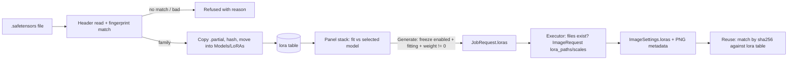

# LoRA Support and Management - Plan

## Goal Capsule

- **Objective:** A user can bring LoRA files from their own disk into mlx-create, trust that each one fits the model it is used with, and apply a stack of them to text-to-image generations, with every image recording what was used.
- **Product authority:** The Product Contract below, plus `docs/HLD.md` decisions D5, D8, D12, D17, D20 and sections 8.3, 8.6, 8.9 and 9. Local files only; Civitai/CivArchive is not active scope.
- **Stop conditions:** Stop and ask if the work needs to break an HLD `D*` decision beyond the D34 amendment in U1, if the engine rejects a LoRA the fingerprints accepted, or if no real sample LoRA can be obtained for any shipped family (U2 cannot prove its fingerprint without one).
- **Execution profile:** `ce-work`, one branch, units in order. U2 starts with a prerequisite: real sample LoRA files.

## Product Contract

### Summary

A local LoRA library: the user imports `.safetensors` files by picker or drag-and-drop, and each is copied in and checked against the models the app ships. The generation panel gets a compact LoRA stack of one-line rows that expand for weight and trigger words, and a separate LoRA library sheet is both the manager and the place to add LoRAs to the stack. Finished images record the LoRAs they used, so "Reuse all settings" brings the stack back.

### Problem Frame

The app can generate images but cannot apply a LoRA, which is how most people get a specific style or character out of a local image model. Users who already hold LoRA files have no way to use them. Without a fit check, they would also learn a file is wrong only from an engine error after a long queue wait.

### Key Decisions

- **Stack UI is a compact stack in the panel plus a LoRA library sheet that also picks.** (session-settled: user-directed — chosen over a full-card stack with a Models-sheet tab, and over an inline list where a toggle means "in stack": the user picked the compact stack and dedicated sheet from a visual sketch.) Governs R5, R9, R10.
- **An incompatible LoRA stays in the stack, greyed and skipped.** (session-settled: user-directed — chosen over auto-removing it or blocking Generate: nothing is lost on a model round trip.) Governs R12.
- **Import is one step and asks only when something needs a decision.** (session-settled: user-directed — chosen over a review sheet per file and over fully silent import.) Governs R1, R4.
- **A file that matches no shipped model is refused.** (session-settled: user-directed — chosen over importing it as "unverified" and letting the engine decide: keeps the library clean, at the cost that a fingerprint gap blocks a possibly valid LoRA.) Governs R3.
- **Reuse drops LoRAs no longer in the library, with a notice.** (session-settled: user-directed — chosen over showing them as missing rows or refusing the reuse.) Governs R16.
- **Trigger words are click-to-insert chips with a nudge, never auto-appended.** (session-settled: user-directed — chosen over auto-append and display-only: the prompt is never changed behind the user's back.) Governs R11.
- **Fit is per model, not just per family.** A LoRA for a larger variant imports but is greyed while a smaller variant is selected. Governs R2, R12. Planning narrows this: see KTD4.
- **Delete is refused while any job that can still run holds the LoRA.** (session-settled: user-approved — queued, running, paused and retryable-failed jobs all hold a stack, over refusing only queued and running, which would make Retry fail on a missing file.) Governs R8.
- **Greyed rows stay editable, weight 0 is dropped at queue time, the advanced weight range is per row, and there is no "replace" on import.** (session-settled: user-approved — chosen over frozen greyed rows, a global advanced toggle, and replace-in-place, which would collide with the delete guard.) Governs R4, R10, R12.

### Requirements

**Import**

- R1. The user can import one or many `.safetensors` files by file picker or drag-and-drop; each is copied into the app's library and never used in place.
- R2. Each import is checked against the models the app ships and recorded with the model it fits and a name defaulting to the filename. A LoRA may be imported before its model is installed.
- R3. A file that is not `.safetensors`, is unreadable or truncated, or matches no shipped model is not added and is reported with a plain reason that names the supported models.
- R4. Import is silent except when the file's content already exists in the library or its name clashes. A duplicate is reported and skipped, leaving the existing LoRA as it is; a name clash is auto-suffixed and offered for rename. A multi-file import shows per-file progress with a Cancel, and ends with one summary of what was added and refused.

**Library management**

- R5. The LoRA library sheet is opened from the LoRA section of the generation panel and lists every installed LoRA with its model fit and size, searchable, filtered by default to LoRAs compatible with the selected model. An empty library shows one line and an Import button; a filter that hides everything names the selected model and offers Show all.
- R6. In the library sheet the user can rename a LoRA, edit its trigger words and notes, reveal its file in Finder, and see total disk used by LoRAs.
- R7. The user can delete a LoRA; the confirmation states how many images were made with it and that its rows leave the panel stack. The draft stack is not a job, so it never blocks a delete.
- R8. Deleting a LoRA that a queued, running, paused or retryable-failed job uses is refused with a message saying so.

**Generation panel stack**

- R9. The panel shows the LoRA section whenever the stack has rows or the library has entries. The add control appears only when the selected model accepts LoRAs; for a model that takes none, every row is greyed with "this model takes no LoRAs". Each row is one line (enable toggle, name, weight) and expands to a weight slider and trigger-word chips. Each row is one accessibility element labelled with name, state, weight and any greyed reason, and its toggle, slider and chips are keyboard reachable.
- R10. The user adds LoRAs to the stack from the library sheet, up to 8, one row per LoRA; a new LoRA starts enabled at weight 1.0. Weight ranges from −2 to 2; a per-row switch widens that row's slider to the engine's −20 to 20, and typed values clamp to the active range. A row at weight 0 shows "not used" and is left out of the job.
- R11. Clicking a trigger-word chip appends the word to the end of the prompt after a comma and space, and does nothing if the word is already there. A row of an enabled LoRA that has trigger words shows a hint when none of them is in the prompt. The prompt is never edited automatically.
- R12. When the selected model changes, LoRAs that do not fit it stay in the stack greyed with the reason (for example "doesn't fit Krea-2" or "needs FLUX.2 klein installed") and are skipped on generate; switching back re-enables them with weight and order intact. Greyed rows stay editable, including their enable toggle; when every row is greyed the section says none will be used.
- R13. On Macs in the lowest memory tier, a stack of more than 4 enabled LoRAs shows a soft hint about memory; it does not limit the stack.

**Generation and record**

- R14. Each job applies exactly the enabled, compatible LoRAs with their weights, as the stack stood when the job was queued; later edits, renames or deletes of the stack do not change queued jobs.
- R15. Each finished image records the LoRAs it used (name, content hash, weight) in its settings and its PNG metadata, including the A1111 `Lora hashes` convention from `docs/HLD.md` section 8.9.
- R16. "Reuse all settings" restores the stack from the image, matching LoRAs by content hash so a renamed one still restores; LoRAs no longer in the library are omitted and a one-line notice names them. "Reuse prompt" is unchanged.
- R17. If a LoRA file is missing at run time, or the engine rejects a LoRA, the user sees a plain-language message naming the LoRA and the model, not the raw engine error. A missing file is retryable; an engine rejection is not, and its message tells the user to remove or replace the LoRA. The message appears on the failed job's tile next to its action.

### Key Flows

- F1. Import and first use
  - **Trigger:** The user drops two `.safetensors` files onto the library sheet.
  - **Steps:** Each is checked and added; a summary shows one added and one refused with a reason; the user adds the new LoRA to the stack, clicks a trigger chip, and generates.
  - **Outcome:** The image is made with the LoRA, and its metadata lists it.
  - **Covered by:** R1-R4, R9-R11, R14, R15

- F2. Model switch round trip
  - **Trigger:** The user switches the model chip with LoRAs in the stack.
  - **Steps:** Non-fitting LoRAs grey out with a reason and are skipped; the user switches back.
  - **Outcome:** They are enabled again with their weights.
  - **Covered by:** R12, R14

### Acceptance Examples

- AE1. **Covers R12, R14.** Given a stack of Watercolor Wash (0.8) and Ink Sketch (1.0), both for FLUX.2 klein, when the user selects Krea-2 and generates, then the job carries no LoRAs, both rows show "doesn't fit Krea-2", and after switching back both rows are enabled at 0.8 and 1.0.
- AE2. **Covers R16.** Given an image made with a LoRA that has since been deleted, when the user chooses Reuse all settings, then the model, prompt and other settings are restored, the stack omits that LoRA, and a notice names it.
- AE3. **Covers R8.** Given a queued job that uses Ink Sketch, when the user deletes Ink Sketch, then it is not deleted and the message says a job uses it; the same holds for a paused job and for a failed job that can be retried.
- AE4. **Covers R3.** Given a valid SDXL LoRA, when the user imports it, then nothing is added and the message says it matches none of the supported models and names them.
- AE5. **Covers R4.** Given a file identical in content to an installed LoRA, when the user imports it, then it is reported as already installed, nothing is added, and the existing LoRA is unchanged.
- AE6. **Covers R11.** Given an enabled LoRA with trigger word `wtrclr` and a prompt without it, when the row is visible, then it shows a hint, and clicking the `wtrclr` chip inserts the word into the prompt.
- AE7. **Covers R14, R15.** Given a LoRA queued in a job and renamed before the job runs, when the job finishes, then the image records the name the LoRA had when queued.
- AE8. **Covers R16.** Given an image made with a LoRA that was later renamed, when the user chooses Reuse all settings, then the stack restores it under its current name.

### Scope Boundaries

**Deferred for later**

- Civitai and CivArchive: browsing, download, previews, license acceptance, NSFW opt-in, and the Keychain-stored API key.
- Drop-a-PNG-to-restore: the app does not read PNG metadata anywhere today, so this is its own piece of work. R15 only ensures LoRA data is recorded so it can be restored later.
- Per-project default LoRAs: a project currently holds only a name, a cover and an unused default model.
- Prompt Enhance using trigger words and example prompts.
- Importing LoRAs that match no shipped model, and fine-tune or checkpoint import.
- Replacing a LoRA in place, and telling FLUX.2 klein 4B from 9B LoRAs (KTD4).

**Not part of this plan**

- Any content filtering of LoRAs or their output (`docs/HLD.md` D3).
- Reading LoRAs in place from other tools' folders (D17).

### Dependencies / Assumptions

- The pinned engine (v26.10.2) accepts `lora_paths` and `lora_scales` from loopback, up to 8, with scales from −20 to 20, and reads kohya, diffusers, PEFT and BFL fused-QKV key layouts (`AGENTS.md`; `docs/HLD.md` section 7.1).
- Building and proving the fit check needs a real LoRA file for each family it covers. A search of this machine found none, so they must be supplied or obtained.
- Fit labels use the shipped families: `krea-2-turbo`, `flux2-klein`, `qwen-image-2.1-turbo`. Only the FLUX.2 klein 4B checkpoint is in the catalog.
- The app has no guard today against changing a model while a job uses it, no safetensors header reader, no file picker or drop target, and no LoRA error mapping; all are new.
- The Models root (`AppModel.swift:151`) is separate from the Library root that `LibraryStore` and `LibraryPaths` use today, and `JobExecutor` has no Models root; U3 and U4 wire it in.
- Whether the engine accepts absolute `lora_paths` outside its `--model-dir` Weights folder is not shown in this repo; U8 verifies it, and KTD2's layout changes if it does not.

### How This Work Fits Together

<!-- ce-section: work-relationships -->

This plan covers using, importing and managing LoRA files that are already on the user's disk. The wider breakdown below is the current understanding, not a committed roadmap.

- Civitai/CivArchive browse and download
  - Depends on this plan's library, fit check and file layout.
  - Can proceed independently of the generation panel stack.
  - Still to decide: CivArchive's API contract (`docs/HLD.md` section 15) and where the Civitai key lives.
- Drop-a-PNG-to-restore
  - Depends on R15 for LoRA data in metadata.
  - Shares the reuse behavior in R16.
- Per-project default LoRAs and Enhance integration
  - Depend on this plan's stack and trigger words.
  - Still to decide: whether projects carry settings at all.

## Planning Contract

### Key Technical Decisions

- KTD1. **LoRAs live in their own `lora` table (migration `v4-lora`), not in `installed_model`.** The shipped `installed_model` is checkpoint-shaped: it requires repo, revision, catalog sequence and a license. HLD section 9 draws one table with a `kind`, so U1 amends the HLD (D34) before code. Rows hold id, name, family, sha256, relative path, size, trigger words, notes, created time; `sha256` is unique. Governs R2, R4, R6.
- KTD2. **Files are content-addressed under `Models/LoRAs/<family>/<sha10>-<slug>.safetensors`**, the layout HLD section 9 already names, with no JSON sidecar; the database is the record. Import copies to a `.partial` file, verifies the hash, then moves into place, mirroring `LibraryStore.saveImage`. Jobs and metadata store the path relative to the Models root so the relocatable root (D17) keeps working. `LibraryStore.init` and `JobExecutor.init` each take the Models root (from `AppModel.init`), and `LibraryPaths` gains a LoRA path helper resolving against it. Governs R1, R14.
- KTD3. **The stack is frozen onto `JobRequest` at enqueue as an optional `loras` list** (library id, name, sha256, weight, relative path). The old-row decode path falls back silently to `JobRequest.unreadable`, so the field is optional and a decode test over a pre-LoRA fixture lands in U1. `ImageSettings` gets an optional `loras` list (name, sha256, weight), copied from the job in `Executor.generateNext`. `MetadataCodec.schemaVersion` stays 1. Governs R14, R15.
- KTD4. **Fit is decided by tensor-key and shape fingerprints stored per family in `families.json`; a family accepts LoRAs only when it has a fingerprint.** FLUX.2 klein LoRAs are labelled "FLUX.2 klein" with no 4B or 9B claim, because the architecture strings cannot separate the variants and no 9B sample exists. A family without a proven fingerprint (needs a real sample, U2) offers no add control (R9), and files for it are refused with the R3 message. This narrows the per-model fit decision to per-family for now. Governs R2, R3, R9, R12.
- KTD5. **The safetensors reader reads only the header.** It checks the 8-byte length against the file size, parses the JSON header, bounds every `data_offsets` entry inside the file, and returns a typed reason on failure for the R3 message. It never loads tensor data. Governs R3.
- KTD6. **Delete refusal and enqueue share one write transaction.** The guard decodes `job.request` and `job.failure` for jobs in queued, running, paused or failed status and filters by LoRA id in Swift inside the write closure, with no new index; `enqueueJob` takes the frozen `loras` list and checks each row and its file in its existing `dbQueue.write` closure, so a delete cannot slip between them. Governs R8, R14.
- KTD7. **Duplicates resolve on the unique `sha256` index.** Two concurrent imports of one file cannot both commit; the loser is reported as already installed, exactly like a duplicate. Governs R4.
- KTD8. **A missing LoRA file fails the job before the engine call** through a new `ExecutorError` case, retryable, naming the LoRA. An engine "no modules matching" 400 maps through a new `EngineError` arm to the R17 message and is not retryable (`FailureMapping` treats `badRequest` as non-retryable); the message text is verified against a real engine rejection in U8 before it is relied on. Governs R17.
- KTD9. **Reuse and `Lora hashes` use the first 10 hex characters of the SHA-256** (A1111 AutoV2, `docs/HLD.md` section 8.9); reuse matches the full hash, never the name. Governs R15, R16.
- KTD10. **No LoRA fields are sent when the effective stack is empty.** `lora_paths` and `lora_scales` are omitted, not sent as empty arrays; U8 confirms the engine accepts their absence. Governs R14.

### High-Level Technical Design

*Directional guidance, not implementation specification.*

### Output Structure

    Sources/MCLibrary/LoRALibrary.swift          # lora table store + import + delete guard
    Sources/MCLibrary/SafetensorsHeader.swift    # header reader + fingerprint types
    Sources/MCApp/LoRAStackModel.swift           # stack state, fit, freeze
    Sources/MCApp/LoRASection.swift              # panel section
    Sources/MCApp/LoRALibraryView.swift          # library sheet + import summary

Paths are directional; the implementer follows the module split in `docs/HLD.md` section 6 and places types where the existing seams already sit.

## Implementation Units

### U1. Record types, HLD amendment, decode compatibility

- **Goal:** The data shapes exist and old data still decodes.
- **Requirements:** R14, R15; KTD1, KTD3.
- **Files:** `docs/HLD.md` (decision log D34, section 9), `Sources/MCLibrary/Models.swift`, `Sources/MCLibrary/LibraryStore.swift` (migration `v4-lora`), `Tests/MCLibraryTests/`.
- **Approach:** Amend HLD first (D34: separate `lora` table, layout, per-family fit). Add optional `loras` to `JobRequest` and `ImageSettings`, and the `lora` table migration. Follow the optional-field precedent at `Models.swift:15-54, 82-115` and the migration style at `LibraryStore.swift:47-93`.
- **Test scenarios:**
  - A `JobRequest` JSON saved before this change decodes with `loras == nil`, not as `JobRequest.unreadable`.
  - An `ImageSettings` JSON without `loras` decodes unchanged.
  - A `JobRequest` with three LoRAs round-trips through the store with name, hash, weight and path intact.
- **Verification:** `swift test --filter MCLibraryTests` passes; HLD diff carries D34.

### U2. Safetensors header reader and fingerprint match

- **Goal:** A file is classified to a family, or refused with a typed reason.
- **Requirements:** R2, R3; KTD4, KTD5.
- **Files:** `Sources/MCLibrary/SafetensorsHeader.swift`, `Sources/MCCatalog/ModelFamily.swift`, `Sources/MCCatalog/Resources/families.json`, `Tests/MCLibraryTests/`, `Tests/MCCatalogTests/`.
- **Approach:** First obtain a real LoRA per family (user supplies or fetches; ask before large downloads). Record each sample's tensor-key patterns and shapes as the family's fingerprint, with `decodeIfPresent` so old records decode (`ModelFamily.swift:99-113`). A family without a fingerprint accepts no LoRAs. Tests build tiny synthetic safetensors files (header plus a few bytes) to exercise the reader and matcher; real samples prove the fingerprints only in the U8 smoke.
- **Test scenarios:**
  - A synthetic file whose keys match family A's fingerprint classifies to A.
  - A header length larger than the file, malformed JSON, and an offset past end-of-file each return a distinct typed reason.
  - A file whose keys match no fingerprint returns `unmatched`, listing the supported families.
  - A non-`.safetensors` extension is refused before any read (`WeightFilePolicy`).
  - Keys that match two families resolve deterministically or refuse; they never pick silently.
- **Execution note:** Fingerprint content comes from the real samples, not from guessing key names.
- **Verification:** `swift test --filter MCCatalogTests` and `MCLibraryTests`; each shipped family's real sample classifies correctly in a throwaway run.

### U3. LoRA library: import, rename, delete guard

- **Goal:** The store can import, list, edit and delete LoRAs safely.
- **Requirements:** R1-R4, R6-R8; KTD1, KTD2, KTD6, KTD7.
- **Files:** `Sources/MCLibrary/LoRALibrary.swift`, `Sources/MCLibrary/LibraryPaths.swift`, `Sources/MCLibrary/LibraryStore.swift` (Models root), `Sources/MCModels/Sha256File.swift` (moves to `MCLibrary` as `public`, with `MCModels` depending on `MCLibrary` and `ModelDownloader` updated), `Tests/MCLibraryTests/`.
- **Approach:** Import = classify (U2), stream-copy to `.partial` with SHA-256, resolve duplicates and name clashes, move into `Models/LoRAs/<family>/`, insert the row; remove leftovers on failure and sweep `.partial` at open, as `saveImage` does. Name clash gets a numeric suffix. Delete = in one write transaction, count blocking jobs by LoRA id (queued, running, paused, failed with a retryable failure), refuse or remove file and row; also return the image count for the confirmation. Missing files are reported, not thrown, when listing.
- **Test scenarios:**
  - Importing the same content twice yields a duplicate outcome and one row; two concurrent imports leave one row.
  - A name clash adds `Name 2` and still imports.
  - A failure mid-copy leaves no file and no row.
  - Delete refuses for each blocking state (queued, running, paused, retryable failed) and succeeds for completed-only use and for a non-retryable failed job.
  - Delete reports N images used from stored image settings.
  - Rename changes the row but not the file or hash.
  - Listing flags a row whose file was removed behind the app.
- **Verification:** `swift test --filter MCLibraryTests`.

### U4. Engine request, composer freeze, executor and error mapping

- **Goal:** Enabled, fitting LoRAs reach the engine and the saved image records them.
- **Requirements:** R14, R15, R17; KTD3, KTD6, KTD8, KTD10.
- **Files:** `Sources/MCEngine/ImageRequest.swift`, `Sources/MCEngine/EngineError.swift`, `Sources/MCGeneration/GenerationComposer.swift`, `Sources/MCGeneration/Executor.swift`, `Sources/MCGeneration/FailureMapping.swift`, `Tests/MCEngineTests/`, `Tests/MCGenerationTests/`.
- **Approach:** Add optional `lora_paths` and `lora_scales` to the request `Wire` struct (absolute paths, resolved from the Models root at run time). The composer filters the draft stack to enabled, fitting, non-zero rows, caps at 8, and freezes it in the same transaction that checks the files still exist (KTD6). The executor checks every file exists before building the request, then copies `loras` into `ImageSettings`. Add the `ExecutorError` and `EngineError` cases with exhaustive-switch arms.
- **Test scenarios:**
  - Request JSON omits both LoRA keys when the stack is empty, and carries arrays of matching length when not.
  - Composer drops disabled, non-fitting and weight-0 rows and keeps order; 9 rows are rejected at 8.
  - A job queued with a LoRA and renamed afterwards saves an image recording the queued name (AE7).
  - A deleted file at run time fails the job with a message naming the LoRA, marked retryable; Retry after re-import succeeds.
  - A fake engine 400 "no modules matching" maps to the R17 message naming the LoRA and model, and the failure is not retryable.
- **Verification:** `swift test --filter MCEngineTests`, `MCGenerationTests`.

### U5. Metadata record

- **Goal:** PNG metadata carries the LoRAs used.
- **Requirements:** R15; KTD3, KTD9.
- **Files:** `Sources/MCLibrary/MetadataCodec.swift`, `Tests/MCLibraryTests/MetadataCodecTests.swift`.
- **Approach:** Append `Lora hashes: "name: sha10, ..."` to the A1111 line only when LoRAs exist, and carry full hashes and weights in the `mlx-create` JSON through `ImageSettings`. Update the byte-for-byte test deliberately rather than loosening it.
- **Test scenarios:**
  - An image with two LoRAs writes then reads back both with name, hash and weight (extend `writeThenReadRestoresEveryField`).
  - The A1111 line with LoRAs matches a fixed expected string, and without LoRAs is unchanged byte for byte.
- **Verification:** `swift test --filter MetadataCodecTests`.

### U6. App state: stack, fit, switch rule, reuse

- **Goal:** The composer's stack behaves per R9-R13 and R16.
- **Requirements:** R9-R13, R16; KTD4, KTD9.
- **Files:** `Sources/MCApp/AppModel.swift`, `Sources/MCApp/Model/ModelSelection.swift`, `Sources/MCApp/ViewState.swift`, new stack model, `Tests/MCAppTests/`.
- **Approach:** Stack state lives beside the composer inputs on `AppModel`. Each row's fit is derived from the selected model's family and installed models, with a reason string. A `loraSupport` capability joins `SettingsControls` (update `SettingsControlsStateTests`). `reuseSettings(of:)` restores the stack by hash against the library and sets a notice listing the missing ones. Trigger chip insertion appends to the prompt; the hint compares enabled LoRAs' words to the prompt. The memory hint reads `MemoryTier.current`.
- **Test scenarios:**
  - AE1: switching to Krea-2 greys both rows with the reason, generate carries none, switching back restores weights and order.
  - A LoRA whose family has no installed checkpoint shows "needs <model> installed".
  - The 9th add is refused; adding a LoRA already in the stack is refused.
  - AE2, AE8: reuse after delete omits and names the LoRA; reuse after rename restores under the current name.
  - AE6: the hint appears when no trigger word is in the prompt, and a chip click inserts it once.
  - The memory hint appears at 5 enabled on the lowest tier and never on others.
- **Execution note:** Start tests with `await model.start()` before any call needing the engine (`AppModelTests.swift:35-37`); a missing `start()` hangs.
- **Verification:** `swift test --filter MCAppTests` within the capped-run discipline in `AGENTS.md`.

### U7. UI: panel section, library sheet, import

- **Goal:** The user can see and operate everything in U3-U6.
- **Requirements:** R1, R4-R7, R9-R12; Key Decisions on stack UI and import.
- **Files:** `Sources/MCApp/GenerationPanel.swift`, new `LoRASection`, new library sheet, `Sources/MCApp/MainWindow.swift` (sheet presentation, following lines 45-47), `Sources/MCApp/AppModel.swift` (`isLoRALibraryPresented`).
- **Approach:** A `Section("LoRAs")` in the panel Form, shown per R9, with one-line rows that expand, a per-row advanced weight switch, a "Library…" button, and a drop target that highlights while a valid drag hovers. The sheet is a second drop target, lists LoRAs with fit labels and search, imports by `fileImporter` and `.onDrop`, shows per-file progress with Cancel, the one-step import summary, and the empty and filtered-empty states from R5. A non-`.safetensors` drop shows the R3 reason and adds nothing; drops elsewhere do nothing. It offers rename, trigger-word and notes editing, reveal in Finder, delete with the image count and the R8 refusal message, and total disk used. The sheet stays open while LoRAs are added. Neutral (non-red) lines carry the import summary, the R13 hint and the R16 notice; the R17 message goes on the failed job's tile in `QueueStripView`. Rows, weight, chips and sheet actions carry accessibility labels and actions following `ModelChip` and `ImageCell`.
- **Test scenarios:** Test expectation: none for view layout (visual surface; verified in U8). Behavior it exposes is covered in U3 and U6.
- **Verification:** App builds (`xcodegen generate`, then `xcodebuild`); U8 exercises it.

### U8. Real-engine smoke and docs

- **Goal:** Prove the path end to end and record it.
- **Requirements:** R14-R17; KTD8, KTD10.
- **Files:** `docs/lld/` (a LoRA component note), `AGENTS.md` (commands/gotchas if new), `docs/HLD.md`.
- **Approach:** Ask before downloading the FLUX.2 klein 4B checkpoint (about 5 GB; not on disk). With the real sample LoRA stored under `Models/LoRAs`, outside Weights: import, generate with and without it, confirm the engine accepts the path, the image differs, metadata lists it, and Reuse restores it; record the result in the KTD2 note. Force a rejection (a LoRA for another family forced past the fit check in a throwaway harness) to capture the engine's real 400 text and confirm KTD8 and KTD10 hold. Launch the app and list what to try for the GUI; the user prefers to do the GUI smoke test themselves.
- **Test scenarios:** Test expectation: none -- manual and harness proof against the real engine.
- **Verification:** The observations above, reported; `pgrep mlx-serve` clean after quit.

## Verification Contract

- `swift test` (library targets and `MCCatalogTool`, Swift Testing). Cap every run: `pty: true` with a 90-120 s timeout; anything longer is a hang, so investigate with `swift test --filter <target>` instead of waiting.
- Per-unit filters: `MCLibraryTests` (U1, U3, U5), `MCCatalogTests` (U2), `MCEngineTests` and `MCGenerationTests` (U4), `MCAppTests` (U6).
- App build: `xcodegen generate`, then `xcodebuild -project MLXCreate.xcodeproj -scheme MLXCreate -configuration Debug -derivedDataPath build build`.
- Real-engine smoke per U8 with `MLXC_ENGINE_BIN` for engine-backed tests; smallest model only (FLUX.2 klein 4B 4-bit), asking before the download.
- Review each worker-added test against existing ones before the first run; delete wording-pinning and duplicate tests.

## Definition of Done

- R1-R17 and AE1-AE8 are true in the running app or proven by the unit tests named above.
- HLD carries D34 and section 9 matches the shipped `lora` table; `docs/lld/` has the LoRA note; `AGENTS.md` records any new command or gotcha.
- `swift test` passes within the capped run; the app builds.
- U8's observations are reported, including the real engine rejection text and that omitted LoRA keys are accepted.
- Fingerprints ship only for families whose real sample LoRA classified correctly; other families show no LoRA section.
- No abandoned-attempt code, stub, or throwaway harness remains in the diff.

## Sources / Research

- `docs/HLD.md`: sections 7.1 (engine API and LoRA key formats, lines 216 and 222), 8.3, 8.4 (`loraFingerprint`, line 335), 8.6, 8.9 (metadata, line 457), 9 (on-disk layout, line 559), 11 (memory tiers).
- `Sources/MCEngine/ImageRequest.swift:4-42` and `Tests/MCEngineTests/ImageRequestTests.swift:4-37`: optional-key omission pattern and its exact-key-set tests.
- `Sources/MCEngine/EngineError.swift:22-74`, `Sources/MCGeneration/FailureMapping.swift:6-22`: error mapping, exhaustive switches.
- `Sources/MCLibrary/Models.swift:15-54, 82-115`, `LibraryStore.swift:47-93, 222-285, ~380`: settings types, migrations, partial-then-move save, the silent `JobRequest.unreadable` fallback.
- `Sources/MCLibrary/LibraryStore+InstalledModels.swift:49-66`: checkpoint-shaped `installed_model` table (why KTD1 adds a separate table).
- `Sources/MCCatalog/ModelFamily.swift:99-113`, `Resources/families.json`: capability flags with `decodeIfPresent`.
- `Sources/MCGeneration/GenerationComposer.swift:54-88`, `Executor.swift` (`generateNext`): where the stack is frozen and recorded.
- `Sources/MCApp/AppModel.swift:483-498`, `MainWindow.swift:45-47`, `GenerationPanel.swift:~60-90`, `Tests/MCAppTests/AppModelTests.swift:35-37, 186-203`: reuse, sheet presentation, Form sections, harness and the `start()` requirement.
- `Sources/MCEngine/MemoryTier.swift:6-17`: tiers for the soft hint.
