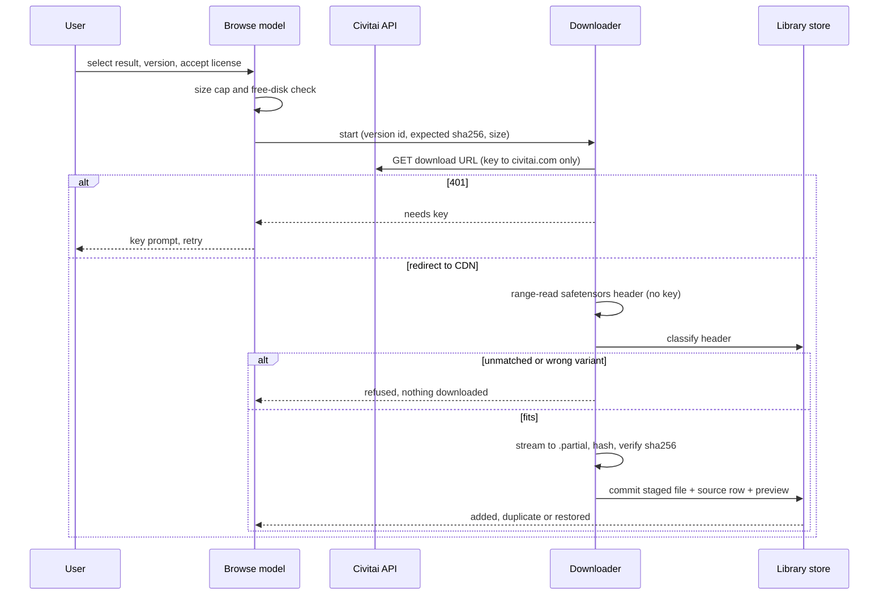

# Civitai LoRA Browse and Download - Plan

## Goal Capsule

- **Objective:** A user can find a LoRA that fits the model they are generating with, download it from Civitai without leaving the app, and see it in their LoRA library with its trigger words filled in.
- **Means:** A Browse Civitai tab in the existing LoRA library sheet, backed by a new single-stream downloader that checks the file header before the bulk transfer (KTD1, KTD3).
- **Product authority:** HLD D15 (anonymous by default, optional key in Keychain, NSFW blurred until opt-in), D20 (license shown and accepted at download), D34 and `docs/lld/loras.md` (the LoRA library this feeds). This plan covers Civitai browse and download only. CivArchive, fetch-by-link or hash, and update checks are not active scope.
- **Execution profile:** Implementation units run in dependency order: U1 (documentation amendments) before any code, then U2 to U7, then U9 (live smoke), then U8 (record what was observed). U9 needs the user's say-so before it downloads the klein 4B model.
- **Open blockers:** none. Deferred questions are listed under Outstanding Questions.

## Product Contract

### Summary

The LoRA library sheet gains a "Browse Civitai" tab next to Installed. It lists LoRAs matching the selected model, with a detail pane for versions, trigger words, preview and license. After the user accepts the license, the download lands in Installed. It is not attached to the generation stack. The library keeps the Civitai link, license and acceptance, a preview thumbnail, trigger words and example prompts.

### Problem Frame

Today a user finds a LoRA in a browser, downloads the file by hand, imports it, then retypes the trigger words. The LoRA library already verifies fit and dedupes by hash, so the missing piece is discovery and transfer. A probe of Civitai on 2026-10-19 found LoRAs under the labels `Flux.2 Klein 4B`, `Flux.2 Klein 9B`, `Krea 2` and `Qwen 2.1`. Mage-Flow was not probed, so its Browse behavior is unverified and must be checked before the family chip offers it. Creator-set labels are sometimes wrong, so the file's own fit check stays the authority. Version metadata carries a SHA-256 and `trainedWords`.

### Key Decisions

- **The browser is a tab in the existing LoRA library sheet.** Chosen over a Models-window Browse tab (HLD §10) and a panel-only "Find on Civitai" sheet (session-settled: user-directed — chosen over the Models-window tab and the panel-only sheet: one place for what the user has and what they could get, with room for a detail pane). Governs R1, R2. Needs an HLD amendment before code.
- **A finished download goes to the library only.** (session-settled: user-directed — chosen over "Download & use" and "always attach if it fits": a download should not change the next generation.) Governs R9.
- **Results default to the current model's family.** (session-settled: user-directed — chosen over all installed families and a remembered choice: least noise while composing.) Governs R3.
- **License handling keeps D20.** The license is shown, acceptance is required at download, and both are recorded. (session-settled: user-directed — chosen over show-only and accept-without-recording: AGENTS.md non-negotiable 8.) Governs R6, R11.
- **What a download keeps from Civitai:** the Civitai link, a preview thumbnail, and example prompts, plus license and acceptance (above). (session-settled: user-directed — selected from the offered set.) Governs R11.
- **The file's fit check decides compatibility, not Civitai's label.** Labels are creator-set and can be wrong. Governs R4, R10.

### Requirements

**Browsing**

- R1. The LoRA library sheet has a "Browse Civitai" tab beside Installed.
- R2. The tab supports text search and a sort choice, and shows each result's preview, name, download count and size.
- R3. Results are filtered to the model selected in the generation panel, using Civitai's base-model label for that model (4B and 9B separately for FLUX.2 klein). A family chip is a per-session override: it starts on the selected model's family, and choosing another family filters to that family's labels. With no model selected, the tab asks the user to select one and does not query Civitai.
- R4. A "show incompatible" toggle removes the label filter entirely, so results from every family appear, with the selected model's label sorted first. Fit is confirmed by the header peek before the bulk transfer (R10); the post-download classification stays the authority.
- R5. LoRAs already installed are marked as installed, matched by hash.
- R6. Selecting a result opens a detail pane with versions, trigger words, example prompts, and the license and commercial-use flags.

**NSFW and key**

- R7. NSFW results are hidden until the user turns on one persisted opt-in toggle in the Browse header (off by default). NSFW previews stay blurred until the user reveals each one in the session, including stored thumbnails if the opt-in is later turned off.
- R8. The Civitai API key is optional and held in Keychain only. It is attached only to requests to the Civitai API host, never placed in a query string, and never logged. A download that follows a redirect to another host is sent without the key. A LoRA that needs login or early access shows a "needs your Civitai key" prompt with a field to enter it. Region-limited SFW-only responses are surfaced as "Civitai limits results in your region".

**Download and library**

- R9. A download is started from the detail pane after license acceptance (R11). It is refused before any bytes are written when Civitai's advertised size exceeds a fixed cap or the free disk space. Downloads run one at a time and continue after the sheet closes. Progress with cancel shows on the matching Browse result and in Installed, and a second download waits as queued. On completion, if the file passes R10, the LoRA appears in Installed with a "just added" mark, which clears the next time Installed is opened, and the generation stack is unchanged.
- R10. Only `.safetensors` files are downloaded (AGENTS.md non-negotiable 6). Before the bulk transfer, the safetensors header is range-read and classified (KTD3). For FLUX.2 klein the fit check also determines the 4B or 9B size variant from the tensor shapes, and refuses a file whose variant differs from the selected model's. A file matching no shipped family or the wrong variant is refused with a clear reason before transfer, and nothing is written. After the transfer the file is hash-verified against Civitai's SHA-256 and classified again, and that result is the authority; it then goes through the same duplicate handling and name-clash handling as a local import. Civitai-supplied names (model, version, file) are display text only: the on-disk path is built from the verified hash and a restricted-character slug, and must resolve inside `Models/LoRAs/<family>/`.
- R11. The library records, for each downloaded LoRA, the Civitai model and version link, license and commercial-use flags with the acceptance timestamp, one preview thumbnail, and example prompts. Civitai's trigger words fill the LoRA's trigger words.
- R12. Failures (network, disk space, size cap, missing key, refused file) are reported in plain language with a next step. A search or family with no results shows an empty state with "Show incompatible" and "Clear search" actions.

**Privacy and docs**

- R13. Civitai necessarily sees which LoRAs the user looks up and downloads. The privacy wording in AGENTS.md, the HLD and `docs/lld/models.md` is amended so the rule covers our own servers and analytics, not Civitai itself. The amended rule states that the Civitai API key may be sent to `civitai.com` API requests only, never to any other host, and is never logged. Analytics stay content-free.
- R14. The HLD is amended before code: D34's "Civitai is separate work" closes, §8.6 and §10 place LoRA browsing in the library sheet, and the privacy lines change per R13.

### Key Flows

- F1. Find and download a LoRA
  - **Trigger:** The user opens the LoRA library sheet while a model is selected and chooses Browse Civitai.
  - **Steps:** Results appear filtered to the model. The user searches, picks a result and reads the detail pane. They accept the license and download. The file is verified and fit-checked, then appears in Installed with its trigger words.
  - **Outcome:** The LoRA is in the library. The user attaches it to the stack themselves.
  - **Covered by:** R1, R2, R3, R6, R9, R10, R11

- F2. A LoRA needs a Civitai key
  - **Trigger:** The user starts a download that Civitai refuses without login.
  - **Steps:** The detail pane shows the key prompt. The user enters a key, which goes to Keychain. The download proceeds.
  - **Covered by:** R8, R9

### Acceptance Examples

- AE1. **Covers R3, R4.** Given FLUX.2 klein 4B is selected, when the user opens Browse, only results labeled `Flux.2 Klein 4B` appear. Turning on "show incompatible" adds other labels.
- AE2. **Covers R10.** Given a result labeled `Krea 2` whose file matches no shipped family, when the header peek completes, the file is refused with a reason, no bulk transfer starts, nothing is written to disk and Installed is unchanged.
- AE3. **Covers R5, R10.** Given a LoRA is already installed, when its Civitai result appears, it shows as installed. A download whose hash matches a stored LoRA is handled as a duplicate and adds no row.
- AE4. **Covers R7.** Given the NSFW opt-in is off, NSFW results do not appear. With it on, their previews are blurred until revealed.
- AE5. **Covers R9.** Given a download finishes while a generation is being composed, the stack and the next job are unchanged.

### Scope Boundaries

Deferred for later:

- CivArchive as a fallback source (its API contract is unconfirmed, HLD §15).
- Fetch by pasted Civitai link or hash, and drop-a-PNG to fetch its missing LoRAs.
- Checking for newer versions of a downloaded LoRA.
- A curated per-family "recommended" shelf in the signed catalog.
- Starting several downloads at once. R9 runs them one at a time.
- Showing preview thumbnails in the generation panel's LoRA stack (only the library lists them).

Outside this plan:

- Civitai checkpoints. Only LoRAs are browsed.
- Any content filtering (AGENTS.md non-negotiable 1).

### Dependencies / Assumptions

- Civitai's public API stays anonymous-readable for public LoRAs. An anonymous download of a public LoRA returned a signed redirect on 2026-10-19. Whether login-gated and early-access files behave as R8 assumes is not yet probed.
- The Civitai base-model labels above are catalog data, not code. The shipped fingerprints already separate klein 4B (hidden 3072) from 9B (hidden 4096) by tensor shape (`docs/lld/loras.md`), but the classifier returns only the family id `flux2-klein` (`FamilyRegistry.classifyLoRA`), so R10 needs it to surface the size variant.
- Code facts planning must handle (verified 2026-10-19):
  - `lora` table has no source, preview, license or base-model column (`Sources/MCLibrary/LibraryStore.swift`, v4-lora).
  - `InstallPlan` and `ModelDownloader` are shaped around a Hugging Face repo plus a 40-hex revision (`Sources/MCModels/InstallPlan.swift`), so a Civitai file needs a new input shape.
  - `LibraryStore.importLoRA(from:)` always stage-copies a local file (`Sources/MCLibrary/LoRALibrary.swift`), so a downloaded file would be copied twice without a new entry point.
  - `sweepUnreferencedLoRAs` deletes any file under `Models/LoRAs` that has no row and does not end in `.partial` (`Sources/MCLibrary/LibraryStore.swift`), so a downloaded file must stage as `.partial` or elsewhere.
  - No Civitai, Keychain or NSFW-preference code exists. Preferences use the injected `UserDefaults` in `Sources/MCApp/AppModel.swift`.
  - Install progress UI (`Sources/MCApp/Models/InstallRow.swift`) is tied to catalog rows, so LoRA downloads need their own state.

### Outstanding Questions

**Deferred to implementation**

- Rate-limit behavior and the exact login-gated and early-access signals beyond the sampled 401. U5 treats any 401 or 403 as needs-key.
- Whether the engine architecture string for a klein 9B model is `flux2-klein-9b`. KTD6 never gates when it cannot read a variant.
- Whether Qwen 2.1 and klein 9B LoRAs classify correctly against the shipped fingerprints in practice. The live smoke covers klein 4B only.
- Where the NSFW opt-in and Civitai key also appear outside the Browse header, if anywhere. The plan puts them only in Browse.

### Sources / Research

- `docs/HLD.md` §8.7 (Civitai endpoints, downloader), §8.6, §10, §12, §15; decisions D15, D20, D34.
- `docs/lld/loras.md`, `docs/lld/models.md`, `docs/plans/2026-10-19-1341-feat-lora-support-and-management-plan.md` (this plan was deferred from there).
- Light anonymous probe of Civitai's API on 2026-10-19: base-model labels, version metadata with SHA-256 and `trainedWords`, and an anonymous download redirect.

## Planning Contract

### Key Technical Decisions

- **KTD1. A new single-stream Civitai downloader, not the Hugging Face install path.** `InstallPlan` needs a repo and a 40-hex revision, and `FileDownloader` refuses any response without an `ETag`. Civitai's CDN sends none (probed 2026-10-19). LoRAs are tens to hundreds of MB, so one stream per file is enough. An interrupted download restarts from zero, since without an ETag a resume cannot prove the bytes are the same object, and the signed CDN URL is re-resolved on every attempt anyway. The new downloader reuses `DiskSpace`, `Sha256File` and the ephemeral-session policy, and sits behind its own transport protocol (D30 pattern) so tests script it. Serves R9, R10, R12.
- **KTD2. The Civitai key is a request header with an explicit redirect policy.** `Authorization: Bearer` goes only to the Civitai API host over https. The downloader's own redirect handler removes it on any redirect to a different host or to a non-https URL, rather than relying on Foundation's default, and any non-https download or header-peek URL is refused outright. A cross-host redirect test (`127.0.0.1` to `localhost`) and a same-host redirect-to-http test assert the key is absent on the second hop. The key lives in a small Keychain wrapper (no Keychain code exists today). Serves R8.
- **KTD3. A header peek runs before the bulk transfer and doubles as the auth probe.** After license acceptance and the size and disk checks, the app range-reads the safetensors header from the resolved CDN URL (8 bytes for the length, then the header, bounded by the existing 100 MiB header limit) and classifies it. An unmatched file is refused having cost kilobytes. A 401 on this first request is the login-gated signal that opens the key prompt. The post-download hash and classification stay the authority. Serves R4, R8, R10.
- **KTD4. Downloads stage outside `Models/LoRAs/`.** The staging file is `Models/.partial/civitai/<versionId>.partial`. `sweepUnreferencedLoRAs` deletes any unreferenced non-`.partial` file under `Models/LoRAs/` at launch, and `.partial` files are left to `sweepPartials`. After verification, a new `LibraryStore` entry point commits a staged file with a known hash. It shares one commit routine with `importLoRA`: classify, same-hash duplicate or restored handling, name-clash suffixing, rename into `LoRAs/<family>/<sha10>-<slug>.safetensors` and row insert in one write. A same-volume rename avoids the second copy. Serves R10.
- **KTD5. Schema: one new column and one new table, migration `v5-lora-source`.** `lora` gains a nullable `variant` (for example `4b` or `9b`). A new table `lora_source` holds one row per downloaded LoRA, keyed by `lora_id` with cascade delete: Civitai model id and version id, page URL, license and commercial-use flags as JSON, `accepted_at`, preview path, preview NSFW level, and example prompts as JSON. `LoRARecord` decode is strict, so it keeps no new required field. A local import writes no `lora_source` row. `deleteLoRA` also removes the preview file. v4 is never edited. Serves R11.
- **KTD6. The classifier returns the size variant.** `LoRAFingerprint` gains an optional `variant` and `classifyLoRA` reports it with the family id. U2 marks the two klein fingerprints `4b` and `9b`; `families.json` has no variant key today. The variant is stored on the row, shown in the library row and used by the fit rule, so a 9B file is greyed on a 4B model for local imports too. The selected model's variant comes from its engine architecture string (`flux2-klein-4b` gives `4b`). A model or LoRA with no variant is never gated on it. Existing rows keep a null variant. Serves R10.
- **KTD7. Civitai labels are data in `families.json`.** `ModelFamily` gains `civitaiBaseModels` (HLD §8.4 already names it), mapping each verified label to a family and optional variant: `Flux.2 Klein 4B`, `Flux.2 Klein 9B`, `Krea 2` and `Qwen 2.1`. Mage-Flow has no entry, so the family chip never offers it. The file is bundled, so a new label needs an app release until a remote path exists (HLD §8.4 intends otherwise; noted, not built). Serves R3, R4.
- **KTD8. Browse state is its own `@Observable` model, mirroring `ModelBrowserModel`.** It owns query, sort, family chip, show-incompatible, selection, the one-at-a-time download queue and per-session reveal state. The NSFW opt-in is a persisted key in the injected `UserDefaults`, following the `lastUsedModelID` and `queuePaused` pattern. `AppModel+LoRA` stays the library layer and gets only the commit and refresh hooks. Serves R5, R7, R9.
- **KTD9. Version choice and license record.** The detail pane lists versions. The default is the newest version whose label matches the selected model, else the newest overall. License acceptance is recorded per version with its timestamp, and every download asks again. Serves R6, R11.
- **KTD10. Limits.** The size cap is a fixed constant of 4 GiB, checked with the existing 1 GiB headroom against free disk before any request beyond the metadata fetch. Observed LoRAs run from 22 MB to about 470 MB. Only files whose metadata says `SafeTensor` are offered, and a version with several files uses the primary safetensors file. Serves R9, R10, R12.
- **KTD11. Previews are fetched once at download time.** One image from the chosen version is fetched from Civitai's image CDN, re-encoded to a HEIC thumbnail with the existing `Thumbnails` helper, and stored outside `Models/LoRAs/`, next to the other library thumbnails. Browse results load remote previews on demand through the same ephemeral session. A preview failure never fails the download. Serves R2, R11.

### High-Level Technical Design

> This illustrates the intended flow and is directional guidance for review, not implementation specification.

### System-Wide Impact

- **Launch sweep:** staging outside `Models/LoRAs/` keeps a half-finished download from being deleted or from being mistaken for a LoRA (KTD4). The existing launch sweeps cover only the Library root and `Models/LoRAs/`, so U3 adds `Models/.partial/civitai/` as a sweep root in `LibraryStore.init` (it already receives `modelsRoot`). Interrupted downloads restart from zero, so a leftover partial is pure waste.
- **Delete:** `deleteLoRA` cascades the `lora_source` row and removes the preview file inside the same write, keeping the existing rule that a failed file removal rolls back.
- **Fit rule change:** the variant gate also changes local import and the generation panel's greyed rows, not only Browse. Rows imported before this change have no variant and behave as today.
- **Privacy and docs:** R13 and R14 are real edits to AGENTS.md non-negotiable 7, HLD §4, D15, D34, §8.6, §8.7, §8.10, §10, §12, and `docs/lld/loras.md` and `docs/lld/models.md` (including the "only additional header" line). They land first (U1).
- **Memory and engine:** none. LoRAs still reach the engine by absolute path, and the engine is untouched.

### Risks & Dependencies

- **Login-gated downloads are common.** Probes on 2026-10-19: 3 of the top 6 Klein 4B LoRAs returned 401 anonymously, and across the top 10 each of Klein 4B, Krea 2 and Qwen, 14 of 30 download URLs returned 401 (the other 16 redirected, 307). Roughly half are gated, so the key prompt is a main path, not an edge case, and the 401 signal comes from the header peek. Whether the 401 is a per-file login requirement or throttling is not established.
- **Civitai's 401 body and early-access fields were only sampled.** The peek treats any 401 or 403 on the download URL as "needs key" and shows the response's own message when present. If a key is saved and still refused, the pane says so instead of looping.
- **Fingerprints for klein and Qwen are header-matched only.** Krea fingerprints come from real samples. A false mismatch refuses a good file after the license acceptance. The live smoke (U9) covers one klein 4B file. Qwen and klein 9B are not run against a loaded model, and the unit says so in `docs/lld/loras.md` rather than claiming otherwise.
- **Klein 9B model identity is unverified.** The engine architecture string for a 9B model is not in the catalog or tests. KTD6 therefore never gates when it cannot read a variant, and the first real 9B install must confirm the string.
- **Civitai rate limits are unknown.** Search is debounced, and responses are not cached across launches.
- **A klein diffusers LoRA using `lora_down` keys on blocks 0-7 classifies as Qwen** (known residual risk in `docs/lld/loras.md`). A downloaded file in that shape is refused or misfiled, never silently attached to the wrong model, because the engine's 400 stays the last check.

## Implementation Units

### U1. Amend the HLD, AGENTS.md and LLDs

- **Goal:** Make the written contract match this feature before any code, as AGENTS.md requires.
- **Requirements:** R13, R14
- **Dependencies:** none
- **Files:** `docs/HLD.md` (D34, §4, §8.4, §8.6, §8.7, §8.10, §10, §12, §13), `AGENTS.md` (non-negotiables 1 and 7), `docs/lld/loras.md`, `docs/lld/models.md`
- **Approach:** Close D34's "Civitai is separate" clause and place LoRA browsing in the library sheet. Reword the privacy rule so it names our servers and analytics, not Civitai, as the recipients that never see IDs, and records the key exemption (Civitai API requests only). Amend AGENTS.md non-negotiable 1 and HLD §4 so the NSFW opt-in and blur cover the LoRA library Browse tab as well as the model browser (D15). Add the Browse tab, the key and redirect rule, the header peek and the size cap to the LLDs. Record that CivArchive, fetch-by-link and update checks stay deferred.
- **Test scenarios:** none. This is documentation.
- **Verification:** A grep for the old "Civitai item IDs or names never leave the device" wording finds none that contradicts the new rule.

### U2. Size variant in the classifier, and Civitai labels in families.json

- **Goal:** `classifyLoRA` reports klein 4B or 9B, and each family declares which Civitai labels map to it.
- **Requirements:** R3, R10
- **Dependencies:** U1
- **Files:** `Sources/MCCatalog/ModelFamily.swift`, `Sources/MCCatalog/Resources/families.json`, `Tests/MCCatalogTests/LoRARealSampleFingerprintTests.swift`, `Tests/MCCatalogTests/FamilyRegistryTests.swift`
- **Approach:** Add an optional `variant` to `LoRAFingerprint` (decode with `decodeIfPresent`, as the neighbouring fields do) and carry it in the match result. Mark the two BFL klein fingerprints and the diffusers 9B one. Add `civitaiBaseModels`, a list of `{label, variant?}`. Update every `switch` over `LoRAFamilyMatch`.
- **Execution note:** test-first. The real-sample fixtures already assert families, so extend them to assert variants.
- **Test scenarios:** klein 4B BFL fixture reports `4b`. Klein 9B BFL and diffusers fixtures report `9b`. Krea and Qwen fixtures report no variant. Each shipped label resolves to the expected family and variant. A label with no entry (for example `Mage-Flow`) resolves to nothing. Existing unmatched and ambiguous cases still pass.
- **Verification:** `swift test --filter MCCatalogTests` passes.

### U3. Migration v5, source table and staged-file commit

- **Goal:** The library can store a downloaded LoRA with its source metadata and can commit a staged, already-hashed file without a second copy.
- **Requirements:** R10, R11
- **Dependencies:** U2
- **Files:** `Sources/MCLibrary/LibraryStore.swift`, `Sources/MCLibrary/LoRARecord.swift`, new `Sources/MCLibrary/LoRASource.swift`, `Sources/MCLibrary/LoRALibrary.swift`, `Sources/MCLibrary/LibraryPaths.swift`, `Tests/MCLibraryTests/LoRALibraryTests.swift` (and a new source-table test file)
- **Approach:** Add `v5-lora-source` per KTD5. Factor the commit half of `importLoRA` into a shared routine, and add a staged-file entry that takes the staged URL, its SHA-256, the classification, the name and a `LoRASource` value, and writes both rows in one transaction. Add a preview directory to `LibraryPaths` outside `LoRAs/` and make `deleteLoRA` remove the preview. Sweep `Models/.partial/civitai/` at `LibraryStore` open. Civitai previews may be JPEG, PNG or WebP, but `Thumbnails` currently accepts PNG only, so add a data-in thumbnail entry point that takes any ImageIO-readable format. Local import stores the matched `variant` too.
- **Execution note:** test-first for the commit routine, since it shares the import's duplicate and clash paths.
- **Test scenarios:** a staged file commits to `LoRAs/<family>/<sha10>-<slug>.safetensors` with a source row and trigger words. A same-hash second commit returns duplicate and adds nothing. A name clash gets a numeric suffix. A missing recorded file with the same hash returns restored. A crash between rename and insert leaves no orphan the sweep misses or the sweep wrongly removes. Deleting the LoRA removes the source row and preview file. An old v4 database migrates and old rows decode. A hostile name such as `../../x` never changes the destination path.
- **Additional test scenarios:** a leftover `.partial/civitai/<versionId>.partial` is removed at the next open. A JPEG preview fixture produces a HEIC thumbnail.
- **Verification:** `swift test --filter MCLibraryTests` passes.

### U4. Civitai API client, response models and Keychain store

- **Goal:** A tested client lists and searches LoRAs and fetches version detail, and the key is stored safely.
- **Requirements:** R2, R3, R5, R6, R7, R8
- **Dependencies:** U2
- **Files:** new `Sources/MCModels/Civitai/CivitaiClient.swift`, `CivitaiModels.swift`, `CivitaiKeychain.swift`; new `Tests/MCModelsTests/Civitai*Tests.swift` with recorded fixtures in `Tests/MCModelsTests/Fixtures/`
- **Approach:** A `CivitaiTransport` protocol (D30 pattern) with an ephemeral URLSession implementation: cookies off, fixed User-Agent, no cache, key attached only for the API host and never in the URL. Endpoints: `GET /api/v1/models` (types LORA, base-model label, query, sort, cursor, NSFW flag from the opt-in) and `GET /api/v1/model-versions/{id}` plus a by-hash lookup for the installed mark. Decode only the fields used: names, versions, files with `sizeKB`, `type`, format and SHA-256, `trainedWords`, license flags, images with their NSFW level. Tolerate missing and unknown fields. Keychain wrapper exposes read, write, delete with a service name unique to the app, and never logs the value.
- **Test scenarios:** recorded search and version responses decode, including a version with several files and one with no safetensors file. A response missing optional fields still decodes. An API request carries the key header, and the URL contains no key. A request with no saved key carries no Authorization header. Region-limited and 429 responses map to distinct error cases. Keychain round-trip uses a test service name and cleans up.
- **Verification:** `swift test --filter MCModelsTests` passes. Fixtures are recorded from real responses on 2026-10-19 with private fields removed.

### U5. Civitai downloader

- **Goal:** Download one LoRA file safely: size and disk checks, header peek, key handling across redirects, streaming, hash verification, cancel.
- **Requirements:** R8, R9, R10, R12
- **Dependencies:** U4
- **Files:** new `Sources/MCModels/Civitai/CivitaiDownloader.swift`, `Sources/MCModels/Civitai/CivitaiDownloadEvent.swift`, `Tests/MCModelsTests/Fixtures/range_server.py` (extended), new `Tests/MCModelsTests/CivitaiDownloadTests.swift`
- **Approach:** An actor behind a `CivitaiFileTransport` protocol. Steps per KTD1 to KTD4, KTD10: refuse over the size cap or without room, request the download URL with the key header, treat a 401 or 403 as needs-key, follow the redirect with the header dropped on any host change, range-read the header from the resolved URL and hand it to a classifier closure, then stream to the staging file while hashing, check the SHA-256, and return the staged URL and hash. Events come as an `AsyncStream` with one terminal event, following `InstallEvent`. Extend the local test server to mimic Civitai: a download path that 302s to another host name with a signed query, no `ETag`, optional bearer check returning 401, and honoured `Range`.
- **Execution note:** test-first. The key and redirect behaviour is the security-sensitive part.
- **Hardening:** the stream keeps a running byte counter and aborts, deletes the staged file and reports a distinct error once received bytes exceed the advertised size or the 4 GiB cap, re-checking free disk during the transfer. The signed CDN URL is re-resolved if it has expired between the header peek and the stream (one retry), and a second expiry fails with a plain message. Only https URLs are followed (KTD2).
- **Additional test scenarios:** a server that sends more bytes than advertised aborts and the staged file is removed. A same-host redirect to `http://` drops the key and fails the request. An expired signed URL after the peek is re-resolved once.
- **Test scenarios:** a successful download hashes to the expected value and the staged file equals the payload. A wrong SHA-256 deletes the staged file and fails. The key is absent on the redirected request and present on the first, asserted from the server's request log. A 401 with no key yields needs-key, and the same request with a key succeeds. A saved key that is still refused yields a distinct error, not a loop. Over-cap and low-disk requests make no network request for the file. A classifier refusal after the header peek transfers at most the header bytes. Cancel mid-stream removes the staged file. A server that ignores `Range` for the peek is handled by falling back to a bounded streamed read of the header, or by refusing with a clear error. A response shorter or longer than the advertised size fails.
- **Verification:** `swift test --filter MCModelsTests` passes, run through the eval subprocess pattern.

### U6. Browse model, download queue and app wiring

- **Goal:** The app can search, pick a version, accept the license, download, commit and refresh the library, one download at a time.
- **Requirements:** R3, R4, R5, R7, R9, R11, R12
- **Dependencies:** U3, U4, U5
- **Files:** new `Sources/MCApp/Civitai/CivitaiBrowseModel.swift`, `Sources/MCApp/AppModel.swift` (preference key, injected client and downloader), `Sources/MCApp/AppModel+LoRA.swift` (commit hook), `Tests/MCAppTests/` new browse-model tests
- **Approach:** State per KTD8 and KTD9: query with debounce, sort, family chip, show-incompatible, selection and version, installed-by-hash set refreshed from the library, a queue that runs one download and shows the rest as queued, and a status per result (idle, queued, downloading with fraction, refused with reason, added). A finished download hops to the library commit, writes trigger words from `trainedWords`, fetches and stores the preview (KTD11), refreshes the library and marks the row just-added until Installed is next shown. The model reads the persisted NSFW key and the Keychain key, and exposes no-model, empty, needs-key, region-limited and failure states with their actions. Downloads continue when the sheet closes because the model lives on `AppModel`, not in the view.
- **Test scenarios:** with klein 4B selected only its label is queried, and "show incompatible" drops the label filter with the selected label first. No selected model produces the prompt state and no request. Two downloads queue and run in order. A cancelled queued item never starts. A refused file leaves the library unchanged and reports the reason. A duplicate hash shows installed and adds no row. A finished download leaves the LoRA stack and any queued job unchanged. The NSFW preference persists across a new `AppModel` on the same defaults suite. Closing the sheet mid-download does not cancel it.
- **Verification:** `swift test --filter MCAppTests` passes.

### U7. Browse tab UI

- **Goal:** The visible feature: the tab, results grid, detail pane, license sheet, key prompt, NSFW blur, empty and error states, progress and the just-added mark.
- **Requirements:** R1, R2, R4, R5, R6, R7, R8, R9, R12
- **Dependencies:** U6
- **Files:** `Sources/MCApp/LoRALibraryView.swift` (tab switch), new `Sources/MCApp/Civitai/CivitaiBrowseView.swift`, `CivitaiResultCard.swift`, `CivitaiDetailPane.swift`, `CivitaiKeyField.swift`, reuse `LicenseSheet` where its shape fits
- **Approach:** Follow the sketch the user chose: Installed and Browse Civitai tabs in the library sheet, results grid on the left, detail pane on the right with versions, trigger words, example prompts, license and commercial-use flags, and the Download button behind the license acceptance. Add one blur view modifier with a per-item reveal. The Browse header carries the family chip, search, sort, "show incompatible" and the NSFW toggle. Progress and Cancel appear on the matching card and as a row in Installed. Accessibility labels on cards, the reveal control and the download button.
- **Test scenarios:** no automated UI test. View state is driven by U6's tested model. Manual checks: tab switch keeps Installed state, a blurred NSFW card stays blurred until revealed, the license sheet blocks Download until accepted, an empty search shows both actions, a needs-key result shows the key field.
- **Verification:** `xcodegen generate` then `xcodebuild -project MLXCreate.xcodeproj -scheme MLXCreate -configuration Debug -derivedDataPath build build` succeeds. The user smoke-tests the window (they prefer to run GUI checks themselves), and I launch the app and list what to try.

### U8. Documentation of verified behavior

- **Goal:** Record what was actually observed, and what was not.
- **Requirements:** R13
- **Dependencies:** U7, U9 (runs after the live smoke)
- **Files:** `docs/lld/loras.md` (verification section), `AGENTS.md` (Commands and gotchas if any new)
- **Approach:** Add the Civitai download results, the CDN behaviour (no ETag, range reads, signed redirects, 401 on gated files), and any new gotcha the next agent would otherwise rediscover. State which families and the klein 9B were not run against a loaded model.
- **Test scenarios:** none.
- **Verification:** The doc claims match the smoke output captured in U9.

### U9. Live smoke against Civitai and the real engine

- **Goal:** Prove the path end to end once with a real file.
- **Requirements:** R9, R10, R11
- **Dependencies:** U6 (U7 optional for the app route)
- **Files:** none permanent
- **Approach:** With a small public FLUX.2 klein 4B LoRA (under 100 MB, no key needed), run the downloader and commit through a throwaway harness or the built app: confirm the hash verified, the row and `lora_source` written, trigger words filled, preview stored and the file classified `flux2-klein` with variant `4b`. Then load the klein 4B model on the real engine and generate once with the LoRA to see the image change. AGENTS.md names the klein 4B model as the smoke model; it is about 5 GB and not on disk, so ask before downloading it. If the user declines, the engine step is reported as not run. Also confirm one gated LoRA returns the needs-key state without a key. Do not use a real key in the smoke.
- **Test scenarios:** the live checks above.
- **Verification:** Observed output captured for U8. Anything not run is reported as not run.

## Verification Contract

- Library and catalog tests: `swift test` (Swift Testing). Run it through the eval subprocess with a timeout, not the bash pty, which aborted twice on this repo.
- Civitai download tests need `/usr/bin/python3` for the local server and skip when absent, like the existing `MCModelsTests` suites. Real-engine tests need `MLXC_ENGINE_BIN`.
- App build: `xcodegen generate`, then `xcodebuild -project MLXCreate.xcodeproj -scheme MLXCreate -configuration Debug -derivedDataPath build build`.
- Catalog check unaffected: `swift run mc-catalog verify Sources/MCCatalog/Resources/catalog.json` is only needed if `catalog.json` changes, which this plan does not do.
- No live Civitai call runs in the permanent suite. Fixtures are recorded responses.

## Definition of Done

- Every R1 to R14 is met, and AE1 to AE5 pass or are covered by a named test or a manual check recorded in U7 (UI checks) or U9 (live smoke).
- A Civitai LoRA downloads into the library with hash verified, fit checked, trigger words and license recorded, and the generation stack untouched.
- The key never appears in a URL, a log or a redirected request, proven by a test.
- A launch sweep never deletes or resurrects a staged or finished download.
- The HLD, AGENTS.md and both LLDs agree with the code, and `docs/lld/loras.md` states what was and was not verified.
- No throwaway scripts, probe files or abandoned approaches remain in the diff. The local test server's Civitai additions are the only new fixture code.

