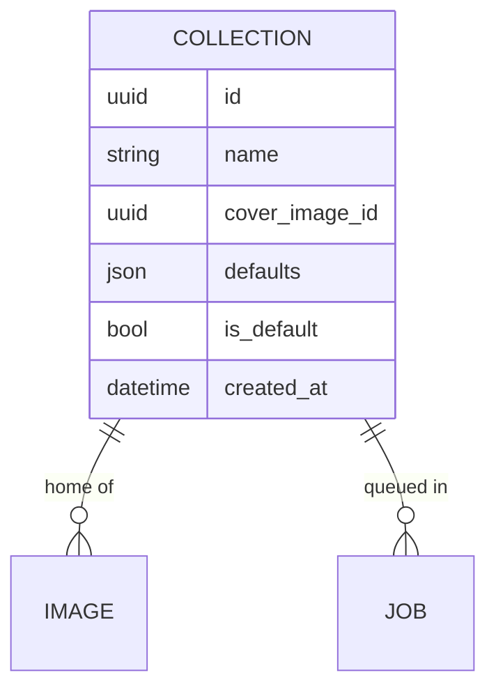

# Collections (renamed from Projects) - Plan

## Goal Capsule

- **Objective:** Make the HLD's "Projects" (D10) real under the name **Collections**: create, rename, delete, switch, move images between them, and keep per-collection defaults.
- **Authority:** Implementation-ready. The rename covers code, the SQLite schema, the on-disk folder, the UI and the HLD.
- **Stop conditions:** Stop and ask the user if a task seems to need breaking a `D*` decision other than D10/D18's wording, or if the migration cannot preserve an existing library.
- **Finishes the work:** `ce-work`, on branch `feat/collections`.

---

## Product Contract

### Summary

Today every image lands in one hidden default project and the toolbar shows its name as plain text. This plan adds a toolbar collection switcher, create/rename/delete, "Move to Collection", and per-collection default model, settings and LoRA stack. Every library "project" in the app, schema, files and HLD becomes "collection"; XcodeGen terms, historical docs and the repo's "project settings" keep their wording.

### Problem Frame

The library already stores a `project` table, `project_id` on `job` and `image`, and one `is_default` row, but no UI or store API can make a second one. Users have no way to organise work, which D10 promises. "Project" also reads as a document or a job, while this unit is a gallery of images.

### Requirements

**Organising**

- R1. The user can create a collection with a name.
- R2. The user can rename any collection, including the default one.
- R3. The toolbar shows the current collection and lets the user switch to another. The choice persists across relaunch.
- R4. Every image belongs to exactly one collection (D10). The gallery shows the current collection's images only.
- R5. The user can move an image to another collection from the gallery tile menu. The image leaves the current gallery and its canvas selection clears if it was selected.

**Deleting**

- R6. A collection can be deleted only when it holds no images. A non-empty collection shows delete as unavailable, with the reason.
- R7. The default collection cannot be deleted.
- R8. A collection that still has queued, running or paused jobs cannot be deleted either, so a delete never silently drops queued work. Finished failed or cancelled job rows go with the collection.

**Defaults**

- R9. A collection carries optional defaults: model, size, steps, guidance, negative prompt and LoRA stack (no prompt, seed or batch count).
- R10. A menu item "Save Current Settings as Collection Defaults" writes the composer's current state into the current collection's defaults.
- R11. Switching to a collection applies its defaults to the composer. A field the collection does not set keeps the composer's current value. An uninstalled model keeps the current model, an out-of-grid size snaps to the family grid, and a missing LoRA is dropped. Creating a collection starts with no defaults.
- R12. Queued jobs keep the collection they were created in. The queue strip shows only the current collection's jobs, as it does for projects today.

**Naming**

- R13. "Collection" replaces "Project" in the UI, code identifiers, schema, on-disk folder, tests and the HLD. A new HLD decision records the rename and its scope.
- R14. Collection names are trimmed, non-empty and unique ignoring case.

### Scope Boundaries

- Not in this plan: search across collections, an "All collections" gallery view, prompt history per collection (HLD D10 and §9 list it; it stays unbuilt), a collection cover picker, and the separate Gallery mode (D33 open question).
- No multi-membership, tags or smart collections (D10).
- Moving an image does not rename or move its file (KTD3).
- "Project" in `project.yml`, XcodeGen and Xcode terms, and "project settings" meaning the repo, is unrelated and stays.
- Historical docs under `docs/plans/`, `docs/ideation/` and `docs/solutions/` keep their wording.

---

## Planning Contract

### Key Technical Decisions

- KTD1. **One migration renames the schema in place.** `v6-collection` renames table `project` to `collection`, and `project_id` to `collection_id` on `job` and `image`, using SQLite `ALTER TABLE ... RENAME` (foreign keys and the `image_project_recent` index follow; the index is dropped and recreated under its new name). It adds `defaults` (JSON text, nullable) and drops `default_model_id`, which was never written (it moves into `defaults`). Migrations are append-only, so v1 stays as is.
- KTD2. **Disk folder rename is reconciled after the migration, idempotently and per file.** The same migration rewrites `image.file_path` from `Projects/` to `Collections/`. After migrations, `LibraryStore` open walks `<Library>/Projects/` and moves each file to the same relative path under `<Library>/Collections/`. Where the target already exists, the `Projects/` copy is deleted, since the database references the `Collections/` copy. `Projects/` is removed once empty. A failed move throws a typed error naming the folder and the library does not open, so no image is stranded unreported. A crash between the migration and the reconcile leaves a state that the next open completes, because the DB is the record and new files are written under `Collections/`.
- KTD3. **A move changes only `collection_id`.** `file_path` is an opaque key recorded in the database (it already embeds the original project id today), and thumbnails are keyed by image id. Not moving files removes a half-moved failure mode. The existing `cover_image_id` column is left untouched, since nothing sets it and a cover picker is out of scope.
- KTD4. **Delete is a single store transaction** that re-checks R6, R7 and R8 inside the write, so a save landing between the UI check and the delete cannot lose an image. The UI disables the item from the same predicate and shows the reason, and the store throws a typed error for it.
- KTD5. **The current collection lives in `AppModel`**, persisted as a `UserDefaults` id like `lastUsedModelKey`, falling back to the default collection if the stored id is gone. Every `store.defaultProject()` call in `AppModel` and `GenerationComposer` is replaced by the current collection id, passed in explicitly. The composer stops looking up a default itself.
- KTD6. **Defaults are an explicit save, not auto-sync.** Silent writes whenever a control changes would make switching surprising and would hide stale values. The defaults value is a small `Codable` struct (`CollectionDefaults`) that stores LoRAs by library id and weight, never file paths.
- KTD7. **Applying defaults reuses the existing fit path.** Setting `selectedModelID` already runs `fitComposerToSelectedFamily()`, which snaps size and steps. Apply sets the model first (only if installed and selectable, else keep the current), then size, steps, guidance and negative prompt, then the LoRA stack. LoRAs whose record is missing or do not fit the family are dropped silently, the same as library pruning today.
- KTD8. **Other-collection saves do not touch the visible gallery.** The executor still saves into the job's own collection. `AppModel` inserts a saved image into the gallery and selects it only when its collection is the current one.

### Data shape

### Assumptions

- The app is single-instance (D28), so the on-disk reconcile at open needs no cross-process locking.
- The migrator runs `v6-collection` with foreign keys disabled and checks them before commit (GRDB's default `.deferred`). SQLite 3.26 or later rewrites child foreign-key references on `ALTER TABLE ... RENAME TO`, so the renamed table keeps its `job` and `image` references. `RENAME COLUMN` needs 3.25 and `DROP COLUMN` needs 3.35, and macOS 26 provides both.

---

## Implementation Units

### U1. Schema migration and folder reconcile

- **Goal:** Rename the schema, add `defaults`, rewrite image paths, and finish the disk folder rename at open (R13, KTD1, KTD2).
- **Requirements:** R13
- **Files:** `Sources/MCLibrary/LibraryStore.swift`, `Sources/MCLibrary/LibraryPaths.swift`, `Tests/MCLibraryTests/`
- **Approach:** Add `v6-collection` after `v5-lora-source`. Add a post-migration reconcile step in the store's open path, beside the existing LoRA sweep. `LibraryPaths.imageRelativePath(projectID:...)` becomes `imageRelativePath(collectionID:...)` and returns `Collections/<id>/<yyyy-mm>/<image-id>.png`.
- **Test scenarios:**
  - A database built at v5 with a default project, jobs, images and `Projects/` files opens at v6 with the same rows readable, `file_path` under `Collections/`, and the files reachable.
  - Reconcile run twice, or after a simulated crash with half the files moved (including a file present in both folders), converges with no file lost.
  - Reconcile with an unwritable target throws a typed error naming the folder, and the library does not open.
  - A fresh library creates the default collection and `Collections/`.
- **Verification:** `swift test` for `MCLibraryTests`.

### U2. Store API for collections

- **Goal:** Create, rename, list, delete, move image, read and write defaults (R1, R2, R4-R9, R14).
- **Requirements:** R1, R2, R4, R5, R6, R7, R8, R9, R14
- **Files:** `Sources/MCLibrary/Models.swift` (`Project` becomes `Collection`, adds `CollectionDefaults`, and `LibraryImage.projectID` becomes `collectionID`), `Sources/MCLibrary/LibraryStore.swift` (`ProjectRow` becomes `CollectionRow`, `defaultProject()` becomes `defaultCollection()`, `projectID` becomes `collectionID` throughout), new `Sources/MCLibrary/LibraryStore+Collections.swift` if the file grows, `Tests/MCLibraryTests/`
- **Approach:** `collections()` returns each with its image count, so the switcher can disable delete without a second query. Delete and move follow KTD3 and KTD4. Delete changes database rows only and never touches files or folders, because a collection's folder can hold files of images that were moved out of it. Name validation follows R14, runs inside the same write as the insert or rename, and throws a typed `LibraryError`.
- **Test scenarios:**
  - Creating with a blank name, or a name equal ignoring case to an existing one, fails. Rename to its own name differing only in case succeeds.
  - Delete fails for a collection with an image, for one with a queued job, and for the default. It succeeds for an empty one and removes its failed/cancelled job rows.
  - Delete racing a save: save first, then delete, and the delete fails with the image intact.
  - Move changes the image's collection, the counts of both collections and the gallery page of each. Moving to the same collection is a no-op. After a move out of a collection and the delete of that now-empty collection, the moved image's file still exists.
  - Defaults round-trip through JSON, and an unknown future field in stored JSON still decodes.
- **Verification:** `swift test` for `MCLibraryTests`.

### U3. Generation callers

- **Goal:** Stop assuming a default collection in generation (KTD5).
- **Requirements:** R4, R12
- **Files:** `Sources/MCLibrary/Models.swift` (`Job.projectID` and `NewImage.projectID` become `collectionID`), `Sources/MCGeneration/GenerationComposer.swift`, `Sources/MCGeneration/Executor.swift`, `Tests/MCGenerationTests/`
- **Approach:** `enqueue` takes a `collectionID`. The executor already saves with `job.projectID`, which becomes `job.collectionID`.
- **Test scenarios:** A job enqueued in collection B saves its images into B while A is the current one, and the queue snapshot keeps the job's collection.
- **Verification:** `swift test` for `MCGenerationTests`.

### U4. AppModel state, switching and defaults

- **Goal:** Current collection, switching, and applying and saving defaults (R3, R5, R10-R12, KTD5-KTD8).
- **Requirements:** R3, R5, R10, R11, R12
- **Files:** `Sources/MCApp/AppModel.swift` (replace `projectName` and the three `defaultProject()` calls: queue projection, `reloadGallery`, `loadMoreImages`), `Sources/MCApp/AppModel+LoRA.swift` (read before using the slot API), new `Sources/MCApp/AppModel+Collections.swift`, `Tests/MCAppTests/`
- **Approach:** Switching clears `galleryImages` and `selection`, increments `galleryRevision` (it is never reset, so an earlier load can never match a later value), reloads the queue projection, then applies defaults (KTD7). `reloadGallery`, `loadMoreImages` and the queue reload each capture the revision and the collection id before their awaits, and drop their results when either changed. `loadMoreImages` has no such guard today and needs one. `prependImage` ignores an image whose collection is not the current one, and moves the selection only for one that is (KTD8). For LoRA defaults, call the existing fit rule (`LoRAStackRules.fit`) from `AppModel+Collections.swift` and write the filtered slots directly, since `loraFit` in `AppModel+LoRA.swift` is private.
- **Test scenarios:**
  - Switching changes the gallery and the queue strip to the target's items, and persists across a new `AppModel` on the same defaults.
  - The stored id of a deleted collection falls back to the default at relaunch. Deleting the current collection in-session switches to the default.
  - Applying defaults with an uninstalled model keeps the current model. A size outside the model family's grid snaps to it. A missing or non-fitting LoRA is dropped.
  - A gallery page load, a gallery reload and a queue reload in flight when the user switches do not put the old collection's data into the new one.
  - A job in collection A saving while B is current leaves B's gallery and selection unchanged.
  - Moving the selected image clears the selection and removes it from the gallery.
- **Verification:** `swift test` for `MCAppTests`.

### U5. Toolbar switcher and tile menu

- **Goal:** The user-facing surface (R1-R3, R5-R7, R10).
- **Requirements:** R1, R2, R3, R5, R6, R7, R10
- **Files:** `Sources/MCApp/MainWindow.swift` (replaces the plain project `Text`), `Sources/MCApp/GalleryView.swift` (the tile `Menu` that holds "Reuse prompt" and "Reuse all settings"), new `Sources/MCApp/CollectionMenu.swift`
- **Approach:** A `Menu` in the navigation toolbar lists collections with a checkmark on the current one, plus New Collection, Rename, Delete and Save Current Settings as Collection Defaults. Name entry uses a small sheet or alert with inline validation errors. Delete is disabled with a hint when R6, R7 or R8 applies. After a successful delete of the current collection, the app switches to the default collection through the normal switch path. The tile menu gets a "Move to Collection" submenu of the other collections. Accessibility labels say "Collection".
- **Test scenarios:** Covered by U4 model tests. Smoke-run the real app (see Verification Contract).
- **Verification:** `xcodebuild` build, then a manual run.

### U6. Rename sweep and documentation

- **Goal:** No remaining "project" as a library concept (R13).
- **Requirements:** R13
- **Files:** `docs/HLD.md`, `docs/lld/*.md`, `AGENTS.md` if it mentions the concept, remaining Swift identifiers and tests found by `grep -rni "project" Sources Tests App`.
- **Approach:** Do this first in the HLD, per AGENTS.md. Add decision **D35** (Collections replace Projects; names the schema, folder and UI rename, the delete rules R6-R8, and that collection prompt history stays deferred). Update D10, D18's note, §8.9, §9 (ER diagram and `PROJECT` fields), the on-disk layout (`Collections/<folder>/...`, where the folder is the collection the image was first saved into, and moves do not relocate files, KTD3), §10 and the module list wording. Leave unrelated "project" uses (XcodeGen, "project settings" meaning the repo) alone.
- **Verification:** `grep -rni "project" Sources Tests App docs/HLD.md docs/lld` returns only the unrelated uses.

---

## Verification Contract

| Check | Command or action | Units |
|---|---|---|
| Library, generation and app tests | `swift test` (via an `eval` subprocess) | U1-U4 |
| App build | `xcodegen generate`, then `xcodebuild -project MLXCreate.xcodeproj -scheme MLXCreate -configuration Debug -derivedDataPath build build` | U5 |
| Migration on a real library | Copy an existing `library.sqlite` and `Projects/` folder to a scratch location, open with the new build, confirm images still display | U1 |
| Real run | Launch the app, create a collection, generate into it, switch back and forth, move an image, try deleting a non-empty collection. Generation uses the real engine with the smallest installed model (ask before downloading anything). | U4, U5 |

The GUI pass is for the user to confirm too, since they verify the GUI themselves.

## Definition of Done

- R1-R14 met, with U1-U6 complete and tests passing.
- A pre-existing library opens after the migration with every image intact.
- HLD carries D35 and no stale "Projects" wording.
- No tests pin wording or wiring.

## Risks

| Risk | Mitigation |
|---|---|
| Migration or folder reconcile loses images on a real library | Idempotent reconcile (KTD2), a v5 fixture test, and a real-copy check before merge |
| A switch during a gallery or queue load shows the wrong collection's data | A monotonic `galleryRevision` plus a collection-id check on every gallery and queue load (KTD5, U4), tested in U4 |
| Two collections accidentally share the default flag or none remains | `is_default` is set only at creation, delete refuses it, tests cover both |

## Open Questions

- None blocking. Collection prompt history stays deferred with the HLD's unbuilt `PROMPT_HISTORY`.
