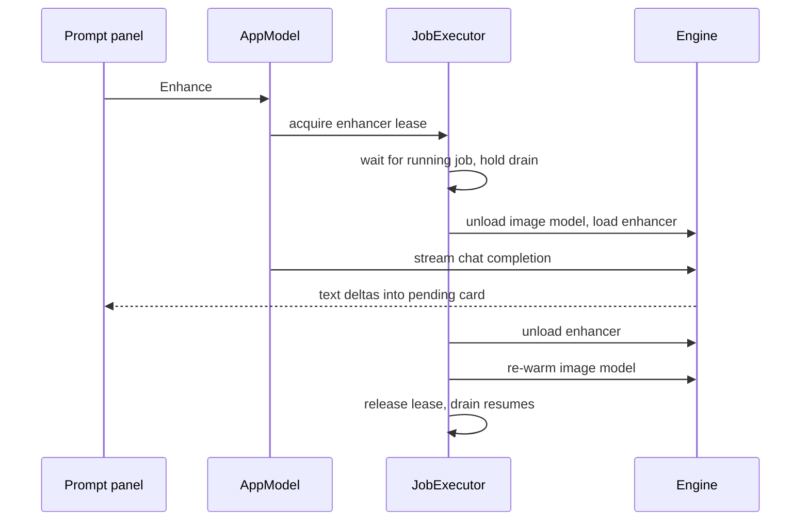

# Prompt Enhancer - Plan

## Goal Capsule

- **Objective:** A user can press Enhance on a rough prompt and get back one tuned to the selected model and the active LoRAs, fast enough to use on every prompt and without refusals, all running locally.
- **Means:** a streamed plain-text chat call to a provisional enhancer model inside the bundled engine, guided by bundled per-family prompt packs (KTD3, KTD8).
- **Authority:** Product Contract first, then Planning Contract. Where research contradicted a Product Contract premise, the correction is stated on the requirement (R7, R18).
- **Stop conditions:** stop and ask the user before downloading any candidate model weights (U6); stop and ask if no candidate clears the refusal probe and the 10 s bar (KTD2); stop before relaxing any engine-privacy flag.

---

## Product Contract

### Summary

An Enhance action beside the prompt editor, also on ⌘E, rewrites the prompt with a local LLM running in the bundled mlx-serve engine. A per-family prompt pack and each active LoRA's trigger words and example prompts guide the rewrite. The result streams into a diff the user accepts, reverts or regenerates. One provisional enhancer model is offered for install next to the first image model, with an inline install sheet as the fallback.

### Problem Frame

Each supported family wants a different prompt style, and each LoRA wants its own trigger words and phrasing. Today the user does all of that by hand, and the app helps with none of it. HLD G3 promises an Enhance button backed by a local, uncensored LLM (D9, D11, §8.8), but nothing exists: no enhancer module, no chat client in the engine client, no LLM kind in the catalog, and an installer that rejects any weight format but `.safetensors`.

The HLD defers choosing the enhancer model to an offline blind A/B that has not been built. This plan ships a provisional pick instead, so the feature can exist before the evaluation does.

### Key Decisions

- **Own the in-app Enhance flow, not remote packs or the evaluation.** (session-settled: user-directed — chosen over bundling signed remote prompt packs, and over model evaluation alone: delivers a working feature without new signing or delivery infrastructure.)
- **Ship a provisional model now; evaluate later.** (session-settled: user-directed — chosen over gating on the evaluation, and over letting users bring their own LLM: fastest route to a working Enhance, and the pick can be swapped.) Governs R11, R12, R13. This narrows D9's "one per RAM tier" to one model for all tiers for now, so it needs an HLD decision-log entry before code (KTD1).
- **Offer the enhancer alongside the first image model.** (session-settled: user-directed — chosen over a first-use inline download, and over pointing users to the Models screen.) Governs R15.
- **Pressing Enhance without the enhancer opens an inline install sheet.** (session-settled: user-directed — chosen over a message linking to Models, and over disabling the button.) Governs R16.
- **Performance bar is ~3 s to first text and ~10 s to finish on a 16 GB Mac.** (session-settled: user-directed — chosen over ~5 s / ~2 s, which forces a 1–2B model or residency on 16 GB, and over a ~20 s quality-first bar.) Governs R13.
- **The enhancer runs only in the engine, locally, and is uncensored.** Follows HLD G6, D3, D9 and the no-inference-in-app rule. Governs R10, R12.
- **One enhanced prompt per press, with the original kept as image provenance, and the negative prompt enhanced only where the family supports one.** (session-settled: user-approved — proposed with the multi-variant and no-provenance alternatives set aside: simple model, and provenance is hard to add after images exist.) Governs R4, R5, R17, R18.
- **Prompt packs ship inside the app.** (session-settled: user-approved — proposed with remote updates deferred: removes signing and delivery from this plan at the cost of a pack change needing an app release.) Governs R7.

### Requirements

**Invoking and result**

- R1. An Enhance action beside the prompt editor, also on ⌘E, rewrites the current prompt for the selected model family and the active LoRA stack.
- R2. Enhance is unavailable while the prompt is empty.
- R3. The streamed result appears in a pending card attached to the prompt editor, with the words it added highlighted, and the user can accept it, revert it (discard it) or regenerate it. The editor keeps the user's text until Accept. The user can keep editing while it runs, but a result built on text that has since changed cannot be accepted. The user can cancel while it waits or streams.
- R4. Each run returns one enhanced prompt. Regenerate runs it again.
- R5. The negative prompt is rewritten only when the selected family supports one.
- R6. Any failure leaves the user's prompt unchanged and says why in plain language.

**Knowledge**

- R7. Each current family (FLUX.2 klein, Krea-2 Turbo, Qwen-Image 2.1 Turbo) has a prompt pack bundled in the app. The packs are written for this app, follow the structure of upstream mlx-serve's prompt rewriter (system prompt plus examples per family), and credit that rewriter by name in `NOTICE`. Upstream's rewriter carries no QwenLM text, so none is claimed.
- R8. Each engine-applicable active LoRA's trigger words and up to 3 creator example prompts are supplied as context, within a size cap.
- R9. Every trigger word of an engine-applicable active LoRA appears in the result. Missing ones are re-inserted.

**Model, privacy and performance**

- R10. The enhancer runs only through the bundled mlx-serve engine on the user's Mac. No inference runs in the app process and no prompt leaves the device.
- R11. The enhancer is an MLX-native quantized `.safetensors` model that the engine runs natively. One provisional model serves every memory tier, ships as a catalog entry, and goes through the standard license acceptance (D20).
- R12. The provisional model passes a refusal probe before it ships, and the app adds no filtering or refusal path (G6, D3).
- R13. On a 16 GB-class configuration with a cold load, the first text appears in about 3 s and the result finishes in about 10 s. Larger tiers are at least as fast. The figures are measured on real hardware with 16 GB residency reproduced (`--max-resident-models 1`), not on a physical 16 GB Mac.
- R14. Below the 24 GiB memory tier the enhancer is never co-resident with the image model. It unloads after use, the image model re-warms in the background, and a one-time note explains the reload. Larger tiers may keep it resident.

**Getting the model**

- R15. The enhancer is offered for install next to the first image model, in the existing no-models and model-browser flow.
- R16. Pressing Enhance with no enhancer installed opens an inline install sheet showing size and license.

**Provenance**

- R17. An image generated from an accepted enhanced prompt records the original prompt in its own metadata.
- R18. Export strips that original prompt when the user's metadata-privacy setting says so. The repo has no export path and no such setting yet, so this requirement is blocked on them and not built here.

### Key Flows

- F1. Enhance a prompt
  - **Trigger:** The user presses Enhance or ⌘E with a non-empty prompt.
  - **Steps:** The prompt, family and active LoRAs go to the enhancer. The result streams into the pending card. The user accepts, reverts or regenerates.
  - **Outcome:** The prompt editor holds the accepted text, or the original if the result was reverted.
  - **Covered by:** R1, R3, R4, R8, R9
- F2. First press without the enhancer
  - **Trigger:** The user presses Enhance and no enhancer is installed.
  - **Steps:** The inline install sheet shows size and license. The user accepts and the download runs.
  - **Outcome:** The enhancer is installed and Enhance works.
  - **Covered by:** R16

### Acceptance Examples

- AE1. **Covers R9.** Given an active LoRA with trigger word `chromeskin`, when the enhancer returns a prompt without it, the accepted prompt contains `chromeskin`.
- AE2. **Covers R13, R14.** Given the engine running with 16 GB residency and the enhancer unloaded, when the user presses Enhance, text starts within about 3 s, the result finishes within about 10 s, and the image model is warm again afterwards when the queue is empty.
- AE3. **Covers R2.** Given an empty prompt, Enhance is unavailable.
- AE4. **Covers R6.** Given the engine fails mid-enhance, the prompt editor is unchanged and a plain-language message explains why.
- AE5. **Covers R5.** Given a family without negative-prompt support, Enhance rewrites the prompt only.

### Scope Boundaries

**Deferred for later**

- Signed, versioned remote prompt-pack updates (D11's "update without an app release").
- Per-tier enhancer picks and the offline blind A/B evaluation (HLD open question 3).
- Bring-your-own enhancer LLM.
- Edit-instruction and video prompt variants.
- Multi-variant output per press.
- Collection prompt history (deferred with D10).

**Considered and not built**

- JSON-schema structured output from the enhancer. It would switch off the engine's speculative decoding, and a plain-text reply with a cleaning step covers the need. Revisit if cleaning proves unreliable on the chosen model.
- Letting Enhance run alongside a generation on larger-memory Macs. Chat during an image job is unmeasured, so the lease keeps them apart everywhere. Revisit once someone measures it.
- Pre-warming the enhancer when the button gains focus. It adds a load the user may never use. Revisit only if U6 timing shows the cold-load budget cannot be met.
- A cache of enhancement results. A repeat press is a deliberate request for another take (Regenerate), so a cache has no consumer.
- Auto-running the pending Enhance after the inline install finishes. The user presses it again, which avoids a surprise rewrite.

### Dependencies / Assumptions

- Verified against the repo and the engine at the pinned tag v26.10.2:
  - No enhancer code exists. `EngineClient` has no chat method, and `SSELineParser` decodes only image frames (`Sources/MCEngine/EngineClient.swift`, `Sources/MCEngine/SSELineParser.swift`).
  - The engine serves `POST /v1/chat/completions` with streaming SSE, `enable_thinking`, and runs gemma4 and qwen3 natively (upstream `src/server.zig`, `docs/models.md`).
  - The catalog has no LLM kind. Validation only requires `family` to be non-empty; the match against a family record happens where a model is used, so an enhancer entry would fail there, not at validation (`Sources/MCCatalog/Catalog/Catalog.swift`, `Sources/MCCatalog/Catalog/CatalogValidation.swift`, `Sources/MCCatalog/FamilyRegistry.swift`).
  - Catalog validation allows only `.safetensors` and `.json` weights plus `chat_template.jinja`, `LICENSE`, `NOTICE` (`Sources/MCCatalog/WeightFilePolicy.swift`).
  - Active LoRA rows carry trigger words but not example prompts, which live in `LibraryStore.loraSource(loraID:)` (`Sources/MCApp/LoRAStackModel.swift`, `Sources/MCLibrary/LoRASource.swift`).
  - Launch passes `--max-resident-models` from the memory tier, so a 16 GB Mac runs one model at a time. `JobExecutor.serialized` orders only model switches. The image stream runs in its own task outside it, and `currentJobID` marks a running job (`Sources/MCEngine/EngineLaunch.swift`, `Sources/MCGeneration/Executor.swift`).
  - The image picker already drops models without the `image` capability (`Sources/MCGeneration/InstalledModel.swift`).
  - No bundled family supports a negative prompt (`Sources/MCCatalog/Resources/families.json`).
  - `ImageSettings` has no provenance field and gains an optional one without breaking old JSON (`Sources/MCLibrary/Models.swift`, `Sources/MCLibrary/MetadataCodec.swift`).
  - The license sheet is bound to the model browser (`Sources/MCApp/Models/LicenseSheet.swift`).
- Not verified, and measured in U6: whether a chat call can run during an image generation, whether the candidate's template honors `enable_thinking:false`, cold-load time of a 2–4 GB model, and refusal behavior on NSFW image prompts.
- Upstream `PromptRewriter.swift` (app/Sources/MLXServe/Services at v26.10.2) is the structural reference. It has no license header, so U4 checks upstream's repo license before crediting it.

### Outstanding Questions

**Deferred to Implementation**

- After the inline install sheet completes, the pending Enhance does not auto-run; the user presses Enhance again.
- LoRAs the engine cannot apply (`engineAppliesLoRAs: false`, currently Qwen's) are left out of the enhancer context.
- Families without a bundled prompt pack get Enhance unavailable, with the reason in a visible caption and the button's accessibility hint, not a generic pack.

**Affects Scope (for the requester)**

- R13 is measured on a larger-memory Mac with 16 GB residency reproduced, and the user has accepted that as sufficient (no physical 16 GB Mac needed). It still understates memory pressure on a real 16 GB machine, so the engine's preflight RAM figure is recorded alongside the timings.
- R18 and the export-strip half of provenance wait on an export feature and a metadata-privacy setting. Neither is in the HLD's current build order.

---

## Planning Contract

### Key Technical Decisions

- KTD1. **Docs first.** Add HLD decision D36 (one provisional enhancer for all tiers, in-app prompt packs, plain-text contract) before code, amend D9 and §8.8 to point at it, and correct the HLD and AGENTS.md claim that upstream's rewriter carries QwenLM attribution. Governs R7, R11. (AGENTS.md: update the HLD decision log first.)
- KTD2. **The model is picked by a measured gate.** Candidates, in order: `McG-221/gemma-4-E4B-it-heretic-mlx-4Bit` (gemma4, 4.23 GB) and `mlx-community/Josiefied-Qwen3-4B-Instruct-2507-abliterated-v2-4bit` (qwen3, 2.27 GB). The first to clear both bars ships: at most 2 of 50 NSFW, violent and neutral image-prompt rewrites refused or deflected, and first text under about 3 s with a result under about 10 s, cold. A refusal is a reply with no rewritten prompt. A deflection is a rewrite that drops or softens an explicit term from the source prompt. The 50 outputs are scored blind and every verdict is recorded. If neither clears both, stop and ask. (session-settled: user-approved — the 2-of-50 threshold was proposed by the planner and confirmed by the user, over 0 of 50 and 5 or more: strict enough to reject a visibly sanitizing model without forcing a model search; Revert and Regenerate cover the remaining misses.) Governs R11, R12, R13.
- KTD3. **Plain-text chat, never a JSON schema.** A fixed system message per family and one user message, streamed, with `enable_thinking:false`. A schema would switch off the engine's speculative decoding, and upstream's own rewriter is plain text. The app strips fences and quotes, then re-inserts any missing trigger words as a comma-separated tail. The system text stays byte-identical across calls so the engine's prefix cache hits. Governs R1, R9, R13.
- KTD4. **The enhancer is a new catalog kind, not an image family.** Add an optional `kind` to catalog entries, defaulting to image so every existing signed catalog still decodes. Validation does not check `family` against the registry today, so an enhancer entry needs a branch there that requires no family record, and every consumer that resolves a model's family (the browser, the installer and the picker) routes enhancer entries away from that lookup. The weight-file policy is not loosened. Before any download, each candidate's repo file list is checked against it, and a candidate with a tokenizer sidecar or other disallowed file is replaced by the next candidate. The bundled catalog is re-signed with the sequence raised. Governs R11, R15.
- KTD5. **Enhance takes an exclusive lease on the executor, and runs after the current image but ahead of queued jobs.** (session-settled: user-directed — chosen over waiting for the whole queue, and over refusing Enhance while generating: the wait is one image, and the user can refine the next prompt while a batch runs.) The lease is explicit state on `JobExecutor`, not a use of `serialized`, which orders model switches only. Acquiring it sets a held flag at once, then waits until no job is running (`currentJobID` is clear). `drain` checks the flag before it claims each queued job, so queued jobs stay queued however many there are. While held, the lease loads the enhancer, streams, unloads it (below 24 GiB), and re-warms the image model only when no job is queued; with jobs queued, `drain` loads whichever model the next job needs, so a re-warm would be wasted. Enhance never overlaps a running generation, because chat during image generation is unmeasured. At or above 24 GiB the enhancer stays resident, which avoids an image-model reload on every press. A paused queue does not block Enhance, since pause only stops `drain` claiming jobs. Cancelling the running job ends the wait. Governs R13, R14.
- KTD6. **The chat call lives in `MCEngine` with its own frame decoder.** It reuses `EngineClient`'s request, auth and cancellation path, adds chat-specific error copy, and is tested through the existing `URLProtocol` stubs, which already serve as the D30 transport seam. A new `MCEnhancer` target holds packs, request building, cleaning, and the trigger-word rules, and depends on `MCEngine`, `MCCatalog` and `MCLibrary`. `MCApp` depends on `MCEnhancer`, so the word-bounded match and append rules move out of `LoRAStackRules` into a public type in `MCEnhancer`, and `LoRAStackRules` calls it. One matcher serves both the chips and the guarantee. Governs R1, R9, R10.
- KTD7. **Provenance rides in the image's own metadata.** `ImageSettings` gains an optional original-prompt field and the job request carries it. The metadata schema stays at 1 and no database migration is added, since nothing queries it. It is set when the user accepts an enhancement (the text it replaced), replaced by a later Accept, and kept through manual edits. Revert only discards a pending card and does not touch it. It is cleared when the prompt is emptied. Governs R17.
- KTD8. **Prompt packs are bundled resources keyed by family id.** One file per current family, each a system message plus a few example prompts, loaded from the `MCEnhancer` bundle. Governs R7.
- KTD9. **No prompt text is logged.** The engine echoes request text in its preview lines, so enhancer prompts and results stay out of `os_log` at any non-private level, and diagnostics exclude them. Governs R10.
- KTD10. **The result appears as a pending card attached to the prompt editor, not in the editor.** The editor keeps the user's text until Accept. The card has these states: waiting (shows that Enhance starts after the current image), streaming, ready, stale, failed. Waiting and streaming offer Cancel, bound to the Enhance task; `⌘.` stays bound to generation jobs only. A result is stale when the prompt changed after the run began; it shows a "built on earlier text" label, Accept is disabled, and Regenerate stays available. Ready offers Accept, Revert (discard the card) and Regenerate. Generate stays available while the card waits; a job requested then starts after the lease is released. Added words are marked by underline or weight as well as colour, the card has an accessibility label listing them, and "enhancement ready" is announced once when streaming ends. Governs R3.

### High-Level Technical Design

The residency sequence for one Enhance press on a Mac below 24 GiB (KTD5). At or above 24 GiB the enhancer stays resident and the unload and re-warm steps are skipped.

### Risks

| Risk | Effect | Mitigation |
|---|---|---|
| No candidate clears the refusal probe and the 10 s bar | The feature cannot ship as specified | Stop condition: ask the user (KTD2) |
| Cold load of a 4 GB model eats the 3 s first-text budget | R13 missed | U6 measures it; the smaller candidate is the fallback; pre-warming at button focus is considered only if timing fails |
| Candidate template ignores `enable_thinking:false` | Reasoning text leaks into the prompt | U4 cleaner drops reasoning blocks; U6 checks the live template |
| Unload during an in-flight chat request aborts it | Failed Enhance | Lease orders the unload after the stream ends (KTD5) |
| Whole-prompt rewrite changes the user's intent | User distrust | Pending card with Revert; the editor keeps the original until Accept (KTD10) |

---

## Implementation Units

### U1. Docs first: HLD decision and attribution correction

- **Goal:** The decision log records the provisional enhancer before any code, and the attribution claim matches what upstream actually carries.
- **Requirements:** R7, R11
- **Dependencies:** none
- **Files:** `docs/HLD.md`, `AGENTS.md`
- **Approach:**
  - Add D36 per KTD1 and amend D9 and §8.8 to cite it.
  - Replace the claim that the rewriter embeds QwenLM Apache-2.0 text with the verified fact, in the HLD and in the AGENTS.md "Reusing mlx-serve's Swift app code" section.
- **Test expectation:** none -- documentation only.
- **Verification:** The HLD decision log has D36 and no text still claims QwenLM attribution for the rewriter.

### U2. Streaming chat client in the engine layer

- **Goal:** The app can stream a chat completion from the engine, cancel it, and map its failures to enhancer-specific messages.
- **Requirements:** R1, R6, R10; KTD3, KTD6
- **Dependencies:** none
- **Files:** `Sources/MCEngine/EngineClient.swift`, `Sources/MCEngine/ChatStream.swift` (new), `Sources/MCEngine/EngineError.swift`, `Tests/MCEngineTests/ChatStreamTests.swift` (new), `Tests/MCEngineTests/Fixtures/Client/`
- **Approach:**
  - Add a streaming method that posts a chat request with `stream`, `enable_thinking:false` and sampling fields, and yields text deltas.
  - Decode `choices[0].delta.content`, stop at `[DONE]`, treat `finish_reason:"error"` frames as failures.
  - Reuse the existing request, auth and cancellation plumbing, and give `out_of_memory` and "model not loaded" enhancer-specific user copy.
- **Patterns to follow:** `generateImage`/`streamGeneration` in `EngineClient`; the `StubbedEngine` helper and recorded SSE fixtures in `EngineClientStreamTests`.
- **Test scenarios:**
  - Happy path: a recorded multi-chunk SSE fixture yields the joined text in order and finishes on `[DONE]`.
  - The request body carries `stream:true`, `enable_thinking:false` and the model id, and the bearer key header is present.
  - A 401 maps to the unauthorized error, and a 503 `out_of_memory` maps to the enhancer-specific out-of-memory message.
  - A mid-stream error frame throws after the text received so far is delivered.
  - Cancelling the consumer cancels the request and finishes silently.
  - A stream that ends without `[DONE]` or a finish reason throws the stream-ended error.
  - A chunk with an empty `choices` array (usage-only) is ignored.
- **Verification:** The chat tests pass and an image generation test in the same target is unaffected.

### U3. Enhancer catalog kind and discovery

- **Goal:** A signed catalog can carry an enhancer entry that installs through the existing installer and is found again without ever appearing as an image model.
- **Requirements:** R11, R12; KTD4
- **Dependencies:** none
- **Files:** `Sources/MCCatalog/Catalog/Catalog.swift`, `Sources/MCCatalog/Catalog/CatalogValidation.swift`, `Sources/MCModels/ModelInstaller.swift`, `Sources/MCApp/Model/InstallCoordinator.swift`, `Sources/MCApp/Models/ModelBrowserModel.swift`, `Sources/MCApp/AppModel.swift`, `Tests/MCCatalogTests/CatalogValidationTests.swift`, `Tests/MCCatalogTests/Support/CatalogFixture.swift`, `Tests/MCAppTests/ModelBrowserTests.swift`, `Tests/MCAppTests/InstallCoordinatorTests.swift`
- **Approach:**
  - Add the optional kind per KTD4. Validation gains a branch for enhancer entries that requires no family record, and the browser, installer and picker route enhancer entries away from the family lookup. Every other field check, including the weight-file policy and the `download_bytes` sum, still applies.
  - The browser lists enhancer entries in their own group and installs them like any model. The app exposes whether an enhancer is installed and its engine model id, from the install record plus the engine listing.
  - The image picker is unchanged: it already drops models without the `image` capability.
- **Patterns to follow:** optional-key decoding in `ModelFamily.init(from:)`; `CatalogFixture.editModel` for validation tests.
- **Test scenarios:**
  - An existing catalog without any kind field still decodes and validates, and every model is an image kind.
  - An enhancer entry whose `family` names no family record validates, and an image entry still behaves as before. An enhancer entry never reaches the family lookup in the browser, installer or picker.
  - An enhancer entry listing a `.gguf` or `.bin` file is rejected by the weight-file policy.
  - An enhancer entry whose `download_bytes` differs from the file size sum is rejected.
  - Installing an enhancer records it and the app reports it installed, while the image model picker still lists only image models.
  - An enhancer present in the engine listing but missing from the install record is reported not installed.
- **Verification:** The catalog and app tests pass. `mc-catalog verify` on the re-signed catalog is checked in U6.

### U4. Enhancer module: packs, request building, cleaning, trigger words

- **Goal:** Given a prompt, a family and the active LoRAs, the module produces the chat request and turns the raw text into a final prompt that keeps every trigger word.
- **Requirements:** R5, R7, R8, R9; KTD3, KTD8, KTD9
- **Dependencies:** U2
- **Files:** `Package.swift`, `Sources/MCEnhancer/PromptEnhancer.swift` (new target), `Sources/MCEnhancer/PromptPack.swift`, `Sources/MCEnhancer/EnhancementCleaner.swift`, `Sources/MCEnhancer/Resources/Packs/`, `Tests/MCEnhancerTests/` (new), `NOTICE`
- **Approach:**
  - Add the `MCEnhancer` target and its test target to `Package.swift` beside `MCGeneration`, and add it to `MCApp`'s dependencies.
  - Move the word-bounded match and append rules out of `LoRAStackRules` into a public type in `MCEnhancer`, and make `LoRAStackRules` call it, so `MCApp` and `MCEnhancer` share one matcher without a dependency cycle.
  - Write one pack per current family, following the structure of upstream's rewriter: a shape instruction, 2–4 examples (three neutral ones plus one that keeps an explicit label, added by the U6 retune, `docs/lld/enhancer.md` 3.5), and a reply-with-only-the-prompt rule.
  - Build the user message from the prompt plus trigger words and up to 3 example prompts per active LoRA, under a total size cap. Example prompts are context only and are never inserted verbatim.
  - After streaming, clean the text: strip fences, wrapping quotes and any reasoning block, then re-insert missing trigger words using the shared word-bounded, case-insensitive match.
  - Rewrite the negative prompt only when the family record says it supports one.
  - Check upstream's repo license and add the `NOTICE` credit.
- **Patterns to follow:** the existing `LoRAStackRules` match and append behavior, moved without change and still covered by `LoRAStackTests`; `FamilyRegistry` ids as pack keys.
- **Test scenarios:**
  - Covers AE1. The model returns text without `chromeskin`, and the final prompt contains it exactly once.
  - A trigger word already present in a different case is not duplicated.
  - Output wrapped in quotes or a fenced block is unwrapped, and a leading reasoning block is removed.
  - Three active LoRAs with five example prompts each contribute at most 3 examples each, and the user message stays under the size cap.
  - A local-import LoRA with no source record and no trigger words contributes nothing and does not fail the build.
  - Covers AE5. For every bundled family the registry says negative prompts are unsupported, so no negative-prompt rewrite is requested.
  - A family with no bundled pack reports Enhance unavailable instead of falling back.
  - The system text is byte-identical across two builds for the same family.
- **Verification:** The module's tests pass without a running engine.

### U5. Executor lease and residency orchestration

- **Goal:** One Enhance press runs the load, stream and unload sequence after the running job and ahead of queued jobs, without racing the queue, and leaves the engine ready for whatever runs next.
- **Requirements:** R6, R10, R14; KTD5
- **Dependencies:** U2, U3
- **Files:** `Sources/MCGeneration/Executor.swift`, `Sources/MCGeneration/EnhancerLease.swift` (new), `Tests/MCGenerationTests/EnhancerLeaseTests.swift` (new), `Tests/MCGenerationTests/Support/Harness.swift`
- **Approach:**
  - Add lease state to `JobExecutor`: a held flag, and acquire waits until `currentJobID` is clear (the running job's `defer` releases it). `drain` checks the flag before it claims each queued job, and `run` waits while the flag is held. Do not use `serialized` to wait for a running job: it orders model switches only, and the image stream runs outside it.
  - Below 24 GiB the lease unloads the image model before loading the enhancer and unloads the enhancer afterwards. It re-warms the previously selected image model only when the queue is empty. At or above 24 GiB the enhancer stays resident and the unload and re-warm are skipped.
  - Releasing the lease, including on cancel or failure, always unloads the enhancer (below 24 GiB), re-warms the image model only when the queue is empty, and lets the drain resume.
  - An out-of-memory refusal reuses the executor's existing unload-all path.
- **Execution note:** Start with a failing test that a queued job does not begin while the lease is held.
- **Patterns to follow:** `serialized` and `selectModel` in `JobExecutor`; `OutOfMemoryFailure` handling.
- **Test scenarios:**
  - Integration: a job is running when the lease is requested; the lease waits, then proceeds after the job ends.
  - Integration: a job is queued while the lease is held; it starts only after release.
  - Below 24 GiB the engine call log shows image unload, enhancer load, enhancer unload, image load, in that order.
  - At or above 24 GiB no unload of the image model happens.
  - Cancelling the Enhance mid-stream still unloads the enhancer. With an empty queue it re-warms the image model.
  - An out-of-memory refusal on enhancer load releases the lease, restores the image model when the queue is empty, and surfaces the enhancer-specific message.
  - A model switch requested by the user during the lease is applied after release, not interleaved.
  - Integration: three jobs are queued and one is running when the lease is requested. The lease waits for the running job only, runs ahead of the other two, and the two then start in their original order.
  - Integration: a job is running and two queued jobs use a model other than the selected one. After the lease, the image model is not re-warmed, and the queued job loads its own model once.
  - Integration: the queue is paused when the lease is requested. Enhance runs and the queue stays paused afterwards.
  - Integration: the running job is cancelled while the lease waits. The lease proceeds without waiting for another job.
- **Verification:** The lease tests pass and the existing executor and queue tests are unchanged.

### U6. Model gate: probe, timing, pick, catalog entry

- **Goal:** One real candidate is chosen on measured evidence and added to the signed catalog with a real RAM figure.
- **Requirements:** R11, R12, R13; KTD2, KTD3
- **Dependencies:** U2, U3, U4
- **Files:** `scripts/enhancer-gate/` (new: harness and probe prompt set), `docs/lld/enhancer.md` (new, results), `catalog/models.src.json`, `Sources/MCCatalog/Resources/catalog.json`, `Sources/MCCatalog/Resources/catalog.json.sig`
- **Approach:**
  - Stop and ask the user before downloading a candidate's weights, and check free disk first.
  - Before any download, list each candidate's repo file tree and check it against the weight-file policy. A candidate with a disallowed file (for example a tokenizer sidecar) is skipped for the next one without downloading it.
  - Run each candidate in order through the real engine launched as the app launches it (private home, strict key), with `--max-resident-models 1` to reproduce the 16 GB residency on a larger Mac. Run the 50-prompt probe, scoring each output blind as a refusal, a deflection or a pass per KTD2, and time cold load, first text and total for a typical enhancement with the image model unloaded.
  - Confirm `enable_thinking:false` leaves no reasoning text.
  - Record every verdict, the measured results, the engine's preflight RAM figure and the note that the machine has more than 16 GB (accepted by the user) in `docs/lld/enhancer.md`.
  - Add the winner with `mc-catalog build`, sign with the development key and `--acknowledge-diff`, and raise the sequence.
  - If neither candidate clears both bars, stop and ask.
- **Execution note:** Smoke-first. This unit is measurement, so its output is a recorded result and a catalog entry, not unit tests.
- **Test expectation:** none -- this is a real-hardware measurement gate. Its result is recorded in the LLD and enforced by catalog validation in U3.
- **Verification:** `mc-catalog verify` passes on the bundled catalog, the LLD records both candidates' probe and timing numbers, and the chosen entry's `ram_gb` is the engine's measured figure.

### U7. Enhance state, LoRA context and provenance in the app model

- **Goal:** The app model runs an Enhance end to end and carries the original prompt through to the saved image.
- **Requirements:** R1–R6, R8, R9, R14, R17; KTD7, KTD10. R18 (strip on export) is not built here: the repo has no export path or metadata-privacy setting.
- **Dependencies:** U4, U5
- **Files:** `Sources/MCApp/AppModel.swift`, `Sources/MCApp/AppModel+Enhance.swift` (new), `Sources/MCLibrary/Models.swift`, `Sources/MCGeneration/` (job request type), `Sources/MCGeneration/Executor.swift`, `Tests/MCAppTests/EnhanceTests.swift` (new), `Tests/MCAppTests/Support/AppHarness.swift`, `Tests/MCLibraryTests/MetadataCodecTests.swift`
- **Approach:**
  - Add pending-result state: idle, waiting for the queue, streaming, ready (with the text it was built on), stale, failed with a message. Cancel ends the Enhance task from waiting or streaming.
  - Gather the active LoRAs (used and engine-applicable), look up each one's example prompts from the library, and call the module through the lease.
  - Accept replaces the prompt and sets the original-prompt provenance to the text it replaced. Revert discards the pending result and leaves provenance alone. Regenerate runs again per R4. A result is stale once the prompt differs from the text it was built on, and a stale result cannot be accepted. Emptying the prompt clears provenance.
  - Carry the original prompt on the job request into `ImageSettings` as an additive optional field. The metadata schema stays at 1.
  - Enhance is unavailable on an empty prompt. With no enhancer installed it routes to the install sheet (U8). On a failure the prompt is untouched.
- **Patterns to follow:** `AppModel+LoRA.swift` for stack access; `AppModel.selectModel` for the warming banner; the cancelled-first-load lesson in `docs/solutions/` (a cancelled Enhance must not leave a pending state).
- **Test scenarios:**
  - Covers AE3. An empty prompt cannot start Enhance.
  - Covers AE4. The engine fails mid-stream, the prompt is unchanged, and a plain-language message is set.
  - Accept replaces the prompt, Revert leaves it as it was, and Regenerate produces a fresh pending result.
  - Cancelling while waiting or streaming leaves no pending state and the prompt unchanged.
  - Editing the prompt during a run makes the result stale, and Accept is refused until Regenerate produces a result built on the current text.
  - Generating after Accept stores the original prompt in the image's metadata. After Revert it stores whatever it stored before, and after an emptied prompt it stores none.
  - An edit after Accept keeps the original-prompt provenance, and a second Accept replaces it.
  - Metadata round trip: an image with the original prompt embedded decodes with it, and an image from before this change decodes with none.
  - A disabled or engine-inapplicable LoRA contributes no trigger words or examples.
  - Covers AE2 (logic only). The call log for a press below 24 GiB shows the lease sequence and the image model selected afterwards.
- **Verification:** The app and library tests pass and old saved images still decode.

### U8. Enhance UI, install offer and inline sheet

- **Goal:** The user can see, trigger and judge an enhancement, and can get the model from the first-model flow or from the button itself.
- **Requirements:** R1, R3, R15, R16; KTD10
- **Dependencies:** U3, U7
- **Files:** `Sources/MCApp/GenerationPanel.swift`, `Sources/MCApp/EnhanceResultCard.swift` (new), `Sources/MCApp/EnhancerInstallSheet.swift` (new), `Sources/MCApp/Models/LicenseSheet.swift`, `Sources/MCApp/Models/ModelBrowserView.swift`, `Sources/MCApp/AppModel.swift`, `Sources/MCApp/MainWindow.swift`, `Sources/MCApp/EmptyModelsView.swift`, `Tests/MCAppTests/EnhanceOfferTests.swift` (new)
- **Approach:**
  - Add an Enhance button beside the prompt editor, with ⌘E through the existing hidden-shortcut group, disabled on an empty prompt. When disabled for an unsupported family, show the reason in a visible caption and the button's accessibility hint, not only a tooltip.
  - Show the pending card per KTD10 with its states and Cancel, Accept, Revert and Regenerate. Mark added words by underline or weight as well as colour, give the card an accessibility label listing them, and announce "enhancement ready" once when streaming ends.
  - Show a one-time note below 24 GiB that the image model reloads afterwards, remembered in a named preferences key. While the card waits and jobs are queued, say that they start after Enhance.
  - Move the pending license state from the model browser's own model up to `AppModel` so the browser and the generation panel can both present the license sheet. The inline sheet has states: ready, downloading with Cancel, failed with Retry, and unavailable when the catalog has no enhancer entry.
  - List the enhancer as an optional extra in the no-models state and in the model browser while it is not installed, with no persisted dismissal. The inline sheet stays the fallback route.
- **Patterns to follow:** `ShortcutButtons` for ⌘R; the placeholder overlay in the prompt editor; the `LicenseSheet` accept-then-install flow.
- **Test scenarios:**
  - Covers F2. Enhance with no enhancer installed presents the install sheet with size and license, accepting starts the install, and the prompt is untouched.
  - The enhancer is offered in the no-models state and the model browser while not installed, and not offered once installed.
  - The inline sheet shows its failed state with Retry when the download fails, and its unavailable state when the catalog has no enhancer entry.
  - The card marks only words added to the original.
  - ⌘E triggers Enhance with the prompt editor focused and does not conflict with ⌘↩, ⌘R or ⌘. If the focused text view consumes ⌘E for Find, bind it through the app's command menu instead, and record which was needed.
  - A disabled Enhance for a family with no pack exposes its reason through the accessibility hint.
- **Verification:** The offer tests pass. A visual check of the card, the sheet and the keyboard flow is left to the user's own GUI testing, as for earlier work.

### U9. Documentation and real-engine smoke

- **Goal:** The next agent finds the commands, the gate results and the conventions without rediscovering them.
- **Requirements:** R7, R10, R13
- **Dependencies:** U6, U8
- **Files:** `docs/lld/enhancer.md`, `docs/lld/engine.md`, `AGENTS.md`, `NOTICE`
- **Approach:**
  - Write the enhancer LLD: the sequence in the design diagram, the chat call shape, the candidate results, and the removal conditions for the provisional pick.
  - Add the enhancer smoke step to the engine LLD's smoke procedure: one chat call, then confirm the enhancer unloaded and the image model re-warmed.
  - Add the new target's test command and the enhancer gotchas to AGENTS.md.
  - Run the smoke against the real engine with the selected enhancer and the smallest image model.
- **Test expectation:** none -- documentation and a smoke run.
- **Verification:** The smoke run shows an enhanced prompt streamed, the enhancer unloaded afterwards, and an image generated with the original prompt present in its metadata.

---

## Verification Contract

| Gate | Command or check | Applies to |
|---|---|---|
| Library tests | `swift test` (run through an eval subprocess in this environment) | U2–U5, U7, U8 |
| Focused suites | `swift test --filter MCEngineTests`, `MCCatalogTests`, `MCGenerationTests`, `MCEnhancerTests`, `MCAppTests` | per unit |
| Catalog signature | `swift run mc-catalog verify Sources/MCCatalog/Resources/catalog.json` | U3, U6 |
| App build | `xcodegen generate`, then `xcodebuild -project MLXCreate.xcodeproj -scheme MLXCreate -configuration Debug -derivedDataPath build build` | U7, U8 |
| Real-engine gate | Probe and timing run against the engine with strict key and private home (`MLXC_ENGINE_BIN`) | U6, U9 |
| Engine hygiene after smoke | `pgrep mlx-serve` shows no leftover engine | U6, U9 |

---

## Definition of Done

- Every requirement R1–R17 is built and covered by a test or the real-engine gate. R18 is explicitly recorded as blocked on export and a privacy setting.
- The selected model passed the refusal probe and the timing bar on the measuring machine with 16 GB residency reproduced (the user accepted this in place of a physical 16 GB Mac), with the numbers and every probe verdict recorded in `docs/lld/enhancer.md`, and its `ram_gb` is the engine's measured figure.
- The bundled catalog is re-signed and `mc-catalog verify` passes.
- HLD D36 exists, and no document still claims QwenLM attribution for upstream's rewriter.
- No prompt text reaches logs, no engine-privacy flag was relaxed, and no inference runs in the app process.
- The real-engine smoke run completed and the engine was reaped.
- Scaffolds and throwaway scripts from the measurement gate are removed, except the documented `scripts/enhancer-gate/` harness.
