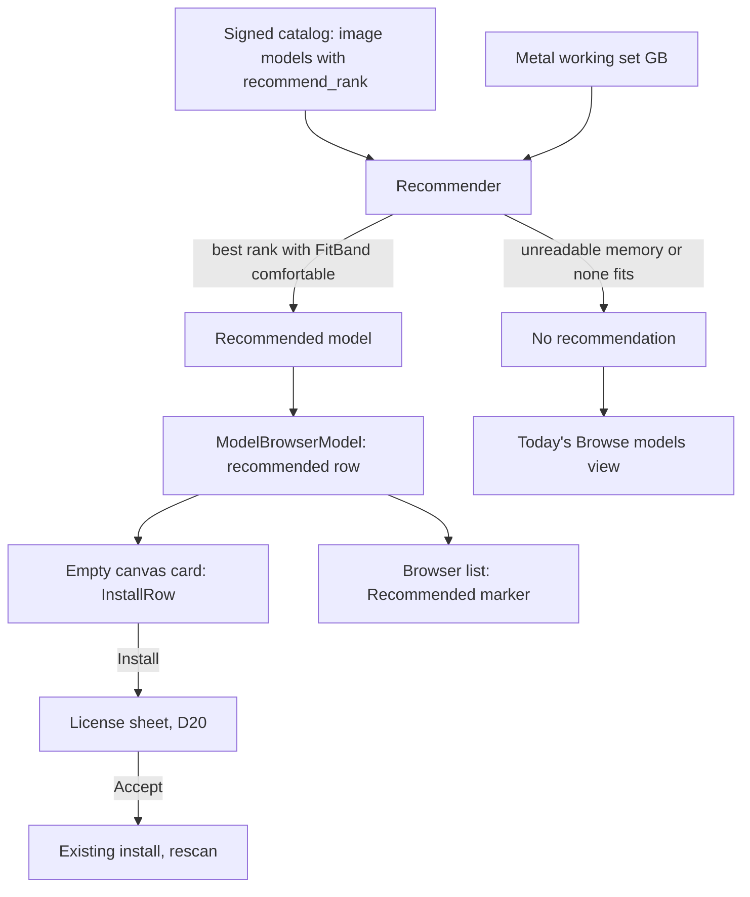

# Machine-fit model recommendation - Plan

## Goal Capsule

- **Objective:** A new user with no image model installed sees the one model that suits this Mac and can start using it with a single, obvious action, without reading fit warnings or choosing from a catalog.
- **Means:** The signed catalog carries a preference rank per image model, and a recommender picks the best-ranked model that fits this Mac comfortably (KTD1, KTD2).
- **Authority:** `STRATEGY.md` ("Zero to first image", "Expert in the box") and `docs/HLD.md` win over this plan. Per `AGENTS.md`, the HLD decision log is updated before any code acts on this plan (U1).
- **Stop conditions:** Stop and ask if the work needs a change to a D-entry other than the new D42, a second engine, or downloading weights beyond what the verification step names.
- **Execution profile:** Swift 6, SwiftUI plus library targets, Swift Testing. One owner, units in order.

---

## Product Contract

### Summary

On a Mac with no installed image model, the empty canvas offers one recommended model with an install button, chosen from the signed catalog by rank among the models that fit this Mac comfortably and that the user can install. The license sheet still appears before any download. The model browser marks the same model. The empty canvas is unchanged for users who already have a model; they see only the marker in the browser.

### Problem Frame

A new user lands on "No image models installed" and must pick from the catalog. The catalog already labels each model "Fits this Mac", "Tight fit" or "Exceeds this Mac", but the user still has to read the labels, understand RAM and quantization, and decide. `STRATEGY.md` makes time to first kept image the lead metric and names "no decision the user can't make" as the bar for "Zero to first image". Choosing a model is the first such decision.

### Requirements

**Recommendation**

- R1. When no image model is installed, the empty canvas offers one recommended model with one install action, ahead of the "Browse models" path.
- R2. The recommended model is the best-ranked catalog image model whose fit band on this Mac is comfortable and that the user can act on: not already installed, not an unverified local folder, and installable (the installs coordinator exists). A model that fails the last condition is skipped, and the next-ranked candidate is considered.
- R3. Qwen-Image 2.1 Turbo is eligible for the pick like any other ranked model (Key Decision KD1).
- R4. When this Mac's usable memory cannot be read, or no ranked model is both comfortable and actionable, no recommendation is shown and the empty canvas behaves as it does today.
- R5. The model browser marks the recommended model as the recommendation.

**Install**

- R6. The install action opens the license sheet, and nothing downloads until the user accepts (D20, KD2).
- R7. Install progress, cancel, resume, retry and failure messages show on the empty canvas in the states the browser already shows.
- R8. When the install finishes, the app leaves the empty canvas through the existing model rescan, with no extra step.

**Catalog**

- R9. The preference order lives in the signed catalog, so it changes with a catalog update and not a code change. Until a catalog URL is configured (HLD §15 Q4 and `docs/lld/models.md` release gate), the only catalog is the bundled one, so a rank change then ships with an app release.
- R10. A model without a rank is never recommended, and a catalog with no ranks yields no recommendation. Catalogs signed before this change still verify and load unchanged.

### Key Decisions

- KD1. **Qwen-Image 2.1 Turbo can be the automatic pick.** The app's own terms, accepted at install, are assumed to cover use of each model's license. (session-settled: user-directed — chosen over keeping research-licensed models out of the automatic pick: the user will have buyers accept app terms that cover model licensing.) Governs R3.
- KD2. **The per-download license sheet stays.** (session-settled: user-approved — chosen over skipping the sheet for models the app terms cover: the Qwen license says commercial use needs a separate grant, so one extra click is cheap insurance, and D20 stays intact.) Governs R6.

### Scope Boundaries

- No first-run wizard, starter prompt, or on-device speed calibration.
- No enhancer recommendation. The existing optional enhancer offer on the empty canvas stays as it is.
- No change to the empty canvas for users who already have an installed image model. The recommendation drives the empty state, and the browser marks the same row for everyone.
- No reading of chip generation, GPU core count or Neural Accelerator support. The pick follows the Metal working set the browser already reads.
- Considered and not built:
  - A confirmation dialog before installing a recommended model. The license sheet is already a deliberate step.
  - Re-ranking from observed generation speed. It needs calibration data we don't have, so revisit it with calibration.
  - A user setting for the order. Nothing in the strategy asks the user to rank models.

#### Deferred to Follow-Up Work

- Onboarding calibration and per-model time estimates (HLD §8.5, calibrator level 1).
- Enhancer pairing in the recommendation (HLD §8.5 seed tiers).

### Success Criteria

- On a Mac whose usable working set matches a 16 GB machine (about 11.9 GB, HLD §4), a user with no model sees FLUX.2 klein 4B recommended and reaches a download in one click plus license acceptance.
- On a Mac where the higher-ranked models are comfortable, the user sees the highest-ranked one, not just the largest. Which real Macs that covers is unmeasured (see Dependencies); the criterion is checked with synthetic working-set values.
- The empty canvas never recommends a model the browser would label "Tight fit" or "Exceeds this Mac".

### Dependencies and Assumptions

- The app's terms must cover third-party model licenses before release (KD1). This plan adds no terms text, and the legal read stays a release prerequisite (HLD §14). Known risk, recorded because KD1 is settled: the catalog's own Qwen license summary says any commercial purpose needs a separate commercial license from Hangzhou Tongyi Laboratory Technology Co., Ltd., which app terms alone may not grant. That read must name this clause. If it fails, the fix is one rank change (or removing Qwen's rank) in the catalog, not a code change.
- Usable memory for 24 GB and 32 GB Macs is not measured here. The only evidence is the 16 GB figure in HLD §4 (about 11.9 GB). HLD §8.5 calls Qwen-Image 2.1 Turbo "tight" on 24 GB, and the `FitBandTurboTests` fixture pins Qwen as tight at 16.5 GB, so a 24 GB Mac may be recommended klein instead of Qwen. Tests use synthetic working-set values instead of claiming Mac sizes. [INFERENCE: larger tiers scale at a similar fraction of RAM.]

---

## Planning Contract

### Key Technical Decisions

- KTD1. **Rank is an optional `recommend_rank` integer on a catalog model, lowest first.** It is written only when set, so models without it re-encode to the same bytes and the signature still matches, as `kind` does (`Sources/MCCatalog/Catalog/Catalog.swift`). `schema_version` stays 1, because old builds ignore the unknown key. Chosen over using catalog array order: array order is also the browser's display order and a bundled-catalog test pins it, so reusing it would couple two unrelated choices. (session-settled: user-approved — chosen over a fixed "largest comfortable" rule: rank in the signed catalog lets us change the pick without an app release and keeps Krea's revenue-cap license from winning on size alone.) Serves R2, R9, R10.
- KTD2. **The recommender is a pure function in `MCCatalog`, over the catalog, the usable working set and a caller-supplied eligibility predicate.** It reuses `FitBand` and returns a model or nil. The app layer supplies the predicate (installed, unverified, no installs coordinator), so the library stays free of install state. The appendix reuse table in HLD names `MCCatalog.Recommender`; §8.5 leaves the module unnamed. Serves R2, R4.
- KTD3. **Only the comfortable band qualifies.** `tight` is a warning band (`FitBand`): the model runs but may thrash. The automatic pick must not start a newcomer there. Serves R2.
- KTD4. **Proposed order: Qwen-Image 2.1 Turbo (1), Krea 2 Turbo (2), FLUX.2 klein 4B (3).** HLD §14 says to lead with Qwen-Image where it fits. Krea carries a revenue cap and a content-filter clause, and klein is the weakest on uncensored output but the only model that fits 16 GB. The order is catalog data, so the user can overrule it without code. Serves R2.
- KTD5. **The empty canvas reuses `InstallRow`, headed "Recommended for this Mac".** `InstallRow` already renders fit, facts, every install state, errors and the action button (`Sources/MCApp/Models/InstallRow.swift`), so R7 needs no second state renderer. Serves R7.
- KTD6. **The empty canvas owns its own license sheet, bound to the shared `AppModel.license` (`LicensePrompt`).** Today the browser sheet and `EnhancerInstallSheet` each attach a `.sheet` to that prompt, and nothing presents it from the canvas. The canvas view attaches the same kind of sheet, following `EnhancerInstallSheet`, and stands down while the browser sheet is presented, so exactly one sheet shows. Serves R6.
- KTD7. **The decision lands in the HLD first.** A new D42 records rank-in-catalog, comfortable-and-actionable-only and the KD1 assumption, per `AGENTS.md` ("update the HLD decision log first, then the code"). Serves all requirements.
- KTD8. **The canvas card uses the existing `AppModel.browser` instance.** `InstallRow` takes a `ModelBrowserRow` and the `ModelBrowserModel`, and that model owns the install task and rescan. A second instance would duplicate install state. Serves R7.

### Technical Design

---

## Implementation Units

### U1. Record the decision in the HLD and the catalog LLD

- **Goal:** Make D42 and the new catalog field the written source of truth before any code.
- **Requirements:** R2, R3, R6, R9, R10 (KTD7).
- **Dependencies:** none.
- **Files:** `docs/HLD.md`, `docs/lld/models.md`.
- **Approach:**
  - Add D42 to the HLD decision log: rank in the signed catalog, comfortable and actionable only, the KD1 assumption about app terms (with the Qwen commercial-license caveat), KD2 keeps the sheet.
  - Update HLD §8.5 (Recommender) so its pick rule reads "best-ranked comfortable, actionable model" instead of "largest comfortable model", and note that the seed-tier table is guidance rather than the rule.
  - Update HLD §13 (v1.0 row) and §14 (Qwen license row) only where their text now disagrees.
  - Document `recommend_rank` in `docs/lld/models.md` §2 beside the other field rules.
- **Patterns to follow:** D40 and D41 entries in `docs/HLD.md` for decision wording.
- **Test scenarios:** Test expectation: none -- documentation only.
- **Verification:** The HLD and LLD describe the same rule the code in U2 and U3 implements, and no D-entry other than D42 changed meaning.

### U2. Add `recommend_rank` to the catalog and re-sign the bundled catalog

- **Goal:** Carry the preference order in the signed catalog without breaking existing catalogs.
- **Requirements:** R9, R10.
- **Dependencies:** U1.
- **Files:**
  - `Sources/MCCatalog/Catalog/Catalog.swift`
  - `Sources/MCCatalog/Catalog/CatalogValidation.swift`
  - `Sources/MCCatalogTool/CatalogBuilder.swift`
  - `catalog/models.src.json`
  - `Sources/MCCatalog/Resources/catalog.json`
  - `Sources/MCCatalog/Resources/catalog.json.sig`
  - `Tests/MCCatalogTests/CatalogValidationTests.swift`
  - `Tests/MCCatalogToolTests/CatalogToolTests.swift`
- **Approach:**
  - Add the optional field to `CatalogModel`, decoded when present and encoded only when set, following the `kind` precedent so entries without it keep byte-identical output.
  - Validate the rank as a positive integer.
  - Carry it from the source entry through `CatalogBuilder` into the built model.
  - Add ranks to `catalog/models.src.json` per KTD4 for the three image models, none for the enhancer.
  - Rebuild with `mc-catalog build`, review the printed diff, and sign with the development key under `~/.config/mlx-create/` (never committed). The sequence rises by one.
  - Update the bundled-catalog test that pins model ids so it also pins the ranks.
- **Patterns to follow:** the `kind` field's decode, conditional encode and builder pass-through; `CatalogValidationTests` for rejection cases.
- **Execution note:** Rebuild and sign only after the field round-trips in tests, so a signing mistake can't ship an unverifiable bundle.
- **Test scenarios:**
  - A model with `recommend_rank` set decodes, re-encodes and keeps the same rank.
  - A model without the field re-encodes byte-identically to before, so an old signed catalog still verifies.
  - A rank of 0 and a negative rank are rejected with a plain validation error.
  - The builder copies a source entry's rank into the built catalog and omits it when the source has none.
  - The bundled catalog verifies against the pinned keys, the image models carry ranks 1 to 3 per KTD4, and the enhancer carries none.
  - The bundled catalog passes `mc-catalog verify --release` with an empty catalog URL.
- **Verification:** `mc-catalog verify Sources/MCCatalog/Resources/catalog.json` passes, and the catalog tool and catalog test suites pass.

### U3. Recommender in `MCCatalog`

- **Goal:** Pick the best-ranked comfortable model for a given usable working set.
- **Requirements:** R2, R3, R4, R10.
- **Dependencies:** U2.
- **Files:** `Sources/MCCatalog/Recommender.swift`, `Tests/MCCatalogTests/RecommenderTests.swift`.
- **Approach:**
  - The function takes the catalog, the usable GB (optional) and an eligibility predicate, and returns a catalog model or nil.
  - It considers image models that carry a rank and pass the predicate, keeps those whose `FitBand` is comfortable, and returns the lowest rank. Equal ranks resolve by catalog order.
  - It does not read system memory itself. The caller passes the value `ModelBrowserModel` already reads.
- **Patterns to follow:** `FitBand.swift` for a small pure type; `FitBandTurboTests.swift` for tests against the bundled catalog.
- **Test scenarios:**
  - With the bundled catalog and usable 11.9 GB, the pick is FLUX.2 klein 4B, because Qwen and Krea exceed that set.
  - With a usable set where Qwen is tight (16.5 GB, as `FitBandTurboTests` already pins) and Krea exceeds, the pick is klein, not Qwen.
  - With a usable set where Qwen and Krea are both comfortable, the pick is Qwen (rank 1).
  - With a usable set too small for klein (5 GB), the result is nil.
  - With usable nil, the result is nil.
  - A catalog with no ranks yields nil even when every model is comfortable.
  - An unranked model and an enhancer are never picked, even when comfortable and the only candidates.
  - Two models with equal rank resolve to the one listed first.
  - A top-ranked comfortable model the predicate rejects is skipped, and the next-ranked comfortable model is returned. If the predicate rejects all of them, the result is nil.
- **Verification:** The recommender suite passes and no scenario depends on a specific Mac's memory size.

### U4. Expose the recommendation from the model browser

- **Goal:** Let the app layer know which row is recommended and whether it can be acted on.
- **Requirements:** R1, R4, R5, R6, R7.
- **Dependencies:** U3.
- **Files:** `Sources/MCApp/Models/ModelBrowserModel.swift`, `Tests/MCAppTests/ModelBrowserTests.swift`.
- **Approach:**
  - Expose a single recommended `ModelBrowserRow`, computed by calling the recommender with an eligibility predicate that rejects installed models, unverified local folders and every model when the installs coordinator is missing. A top-ranked model that is not actionable is skipped, not a reason to show nothing (R2, R4).
  - Mark that row recommended on `ModelBrowserRow`, so the browser shows the marker for any user, including those with another model installed.
  - Keep the recommendation on the row while it installs, so the card stays on screen and shows progress. While installing, the model counts as eligible.
  - Recompute on catalog replacement and on refresh, since rows already derive from the live catalog.
- **Patterns to follow:** the existing `row(for:)` and `state(for:)` derivation and the harness in `ModelBrowserTests.swift` (`workingSetGB` is already injectable).
- **Test scenarios:**
  - With working set 11.9 GB and nothing installed, the recommended row is klein and its action is install.
  - While klein installs, the recommended row is still klein, its state is installing, and its action is cancel.
  - After a failed install, the row stays recommended and offers retry.
  - With a flat local folder (unverified) for the top-ranked comfortable model, the recommendation is the next-ranked comfortable model.
  - With the recommended model installed and no other comfortable ranked model, no recommendation is returned.
  - With `workingSetGB` nil, no recommendation is returned.
  - After `replaceCatalog` with a catalog that has no ranks, no recommendation is returned.
  - With the installs coordinator missing (unverifiable catalog), no recommendation is returned.
- **Verification:** The browser tests pass, including every existing row test.

### U5. Recommended card on the empty canvas and marker in the browser

- **Goal:** Show the recommendation where the new user lands and keep the browser consistent.
- **Requirements:** R1, R4, R5, R6, R7, R8.
- **Dependencies:** U4.
- **Files:**
  - `Sources/MCApp/EmptyModelsView.swift`
  - `Sources/MCApp/Models/InstallRow.swift`
  - `Sources/MCApp/Models/ModelBrowserView.swift` (only if the marker needs a header change)
- **Approach:**
  - When a recommended row exists, show a "Recommended for this Mac" card above everything else: the model name, its facts line and a primary install button, using `InstallRow` (KTD5). "Browse models" becomes the secondary action beneath it. With no recommendation the view is today's view.
  - Follow `EnhancerInstallSheet.swift` for a view that installs outside the browser: it reads `model.browser` (KTD8) and observes it while the view is visible, so progress is live.
  - Attach a license sheet to the canvas view, bound to `model.license`, only while the browser sheet is not presented (KTD6).
  - Add a "Recommended" capsule to `InstallRow` for the recommended model, beside the existing fit capsule.
  - The empty canvas already leaves its state when the existing rescan lists the new model (R8), so no navigation code is added.
- **Execution note:** This unit is UI. Prove it by running the app and looking at it, not by unit tests alone.
- **Patterns to follow:** `Sources/MCApp/EnhancerInstallSheet.swift` for install-and-license outside the browser; `Sources/MCApp/Models/InstallRow.swift` capsule styling.
- **Test scenarios:**
  - Test expectation: none at unit level -- the behavior is in U4. The checks below are smoke observations.
  - With a recommendation, the empty canvas shows the card and the install button opens the license sheet with the model's real license text.
  - Accepting the license starts the download, and the card shows progress and a working Cancel.
  - Cancelling leaves the card showing Resume.
  - Opening "Browse models" while the card is up presents exactly one license sheet when Install is pressed there.
  - When the install finishes, the card is gone and the canvas is in its post-install state (`canvasMode` is `.emptyHint`, "Type a prompt and press ⌘↩", until a job exists) with the model selected through the existing default, and no extra click. Confirm the composer is visible in that state before calling it done.
  - With no recommendation (nil memory or nothing fits), the view matches today's view.
- **Verification:** A real run of the app, per the Verification Contract, shows each observation above. Leftover `mlx-serve` and `mlx-create` processes are checked after.

---

## Verification Contract

| Check | How | Applies to |
|---|---|---|
| Library and app tests | `swift test` (about 40 s; past 2 minutes it is hung, then `pkill -f swiftpm-testing-helper; pkill -f swift-test` and bisect with `--filter`) | U2 to U4 |
| Bundled catalog | `swift run mc-catalog verify Sources/MCCatalog/Resources/catalog.json` | U2 |
| Formatting | `swift format lint --strict --configuration .swift-format` on touched files. Check `git diff -w --stat` after every edit of an existing Swift file, because the format-on-save hook can reindent it | U2 to U5 |
| File size | The pre-commit ratchet (`scripts/check-file-size.mjs`) passes on touched files | all code units |
| App build | `xcodegen generate` then `xcodebuild -project MLXCreate.xcodeproj -scheme MLXCreate -configuration Debug -derivedDataPath build build` | U5 |
| Smoke run | Launch the built app in the no-model state and walk the U5 observations. The app's data root is fixed under Application Support (no override), so do not move or delete the user's real `Models/` to reach the empty state without asking. Prefer a throwaway harness or preview that renders the empty state against a temporary catalog and models root | U5 |
| Real download | Ask before downloading. Use the smallest model and check free disk first (`AGENTS.md`). On a Mac with a large working set the pick is Qwen, about 10.5 GB | U5 |

## Definition of Done

- R1 to R10 hold as checked by the U2 to U4 tests and the U5 smoke observations.
- HLD D42, §8.5 and `docs/lld/models.md` match the shipped behavior.
- The bundled catalog is signed with a pinned key and verifies; no private key or `.env` content is committed.
- `swift test` passes and formatting lint is clean.
- No stray `mlx-serve` or `mlx-create` processes remain from smoke runs.
- Abandoned experiments and throwaway harnesses are removed from the diff.

## Open Questions

### Deferred to implementation

- Whether the empty-state smoke run uses a preview, a throwaway harness, or a temporary models root. It depends on what the build offers without touching real data.
- The real usable working set for 24 GB and 32 GB Macs. Only this Mac's value can be measured here, so the tests stay synthetic.
- Which key signs the release bundle and when a catalog URL is set. U2 signs with the development key, which a Release build may pin only while no catalog URL is configured (`docs/lld/models.md` release gate). A release key and a catalog URL are release prerequisites outside this plan; until they exist, R9's update channel is the app release.

### For the requester

- The order Qwen, Krea, klein in KTD4 is my proposal from HLD §14 and the license terms, not a measured quality comparison. Say if you want a different order. It changes one number per model in `catalog/models.src.json`.

## Sources & Research

- `STRATEGY.md`: "Zero to first image" and "Expert in the box" tracks; time to first kept image as the lead metric.
- `docs/HLD.md` §4 (16 GB working set), §8.5 (Recommender), §11 (tier policy), §14 (lead with Qwen-Image; Qwen license risk), the appendix reuse table (`MCCatalog.Recommender`), D20 (license acceptance), D32 (Qwen RAM figure).
- `docs/lld/models.md` §2 (catalog format and signing), §11 (verification commands).
- `Sources/MCCatalog/FitBand.swift`; `Tests/MCCatalogTests/FitBandTurboTests.swift` (Qwen exceeds 11.9 GB and is tight at 16.5 GB; klein is comfortable at 11.9 GB).
- `Sources/MCApp/Models/ModelBrowserModel.swift`, `InstallRow.swift`, `ModelBrowserView.swift`; `Sources/MCApp/EnhancerInstallSheet.swift`; `Sources/MCApp/EmptyModelsView.swift`; `Sources/MCApp/AppModel.swift` (`canvasMode`, install rescan).
- `Sources/MCCatalogTool/CatalogBuilder.swift`; `catalog/models.src.json` (catalog build path).
