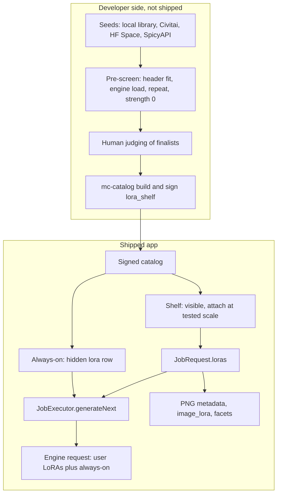

# Curated LoRA Supply - Plan

## Goal Capsule

- **Objective:** A first-time user gets a model that already resists less, plus a shelf of vouched LoRAs, in klein, Krea 2 and Qwen-Image, without knowing which LoRAs exist, which one fits their model, or what scale to use. For a user with the NSFW opt-in off, uncensoring comes only from always-on LoRAs, and a family with no passing always-on LoRA ships without one. Explicit-concept shelf picks need the NSFW opt-in.
- **Product authority:** `STRATEGY.md` tracks "Expert in the box" and "Uncensored quality and supply"; HLD D3, D8, D20, D34, D41 and non-negotiable 7 in `AGENTS.md`. The Key Decisions below record what the user decided about the shelf shape, the always-on behavior and the pool rules.
- **Active scope:** the vouched shelf, always-on LoRAs, and the test harness that feeds both. Remote shelf updates, crowd signals, video and new families are not active scope (see Scope Boundaries).
- **Open blockers:** none that block planning. The HLD decision entries listed under Dependencies must land before code.

## Product Contract

### Summary

Each supported family gets a shelf of up to 4 vouched LoRAs, one per role, shown in the LoRA library with the existing NSFW opt-in controlling which roles appear. A role with no passing candidate stays empty. Picking one downloads it, attaches it to the stack at a tested scale and feeds its trigger words to the enhancer. Some families also get always-on LoRAs that the app applies to every generation without ever showing them. One test harness produces both: it pre-screens a seeded candidate pool automatically, we judge the finalists, and the results ship bundled in the signed catalog. The harness is developer-side tooling, like `scripts/enhancer-gate/`, and is not part of the shipped app. Only its signed catalog output reaches users.

### Problem Frame

The core promise is images other tools refuse. Base models such as Krea 2 refuse, soften or ignore explicit prompts, and the LoRA supply for these three families is thin compared with SDXL (HLD §14, risk 1). Civitai browse already exists, but it hands a first-time user a raw list. They must already know which LoRA fits, whether it works with their model, and what weight to use. The most-downloaded Klein 4B result in a prior probe was a general quality fixer, not an uncensored concept (`docs/lld/loras.md:110`).

Picking the right LoRA does not fix a model that resists. A LoRA that reduces refusals only matters if every user of that family gets it without having to find it.

The author's own history shows the pattern. Across 145 past InvokeAI images, 45 were made on Krea-2 Turbo, and the refusal-reduction LoRA was applied in 46 LoRA applications, so it was effectively always on. SNOFS (an uncensoring LoRA, 25 uses), Beauty Enhancer (29) and Natural Expressions (12) followed. The author's library holds about 30 Krea 2 LoRAs and a handful for Qwen-Image 2.1, plus a larger set for Anima, a model family this app does not support yet.

### Key Decisions

- **Harness with automated pre-screen, we judge finalists.** Scales past hand-testing while keeping LoRA identities on the device. (session-settled: user-directed — chosen over hand-run grids only, opt-in crowd signal and ratings-only: crowd signal needs a change to non-negotiable 7 and an analytics vendor; ratings-only drops "our own experience"). Governs R14, R15, R16.
- **Shelf is best-of-each-role, not top overall.** Teaches what LoRAs are for without a settings panel. (session-settled: user-directed — chosen over top-overall and two separate shelves: top-overall fills with near-duplicates; two shelves double the curation). Governs R1, R2.
- **Picking a shelf item downloads, attaches and applies a tested scale.** Matches "nothing to learn". (session-settled: user-directed — chosen over library-only and hidden-scale: library-only leaves the scale decision with the user). Reverses D34's library-only rule. Governs R4, R5.
- **Shelf ships bundled, shaped for a later remote override.** (session-settled: user-directed — chosen over bundled-only and remote-now: remote-now needs hosting and a catalog URL that do not exist). Governs R18.
- **Always-on LoRAs are invisible and not switchable.** They are the app's own handling of a model, described publicly only as "refusal reduction measures". (session-settled: user-directed — chosen over a visible switch and an NSFW-gated version: either exposes the mechanism or limits its reach). Governs R8, R9, R10, R11.
- **Every LoRA's license is disclosed; no candidate is excluded for its license.** Compliance is not our decision to make. (session-settled: user-directed — chosen over limiting the pool to commercially permissive licenses: that filter was ours to impose, not the user's wish). Governs R19, R21.
- **The Hugging Face Space and SpicyAPI seed the candidate pool.** Neither is evidence of quality. (session-settled: user-directed — chosen over using the Space only as a reference). Governs R14.
- **The author's local LoRA library and past image metadata seed the pool and supply usage evidence.** The files are screened in place and never uploaded or committed. (session-settled: user-directed — chosen over seeding only from public sources: the library holds LoRAs the author already runs and judges by use). Governs R14, R23.
- **Always-on applies on every generation of its family, regardless of the NSFW opt-in.** A user who never opted in gets its side effects, so a regression check gates it (R12). This is a consequence of "invisible and always-on", not a separate choice.
- **A role slot stays empty when no candidate passes.** An honest gap beats a weak vouch, and it records the supply evidence D41 asks for.
- **A vouch is pinned to the engine version it was tested on.** An engine bump re-runs the harness, since Qwen LoRAs only worked from `v26.10.3-pre-release.1`.
- **Community ratings are read at curation time and baked in.** They are an input to ranking, not a live feed and not a replacement for our testing.

### Requirements

**Shelf**

- R1. Each supported family shows a shelf of at most 4 vouched LoRAs in the LoRA library, one per role.
- R2. Roles include an anatomy/quality fixer and a realism or style pick. Explicit-concept roles appear only when the NSFW opt-in is on.
- R3. The shelf's NSFW toggle is the existing persisted NSFW opt-in (`civitaiIncludeNSFW`, default off), so one setting controls both Browse and the shelf.
- R4. Picking a shelf item downloads it, attaches it to the current generation stack and applies the tested scale for that LoRA.
- R5. Each shelf item carries a tested scale, and its trigger words reach the enhancer through the existing path.
- R6. A role with no passing candidate shows no entry. It is never filled with a lower-ranked pick.
- R7. A vouched LoRA that can no longer be fetched from its source shows a plain "no longer available" state and does not break the shelf.

**Always-on LoRAs**

- R8. A family may have always-on LoRAs, which the app applies to every generation on that family.
- R9. Always-on LoRAs never appear in the stack, library, composer, job summary, gallery filters or any other UI, and the user cannot disable them.
- R10. Always-on LoRAs count against the engine's per-request limit, so the user-visible cap on that family drops by their number.
- R11. Always-on LoRAs are recorded only in the local database, in a record that no UI or metadata writer reads. Exported PNG metadata does not name them, and drop-to-restore still applies them for the family.
- R12. An always-on candidate is rejected unless it passes two checks against the same seeds without it: ordinary, non-explicit prompts show no quality regression, and a fixed refusal-prone prompt set shows a measured drop in refusals or softening.
- R13. If an always-on LoRA fails to load, generation continues without it and the failure is logged locally. This fallback applies to always-on LoRAs only; a rejected shelf LoRA still fails the job as today. The harness must catch the failure.

**Test harness and candidate pool**

- R14. The candidate pool is seeded from the author's local LoRA library and past-image metadata, Civitai, the LoRAs referenced by the Hugging Face Space `raubatz/qwen-image-2.1-uncensored-aio-loras`, and SpicyAPI's LoRA lists. Pool seeding is not endorsement.
- R15. The harness pre-screens each candidate automatically on four checks: it fits the family by its safetensors header, the pinned engine loads it without error, two same-seed runs reproduce the same image, and strength 0 reproduces the baseline. A role effect is never pre-screened.
- R16. The author judges finalists on fixed per-family prompt sets and same-seed comparisons, with the evidence prepared for them, weighing Civitai community ratings and, where it exists, the author's usage count. No shelf slot or always-on entry ships without the author's recorded approval, and the author may overrule a pre-screen rejection, with the reason kept in the verdict file.
- R17. Vouch results carry the engine version they were tested on, and the harness is re-run before an engine bump is pinned.

**Catalog data and freshness**

- R18. Shelf and always-on entries ship in the signed catalog, in a shape that allows a remote update later without reshaping the data.
- R19. Each entry carries its source (Civitai or Hugging Face) and license text, and no weights are hosted by us.
- R20. `civitai.red` and `civitai.com` are one source: Civitai's own FAQ says they are filtered views of the same database and that "the API continues to live on civitai.com and will also be accessible through civitai.red". A `civitai.red` model URL is resolved by its model and version IDs through the `civitai.com` API the app already uses, and the Civitai API key is still sent only to `civitai.com`.

**Disclosure and privacy**

- R21. Shelf items show each LoRA's license in the existing license sheet before download. Always-on LoRAs are disclosed in the base model's license/notices screen and `NOTICE`, and nowhere else in the UI.
- R22. No LoRA identity (Civitai or Hugging Face item IDs, names) leaves the device to our servers or analytics.
- R23. Local files and past-image metadata stay on the device. The harness reads them in place, nothing from them is committed to the repo, and only public identifiers (Civitai model and version IDs, Hugging Face repo and file) and our verdicts reach the catalog.

### Acceptance Examples

- AE1. **Covers R1, R2, R3.** Given NSFW is off, a family's shelf shows only the SFW roles. When the user turns NSFW on in either Browse or the shelf, the explicit-concept roles appear in both.
- AE2. **Covers R4, R5.** Given a shelf item the user has not installed, when they pick it and accept its license, it downloads, joins the stack at its tested scale, and its trigger words are in the enhancer's context for the next prompt.
- AE3. **Covers R6.** Given no Qwen candidate passes the explicit-concept role, the Qwen shelf shows the other roles and no placeholder or substitute.
- AE4. **Covers R9, R10.** Given Krea 2 has one always-on LoRA, the Krea 2 stack, library and composer show no trace of it, and adding an 8th LoRA to the stack is refused with a message that states the cap as 7.
- AE5. **Covers R11.** Given an image generated on Krea 2, its exported PNG metadata lists no always-on LoRA, and dropping it back into the app regenerates with the always-on LoRA applied.
- AE6. **Covers R13.** Given the engine rejects an always-on LoRA with "no modules matching", the job completes without it and the app logs the rejection locally.
- AE7. **Covers R7.** Given a vouched LoRA's download returns not-found, its shelf entry shows "no longer available" and the rest of the shelf is unaffected.

### Scope Boundaries

**Deferred for later**

- Remote shelf updates between app releases. The data shape allows it, but the remote path and the catalog URL are not part of this plan.
- Crowd or usage signals on LoRAs. Non-negotiable 7 blocks them until a separate HLD decision.
- Mage-Flow, SDXL/Pony and any other family. The shelf covers klein, Krea 2 and Qwen-Image.
- Video LoRAs.
- Uncensored fine-tune import, including the fine-tune the Hugging Face Space runs on (v2.x).
- CivArchive as a source (still deferred, `docs/lld/loras.md:103`).

**Outside this product's identity**

- A user-facing control for always-on LoRAs.
- License-based filtering of the candidate pool.

### Dependencies and Assumptions

- Per `AGENTS.md`, HLD decision entries come before code for: shelf attach reversing D34's library-only rule (R4), the always-on mechanism and its invisibility, license disclosure for always-on LoRAs against D20 (R21), and the public wording "refusal reduction measures" against D3 and the payment-processor risk row.
- For always-on LoRAs the app, not the user, applies the LoRA, so license exposure there is more likely ours than the user's. This is a known risk and not a gate (R19, R21).
- The Krea 2 refusal-reduction LoRA is the first always-on candidate. The author's local copy, `refusal_reduction_v2_full_rank.safetensors`, records Civitai model 2775340, version 3359022 ("Krea2 TextFusion Refusal-Reduction LoRA (Updated)"). The URL the author supplied references model 3008549. Whether the two are the same LoRA or a newer release is unverified, so the harness resolves both through the `civitai.com` API first. The local file is 2.6 GB with 117 tensors and keys under `diffusion_model.txtfusion.layerwise_blocks.*`, not the `lora_A`/`lora_B` layout of the other Krea 2 LoRAs in that library. Whether the family fingerprint classifies it and whether the engine applies it is unverified, and the harness must prove both. One Civitai API user reported key problems on the `.red` host, so calls stay on `civitai.com`.
- The shipped config has no catalog URL, so catalog changes ride app releases (`project.yml:14`).
- The family fingerprint gate accepts no LoRA for a family without one, and fingerprints come from real LoRA headers (`AGENTS.md`).
- Qwen and klein get always-on LoRAs only if the harness finds ones that pass.
- Hugging Face-hosted LoRAs need a download and provenance path that does not exist: `CivitaiDownloader` and `lora_source` are Civitai-only (`Sources/MCLibrary/LoRASource.swift`, the `civitai_model_id` and `civitai_version_id` columns). Building it is part of this plan.
- Harness work comes first because the shelf and always-on picks consume its output. Shelf units (R1–R7) do not depend on always-on units (R8–R13), so planning can sequence and gate them separately.

### Outstanding Questions

**Deferred to Planning**

- Whether the always-on files are downloaded together with the family's base weights and how that silent download is reported to the user, since the refusal-reduction file alone is 2.6 GB and R9 allows no mention in the UI.
- Whether a shelf item's tested scale is one number per LoRA or can vary by role or family variant.
- The pass rule for R12 (prompt-set size, seeds, how the before and after is scored) and the role list per family are proposed by the implementer and approved by the author at the first decision point of U3. They are not left to the implementer.
- Whether Civitai's model 3008549 and the author's local model 2775340 are the same LoRA.

### Sources and Research

- `docs/HLD.md:680` (risk 1, curated shortlist per family) and `STRATEGY.md:49`.
- `docs/lld/loras.md:103` (curated shelf deferred), `:70-72` (Browse filter and NSFW opt-in), `:110` (observed Civitai supply).
- `Sources/MCCatalog/Catalog/Catalog.swift:28-33` (catalog kinds: image and enhancer only).
- `Sources/MCApp/AppModel+LoRA.swift:239-241` (default weight 1.0 on a new slot).
- `Sources/MCApp/AppModel.swift:38` (the persisted NSFW opt-in key `civitaiIncludeNSFW`, passed to `CivitaiBrowseModel` as `nsfwDefaultsKey`).
- `Sources/MCApp/Civitai/CivitaiBrowseView.swift:487-515` (license sheet).
- `docs/HLD.md:664` (§12 privacy), `AGENTS.md:28`.
- Candidate seeds: `https://spicyapi.ai/lora` and `https://huggingface.co/spaces/raubatz/qwen-image-2.1-uncensored-aio-loras`.

---

## Planning Contract

### Key Technical Decisions

- KTD1. **A separate top-level `lora_shelf` array in the signed catalog, not a new `CatalogModelKind`.** `CatalogModel` requires Hugging Face `repo`, `revision` and `files`, and the browser, recommender and validator key on `models`. Verification runs over raw bytes and the loader never re-encodes, so a new array signed with the existing dev key verifies unchanged. A custom `encode(to:)` omits the key when empty so today's catalog bytes stay stable, and `Catalog.init` takes `lora_shelf` with a `[]` default (`Sources/MCCatalog/Catalog/Catalog.swift`, `CatalogSignature.swift`). Implements R18.
- KTD2. **Always-on LoRAs are appended at the engine-call boundary in `JobExecutor.generateNext`, after `freezeLoRAs`, and never enter `JobRequest.loras`.** `ImageSettings.loras` is copied from `request.loras`, and that array feeds the PNG chunk, the A1111 `Lora hashes` line, `image_lora`, gallery facets and restore, so any in-request design leaks (`Sources/MCGeneration/Executor.swift:243-253`). The record R11 requires is the hidden `lora` row from KTD3, and no per-job or per-image record is written. Drop-to-restore needs none because the family's always-on set is re-applied at generation time. Implements R9, R11.
- KTD3. **An always-on LoRA stays a real `lora` row under `Models/LoRAs/`, flagged hidden, and "invisible" is a filter on every projection.** The executor requires a row and the `Models/LoRAs` prefix, and the library sweep deletes unreferenced files, so a file kept outside the library would not apply or survive (`Executor.swift:268-282`, `LibraryStore.swift:246-267`). The hidden flag is excluded from the library list, stack picker, gallery facets, `enhancementLoRAs()` and failure copy, and `deleteLoRA` refuses it (`LoRALibrary.swift:406-460`, `AppModel+Enhance.swift:182-190`, `FailureMapping.swift:49-53`). Implements R9.
- KTD4. **The per-request cap becomes a function of family: 8 minus the family's always-on count.** `GenerationComposer.maxLoRAs` is a static 8, `addToLoRAStack` counts slots and `setLoRAStack` never checks the cap (`GenerationComposer.swift:76`, `AppModel+LoRA.swift:241-247,347-360`). Both entry points enforce the same function, and the cap is read by the executor as a last guard. Implements R10.
- KTD5. **R13's fallback is one automatic retry without the always-on LoRAs when a job carrying them fails with `loraRejected`.** The engine's 400 does not name the failing LoRA, and the rejection arrives at load before denoising, so the retry costs little. A second rejection maps to the existing failure copy naming only the user's LoRAs. Today `loraRejected` is non-retryable and no store API rewrites the request, so the retry lives in the executor, not the UI gate (`FailureMapping.swift:45-68`, `AppModel+Projection.swift:181`). Implements R13.
- KTD6. **Hugging Face provenance generalizes `lora_source` with a source kind through a new migration that rebuilds the table, and the single-file download reuses `FileDownloader` semantics with the SHA-256 from the catalog.** `civitai_model_id` and `civitai_version_id` are NOT NULL today and `LoRASource` requires them (`Sources/MCLibrary/LoRASource.swift`). SQLite cannot drop NOT NULL with `ALTER TABLE`, so the migration creates the new table, copies rows, drops the old one and renames, and keeps the cascade delete from `lora`. The shipped `v5-lora-source` migration is not edited. `ModelDownloader` is repo-shaped. Civitai shelf entries need no new path: `versionDetail(id:)` resolves by ID and `commitStagedLoRA` writes file, row and preview in one call (`CivitaiClient.swift:176-180`). Implements R19.
- KTD7. **A shelf item's tested scale is data on the entry and becomes the new stack slot's weight.** The weight is hard-coded to 1.0 at `AppModel+LoRA.swift:247` today, and trigger words reach the enhancer only through `enhancementLoRAs()`, which still serves shelf-attached LoRAs because they are ordinary stack entries. Implements R4, R5.
- KTD8. **The harness is Python under `scripts/lora-gate/`, run from an Eval cell like `scripts/enhancer-gate/`, and classifies fit through a new `mc-catalog lora classify` subcommand.** Fingerprint rules live in `classifyLoRA` and `families.json`, and `mc-catalog` has only keygen, build, sign and verify, so a Python copy of the rules would drift (`Sources/MCCatalog/ModelFamily.swift:285-289`, `Sources/MCCatalogTool/CatalogToolCLI.swift:60-69`). Files that classify as `.unmatched` or `.ambiguous` are rejected with the reason. Results are JSON under `scripts/lora-gate/results/`, and generated images and contact sheets go to a scratch root outside the repo. Implements R14, R15, R16, R17, R23.
- KTD9. **`mc-catalog build` and `CatalogDiff` learn `lora_shelf`.** They handle only `models` today, so `sign --acknowledge-diff` would approve shelf changes unreviewed (`Sources/MCCatalogTool/CatalogBuilder.swift:72-75,140-176`). Implements R17, R18.
- KTD10. **Each shelf and always-on entry carries `tested_engine`.** An engine bump is blocked until the harness re-runs against that tag and every entry is re-stamped or dropped. Implements R17.

### High-Level Technical Design

This illustrates the intended approach and is directional guidance for review, not implementation specification.

Always-on LoRAs join at `Exec` and never reach `Meta`.

### Assumptions

- The harness may run only against models installed locally. Klein 4B, Krea and Qwen Turbo 4-bit are installed, the pinned engine tarball is cached, and no downloads are needed for verification.
- The author's local files are inputs, not deliverables, and are read in place (R23).

### Sequencing

HLD decisions come first (U1). The harness (U2), the catalog schema (U4), Hugging Face provenance (U5) and the cap and scale work (U6) can then proceed in parallel. Shelf work (U7) and always-on work (U8, U9) are independent of each other once U6 lands. Catalog content is populated only after the curation run (U3) produces verdicts, and any family whose always-on candidate fails ships without one.

---

## Implementation Units

| U-ID | Title | Files touched | Depends on |
|---|---|---|---|
| U1 | HLD decision entries | `docs/HLD.md`, `docs/lld/loras.md` | none |
| U2 | LoRA gate harness | `scripts/lora-gate/`, `Sources/MCCatalogTool/` | U1 |
| U3 | Curation run and verdicts | `scripts/lora-gate/results/`, `docs/solutions/` | U2 |
| U4 | Catalog `lora_shelf` schema and tooling | `Sources/MCCatalog/`, `Sources/MCCatalogTool/` | U1 |
| U5 | Hugging Face LoRA provenance and download | `Sources/MCLibrary/`, `Sources/MCModels/` | U1 |
| U6 | Per-family cap and per-LoRA scale | `Sources/MCApp/`, `Sources/MCGeneration/` | U1 |
| U7 | Shelf UI and attach flow | `Sources/MCApp/Civitai/`, `Sources/MCApp/` | U4, U5, U6 |
| U8 | Always-on engine path | `Sources/MCGeneration/`, `Sources/MCLibrary/`, `Sources/MCApp/`, `Sources/MCCatalog/Resources/families.json` | U1, U4, U6 |
| U9 | Always-on install and disclosure | `Sources/MCApp/`, `NOTICE` | U8, U3 |

### U1. HLD decision entries

- **Goal:** Record the decisions `AGENTS.md` requires before any code.
- **Requirements:** R4, R9, R11, R20, R21 and the public wording constraint.
- **Files:** `docs/HLD.md` (decision table from D43), `docs/lld/loras.md`.
- **Approach:** Add D43 (shelf attach reverses D34's "download goes to the library only, not attached"), D44 (always-on mechanism, invisibility, projection filter, local record), D45 (always-on disclosure placement against D20), D46 (public wording "refusal reduction measures" against D3 and the payment-processor risk row), and D47 (`civitai.red` treated as `civitai.com`, key host rule unchanged). Use the existing `| ID | Decision | Rationale |` format. The user decides the wording in D46 before it appears in any UI or store copy.
- **Test scenarios:** none, documentation only.
- **Verification:** Decision-to-unit map: D43 governs U6 and U7, D44 governs U8, D45 governs U9, D46 governs the copy in U7 and U9, and D47 governs U5. No code in U2–U9 lands before the decision it relies on.

### U2. LoRA gate harness

- **Goal:** A repeatable pre-screen that runs against the pinned engine.
- **Requirements:** R14, R15, R17, R22, R23.
- **Files:** `scripts/lora-gate/` (runner, prompt sets, README), a new `lora classify` subcommand in `Sources/MCCatalogTool/`, and `AGENTS.md` (record the run command).
- **Approach:** Follow `scripts/enhancer-gate/run_gate.py`: launch the engine per `AGENTS.md` rules 3–5 and the `docs/lld/engine.md` §5.9 recipe, with `HOME` set to a scratch directory and the `--api-key-strict` flags. Inputs are a candidate list from Civitai, Hugging Face, SpicyAPI and a local-directory mode that reads files in place and also reads InvokeAI image metadata for usage counts. Per candidate: classify by header, load in the engine, run two same-seed images to check reproducibility, and compare strength 0 with the baseline. Write verdict JSON with the engine tag. Do not commit images, local file paths or the author's file names beyond public identifiers.
- **Test scenarios:**
  - A header with only `lora_A`/`lora_B` keys classifies to its family, and a kohya-style or `.lora_A.default` header classifies as unmatched or ambiguous with a reason.
  - The `txtfusion` full-rank header from the author's refusal-reduction file produces a definite fit or reject result, not an error.
  - A strength-0 run that differs from baseline marks the candidate failed.
  - Verdict JSON contains no local absolute path.
- **Verification:** Run the harness on klein 4B with at least three real LoRAs and read the verdict file.

### U3. Curation run and verdicts

- **Goal:** Produce the evidence that fills the shelf and decides always-on.
- **Requirements:** R6, R12, R16.
- **Files:** `scripts/lora-gate/results/`, prompt sets, and a short findings note in `docs/solutions/` if a non-obvious result appears.
- **Approach:** For each family, pre-screen the pool, then prepare evidence and bring it to the author at fixed decision points. For always-on candidates, add the two R12 checks (no regression on ordinary prompts, measured drop in refusals on a fixed refusal-prone set). Start with the author's Krea 2 usage leaders and the refusal-reduction LoRA. Record per-entry tested scale, role, community rating and the tested engine for the catalog. The author's usage count stays in the harness results only (R23). The run pauses at each decision point until the author answers:
  1. **Roles and prompts.** The proposed role list per family, the ordinary and refusal-prone prompt sets, and the R12 pass rule. The author approves or edits them.
  2. **Finalists per role.** Contact sheets (same seed, with and without) with the author's usage count and the Civitai rating beside each. The author picks or vetoes, and may overrule a pre-screen rejection.
  3. **Scale.** The same seed across a few weights for each pick. The author sets the tested scale.
  4. **Always-on sign-off.** Before and after of the refusal set and the regression set. The author approves or rejects each always-on entry.
  5. **Public wording.** The D46 text, before any copy appears in the UI or store.
- **Test scenarios:** the output is data, not code. Empty roles are recorded as empty with the reason.
- **Verification:** Each family has a verdict file. Every shelf entry has a role, a scale and the author's recorded approval, and every rejection by the pre-screen or the author records its reason.

### U4. Catalog `lora_shelf` schema and tooling

- **Goal:** A signed shelf and always-on data shape.
- **Requirements:** R17, R18, R19.
- **Files:** `Sources/MCCatalog/Catalog/Catalog.swift`, `CatalogSignature.swift`, `Sources/MCCatalogTool/CatalogBuilder.swift`, tests next to the existing catalog suites.
- **Approach:** Add `LoRAShelfEntry` (family, role, `nsfw` flag, source kind and identifiers, filename, SHA-256, size, license text, trigger words, tested scale, community rating, `tested_engine`, `always_on` flag). Custom encode omits an empty array. Extend `mc-catalog build`, `CatalogDiff` and `verify` to cover the array. Bump the catalog sequence and re-sign with the dev key.
- **Test scenarios:**
  - A catalog with no `lora_shelf` encodes to the same bytes as before.
  - A tampered shelf entry fails signature verification.
  - `sign` without `--acknowledge-diff` refuses a shelf-only change.
  - A shelf entry for a family with no `loraFingerprints` is rejected by the validator.
- **Verification:** `swift run mc-catalog verify Sources/MCCatalog/Resources/catalog.json` passes on the re-signed bundle.

### U5. Hugging Face LoRA provenance and download

- **Goal:** Install a LoRA hosted on Hugging Face with provenance.
- **Requirements:** R19, R20.
- **Files:** `Sources/MCLibrary/LoRASource.swift`, `Sources/MCLibrary/` migration and store, `Sources/MCModels/` downloader, the Civitai client's URL resolution.
- **Approach:** Add a source kind and nullable Civitai IDs with a migration, a Hugging Face commit overload next to `commitStagedLoRA`, and a single-file download with SHA-256 verification before the atomic move.
- **Test scenarios:**
  - A Hugging Face LoRA lands in `Models/LoRAs/<family>/` with a source row.
  - A SHA-256 mismatch aborts without a file or row.
  - Existing Civitai rows migrate unchanged.
  - A `civitai.red` model URL resolves by model and version ID through `civitai.com`, and the Civitai API key is sent only to `civitai.com`.
- **Verification:** `swift test` passes, including the migration test.

### U6. Per-family cap and per-LoRA scale

- **Goal:** The cap and default weight become data-driven.
- **Requirements:** R4, R5, R10.
- **Files:** `Sources/MCApp/AppModel+LoRA.swift`, `GenerationComposer.swift`, `Sources/MCGeneration/Executor.swift`.
- **Approach:** Replace the static 8 with an effective-cap function of family, enforce it in `addToLoRAStack` and `setLoRAStack`, and let the stack accept an initial weight. The cap has no visible readout today, so the refused-add message carries the effective cap (AE4).
- **Test scenarios:**
  - With one always-on LoRA on a family, the 8th slot is refused and the 7th is accepted.
  - `setLoRAStack` with too many entries is clamped or refused, not accepted silently.
  - A new slot takes the supplied weight, and a manual add still defaults to 1.0.
- **Verification:** `swift test` passes.

### U7. Shelf UI and attach flow

- **Goal:** The visible shelf.
- **Requirements:** R1, R2, R3, R4, R5, R6, R7, R21.
- **Files:** `Sources/MCApp/Civitai/CivitaiBrowseModel.swift`, the LoRA library view, a new shelf model and view.
- **Approach:** A Shelf section in the LoRA library, filtered by family and the shared `civitaiIncludeNSFW`. Picking an item runs the existing license sheet (with the entry's license text for Hugging Face items), downloads, adds to the stack at the tested scale and leaves trigger words to `enhancementLoRAs()`. A fetch that returns not-found shows "no longer available". Empty roles render nothing.
- **Test scenarios:**
  - Toggling NSFW in Browse shows the explicit roles on the shelf, and the reverse.
  - An item already installed attaches without a second download.
  - A not-found download marks one entry unavailable and leaves the others.
  - A role with no entry renders no placeholder.
- **Verification:** Launch the app, open the shelf for each installed family, attach an item and read the stack. Check `pgrep mlx-serve` afterwards.

### U8. Always-on engine path

- **Goal:** Always-on LoRAs apply invisibly and fail soft.
- **Requirements:** R8, R9, R10, R11, R13.
- **Precondition:** the Krea 2 refusal-reduction file has no bundled fingerprint, because its keys sit under `diffusion_model.txtfusion.layerwise_blocks.*`. Add a Krea 2 fingerprint for that layout to `Sources/MCCatalog/Resources/families.json`, taken from a real header with a test, which makes it an app-release change. Until it exists, always-on for that family is blocked. The candidate must also pass U3's R12 checks.
- **Files:** `Sources/MCGeneration/Executor.swift`, `Sources/MCLibrary/LoRALibrary.swift` and `LibraryStore.swift`, `FailureMapping.swift`, `AppModel+Enhance.swift`.
- **Approach:** Add the hidden flag and projection filters (KTD3), inject at the engine-call boundary (KTD2), and implement the single retry (KTD5) with a local-only log line.
- **Test scenarios:**
  - A Krea 2 job's engine request includes the always-on path and scale, while `ImageSettings.loras`, the PNG chunk and `image_lora` do not.
  - Dropping that PNG back in regenerates with the always-on LoRA applied.
  - A `loraRejected` on a job with always-on retries once without it and completes, and a second rejection fails with copy naming only user LoRAs.
  - The hidden row is absent from the library list, gallery facets and enhancer context, and `deleteLoRA` refuses it.
- **Verification:** Smoke on klein 4B first with a compatible LoRA standing in as always-on, then on Krea 2 once the verdict exists, checking the exported PNG metadata directly.

### U9. Always-on install and disclosure

- **Goal:** Always-on files arrive with the model, and disclosure follows D45.
- **Requirements:** R19, R21.
- **Files:** `Sources/MCApp/` model install path, the notices screen, `NOTICE`.
- **Approach:** Resolve the open question on bundling the download with the family's base-weights install, and how its size is reported given R9. Add the license text to the notices screen and `NOTICE`.
- **Test scenarios:**
  - Installing a family with an always-on entry downloads and verifies it, and the library list does not show it.
  - An always-on file removed from disk is re-fetched at the next install or generation start, without a UI mention.
- **Verification:** Fresh-library launch with `CFFIXED_USER_HOME=/tmp/mc-empty-home`, install, generate, inspect.

---

## Verification Contract

| Check | Command or action | Applies to |
|---|---|---|
| Library tests | `swift test` (about 40 s; past 2 minutes it is hung, then `pkill -f swiftpm-testing-helper; pkill -f swift-test`) | U2, U4, U5, U6, U8 |
| Lint | `git ls-files '*.swift' \| xargs swift format lint --strict --configuration .swift-format` prints nothing | all Swift units |
| Catalog | `swift run mc-catalog verify Sources/MCCatalog/Resources/catalog.json` | U4 |
| Harness smoke | Run `scripts/lora-gate/` from an Eval cell against `MLXC_ENGINE_BIN` with klein 4B | U2, U3 |
| Identity leak | Read the shipped catalog-fetch and analytics paths for LoRA names or IDs, and read the harness verdict JSON for local paths and personal file names | U2, U7, U8 |
| App smoke | `xcodegen generate`, then `xcodebuild -project MLXCreate.xcodeproj -scheme MLXCreate -configuration Debug -derivedDataPath build build`, launch and exercise the changed path | U7, U8, U9 |
| Leftovers | `pgrep mlx-serve` and `pgrep mlx-create` after every app run | U7, U8, U9 |

Krea 2 Turbo needs about 17.6 GB free, so free memory before its smoke run and never use `--skip-mem-preflight`. Ask before downloading any weights beyond what is installed.

## Definition of Done

- Every requirement R1–R23 is met, and AE1–AE7 are observed in a running app or by named tests.
- Decision entries D43 onward exist in the HLD before the code that relies on them.
- `swift test`, the strict lint command and `mc-catalog verify` pass.
- Exported PNG metadata from a Krea 2 generation with an always-on LoRA names none, confirmed by reading the file.
- The catalog is re-signed, each entry carries `tested_engine`, and a family with no passing always-on LoRA ships without one.
- No local file path, image or personal file name from the author's library is in the repo.
- The harness scratch output and any throwaway scripts are removed, and `AGENTS.md` records the harness command.
