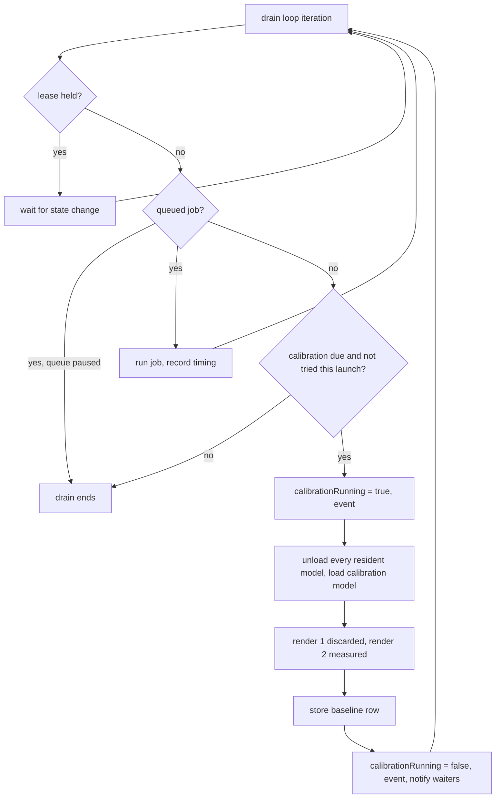

# On-Device Speed Calibration - Plan

## Goal Capsule

- **Objective:** A user can see an honest time-per-image estimate for the models they have installed and the ones they could install. The estimates rest on a measurement of what their own Mac does at its best, and they sharpen as the user generates.
- **Means:** An empty-engine calibration run the executor schedules itself, plus a catalog reference timing per model and a per-generation timing record (KTD1, KTD4, KTD7, KTD8).
- **Authority:** `docs/HLD.md` D16 and §8.5 today; D48 (U1) supersedes their calibration clauses before any code. `AGENTS.md` non-negotiables 2, 3, 4 and 7 bind: no inference in the app process, stock upstream engine, private engine, nothing timing-related leaves the device.
- **Active scope:** onboarding calibration, continuous timing capture, the optional signed catalog field, estimate display in the model browser, the composer and the queue header. Out of scope are listed under Scope Boundaries.
- **Open blockers:** none for planning. U8 needs the author's approval before it downloads FLUX.2-klein 4B weights (`AGENTS.md`: ask before large downloads).

## Product Contract

### Summary

After the first image model with a reference timing is installed, the app measures how fast this Mac renders on an otherwise empty engine, at the moment the queue has nothing else to do. It compares the result with that model's reference timing from the signed catalog to get a machine speed factor. From then on the model browser and composer show how long an image will take: "about N s" once the user has real timings for that exact setup, "estimate" otherwise. A model with no reference timing shows no estimate. The measurement repeats whenever the bundled engine version changes.

### Problem Frame

Nothing in the app records how long a generation takes, and the catalog carries no timings. A user choosing between FLUX.2 klein, Krea 2 and Qwen-Image cannot tell which one will take ten seconds and which a minute on their Mac, and the HLD's promise of "real seconds-per-image estimates on every Mac" (D16) is unmet. Fit is judged on memory alone, so a model can fit and still be too slow to be pleasant.

### Key Decisions

- **Calibration runs on an empty engine on every Mac, with no tier exception.** (session-settled: user-directed — chosen over skipping 16 GB Macs or running only when the enhancer is not resident: the aim is each machine's speed in its best case, whatever its size.) Governs R2.
- **Calibration waits its turn. Only generation and Enhance block it; downloads and installs do not.** (session-settled: user-directed — chosen over also blocking on downloads, whose disk and CPU load can add noise to the timing: the user judged that noise acceptable.) Governs R3.
- **Calibration re-runs after an engine version bump and has no recalibrate button.** (session-settled: assumption the user confirmed with the scope.) Governs R5.
- **Calibration renders are throwaway.** (session-settled: assumption the user confirmed with the scope.) Governs R4.
- **The catalog ships one reference timing for each image model the author has measured, from the author's Mac. Estimates for uninstalled models are scaled from it and labelled as estimates.** Per-chip reference data is a later catalog update. (session-settled: assumption the user confirmed with the scope.) Governs R7, R8.
- **The recommender's pick rule does not change.** Speed informs the display only. (session-settled: assumption the user confirmed with the scope.) Governs R8.

### Requirements

**Onboarding calibration**

- R1. When an image model that has a catalog reference timing is installed and no calibration exists for the running engine version, the app runs a calibration without the user asking.
- R2. The run starts only after every resident model, image or enhancer, is unloaded, and only the calibration model is loaded while it runs. This holds on every memory tier.
- R3. A running generation, a queued generation or a held Enhance lease each delay calibration. A pause does not: with an empty queue calibration starts even while the queue is paused, and a paused queue that still holds jobs keeps calibration waiting because those queued generations come first. Work submitted or requested after calibration has started waits for it to finish. Downloads and installs do not delay it.
- R4. Calibration never creates a job, image, gallery entry, prompt-history entry, thumbnail or library row of any kind, and never appears as a queue job.
- R5. When the bundled engine version differs from the version of the stored calibration, calibration runs again by the same rules. There is no user control to start it.

**Continuous timing**

- R6. Every completed real generation records its timing. These samples are stored apart from the calibration result, keyed so that a different engine version, model, size, step count or LoRA count never mixes with them. Samples under other engine versions are simply never read.

**Catalog**

- R7. A catalog model may carry an optional reference timing. Catalogs without it, and apps that predate it, behave exactly as before, and the existing signature still verifies.

**Display**

- R8. The model browser, the composer and the queue header show timing. Model rows and the composer show "about N s" when measured samples exist for that setup, and an estimate marked as such when they do not. No number is shown when no estimate can be made. The queue header says the app is measuring this Mac's speed while calibration runs.
- R9. No timing, model name or calibration result leaves the device (`AGENTS.md` rule 7).
- R10. A calibration that fails never fails a job, blocks generation or shows an error. The app tries again at most once per launch.

**Process**

- R11. `docs/HLD.md` D16 and §8.5 are amended in the decision log first (D48), then code.

### Acceptance Examples

- AE1. **Covers R1, R2, R3.** Given a fresh library, an idle queue and a first image model installed, the queue header says the app is measuring speed, the engine holds only that model while it runs, and one baseline row for the current engine version exists afterwards.
- AE2. **Covers R3.** Given a calibration is due and a generation is running with two more queued, calibration starts only after all three finish. A generation submitted while calibration runs starts after it.
- AE3. **Covers R3.** Given the user presses Enhance while calibration runs, the Enhance starts after calibration ends. Given Enhance is running when calibration becomes due, calibration starts after the lease releases.
- AE4. **Covers R4.** After calibration the gallery, prompt history and library search show nothing new, and the queue shows no job for it.
- AE5. **Covers R5.** Given a stored baseline for engine 26.10.3 and a build that bundles 26.10.4, the next idle moment starts a new calibration, and the 26.10.3 baseline no longer feeds any estimate.
- AE6. **Covers R8.** Given a model with a reference timing and a baseline, a never-used model shows "estimate", and the same model shows "about N s" after three completed generations at the same size, steps and LoRA count.
- AE7. **Covers R10.** Given the engine refuses the calibration load for memory three times, no baseline is stored, no error appears, no job fails, and no further attempt happens until the next launch.

### Scope Boundaries

Outside this change:

- Using speed in the recommender's pick, as HLD §8.5 currently describes ("meets the tier latency target"). It needs real timing data first.
- Per-chip reference timings, the `HardwareProfile` table and a catalog keyed by chip class.
- A recalibrate or skip control, a progress readout inside calibration, and a calibration cancel button.
- Speed controls, an Advanced panel and sampler choices (D14).
- Queue-wide ETA totals. The composer shows the estimate for the batch being set up, and the queue header shows only calibration state.
- Learning a scale from a model's samples at other sizes. Estimates for a setup with no samples use the reference timing alone (KTD6).
- Video models (D7, phase 3).

## Planning Contract

### Key Technical Decisions

- **KTD1. Calibration is an executor step, not a job row.** `JobExecutor.drain` gets a step that runs when it finds no queued job. It never calls `enqueueJob`, `saveImage` or `store.jobs`. This avoids four traps found in research: `run` fails any job whose mode is not `t2i` (`Executor.swift:138`); `jobs(status:)` and `nextQueuedJob` filter by status only (`LibraryStore.swift:398-436`), so a calibration row would show in the queue strip; `enqueueJob` writes a prompt-history row in its transaction (D39); and every reader would need the skip filter that `docs/solutions/integration-issues/hidden-lora-rows-every-query-must-skip-them.md` documents. Ordering falls out of drain being serial.
- **KTD2. "Waits its turn" rules.** Inside the executor's single drain loop: wait for the lease gate (`waitWhileLeaseHeld`, `EnhancerLease.swift:123`), look for a queued job, and run calibration only when `nextQueuedJob()` is nil. If a job exists but the queue is paused, the drain ends, so calibration also waits (queued generation blocks it); with no job, a pause does not stop calibration (user decision). Both the lease wait and the queue read suspend the actor (`Executor.swift:84-85`), so a lease can begin between them, as `run()` already guards against (`Executor.swift:135-136`). The calibration step therefore re-checks `enhancerLeaseHeld` and `currentJobID` after the queue read returns, in the same synchronous segment that sets `calibrationRunning = true`; if either changed, it loops back to the top of the drain instead. `acquireEnhancerLease` and `selectModel` gain a wait on that flag next to their existing `currentJobID`/lease waits (`EnhancerLease.swift:54-66`, `Executor.swift:111-119`). After calibration, drain loops again, so a job submitted meanwhile starts next. `start()` is a no-op while a drain is in flight (`Executor.swift:67-68`), so a wake-up arriving while the drain is mid-read would be lost: `start()` records a `pendingKick` flag in that case, and the drain checks and clears it before it returns, looping once more if it was set. A lease release and a finished install both wake the executor this way (`AppModel.startDraining` delegates to the executor's `start()`), so a due calibration is not left waiting for an unrelated trigger. A due calibration yields nothing mid-run: it is two renders, and the lease waits for it.
- **KTD3. Empty-engine procedure.** Under `serialized`, list `client.models().filter(\.loaded)`, unload every one, then load the calibration model. This is the same loop `switchModel` uses (`Executor.swift:122-131`), without the "already resident" short-circuit. A load that returns `EngineError.outOfMemory` is retried twice, 30 s apart, never with `--skip-mem-preflight` (`docs/lld/engine.md` §5.9, §5.10: a load failed at 26.2 GB available and a retry succeeded). After calibration the calibration model stays resident, because the next generation's `switchModel` handles any difference.
- **KTD4. What one measurement is.** Two renders at the calibration model's family `defaultSize` and default steps (`nil` steps for `stepsAreFixed` families, `nil` guidance, no LoRAs, fixed seed, fixed benign prompt). The first render absorbs first-run costs and is discarded. The second yields `seconds` = the time from opening the generation stream to its completed frame, taken with `ContinuousClock`. Model load is outside it, because residency is settled before the stream opens. Real generations use the same definition (KTD7), and the reference timing (KTD8) is produced by the same code, so the three agree by construction. No timing field exists in the engine's responses (`SSELineParser` decodes none), so this is client wall-clock. The stage names in progress frames are undocumented, so nothing depends on them.
- **KTD5. Baseline lifecycle.** One `calibration_baseline` row per engine version, written only after the measured render succeeds, so a quit or crash mid-run leaves nothing and the run repeats next launch. Calibration is due when a candidate model exists and no row exists for the running engine version. The version comes from `ENGINE_VERSION` through `bundledEngineVersion()` (`AppModel.swift:313-317`). When it is `nil` (under `swift test`), calibration and timing capture are off, so tests never calibrate by accident. A failed attempt sets an in-memory "tried this launch" flag. Nothing is persisted for failures.
- **KTD6. Estimate formula and tiers.** `factor = baseline.seconds / baseline.referenceSeconds` for the calibrated model. For any model with a reference timing, `estimate = reference.seconds × factor × (pixels / referencePixels) × (steps / referenceSteps)`. This is an approximation: one model sets the factor for all, and cost is assumed linear in pixels and steps. It is why the UI says "estimate". A setup with at least three samples for the exact key (current engine version, model, width, height, steps, LoRA count) is shown as measured: the median of its most recent five. No estimate is made without a baseline and a reference timing. Reference timings are measured without LoRAs, so estimates for families with always-on LoRAs (D44) omit that overhead until samples exist. This is a known limit, recorded in the LLD.
- **KTD7. Continuous timing.** `generation_timing` rows hold engine version, model id, width, height, steps (from the stream's `total`), LoRA count (files in the actual engine request, including always-on), seconds and a timestamp. They are written in `generateNext` after the successful stream, best-effort (`try?`), only when `engineVersion` is non-nil. Each key keeps its newest five rows, which is all the estimator reads (KTD6). Rows under other engine versions are never read, so no cleanup runs.
- **KTD8. Catalog field.** `reference_timing: { width, height, steps, seconds }` on `CatalogModel`, decoded with `decodeIfPresent` and encoded only when set, which is the `recommend_rank` and `kind` precedent. `schema_version` stays 1 and every re-sign bumps `sequence` (`docs/lld/models.md` §2). `CatalogBuilder` and `CatalogDiff` learn the field, or `sign --acknowledge-diff` would approve timing changes unreviewed (the KTD9 trap in `docs/plans/2026-10-22-1149-feat-curated-lora-supply-plan.md`).
- **KTD9. Candidates come from the app.** The executor does not know the catalog or the installed set. `AppModel` supplies an async closure returning `[CalibrationTarget]` (model id, `ModelFamily`, `ReferenceTiming`) for installed, selectable image models that have a reference timing. The selected model comes first and the rest follow registry family order (`ModelSelection.defaultModelID`). It returns an empty list while the engine is not ready. The first target is the calibration model.
- **KTD10. Failure and retry.** OOM load: retried per KTD3. A crash, connection loss or other error ends the attempt with a log line and the in-memory flag. The engine supervisor's own restart budget (3 per 5 min, `docs/lld/engine.md` §5.7) is untouched, and a failed calibration is never reported as a job failure.
- **KTD11. Visibility.** A new executor event `.calibrationChanged(Bool)` drives a `calibrating` case in the queue header state. It has no pause or cancel affordance. A user whose first generation lands behind calibration sees it queued under that header.

### High-Level Technical Design

This sketch is directional guidance for review, not an implementation specification.

Leases and `selectModel` wait on `calibrationRunning` the way they already wait on `currentJobID`.

Data added by the `v11` migration (names directional):

| Table | Columns | Written by |
|---|---|---|
| `calibration_baseline` | `engine_version` (key), `model_id`, `width`, `height`, `steps`, `seconds`, `reference_seconds`, `measured_at` | calibration, once per engine version |
| `generation_timing` | `engine_version`, `model_id`, `width`, `height`, `steps`, `lora_count`, `seconds`, `created_at` | each real generation |

### Risks & Dependencies

- **Calibration can delay the user's first generation.** After the first install the queue is usually empty, so calibration starts at once and the first Generate waits for two renders (seconds on klein, about a minute and a half on Krea 2: two renders at 48 s each, plus model load). The queue header says why. If that proves unacceptable, the follow-up is letting a user's submission cut in front before calibration starts, which this plan does not do.
- **Calibration runs while the queue is paused** when nothing is queued (user decision: only generation and Enhance block it). A user who paused to free the engine for something else can see two renders start, about a minute and a half on Krea 2.
- **A first-render outlier or a noisy download can skew the factor.** Mitigated by the discarded warm-up. Accepted for downloads (user decision). One bad baseline persists until the next engine version, and continuous samples correct installed models in the meantime.
- **Idle eviction is undecided** (`docs/lld/engine.md` §6 item 3). The procedure unloads and loads explicitly, so the measurement does not depend on whether a model was warm.
- **16 GB Macs may not fit a candidate.** The load is refused and retried (KTD3, KTD10), then calibration gives up for the launch. Estimates for that Mac then rely on continuous samples only.
- **The reference timings describe one Mac.** On a Mac whose bottleneck differs from the author's (memory bandwidth versus GPU compute), the cross-model scaling can be off. The smoke test in U9 measures the error on a second model so the LLD can state it.
- **File-size ratchet.** `Executor.swift` and `AppModel.swift` must not grow past budget; new logic goes in new files (`node scripts/check-file-size.mjs --all`).
- **Dependency:** none. `MCGeneration` already depends on `MCCatalog` (`Package.swift:25`), so `ReferenceTiming` needs no package change.

### Sources / Research

- Executor drain, run and generation seam: `Sources/MCGeneration/Executor.swift:82-96` (drain), `:134-152` (mode guard and claim), `:190-263` (request build, `makeResident`, stream loop), `:122-132` (`switchModel`), `:405` (`unloadResidentModels`).
- Enhance lease and the state-wait machinery: `Sources/MCGeneration/EnhancerLease.swift:54-66`, `:123-155`.
- Recovery: `JobQueue.recoverAfterRelaunch` (`JobQueue.swift:56-60`) requeues `running` jobs; calibration is not a job, so a quit mid-run leaves nothing behind (KTD5).
- Engine facts: preflight `out_of_memory` and transient refusals, `docs/lld/engine.md` §5.9 and §5.10; progress frames carry `stage`, `step`, `total` only, `Sources/MCEngine/SSELineParser.swift:3-5, 27, 46-62`.
- Catalog precedent: `Sources/MCCatalog/Catalog/Catalog.swift:64-144` (`kind`, `recommend_rank`), `docs/lld/models.md` §2, `Sources/MCCatalogTool/CatalogBuilder.swift:151` (`CatalogDiff`).
- Engine version at runtime: `scripts/embed-engine.sh:282-283`, `AppModel.swift:305, 313-317`; no code compares versions today.
- Migrations: latest is `v10-lora-always-on` (`LibraryStore.swift:196-200`), so the next is `v11`.
- App surfaces: `Sources/MCApp/GenerationPanel.swift:272` (Generate button), `Sources/MCApp/QueueStripView.swift:26-34` (header), `Sources/MCApp/AppModel+Projection.swift:74` (`queueHeader`), `Sources/MCApp/Models/InstallRow.swift`, `AppModel.swift:525-540` (`refreshModels`) and `:519-522` (`startDraining`).
- Prior art that this supersedes in part: `docs/plans/2026-10-21-1805-feat-machine-fit-model-recommendation-plan.md`, HLD D16, D42, §8.5, §9 (CALIBRATION entity).
- Smoke-test recipe for a fresh library: `docs/solutions/developer-experience/launch-app-with-empty-library-for-first-run-testing.md`.

## Implementation Units

| U-ID | Title | Key files | Depends on |
|---|---|---|---|
| U1 | Amend HLD and write the calibration LLD | `docs/HLD.md`, `docs/lld/calibration.md`, `docs/lld/models.md` | none |
| U2 | Catalog `reference_timing` field | `Catalog.swift`, `CatalogValidation.swift`, `CatalogBuilder.swift` | U1 |
| U3 | Library tables and store API | `LibraryStore.swift`, new `LibraryStore+Timing.swift` | U1 |
| U4 | Timing capture and speed estimator | `Executor.swift`, new `SpeedEstimator.swift` | U2, U3 |
| U5 | Calibrator and drain integration | new `Calibrator.swift`, `Executor+Calibration.swift`, `EnhancerLease.swift` | U2, U3, U4 |
| U6 | App wiring and triggers | `AppModel.swift`, `AppModel+Calibration.swift` | U5 |
| U7 | Estimate display and calibrating header | `GenerationPanel.swift`, `InstallRow.swift`, `QueueStripView.swift` | U4, U6 |
| U8 | Reference timings and signed catalog | `catalog/models.src.json`, bundled catalog | U2, U5 |
| U9 | Live smoke, AGENTS.md and cleanup | `AGENTS.md`, `docs/lld/calibration.md` | U1-U8 |

### U1. Amend HLD and write the calibration LLD

- **Goal:** the decision log and component docs say what will be built, before code (R11).
- **Requirements:** R11.
- **Files:** `docs/HLD.md` (decision log: add D48; §8.5 catalog bullet, Recommender bullet and Calibrator level 1; §9 CALIBRATION and IMAGE duration sketch; §13 roadmap line), new `docs/lld/calibration.md`, `docs/lld/models.md` (the `reference_timing` field and its optional encoding).
- **Approach:** D48 supersedes the calibration part of D16 and these §8.5 clauses: "reference timings per chip class" becomes one reference timing per model from one Mac; Calibrator 1 becomes the empty-engine, queued-behind-generation-and-Enhance run, repeated per engine version; the recommender's "meets the tier latency target" clause is removed because the pick rule is unchanged. The LLD carries KTD1 to KTD11 as the contract, the formula and its known limits (KTD6), and the measurement definition (KTD4).
- **Test scenarios:** none (docs). Grep that no remaining HLD line still says "chip class" for timings or ties the pick to a latency target.
- **Verification:** D48 exists with the next free number, and every changed HLD line cites it.

### U2. Catalog `reference_timing` field

- **Goal:** a signed catalog can carry a reference timing per model without breaking old signatures or old apps (R7).
- **Requirements:** R7.
- **Files:** `Sources/MCCatalog/Catalog/Catalog.swift`, `CatalogValidation.swift`, `Sources/MCCatalogTool/CatalogBuilder.swift`, `Tests/MCCatalogTests/CatalogValidationTests.swift`, `CatalogSignatureTests.swift`, `Tests/MCCatalogToolTests/CatalogToolTests.swift`.
- **Approach:** add `ReferenceTiming { width, height, steps, seconds }` and an optional `referenceTiming` on `CatalogModel`, decoded with `decodeIfPresent`, encoded only when set, placed after `recommend_rank` in key order (KTD8). Validation requires positive dimensions and steps and finite positive seconds, and allows it on image models only. The builder reads the field from `models.src.json` and `CatalogDiff` prints added, removed and changed timings.
- **Test scenarios:**
  - A catalog without the field re-encodes to identical bytes, and the existing bundled signature verifies (regression for R7).
  - A model with the field round-trips through encode and decode and keeps its position.
  - Validation rejects zero or negative dimensions or steps, and zero, negative, NaN or infinite seconds.
  - Validation rejects a timing on an enhancer entry.
  - `CatalogDiff` output names a model whose timing was added or changed.
- **Verification:** `swift test --filter MCCatalog` and `swift run mc-catalog verify Sources/MCCatalog/Resources/catalog.json` pass.

### U3. Library tables and store API

- **Goal:** durable storage for the baseline and the continuous samples, with no overlap with gallery, jobs or prompt history (R4, R6).
- **Requirements:** R4, R6.
- **Files:** `Sources/MCLibrary/LibraryStore.swift` (migration `v11-timing`), new `Sources/MCLibrary/LibraryStore+Timing.swift`, `Tests/MCLibraryTests/TimingStoreTests.swift`.
- **Approach:** create `calibration_baseline` and `generation_timing` as in the Planning Contract table, with an index on the sample key and `created_at`. API: write and read the baseline for an engine version (replace on repeat); record a sample, which trims the key to its newest five in the same transaction; read the most recent five seconds for a key. Neither table is read by any gallery, job, FTS or prompt-history query, and a test asserts that.
- **Test scenarios:**
  - Baseline written for engine A is invisible when asked for engine B, and writing again for A replaces it.
  - Samples for a different model, size, steps, LoRA count or engine version never appear in a key's read.
  - The sixth sample for a key drops the oldest; the read returns the newest five in a deterministic order.
  - After writing samples and a baseline, `images`, `jobs`, gallery listing, prompt history and FTS search are all unchanged (R4).
  - The migration applies cleanly on a library at `v10`.
- **Verification:** `swift test --filter MCLibrary` passes.

### U4. Timing capture and speed estimator

- **Goal:** every real generation records its timing, and one pure function turns stored data into the number the UI shows (R6, R8).
- **Requirements:** R6, R8.
- **Files:** `Sources/MCGeneration/Executor.swift` (small change in `generateNext`), new `Sources/MCGeneration/SpeedEstimator.swift`, `Tests/MCGenerationTests/ExecutorTimingTests.swift`, `Tests/MCGenerationTests/SpeedEstimatorTests.swift`.
- **Approach:** in `stream(_:)` take a `ContinuousClock` instant before `client.generateImage` and measure to the completed frame, so the LoRA-rejected retry (`Executor.swift:254-258`) times only the stream that succeeded. Carry the seconds out in the result tuple. After `saveImage`, record a sample with `try?` when `engineVersion` is non-nil and steps are known. `SpeedEstimator` is a value type built from the baseline, the reference timing, and the sample reads, and returns `.measured(seconds)`, `.estimated(seconds)` or `nil` per KTD6. A formatter turns seconds into "about 12 s" or "about 1 min 20 s".
- **Test scenarios:**
  - A completed generation against the engine stub writes one sample with the stream's `total` as steps and the number of LoRA files actually sent (including always-on) as LoRA count.
  - A cancelled or failed generation writes nothing.
  - A generation whose first stream is rejected for LoRAs and retried records only the retry's seconds.
  - With `engineVersion == nil`, nothing is written.
  - A sample-write failure does not fail the job (`try?`).
  - Estimator: three samples for the exact key give `.measured` with the median; two samples give `.estimated`.
  - Estimator: no baseline or no reference timing gives `nil`.
  - Estimator: the formula scales with pixels and steps and with the factor, checked with hand-computed values.
  - Estimator: baseline from another engine version is ignored.
- **Verification:** `swift test --filter MCGeneration` passes.

### U5. Calibrator and drain integration

- **Goal:** the scheduled, empty-engine calibration run, with the ordering rules of R3 (R1, R2, R3, R4, R5, R10).
- **Requirements:** R1, R2, R3, R4, R5, R10.
- **Files:** new `Sources/MCGeneration/Calibrator.swift` (the measurement, shared with U8), new `Sources/MCGeneration/Executor+Calibration.swift` (due check, flag, event, drain step), `Sources/MCGeneration/Executor.swift` (drain loop calls the step; init takes the targets closure), `Sources/MCGeneration/EnhancerLease.swift` and `selectModel` (wait on `calibrationRunning`), `Sources/MCGeneration/ExecutorEvent.swift` (`.calibrationChanged`), tests under `Tests/MCGenerationTests/`.
- **Approach:** `Calibrator.measure(client:target:)` performs KTD3 and KTD4 and returns the baseline values; it knows nothing about queues. The executor step implements the flowchart, with the post-read re-check from KTD2. `start()` gains the `pendingKick` flag and is also called when a lease releases. The targets closure defaults to empty, so every existing test and harness keeps today's behavior.
- **Test scenarios (engine stub):**
  - Idle queue, due calibration: the stub sees unload calls for every loaded model (including an enhancer) before the one load, two generation requests with the fixed prompt, seed and family default size and steps, and a baseline row afterwards (AE1).
  - A running job with two queued: calibration starts only after the last finishes, and a job enqueued during calibration runs after it (AE2).
  - A lease held when calibration becomes due: calibration starts after release. A lease requested mid-calibration starts after calibration ends (AE3).
  - Queue paused with nothing queued: calibration still runs. Queue paused with a queued job: calibration does not start.
  - A lease acquired while the drain's queue read is suspended: calibration does not start until the lease releases (the engine is never touched concurrently).
  - A `start()` call arriving while the drain is mid-read with calibration due: calibration still runs, with no further trigger.
  - `selectModel` during calibration waits and then applies.
  - No job, image, prompt-history row or `jobChanged` event is produced (AE4).
  - Baseline for the current engine version exists: nothing runs. A different stored version: runs again (AE5).
  - `engineVersion == nil`: never runs.
  - The load is refused as out of memory twice then succeeds: retried and stored. Refused three times: no baseline, no job failure, no second attempt in the same launch (AE7).
  - A crash mid-run: no baseline stored, flag set, drain continues with queued work.
  - The measured render is the second one, and load time is outside it.
- **Verification:** `swift test --filter MCGeneration` passes; `node scripts/check-file-size.mjs --all` shows no ratchet growth.

### U6. App wiring and triggers

- **Goal:** the executor gets real candidates, and calibration is triggered at the right moments (R1, R5).
- **Requirements:** R1, R5, R10.
- **Files:** `Sources/MCApp/AppModel.swift`, new `Sources/MCApp/AppModel+Calibration.swift`, `Tests/MCAppTests/CalibrationTriggerTests.swift`.
- **Approach:** build the `CalibrationTarget` closure from the installed models and catalog (KTD9), empty when the engine is not ready. After each `refreshModels()` (which every install completion and engine-ready transition already runs, `AppModel.swift:511, 525-540`) call `startDraining()`, which delegates to the executor's `start()`, so the idle drain notices a due calibration. Pass the bundled engine version through unchanged.
- **Test scenarios:**
  - After the first image model with a reference timing is installed, a calibration runs without further input (AE1). Tests call `await model.start()` before `refreshModels()` per `AGENTS.md`.
  - An installed model with no reference timing never triggers one.
  - With the engine failed, none runs.
  - A second install after a baseline exists does not re-run it.
  - A second launch under a newer engine version ignores samples recorded under the older one.
- **Verification:** `swift test --filter MCApp` passes.

### U7. Estimate display and calibrating header

- **Goal:** the user sees the numbers and the reason a generation is waiting (R8).
- **Requirements:** R8.
- **Files:** `Sources/MCApp/GenerationPanel.swift`, `Sources/MCApp/Models/InstallRow.swift` and `ModelBrowserModel`, `Sources/MCApp/QueueStripView.swift`, the queue-header state type behind `queueHeader`, `Tests/MCAppTests/EstimateDisplayTests.swift`.
- **Approach:** the model supplies a plain-language string per model row and for the composer's current settings (times the batch count), from `SpeedEstimator`: "about N s" for measured, "N s (estimate)" for estimated, nothing when `nil`. The queue header gains a `calibrating` state set by `.calibrationChanged`, shown as "Measuring this Mac's speed…" with no Pause or Cancel. Wording stays plain and never mentions timing being kept anywhere.
- **Test scenarios:**
  - Model rows show the estimate label for a model with a reference timing and a baseline, and nothing for one without.
  - The composer's text multiplies by batch count and changes with size, steps and LoRA stack.
  - The header is `calibrating` between the start and end events, and is not pausable.
  - An estimate flips from "estimate" to "about" after the third matching generation (AE6).
- **Verification:** `swift test --filter MCApp` passes. A screenshot of each surface is part of U9.

### U8. Reference timings and signed catalog

- **Goal:** the bundled signed catalog ships reference timings for the models the author can measure (R7, R1).
- **Requirements:** R1, R7.
- **Files:** `catalog/models.src.json`, `Sources/MCCatalog/Resources/catalog.json`, `catalog.json.sig`, the bundled-catalog test that pins model ids.
- **Approach:** run the same `Calibrator.measure` code (KTD4, KTD8) on this Mac against the real engine from a real-engine test gated by `MLXC_ENGINE_BIN`, in the pattern of `EngineSupervisorTests`, which prints the measured seconds per model, family default size and steps. Measure the models available here: Krea 2 Turbo and Qwen-Image 2.1 Turbo are on disk. FLUX.2-klein 4B is partly downloaded and needs the author's approval to finish the download (about 2.6 GB left) before it is measured. A model with no timing ships without one and shows no estimate. Write the values into `models.src.json`, then `mc-catalog build`, review the diff, `sign` with the dev key and `--acknowledge-diff`, raise `sequence` by one, and `verify`.
- **Test scenarios:** the bundled catalog verifies, loads, and a model with a timing decodes it. No new permanent test pins the measured numbers.
- **Verification:** `swift run mc-catalog verify Sources/MCCatalog/Resources/catalog.json` passes, and `swift test --filter MCCatalog` passes. The production key and catalog URL remain release prerequisites, as before.

### U9. Live smoke, AGENTS.md and cleanup

- **Goal:** prove the whole path on a real engine and leave the repo documented and clean.
- **Requirements:** all, AE1 to AE7 live where reachable.
- **Files:** `AGENTS.md` (Commands: the reference measurement test and its env), `docs/lld/calibration.md` (measured cross-model error and the always-on overhead observation).
- **Approach:** build the app (`xcodegen generate`, then `xcodebuild … build`). Launch it with an empty library using `open -n --env CFFIXED_USER_HOME=/tmp/mc-empty-home`. Install or link one model that has a reference timing. Observe the queue header, `pgrep` for the loaded model through the engine's model list, and read `library.sqlite` read-only for one baseline row and no `job`, `image` or prompt-history rows. Press Generate during calibration and confirm it waits. Press Enhance during calibration and confirm it waits. Quit and relaunch: no new calibration. Change `ENGINE_VERSION` in a copy of the built app to simulate a bump: calibration repeats. Generate three images at one setting and confirm the model row flips to "about". Compare the estimate for a second installed model with its real timing and record the error. Screenshot the model browser, composer and queue header. Afterwards check `pgrep -fl "mlx-serve|mlx-create.app"` and remove `/tmp/mc-empty-home`.
- **Test scenarios:** the live checks above.
- **Verification:** all verification-contract commands pass; throwaway scripts and scratch directories are removed.

## Verification Contract

- Unit and integration: `swift test` (about 40 s; if it passes 2 minutes it is hung: `pkill -f swiftpm-testing-helper; pkill -f swift-test`, then `--filter` per suite).
- Format and lint: `git ls-files '*.swift' | xargs swift format lint --strict --configuration .swift-format` prints nothing.
- Ratchet: `node scripts/check-file-size.mjs --all` passes.
- Catalog: `swift run mc-catalog verify Sources/MCCatalog/Resources/catalog.json` passes.
- App build: `xcodegen generate`, then `xcodebuild -project MLXCreate.xcodeproj -scheme MLXCreate -configuration Debug -derivedDataPath build build`.
- Live smoke: U9, against the real pinned engine, with no `--skip-mem-preflight`.
- Permanent tests cover behavior only: scheduling and ordering, empty-engine unloads, baseline lifecycle and engine-version invalidation, sample keying and pruning, estimator math and tiers, catalog byte stability and validation, throwaway-ness. They do not pin wording or the measured reference numbers.

## Definition of Done

- D48 is in the HLD decision log and §8.5 and §9 match the shipped behavior, and `docs/lld/calibration.md` exists.
- R1 to R11 hold, AE1 to AE7 pass in tests, and AE1 to AE6 were observed in the live smoke.
- The bundled catalog is re-signed with a higher `sequence` and verifies.
- Every verification-contract command passes with no ratchet growth.
- No calibration artifact is visible in the gallery, prompt history, library search or queue.
- `AGENTS.md` records the reference measurement command.
- Abandoned experiments, throwaway scripts, `/tmp` scratch and stray `mlx-serve` processes are gone.
