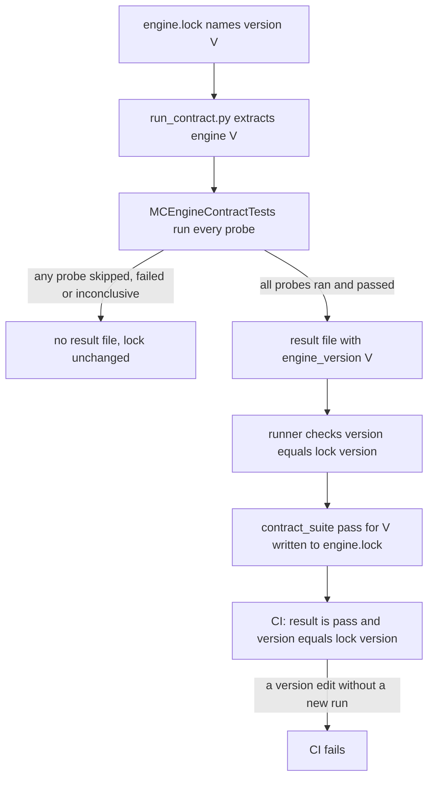

# Engine Contract Suite and Engine Bump - Plan

## Goal Capsule

- **Objective:** A new mlx-serve release can be adopted by the app only after a recorded, reproducible test run shows that every engine behavior the app depends on still holds. A user never receives an engine the app has not been checked against.
- **Means:** A black-box suite that drives the real engine binary through the app's own client and a few raw probes, run locally against real small models, with its result written into `engine.lock` and enforced in CI (KTD1, KTD2, KTD3, KTD8). The first use is the bump to upstream `v26.10.3` (KTD9).
- **Authority:** `docs/HLD.md` §7.3 and `docs/lld/engine.md` §3 today. D49 (U1) amends §7.3's "tiny fixture models" clause before any code. `AGENTS.md` non-negotiables 3, 4, 5 and 6 bind: stock engine, loopback and key rules, nothing written to `~/.mlx-serve`, `.safetensors` only.
- **Active scope:** the suite, its result record and CI check, a baseline run on the current pin, and the bump to `v26.10.3` with the follow-ups that bump forces. Out of scope is listed under Scope Boundaries.
- **Open blockers:** none for planning. U8 needs your approval before it finishes the FLUX.2 klein 4B download (`AGENTS.md`: ask before large downloads), and U9 needs the dev catalog key at `~/.config/mlx-create/dev-catalog.key` if a reference timing moved.

## Product Contract

### Summary

The app gets an engine contract suite: a test pack that launches a given mlx-serve binary exactly as the app does and checks every route, field, status, stream shape, flag and log marker the app relies on, per shipped model family. A passing run is recorded in `engine.lock` with the engine version it tested, and CI rejects a lock whose record is missing, failing, or for a different version. The suite is then used to move the pin from `v26.10.3-pre-release.1` to the stable `v26.10.3`.

### Problem Frame

HLD §7.3 says no engine bump merges without the contract suite, and `engine.lock` says `smoke-only`. The suite was never built, so each bump so far was a hand smoke run (`docs/lld/engine.md` §5.9 and §5.10), and several contract facts exist only as hand-written test bodies: the LoRA 400 text, the OOM and `model_not_loaded` errors, every chat stream, and every load, unload and rescan response. Upstream ships roughly 200 commits a month, so the cost of an unchecked bump is a broken generation path that users find first.

Upstream `v26.10.3` is out (2026-10-22) and supersedes the pinned pre-release. The upstream diff shows the app's HTTP surface is byte-identical across the two tags, so this bump is low risk. It is also the first chance to prove the suite on a real change: four behaviors moved (memory admission counts purgeable pages, a refused load waits about 2 s longer, the eviction planner counts a victim's prefix cache, stacked LoRAs round once on Qwen-Image).

### Key Decisions

- **The suite is built first and gates the bump.** (session-settled: user-approved — chosen over moving the pin now on a hand smoke run, as PR #11 did: `AGENTS.md` and HLD §7.3 say the suite gates `engine.lock`, and this bump is the cheapest first test of it.) Governs R9, R10.
- **The suite runs on this Mac against real models and is not part of CI.** (session-settled: user-approved — chosen over committed tiny fixture models, which do not exist and cannot be made without real architecture weights, and over CI runs, whose only workflow is lint on a runner that cannot hold the weights.) Governs R1, R8.
- **A bump that cannot pass keeps the previous pin.** HLD §7.3 already says so; this plan does not soften it. Governs R9.

### Requirements

**What the suite proves**

- R1. Given an extracted engine binary and a directory of real models, the suite launches the engine with the app's exact launch arguments and environment, under a throwaway `HOME`, and exercises every route the app uses: `/health`, `/v1/models`, `/v1/models/rescan`, `/v1/load-model`, `/v1/unload-model`, `/v1/images/generations`, `/v1/chat/completions`.
- R2. For every image family the app ships, the suite proves the request the app actually composes is accepted and behaves as the family record says: image stream shape and decodable PNG at the requested size, size clamping, steps handling, seed determinism, and that cancelling mid-stream leaves the engine healthy. The app sends no `guidance_scale` and no negative prompt on any shipped family, so the suite proves those fields absent from the composed request and the engine accepting it, not engine handling of them.
- R3. The suite proves the LoRA contract: absolute paths outside the model directory load, at most eight apply, scale 0 equals no LoRA, a wrong-family LoRA returns the 400 the app matches on, and negative and large scales are accepted.
- R4. The suite proves the enhancer contract: a real chat stream decodes with the app's parser, thinking does not reach the content, `finish_reason` `stop` and `length` both arrive, and the not-installed and keyless errors map as the app expects.
- R5. The suite proves the privacy contract: `/health` answers without a key, an authenticated route answers 401 to a missing key and to a wrong key and 200 to the right key, the engine listens on loopback only, and a run writes nothing outside its throwaway `HOME`.
- R6. The suite proves the model lifecycle the queue and the enhancer lease depend on: `/v1/models` reports each family's architecture, rescan makes a new folder visible at once, unloading a model the engine already evicted still succeeds, and the engine never holds more models than `--max-resident-models` allows.
- R7. The suite proves the crash classifier still recognizes the engine's real log output. The missing-weight and request-echo markers always come from the engine under test. The refused-load marker does too, unless no safe launch flag forces a refusal at the pin, in which case the recorded fixture is used and the probe catalog names it synthetic (KTD6).

**Result integrity**

- R8. A run records a result only when every probe ran against the engine version under test. A skipped, partial or inconclusive run, including one stopped by a memory refusal, records no `pass`.
- R9. `engine.lock` carries the result with the version it was run against, and CI fails any change where `contract_suite.result` is not `pass` or `contract_suite.version` differs from the lock's `version`.
- R10. The suite never writes under the real `~/.mlx-serve` or the app's Application Support folder, never modifies model folders, and leaves no `mlx-serve` process running.

**Bump**

- R11. The pin moves to upstream `v26.10.3`, `engine.lock` records a `pass` for that version, and the engine LLD and `AGENTS.md` carry the new pin.
- R12. The catalog's measured reference timings for Krea 2 Turbo and Qwen-Image 2.1 Turbo are re-measured on the new pin, and the catalog is re-signed when either moved by more than 10%.
- R13. Every curated shelf LoRA and the Krea always-on LoRA is re-run through `scripts/lora-gate/run_gate.py` on the new pin and re-stamped or dropped, so no catalog entry's `tested_engine` names an engine version other than the pin (curated-LoRA plan KTD10).

### Acceptance Examples

- AE1. **Covers R8.** Given the model directory lacks the enhancer, when the suite runs, then the chat probes are not executed, no result file is written, and the runner reports an incomplete run instead of `pass`.
- AE2. **Covers R9.** Given a PR changes `engine.lock`'s `version` and leaves the old `contract_suite` record, when CI runs, then the engine-lock check fails.
- AE3. **Covers R3.** Given a Krea 2 LoRA file sent against the FLUX.2 klein model, when the suite probes it, then the response is HTTP 400 containing `no modules matching`.
- AE4. **Covers R6.** Given the engine launched for a 16 GB tier with `--max-resident-models 1`, when the suite loads the enhancer and then an image model, then at most one model reports `loaded` and the requested one is among them.

### Scope Boundaries

- Not built: golden-pixel comparisons across engine versions. Considered because they catch silent numeric drift; not built because upstream changed stacked-LoRA rounding on Qwen-Image in this very bump, so such a golden fails on a correct change. Within-run invariants (same seed gives identical bytes, scale 0 equals no LoRA) cover the app's actual assumptions.
- Not built: a retry loop around memory refusals. A refusal marks the run inconclusive and says to close apps and rerun, because a retry hides real memory regressions.
- Not built: a probe that forces a mid-stream engine error. No safe way to induce one on a healthy engine exists; the synthetic fixture stays and is named as such in the probe catalog.
- Outside the suite: the app's own behavior (queue, executor, UI). Those have app-level tests against stubs.
- Outside the suite: `--skip-mem-preflight`, LAN flags, video, upscale and any route the app does not call.
- Not built: a concurrent-generation characterization probe. The app's queue runs one job at a time (HLD §8, D13), so an either-or observation about a second simultaneous request pins nothing the app depends on.
- Not built: signing the result record. The record's trust is the maintainer's, as every other `engine.lock` field is; the CI check exists to catch a forgotten re-run after a version edit, not forgery.
- Known limit: the CI check compares versions, not probe sets. Probes added later do not invalidate an older `pass` until the next bump, when the runner's manifest check (KTD3) forces a complete run.

#### Deferred to Follow-Up Work

- Whether the app should pass `--no-w8a8` (upstream turns M5 Neural Accelerator int8 on by default on Macs with 64 GB or more, which holds 2 to 8 GB more memory per 4-bit model). This changes memory tiers and fit bands (HLD §11) and needs a product decision.
- `ModelEntry.state` is decoded in `Sources/MCEngine/EngineClient.swift` with no consumer. Drop it or give it an owner; the suite does not pin it meanwhile.
- Live image previews (upstream F1) and the Mage-Flow family, once either lands in the app.

## Planning Contract

### Key Technical Decisions

- KTD1. **The suite is a new Swift Testing target, `MCEngineContractTests`, that depends on `MCEngine`, `MCCatalog` and `MCGeneration` and goes through the app's own `EngineClient`, `EngineSupervisor`, `SSELineParser` and `InstalledModels`.** (session-settled: user-approved — chosen over a Python script in `scripts/`: the suite then exercises what the app really parses, and the family table comes from `families.json`, so it cannot drift from the app.) It follows `EngineSupervisorTests`: serialized, throwaway root. Every suite is gated on `MLXC_CONTRACT_MODEL_DIR` as well as `MLXC_ENGINE_BIN`, because `MLXC_ENGINE_BIN` alone is already set for the engine tests, and a bare `swift test` must not start real-model runs. The runner invokes the target with `--no-parallel`: `.serialized` orders tests inside one suite only, and probe groups in different suites would otherwise start several engines at once and turn memory refusals (KTD7) into the norm.
- KTD2. **Models are real folders read through one symlink from `MLXC_CONTRACT_MODEL_DIR`; coverage comes from `families.json`.** (session-settled: user-approved — chosen over committed tiny fixtures: none exist and the engine needs real architecture weights.) The throwaway `Models/Weights` is itself a symlink to the directory, exactly as `ReferenceTimingMeasurementTests` does, so the engine scans model folders one level down as in the app. Family presence is whatever `InstalledModels` reports, which includes the `sample_sigmas` trait probe Qwen-Image needs. A run is complete only when every family in `families.json` and the enhancer are present. A missing model makes the run incomplete (R8), not green.
- KTD3. **The suite writes a result file only after all probes ran; a runner records it in `engine.lock`.** Swift Testing counts a skipped test as passing, so an exit code cannot prove coverage. A single enum in `ContractResult` declares every probe id and is the only source of `probes_expected`; each probe records its case into one actor-owned ledger as it completes, and the ledger writes the result file exactly once, when every declared id has been recorded and none failed. A meta-test fails when a probe records an id outside the enum or a declared id has no probe. The file holds `{engine_version, probes_expected, probes_run, failures}`; `engine_version` is the bare version parsed from the engine's `mlx-serve <version>` line, the same string `engine.lock` holds. The runner (`scripts/engine-contract/run_contract.py`, run from an Eval cell as `scripts/lora-gate/` is) extracts the engine, points `MLXC_CONTRACT_RESULT` at a new path in a fresh per-run scratch directory and refuses to start if a file already exists there, runs the target, and writes `contract_suite` only when the file exists, `probes_run` equals `probes_expected`, there are no failures, and `engine_version` equals `engine.lock`'s `version`. A result left by an earlier run can therefore never satisfy a later one.
- KTD4. **Assertions are structural, plus invariants that hold within one engine run.** Field presence, status codes, event ordering, PNG validity and dimensions, and byte equality between two runs on the same engine (same seed; scale 0 against no LoRA). No pixel goldens across versions (Scope Boundaries). Upstream numerics on Qwen-Image with two or more LoRAs moved in `v26.10.3` (`src/lora.zig` stacked addmm), and single-LoRA and Krea and FLUX paths are bit-identical.
- KTD5. **Residency is asserted by invariant, never by which model was evicted.** Upstream's eviction planner now credits a victim's prefix cache (`src/model_registry.zig`, commit `fdb7d36a`), so victim choice differs across the bump. The app only needs: loaded count at most the limit, the requested model loaded after a successful load, a refused load leaves residents as reported by `/v1/models`.
- KTD6. **Log-marker probes use logs the engine produces.** A refused load comes from a throwaway second engine launch with a memory cap too small for the model; a missing weight from a model folder copied as symlinks with one weight file left out; a request echo from any normal generation. Each log tail goes through `CrashClassifier`. The flag that forces the refusal is verified at the pin during U6; if no safe flag exists the refusal probe falls back to the existing fixture and says so.
- KTD7. **A memory refusal during any probe aborts the run as inconclusive.** Preflight refusals depend on what else is running (`docs/lld/engine.md` §5.10 saw the first Qwen loads fail at 26.2 GB available and a later one pass). The harness stops, prints the engine's own `out_of_memory` text and the free-memory reading, and writes no result file. Never `--skip-mem-preflight`.
- KTD8. **`engine.lock`'s `contract_suite` becomes `{result, run_at, version, probes}` and a small CI workflow checks it.** `schema` stays `1`: `scripts/embed-engine.sh` rejects any other value and reads no `contract_suite` field. Types: `result` string (`pass` or `smoke-only`), `run_at` string date, `version` string equal to the lock's `version`, `probes` integer. `docs/lld/engine.md` §3 already says CI checks this, and no such check exists. A stale `pass` after a version edit is the harm nobody would catch, so the check is built. It is a shell step over `engine.lock`, in its own workflow so the swift-format `Lint` workflow stays single-purpose. The workflow lands in U8 in the same change as the first recorded `pass`; merged earlier it would fail every PR while the lock still says `smoke-only`.
- KTD9. **The bump targets the stable tag `v26.10.3`, commit `046b647686419df06c6c7132fb1d15d76185c3e5`.** Stable and `v26.10.3-pre-release.2` are the same commit, so nothing sits between them. GitHub reports the macOS asset as 81,326,484 bytes with sha256 `d1781c89c206f0d077d6d1abbcab43aa9ec65280202c83eac908f957956b652b`; `--refresh-manifest` and the embed script's own checks stay authoritative.
- KTD10. **The suite is baselined on the current pin before the bump.** A probe that fails on `v26.10.3-pre-release.1` is a finding about the app, the probe or the assumption, not about the bump. Each such finding is resolved on its own: fix the app, fix the probe, or amend the contract with its reason recorded in the LLD.

### High-Level Technical Design

The gate: a result exists only from a complete run, and CI trusts only a record that names the lock's own version.

Probe layout, one file per concern so each stays under the repo's file-size budget:

| Probe group | Requirement | Runs against |
|---|---|---|
| Process and launch | R1, R5, R10 | engine only, no model |
| Auth and loopback | R5 | engine only |
| Model lifecycle and residency | R6 | two small models, tier 1 and tier 2 launches |
| Image per family | R2 | one model per family in `families.json` |
| LoRA | R3 | one LoRA per family plus a wrong-family file |
| Chat and enhancer | R4 | the Gemma enhancer |
| Log markers | R7 | throwaway second engine and a damaged model folder |

### Assumptions

None carried unconfirmed: the scoping confirmation covered the sequencing, local-only runs, and the Swift target form.

## Implementation Units

### U1. Decision and contract documents first

- **Goal:** Record the suite's shape in the HLD and LLDs before any code, as `AGENTS.md` requires for a decision that departs from the HLD.
- **Requirements:** R1, R8, R9, R10.
- **Dependencies:** none.
- **Files:** `docs/HLD.md`, `docs/lld/engine.md`, `docs/lld/engine-contract.md` (new), `AGENTS.md`.
- **Approach:**
  - Add D49 to the HLD decision log: the suite runs locally on real models, gated by `MLXC_ENGINE_BIN` and `MLXC_CONTRACT_MODEL_DIR`, records its result in `engine.lock`, and CI checks the record. Amend §7.3's "tiny fixture models" clause to cite D49.
  - Write `docs/lld/engine-contract.md`: the probe catalog (probe id, route or flag, assertion, why the app needs it, which part is synthetic today), KTD1 to KTD10 as the contract, the model and LoRA prerequisites, and the memory prerequisite.
  - Update `docs/lld/engine.md` §3 (the new `contract_suite` shape, what CI checks, and the bump procedure naming the runner) and §6 (the smoke list stays; add the contract target to the real-engine test list).
  - Add the run and gate commands to the `AGENTS.md` Commands section in the same change as U7.
- **Test expectation:** none -- documentation only.
- **Verification:** the probe catalog lists every item the inventory marked "needs a real-engine probe", and each R traces to catalog rows.

### U2. Harness target and result record

- **Goal:** A contract target that launches the engine like the app, offers typed and raw HTTP, and records a result only for a complete run.
- **Requirements:** R1, R8, R10. KTD1, KTD2, KTD3, KTD7.
- **Dependencies:** U1.
- **Files:** `Package.swift` (new target with `MCEngine`, `MCCatalog`, `MCGeneration` dependencies), `Tests/MCEngineContractTests/Support/ContractEngine.swift`, `Tests/MCEngineContractTests/Support/RawHTTP.swift`, `Tests/MCEngineContractTests/Support/ContractModels.swift`, `Tests/MCEngineContractTests/Support/ContractResult.swift`, `Tests/MCEngineContractTests/ContractHarnessTests.swift`.
- **Approach:**
  - `ContractEngine`: build `EnginePaths` under a fresh temp root with `Models/Weights` as a symlink to `MLXC_CONTRACT_MODEL_DIR` (KTD2), start `EngineSupervisor` with a chosen `MemoryTier` (tier decides `--max-resident-models`), expose an `EngineClient` and the key for raw probes, and always stop in `defer`.
  - Reuse `EnginePaths`, `ModelsSymlink`, `EngineSupervisor` public APIs. Duplicate only the small fixture helpers from `Tests/MCEngineTests/Support/SupervisorFixtures.swift`; a shared support target is not worth a third target (KTD1).
  - `ContractModels`: a thin wrapper over `InstalledModels.refresh(using:)` and `FamilyRegistry`, reporting which families and the enhancer are present for R8. It owns no architecture-to-family mapping of its own.
  - `ContractResult`: the probe-id enum, the actor-owned ledger and the write-once result file (KTD3). A memory refusal throws an inconclusive outcome that skips the write (KTD7).
  - Gate every suite on `MLXC_CONTRACT_MODEL_DIR` and `MLXC_ENGINE_BIN` with `.enabled(if:)`, mark each `.serialized`, and rely on the runner's `--no-parallel` for cross-suite exclusivity (KTD1).
- **Execution note:** start with the harness test that proves a skipped or partial run writes no result file, because that behavior is what makes every other probe's green mean something.
- **Patterns to follow:** `Tests/MCEngineTests/EngineSupervisorTests.swift`, `Tests/MCEngineTests/Support/SupervisorFixtures.swift`, `Tests/MCGenerationTests/ReferenceTimingMeasurementTests.swift`.
- **Test scenarios:**
  - Happy path: with one model present and every declared probe recorded, the result file contains the bare engine version, equal counts, and no failures.
  - Edge case: with `MLXC_ENGINE_BIN` set and `MLXC_CONTRACT_MODEL_DIR` unset, a bare `swift test` skips every contract suite.
  - Edge case: a probe recording an id outside the enum, or an enum id with no probe, fails the meta-test.
  - Edge case: with an expected probe never recorded, no result file exists afterward.
  - Edge case: with a family from `families.json` absent from the model directory, the run reports which family is missing and writes no result.
  - Error path: an `out_of_memory` load response ends the run as inconclusive, prints the engine's text, and writes no result.
  - Integration: after the run, no `mlx-serve` process remains and nothing under the real `~/.mlx-serve` or the app's Application Support changed.
- **Verification:** running the target with the model directory unset is skipped, and with a model directory that lacks a family or the enhancer it is incomplete and records nothing (AE1).

### U3. Process, auth and lifecycle probes

- **Goal:** Prove R5 and R6 and the launch half of R1.
- **Requirements:** R1, R5, R6, R10. KTD5.
- **Dependencies:** U2.
- **Files:** `Tests/MCEngineContractTests/LaunchContractTests.swift`, `Tests/MCEngineContractTests/AuthContractTests.swift`, `Tests/MCEngineContractTests/LifecycleContractTests.swift`.
- **Approach:**
  - Launch probes cover the argument set the app sends, including `--max-resident-mem auto` and `--log-level info`, which no test asserts today, plus `mlx-serve --version` printing `mlx-serve <version>` as its first line.
  - Auth probes are raw requests, because `EngineClient` always attaches the key.
  - Lifecycle probes run the engine at the 16 GB tier (limit 1) and a larger tier (limit 2 or 3) and use `EngineClient` for load, unload, rescan and models.
- **Test scenarios:**
  - Launch happy path: the engine reaches ready on its own port; `--version` first line equals `mlx-serve <engine.lock version>`.
  - Launch edge case: `ps -o command=` for the engine shows no key in its arguments. This assertion and the keyless 401 below already exist in `Tests/MCEngineTests/EngineSupervisorTests.swift`; they move here and are removed there, leaving that file on process lifecycle only.
  - Auth happy path: `GET /health` with no key returns 200 and `status` `ok`.
  - Auth error paths: `GET /v1/models` with no key returns 401 and with a wrong key returns 401; with the right key it returns 200. The 401 body is the error envelope the app parses.
  - Loopback: a TCP connect to the Mac's non-loopback address on the engine's port is refused.
  - Isolation: a run leaves the entire real `~/.mlx-serve` tree and the throwaway model directory unchanged, with no `models/` exception, and the engine writes its logs under the throwaway `HOME`.
  - Models: `/v1/models` lists each present family with `capabilities` including `image` and the architecture string `families.json` expects.
  - Rescan: a symlink added to the throwaway `Weights` after launch appears in `/v1/models` right after one `rescan`.
  - Load and unload: each returns exactly 200 for a present model; unloading a model that is not resident returns 200; loading an unknown id fails with an error the app maps to `engineFailure` and not to success.
  - Residency (AE4): at limit 1, loading the enhancer then an image model leaves at most one model `loaded` and the requested one is among them; at the larger tier two models stay loaded. A refused load leaves `/v1/models` consistent with what the app is told.
- **Verification:** all listed probes appear in the result file's probe ids.

### U4. Image probes per family

- **Goal:** Prove R2 for each shipped family.
- **Requirements:** R2, R10. KTD4.
- **Dependencies:** U2.
- **Files:** `Tests/MCEngineContractTests/ImageStreamContractTests.swift`, `Tests/MCEngineContractTests/ImageFieldContractTests.swift`, `Tests/MCEngineContractTests/ImageCancelContractTests.swift`.
- **Approach:** Drive `EngineClient.generateImage` with `ImageRequest` for each family in `families.json` at its smallest legal size and its default or fixed step count, from the family record, never from literals. Use a raw request only where the client cannot express the case (response headers, a request without `model`).
- **Test scenarios:**
  - Stream shape: progress events carry `step` and `total`, `step` never decreases, the stream ends with exactly one `complete` event whose base64 decodes to a PNG, and no event type the parser would treat as required is new. Record `Content-Type` and that no image `preview` frames arrive.
  - Dimensions: the PNG's size equals the request, and a request off the family's size grid is clamped as the family's `sizeGrid` states (klein to a multiple of 32 within 256 to 1536; Krea and Qwen to a multiple of 16 within 256 to 2048).
  - Steps: a request without `steps` succeeds on every family; Qwen-Image Turbo's fixed 8 steps is honored.
  - Seed: two requests with the same seed return identical PNG bytes; a different seed returns different bytes.
  - Composed request: for each family, the request `GenerationComposer` builds carries no `guidance_scale` and no negative prompt (every shipped record has `guidance: null` and `supportsNegativePrompt: false`), and the engine accepts it and returns a PNG. These probes return when a family record gains either capability.
  - Error path: a request with no prompt returns 400 with the app's missing-prompt envelope.
  - Cancel: closing the connection mid-stream ends the job, the engine still answers `/health`, and the next generation on the same model completes.
  - Environment: Qwen-Image generation still works with `MLX_SERVE_QWEN_IMAGE_LOW_MEMORY=1`, the variable the app always sets.
- **Verification:** one stream capture per family is saved to the run's scratch folder so a drift is diffable, and no capture is written into the repository.

### U5. LoRA probes

- **Goal:** Prove R3 for each shipped family.
- **Requirements:** R3, R10. KTD4.
- **Dependencies:** U2, U4.
- **Files:** `Tests/MCEngineContractTests/LoRAContractTests.swift`, `Tests/MCEngineContractTests/Support/ContractLoRAs.swift`.
- **Approach:** LoRA files come from the author's LoRA library (`MLXC_CONTRACT_LORA_DIR`, one file per family, chosen by the same header classification `mc-catalog lora classify` uses, never by file name). The wrong-family probe sends another family's file. Paths stay outside the engine's model directory, as the app's real calls do.
- **Test scenarios:**
  - Applies: one LoRA at scale 1 on each family returns a PNG that differs from the no-LoRA PNG with the same seed.
  - Scale 0: the same request at scale 0 returns bytes identical to the no-LoRA request.
  - Range: scale -1 and a large scale such as 5 are accepted.
  - Cap: eight LoRAs succeed on a family where enough files exist, and nine return a 400 the app maps to a LoRA rejection.
  - Wrong family (AE3): a Krea file against klein returns 400 and the body contains `no modules matching`.
  - Paths: an absolute path outside the model directory loads; a relative path is rejected.
  - Always-on: the Krea always-on file together with a user LoRA returns a PNG, as the executor's always-on append does.
  - Rescan: a LoRA file placed after launch applies without a rescan.
- **Verification:** the 400 body is captured verbatim into the run's scratch folder, and the app's `loraRejected` substring match is run against it.

### U6. Chat and log-marker probes

- **Goal:** Prove R4 and R7 against real engine output.
- **Requirements:** R4, R7. KTD6.
- **Dependencies:** U2.
- **Files:** `Tests/MCEngineContractTests/ChatContractTests.swift`, `Tests/MCEngineContractTests/LogMarkerContractTests.swift`.
- **Approach:** Chat probes use `EngineClient.streamChat` with the enhancer's real request shape from `ChatRequest`, so the app's parser sees what users get. Log probes feed engine-produced log tails to `CrashClassifier`. Verify at the pin which launch flag makes a load refuse safely; if none, the refusal probe uses the existing fixture and the catalog names it synthetic (KTD6).
- **Test scenarios:**
  - Stream shape: a real enhancer stream yields a role-only first frame, content deltas, a `stop` finish, a usage frame with empty `choices`, and `[DONE]`; `ChatStreamParser` decodes every frame.
  - Thinking: with `enable_thinking: false`, no reasoning text appears in the content deltas.
  - Length: a request with a small `max_tokens` ends with `finish_reason` `length`.
  - Errors: a chat request to a model that is not installed returns the 503 the app maps to the enhancer's not-installed copy; a keyless request returns 401.
  - Refusal log (R7): the engine's refusal tail from a launch with a cap too small classifies as an out-of-memory preflight refusal.
  - Missing weight log: an engine pointed at a model folder with one weight file left out classifies as a missing weight.
  - Echo: after one normal generation, a request-echo line in the log tail does not change the classification of an unrelated error line.
- **Verification:** each captured log tail is stored in the run's scratch folder with the engine version in its name.

### U7. Runner, lock record and CI check

- **Goal:** Make the result durable and enforced.
- **Requirements:** R8, R9. KTD3, KTD8.
- **Dependencies:** U2.
- **Files:** `scripts/engine-contract/run_contract.py`, `scripts/engine-contract/README.md`, `engine.lock`, `docs/lld/engine-contract.md`, `AGENTS.md`.
- **Approach:**
  - The runner extracts the engine with `scripts/embed-engine.sh --extract`, sets `MLXC_ENGINE_BIN`, `MLXC_CONTRACT_MODEL_DIR` and `MLXC_CONTRACT_LORA_DIR` from its arguments, sets `MLXC_CONTRACT_RESULT` to a fresh per-run scratch path, runs the target with `--no-parallel`, and applies the KTD3 checks before writing `contract_suite`.
  - The CI workflow is written and tested here but committed in U8 with the first `pass` (KTD8).
  - Add the two commands to the `AGENTS.md` Commands section, and update the `contract_suite` field table in `docs/lld/engine.md`.
- **Test scenarios:**
  - Happy path: a complete passing run writes `contract_suite` with `result` `pass`, the run date, the tested version and the probe count.
  - Error path: a result file whose `engine_version` differs from `engine.lock`'s `version` is refused and the lock is unchanged.
  - Error path: a result file with fewer probes run than expected is refused.
  - Error path: a result file already present at the result path before the run makes the runner refuse to start.
  - Integration (AE2): a lock whose `version` was edited without a new run fails the CI check; a lock with a matching `pass` passes it.
  - Negative control: running the target against the existing fake engine used by `EngineSupervisorFakeEngineTests` reports failures and records no `pass`.
- **Verification:** the runner refuses every error-path case above, and the CI check's shell step, run locally against a stale and a matching `engine.lock`, fails on the stale record and passes on the matching one.

### U8. Baseline on the current pin

- **Goal:** Prove the suite on `v26.10.3-pre-release.1` and resolve what it finds.
- **Requirements:** R1 to R10. KTD10.
- **Dependencies:** U3, U4, U5, U6, U7.
- **Files:** `engine.lock`, `.github/workflows/engine-lock.yml`, `docs/lld/engine-contract.md`, `docs/lld/engine.md`, plus whatever file a finding requires.
- **Approach:**
  - Inventory the prerequisites first: the three model folders, the enhancer, and one LoRA file per family plus the Krea always-on file and enough files for the eight-LoRA probe. If any is missing, say which and what it costs (`AGENTS.md`: ask before large downloads) before starting, and finish the FLUX.2 klein 4B download only with approval. Then run the suite with every family, the enhancer and the LoRAs.
  - Each failing probe becomes a recorded finding resolved by KTD10. Findings that change an app behavior are fixed with the app's own tests in the same change.
  - Run with the app closed and heavy applications quit, so memory refusals do not make the run inconclusive.
  - Record the first `pass` for the current pin in `engine.lock`, and commit the `engine-lock` workflow in the same change (KTD8).
- **Execution note:** this is a smoke run on real hardware, so the proof is the recorded result and the saved captures, not a unit test.
- **Test expectation:** none -- this unit runs the suite built in U2 to U7.
- **Verification:** `engine.lock` shows `pass` for `26.10.3-pre-release.1` with the full probe count, and `pgrep mlx-serve` shows no leftover process.

### U9. Bump to v26.10.3

- **Goal:** Move the pin through the suite and leave the app's data consistent with the new engine.
- **Requirements:** R11, R12, R13. KTD9.
- **Dependencies:** U8.
- **Files:** `engine.lock`, `docs/lld/engine.md` (new bump record, §5.11), `AGENTS.md` (pinned-commit note), `Sources/MCCatalog/Resources/catalog.json` and `catalog/models.src.json` (reference timings and every `tested_engine` stamp).
- **Approach:**
  - Edit `engine.lock`'s `version`, `tag`, `commit` and `url` for `v26.10.3`, run `scripts/embed-engine.sh --refresh-manifest`, and review the printed `sha256`, `size` and payload lists against the values in KTD9. The script checks the Team ID itself and fails on a mismatch.
  - Run the suite through the runner. Green records `pass` for `26.10.3`. Red keeps the previous pin: revert the lock and treat each failure per KTD10.
  - Re-measure the two reference timings with `ReferenceTimingMeasurementTests` on the new pin (`AGENTS.md` Commands). Re-sign the catalog when either differs from the stored value by more than 10%, because the machine speed factor scales every estimate by that ratio and smaller drift stays inside the "estimate" label.
  - Re-run `scripts/lora-gate/run_gate.py` on the new pin for each of the seven shelf entries and the Krea always-on file, with the Qwen-Image entries first because `v26.10.3` changes stacked-LoRA rounding there. Re-stamp each passing entry's `tested_engine` to `v26.10.3`, or drop an entry with its reason in `docs/lld/loras.md`, then re-sign the catalog in the same change as the lock edit.
  - Write the bump record in the engine LLD: what the four behavior changes did to the suite, the measured timings, the LoRA gate outcome per entry, and the `--no-w8a8` question left open.
  - Run `swift test` and the LLD §6 smoke (app launch, one generation, `kill -9` recovery), then check `pgrep mlx-serve`.
- **Test scenarios:**
  - Integration: the suite passes on `v26.10.3`, including the residency probes under the changed eviction planner (KTD5).
  - Integration: a single-LoRA Qwen-Image generation and a multi-LoRA Qwen-Image generation both succeed; neither compares pixels with the old pin (KTD4).
  - Edge case: a refused load answers up to about 2 s later than before and the app's load path does not time out.
  - Integration: the app's calibration treats the engine version change as new and re-measures its baseline on next launch with a timed model installed (existing D48 behavior).
- **Verification:** the app launches on the new engine, generates one image, and `engine.lock` shows `pass` for `26.10.3` with the CI check green.

## Verification Contract

| Gate | Command or evidence | Applies to |
|---|---|---|
| Library tests | `swift test` (about 40 s; past 2 minutes it is hung, then `pkill -f swiftpm-testing-helper; pkill -f swift-test` and bisect with `--filter`) | U2, U7, U9 |
| Contract suite | the runner from an Eval cell with `MLXC_CONTRACT_MODEL_DIR` and `MLXC_CONTRACT_LORA_DIR` set; the runner extracts the engine and sets `MLXC_ENGINE_BIN` and `MLXC_CONTRACT_RESULT` | U8, U9 |
| Lock record | `engine.lock` shows `pass`, the tested version and the probe count | U7, U8, U9 |
| CI | the engine-lock workflow (from U8) and the existing `Lint` workflow are green | U8, U9 |
| Format and size | `git ls-files '*.swift' \| xargs swift format lint --strict --configuration .swift-format` prints nothing, and `node scripts/check-file-size.mjs` passes | U2 to U6 |
| Catalog | `swift run mc-catalog verify Sources/MCCatalog/Resources/catalog.json` | U9, when re-signed |
| Smoke | the LLD §6 smoke steps on the new engine | U9 |
| Cleanliness | `pgrep mlx-serve` and `pgrep mlx-create` show nothing after every real run | U8, U9 |

## Definition of Done

- Every R has a probe or a recorded document change, and every probe appears in the catalog in `docs/lld/engine-contract.md`.
- A run that skipped or could not finish a probe records no result (AE1), proven by a test and by the negative control.
- `engine.lock` records a `pass` for `26.10.3` with the full probe count, and the engine-lock CI check is green.
- The engine LLD has the new bump record, and `AGENTS.md` and `engine.lock` name the same pin.
- Reference timings for Krea 2 Turbo and Qwen-Image 2.1 Turbo are measured on the new pin, and the catalog is re-signed when either moved more than 10%.
- Every shelf LoRA and the Krea always-on file is re-gated on the new pin and carries `tested_engine` `v26.10.3`, or is dropped with its reason recorded.
- No probe writes outside its throwaway root, no `mlx-serve` process remains, and nothing from `/tmp` captures or scratch is committed.
- Scaffolds, throwaway scripts and abandoned attempts from the work are removed.

## Risks and Dependencies

| Risk | Effect | Mitigation |
|---|---|---|
| Free memory varies with the desktop | A run goes inconclusive on a busy Mac | KTD7 stops with the engine's own message; run with heavy apps closed |
| FLUX.2 klein 4B weights are incomplete on this Mac | The run is incomplete, so no `pass` | U8 asks approval to finish the download first |
| A baseline probe fails on the current pin | Looks like a suite bug | KTD10 resolves each finding on its own before the bump |
| M5 64 GB+ Macs get int8 by default on the new engine | Memory tiers and timings differ from what was measured here | Deferred question; the app's own calibration measures timing on the user's Mac |
| The LoRA files for the cap and always-on probes are not all on this Mac | R3 coverage is partial | The run stays incomplete and says which file is missing |
| Real-model runs take a long time | The suite is run rarely and skipped by habit | CI checks the record, so a bump cannot merge without a run |
| Byte-identical output within one engine run may not hold | Seed, scale-0 and guidance probes could never pass | U8 runs the baseline first; a probe whose assumption fails is amended per KTD10 with the reason recorded, never silently loosened |
| Contract amended to fit the old engine while chasing a green baseline | The bump is validated against a contract shaped to the pre-release | Each KTD10 amendment is recorded in the engine LLD with its reason and reviewed in the U8 change |

## Sources and Research

- Engine surface inventory: `Sources/MCEngine/EngineClient.swift`, `EngineLaunch.swift`, `ImageRequest.swift`, `ChatStream.swift`, `EngineError.swift`, `CrashClassifier.swift`; real-engine test pattern in `Tests/MCEngineTests/EngineSupervisorTests.swift` and `Tests/MCGenerationTests/ReferenceTimingMeasurementTests.swift`.
- Already-captured fixtures: `Tests/MCEngineTests/Fixtures/Client/` (401, 400 missing prompt, one 512x512 Krea stream, three model entries). Synthetic today: the 503 `out_of_memory` and `no_model` bodies, the chat stream, and the LoRA 400 and `model_not_loaded` inline strings.
- Upstream diff `v26.10.3-pre-release.1` to `v26.10.3` (14 commits, 112 files): surface files `src/gen_sse.zig`, `src/cli.zig`, `src/launch.zig`, `src/version.zig` and `handleImage` are byte-identical; the four changing behaviors are in `src/status.zig`, `src/scheduler.zig`, `src/model_registry.zig` and `src/lora.zig`. `--no-w8a8` (`src/main.zig`) is the only switch for the M5 int8 default. The tarball layout and the seven framework and three notice lists are unchanged.
- Prior bump records: `docs/lld/engine.md` §5.9 and §5.10. Release notes: `gh release view v26.10.3 --repo ddalcu/mlx-serve`.
- Family table: `Sources/MCCatalog/Resources/families.json` (architectures `krea2_turbo`, `flux2-klein-4b` and `flux2-klein`, `qwen_image21`).
