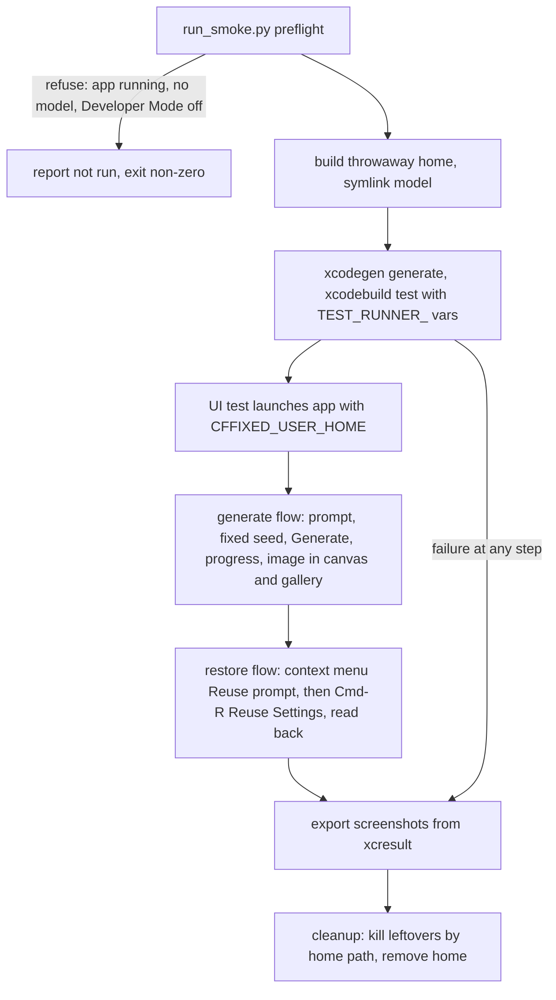

# Automated GUI Smoke Tests - Plan

## Goal Capsule

- **Objective:** Before a UI pull request, an agent or the developer can run one local command and get a trustworthy pass or fail on whether the real mlx-create window still generates an image and lets the user work with it in the gallery.
- **Means:** A UI test target that drives the built app with real input events, started by one Python runner (KTD1, KTD2).
- **Authority:** The Product Contract below, then the Planning Contract. Where they conflict with `docs/HLD.md`, update the HLD decision log first (`AGENTS.md`); U1 does that before any code.
- **Stop condition:** If U2 shows a UI test cannot drive the app from the agent shell on this Mac, stop and report to the developer. Do not fall back to a coordinate-click driver (Key Decisions: a blocked test runner returns to the developer). Before stopping, amend or remove the D50 row U1 added, so the HLD does not keep a decision for a suite that never runs.
- **Execution profile:** Sequential, on the developer's Mac, with the real engine and one small installed model. U2 needs Developer Mode enabled once, which takes the developer's admin password.
- **Who finishes:** The executing agent finishes U1 to U6. The developer enables Developer Mode before U2 starts and supplies the model location. U2 begins by checking Developer Mode and stops with a request if it is still off.

## Product Contract

### Summary

A UI test target launches the Debug build in a throwaway home with one small model linked in, then drives two flows with real input: generate one image on the real engine, and use the gallery and restore on that image. Each run ends in assertions and saved screenshots. It runs locally with one command and replaces the developer hand-checking the GUI before a UI PR.

### Problem Frame

`swift test` covers the model layer through `Tests/MCAppTests/Support/AppHarness.swift` with a stubbed engine, so it never renders SwiftUI or sends a real click. The only GUI check today is the developer launching the app and clicking through it, which the LoRA plan records as the developer's own job (`docs/plans/2026-10-19-1341-feat-lora-support-and-management-plan.md`).

No bug has yet escaped `swift test` that only a manual launch caught. This is a preventive net: the app is about to grow more UI and ship commercially, and a window that fails to render, a button that never enables, or a generation that does not reach the gallery would currently go unnoticed until someone looked.

### Actors

- A1. Agent working on a UI change, running the smoke tests before yielding.
- A2. Developer, running the same command before opening a UI PR.

### Requirements

**Running it**

- R1. One local command builds the Debug app if needed, runs the smoke tests, and exits non-zero when any step fails.
- R2. The app runs in a throwaway home, so the real library and engine state are never read or written, and the linked model weights (R3) are only read. If mlx-create is already running, the command refuses to start and says so, rather than risk quitting the developer's session.
- R3. A small installed model is supplied through a configured location and linked, not copied, into the throwaway home. When the location is not configured, or the named model's folder or its `model_index.json` is missing there, the run reports "not run" with the reason and exits non-zero rather than passing. Whether the weights load is the engine's question, answered by the generate step (AE3).
- R4. After every run, pass or fail, no `mlx-create` or `mlx-serve` process started by the run remains, and the throwaway home is removed.

**Flows covered**

- R5. Generate flow: the test enters a prompt, starts generation, sees progress, and the finished image appears in both the canvas and the gallery.
- R6. Gallery and restore flow: on the image from R5, the test performs at least one gallery action and restores that image's prompt and settings into the composer, then confirms the restored values match the image.

**Evidence**

- R7. The run saves a screenshot after each flow stage to a per-run output folder that outlives the throwaway home.
- R8. A failure names the step that failed and points to its screenshot.

**App changes**

- R9. Views the two flows touch gain stable accessibility identifiers where their existing labels cannot pick out a control uniquely. Visible UI and behavior do not change.
- R10. `AGENTS.md` records the command under Commands and tells agents to run it before yielding a UI change.

### Key Flows

- F1. Generate one image
  - **Trigger:** The smoke command is run with a model location configured.
  - **Actors:** A1 or A2
  - **Steps:** The app launches in the throwaway home and shows the installed model. The test types a prompt and generates. Progress shows. The image lands in the canvas and the gallery.
  - **Outcome:** An image exists in the gallery and its screenshot is saved.
  - **Covered by:** R2, R3, R5, R7
- F2. Use the gallery, then restore
  - **Trigger:** F1 finished with an image in the gallery.
  - **Actors:** A1 or A2
  - **Steps:** The test selects the image and performs a gallery action. It restores the image's prompt and settings into the composer and checks them.
  - **Outcome:** The composer holds the image's prompt and settings and the screenshot is saved.
  - **Covered by:** R6, R7

### Acceptance Examples

- AE1. **Covers R3.** Given no model location is configured, when the smoke command runs, it prints that nothing was run and why, and exits non-zero without launching generation.
- AE2. **Covers R2.** Given the developer's own app is running, when the smoke command runs, it exits non-zero before building or launching anything, names the running app, and leaves it and its library untouched.
- AE3. **Covers R5, R8.** Given the engine cannot load the model, when generation never produces an image, the failure names the generate step and points to a screenshot of the window at that moment.
- AE4. **Covers R6.** Given the generated image is restored, when the composer is read back, its prompt, fixed seed and Size equal the values the image was made with, after the test changed them in between. (Steps is not read back: the review dropped that clause, because the klein 4B family under test sends a fixed step grid and the readback would assert nothing.)
- AE5. **Covers R4.** Given a run that fails mid-generation, when the command exits, no process started by the run remains and the throwaway home is gone.

### Key Decisions

- **UI test target driving the real app, over an external CoreGraphics driver script and over a debug-only self-driving mode.** It is the only option with real input events and programmatic assertions. Governs R1, R5, R6, R9. (session-settled: user-directed — chosen over an external driver script and a debug-only self-driving mode: only option with real input and code-level assertions.)
- **Local runs against the real engine, not CI.** The run needs real weights and a free machine, so CI is deferred. Governs R1, R3. (session-settled: user-directed — chosen over CI on every PR, a release gate only, and local plus CI: wanted agent and developer self-check before a UI PR.)
- **First version covers generate, and gallery and restore.** First launch and empty state, and panels and sheets, wait. Governs R5, R6, R9. (session-settled: user-directed — chosen over first launch and empty state, and over panels and sheets opening.)
- **A blocked test runner returns to the developer, not to the driver-script fallback.** The fallback has weaker assertions and a different shape, so switching is a product call. Governs R1. (session-settled: user-approved — proposed with the tradeoff in the scoping synthesis; the developer confirmed.)
- **The command refuses to start while mlx-create is running.** Launching a UI test may quit a copy of the app with the same bundle ID, so refusing protects the developer's session. Governs R2. (session-settled: user-approved — proposed with the tradeoff in the plan scoping synthesis; the developer confirmed.)

### Scope Boundaries

**Deferred for later**

- CI execution of any smoke tier, including a fake-engine tier that needs no weights.
- First launch and empty state, the recommended-model card, and the panels and sheets (model browser, LoRA library, Civitai browse, enhancer install, settings popover).
- A convention that all new UI carries accessibility identifiers.
- Pixel-diff or visual regression comparison of screenshots.
- Drop-to-restore, because a UI test cannot drag a file in from Finder.
- Video and any mode other than text to image (D7).

**Outside this work**

- Changing the app's visible UI, behavior or engine rules to make it easier to test. R9 adds identifiers only.

### Dependencies / Assumptions

- **Developer Mode is off on this Mac.** `DevToolsSecurity -status` reports "Developer mode is currently disabled" (checked 2026-10-30). UI tests normally need it on, which is [INFERENCE] until U2 runs. Enabling it takes an admin password, so it is a one-time developer step.
- **Feasibility, unverified:** a UI test runner can drive the app from the agent shell on this Mac. The related tooling is partly blocked today (`osascript` System Events is denied; screenshots need a Screen Recording grant for the host terminal). U2 proves it first.
- **Throwaway home, unverified under a UI test:** `CFFIXED_USER_HOME` redirects the app's support directory when set at launch (`docs/solutions/developer-experience/launch-app-with-empty-library-for-first-run-testing.md`). U2 confirms a UI test can set it on the app it launches.
- A small model such as FLUX.2 klein 4B 4-bit (about 5 GB on disk) is installed on the developer's machine, and the machine has free RAM (about 8.9 GB measured for that model). The engine contract suite has the same requirement (`docs/lld/engine-contract.md`).
- The app's single-instance lock lives inside its support directory (`App/MLXCreateApp.swift`, `EnginePaths.appLockURL`), so a throwaway home gets its own lock.

### Outstanding Questions

**Deferred to Implementation**

- Whether the runner needs an Accessibility grant in addition to Developer Mode, and how both are documented for the developer and agents. U2 answers it.

### Sources / Research

- No UI test target exists: `project.yml` declares only the `MLXCreate` application target, and no `accessibilityIdentifier` appears in `Sources/` or `App/`.
- Existing test layers: `Tests/MCAppTests/Support/AppHarness.swift` (model layer, stubbed engine), real-engine tests gated on `MLXC_ENGINE_BIN`, and the engine contract suite (`docs/lld/engine-contract.md`).
- Throwaway-home recipe and cleanup of the engine child that can outlive the app: `docs/solutions/developer-experience/launch-app-with-empty-library-for-first-run-testing.md` and the Gotchas under Commands in `AGENTS.md`.
- Prior statement that the GUI smoke test was the developer's own job: `docs/plans/2026-10-19-1341-feat-lora-support-and-management-plan.md`.

---

## Planning Contract

### Key Technical Decisions

- KTD1. **A new `MLXCreateUITests` target in `project.yml`, sources under `UITests/MLXCreateUITests/`, wired into the app's scheme.** `project.yml` has no scheme configuration today, so XcodeGen's generated `MLXCreate` scheme would not run a new test bundle and `xcodebuild test -scheme MLXCreate` would find nothing to run. The app target gets a `scheme:` block listing `MLXCreateUITests` under `testTargets` (XcodeGen's `TargetScheme`). XcodeGen already owns the app project (`xcodegen generate`, then `xcodebuild`), so the UI test bundle lives beside it and the generated project stays git-ignored. The directory is separate from `Tests/`, which is SwiftPM-only. Satisfies R1, R5, R6.
- KTD2. **A Python runner at `scripts/gui-smoke/run_smoke.py`, run from an Eval cell.** It matches `scripts/engine-contract/run_contract.py` and `scripts/lora-gate/run_gate.py`, takes `--models DIR --model-id ORG/NAME [--out DIR]`, and owns everything a UI test cannot: preflight, building the throwaway home, cleanup, and exporting screenshots. The test bundle stays a plain XCTest with no file-system setup. Satisfies R1 to R4, R7, R8.
- KTD3. **The runner passes the throwaway home and model id to the test through `TEST_RUNNER_`-prefixed variables, and the test applies `CFFIXED_USER_HOME` as the app's `launchEnvironment` and also passes the home as a plain positional launch argument** (not a `-Key value` pair, which `NSUserDefaults` would absorb). `xcodebuild` strips the `TEST_RUNNER_` prefix and hands the rest to the test process (checked against `man xcodebuild`). The positional argument puts the home into the app's own command line, which KTD9 needs. Satisfies R2, R3, R4.
- KTD4. **Preflight refuses on a running mlx-create, a model folder or `model_index.json` missing at `--models DIR/--model-id`, and a failed Developer Mode check, each as "not run" with the reason.** The check is deliberately shallow: a model with a weight file removed passes preflight and fails at the generate step, which is how AE3 is provoked. None of them can be a pass. Satisfies R2, R3 and AE1, AE2.
- KTD5. **One app launch and one generation serve both flows.** A real generation takes tens of seconds, so F2 reuses the image F1 made, as one ordered test with named steps. Satisfies R5, R6.
- KTD6. **Restore is driven through the gallery tile's context menu ("Reuse prompt") and "Reuse all settings", not drop-to-restore.** A UI test cannot drag a file in from Finder. Prefer the ⌘R shortcut for "Reuse all settings"; it is bound to a zero-size, accessibility-hidden view in `Sources/MCApp/MainWindow.swift`, so if U2 finds it cannot be driven, use the tile's "Reuse all settings" menu item instead. The test sets a fixed seed before generating and records the composer's Size (and Steps where shown). After the restore it asserts that prompt, seed, and those recorded values are back. `reuseSettings(of:)` sets the seed policy to fixed and applies the image's settings (`Sources/MCApp/AppModel.swift`). Comparing with the recorded values, not with fixed numbers, keeps the check correct when `fitComposerToSelectedFamily()` adjusts a value. The smoke uses no LoRA. Satisfies R6, AE4.
- KTD7. **Existing accessibility labels are the first choice; identifiers are added only for controls the labels cannot pick out uniquely.** The Prompt editor, Generate button, "Generation progress", "Selected image: …", "Image: …" tiles and "Model: …" chip already carry labels, so R9 likely touches few views. One known candidate: the "Seed policy" segmented picker in `Sources/MCApp/GenerationPanel.swift` is `.labelsHidden()` with no explicit accessibility label, and both flows switch it between Random and Fixed. U2 checks whether its segments ("Random", "Fixed") can be queried; if not, U4 gives the picker a label or identifier. Satisfies R9.
- KTD8. **Screenshots are XCTest attachments exported from the `.xcresult` bundle into `build/gui-smoke/<timestamp>/`.** `build/` is already git-ignored. Each step records a screenshot named by step with `lifetime = .keepAlways`, because XCTest discards attachments from passing tests by default and R7 needs them on a pass. The runner prints the failing step with its exported path. The developer deletes old runs; there is no retention logic. Satisfies R7, R8.
- KTD9. **Cleanup finds leftovers by the throwaway home path in their command line, not by name.** The engine child carries the home in its `--model-dir` argument and the app carries it as the positional argument from KTD3, so one path match covers both. The engine child can outlive the app (`AGENTS.md`), and a name-based `pkill` would hit other `mlx-serve` processes such as a Gemma server another task may be running. Without the app match, a leftover mlx-create would make the next preflight refuse (KTD4). Satisfies R4, AE5.
- KTD3/KTD9 correction (U2 spike). The plain positional launch argument is wrong: AppKit treats it as a file to open and the app opens no window. Pass the home as `-MLXCSmokeHome <home>` instead, plus `-ApplePersistenceIgnoreState YES`; the path stays visible in the app's command line for cleanup. `UserDefaults.standard` is not redirected by `CFFIXED_USER_HOME`, so "defaults unchanged" cannot hold as written. The runner instead snapshots the real preferences before the run, restores the app-owned keys it changed afterwards, and fingerprints the real library (everything but `Engine/`) before and after, failing the run if it changed. See `docs/lld/gui-smoke.md` §4. Steps is not read back (AE4 and every "and Steps" clause below are dropped).

### High-Level Technical Design

This illustrates the intended shape and is directional, not code.

### Risks

| Risk | Effect | Mitigation |
|---|---|---|
| Developer Mode or an Accessibility grant cannot be obtained for the agent shell | The whole approach is blocked | U2 proves it first; the plan stops and reports (Goal Capsule) |
| Launching under XCUITest quits a running mlx-create | Developer loses a session | KTD4 refuses to start while the app runs |
| Ad-hoc signed Debug build refuses to launch under the UI test runner | Runner cannot start the app | U2 checks it; signing settings for the test target are a U2 outcome [unverified] |
| Not enough free RAM for the model (FLUX.2 klein needs about 8.9 GB free, measured) | Generate step fails | The failure names the step and the engine banner is in the screenshot; document the free-RAM need in the README |
| A real generation is slow or the model load stalls | Flaky timeouts | One generation total (KTD5), a generous wait tied to engine progress, no retry loop |

---

## Implementation Units

### U1. Record the decision in the HLD and start the LLD

- **Goal:** `docs/HLD.md` and a new LLD say what the GUI smoke run is before any code exists (`AGENTS.md`: update the HLD decision log first).
- **Requirements:** R1, R10.
- **Dependencies:** none.
- **Files:** `docs/HLD.md` (new decision row after D49 in the decision log), `docs/lld/gui-smoke.md` (new).
- **Approach:** Add D50: the GUI smoke suite is a local-only UI test target against the real engine, not CI, with the scope in this plan. The LLD records contract, prerequisites (Developer Mode, model location, free RAM), flow list, and known limits. U2 and U6 fill in the verified findings.
- **Test expectation:** none -- documentation only.
- **Verification:** The HLD row cites this plan's Key Decisions and no code diverges from a `D*` entry.

### U2. Spike: prove a UI test can drive the app from the agent shell

- **Goal:** A passing minimal UI test that launches the app in a throwaway home, plus a recorded answer to each unknown.
- **Requirements:** R1, R2.
- **Dependencies:** U1.
- **Files:** `project.yml` (new `MLXCreateUITests` target of type `bundle.ui-testing`, and a `scheme:` block on the app target listing it under `testTargets`, KTD1), `UITests/MLXCreateUITests/LaunchTests.swift` (new), `docs/lld/gui-smoke.md`.
- **Approach:** Check Developer Mode first and stop with a request to the developer if it is off. Add the target via XcodeGen (KTD1). The test reads the home from the environment (KTD3), sets `CFFIXED_USER_HOME` on the app's `launchEnvironment`, passes the home as the positional argument, launches, and waits for the main window. Record, in the LLD, for each of: Developer Mode and any Accessibility grant needed from the agent shell, whether the ad-hoc signed Debug app and test runner launch, whether the throwaway home is honored and the real library and the real `com.fearless.mlx-create` preferences domain are untouched, whether a screenshot attachment exports from the `.xcresult`, whether ⌘R and a context-menu item can be driven. Stop and report if the runner cannot drive the app (Goal Capsule).
- **Test scenarios:**
  - Launch in a throwaway home with no model: the main window appears and the empty-state canvas is on screen.
  - The real `Application Support/mlx-create` library is unchanged by the run (fingerprinted by the runner, `Engine/` excluded), and the real `com.fearless.mlx-create` preferences are restored to their pre-run values apart from AppKit's own `NS…` window-frame keys.
  - A passing step's screenshot attachment (with `lifetime = .keepAlways`) exports from the `.xcresult`.
- **Verification:** `xcodebuild test` runs the target to a pass from the agent shell, or the LLD records the exact blocker and the run stops.

### U3. The runner: preflight, throwaway home, cleanup, evidence

- **Goal:** One command that runs the UI tests end to end and leaves the machine clean.
- **Requirements:** R1, R2, R3, R4, R7, R8.
- **Dependencies:** U2.
- **Files:** `scripts/gui-smoke/run_smoke.py` (new), `scripts/gui-smoke/README.md` (new).
- **Approach:** Preflight per KTD4, each refusal a distinct "not run" message. Build the throwaway home with the model symlinked under `Library/Application Support/mlx-create/Models/Weights/<org>/<name>`. Run `xcodegen generate`, then `xcodebuild test` with `-derivedDataPath build` (as `AGENTS.md` does), the `TEST_RUNNER_` variables (KTD3) and a result bundle. Export screenshots (KTD8), print the failing step with its path, and print per-phase times. Clean up in a `finally` using the path match in KTD9 and remove the home. Add `--self-test` for the no-engine logic, like `run_contract.py`.
- **Test scenarios:**
  - `--self-test`: no `--models` configured exits non-zero with "not run" and the reason (AE1).
  - `--self-test`: a models directory without the named model exits non-zero as "not run".
  - `--self-test`: a stand-in process whose command line contains the throwaway home is found and killed by cleanup, and an unrelated process with another path is left alone (AE5, KTD9).
  - With mlx-create running, the command refuses before building anything and does not touch the app (AE2).
- **Verification:** `python3 scripts/gui-smoke/run_smoke.py --self-test` passes from an Eval cell; the live path is proven by U4 and U5.

### U4. Generate flow

- **Goal:** The generate flow runs against the real engine and asserts the image reaches the canvas and the gallery.
- **Requirements:** R5, R7, R8, R9.
- **Dependencies:** U2, U3.
- **Files:** `UITests/MLXCreateUITests/SmokeSteps.swift` (new: step runner that wraps each step in `XCTContext.runActivity` and attaches a named screenshot), `UITests/MLXCreateUITests/GenerateFlow.swift` (new), `Sources/MCApp/GenerationPanel.swift`, `Sources/MCApp/GalleryView.swift`, `Sources/MCApp/CanvasView.swift` (identifiers only where KTD7 finds a label ambiguous).
- **Approach:** Launch with the model installed, wait for the "Model: …" chip, type a prompt containing a per-run token, set the seed policy to fixed with a known seed (KTD6), record the composer's Size, press Generate, assert "Generation progress" appears, then wait for "Selected image: <prompt>" and the matching "Image: <prompt>" gallery tile. Each stage is a named step whose screenshot uses `.keepAlways` (R8, KTD8).
- **Test scenarios:**
  - Happy path: the canvas and the gallery both show the image with the run's prompt token.
  - Progress is observed before the image appears.
  - Engine cannot load the model: the run fails at the generate step with that step's name and a screenshot (AE3). Provoke it by running with a model folder that has a weight file removed.
  - Visible UI is unchanged: the identifier additions alter no view's text, layout or behavior (R9).
- **Verification:** A live run with the small model passes, and the exported screenshots show the generated image.

### U5. Gallery and restore flow

- **Goal:** On the image from U4, a gallery action and a restore both change the composer as designed, and the test reads the values back.
- **Requirements:** R6, R7, R8.
- **Dependencies:** U4.
- **Files:** `UITests/MLXCreateUITests/RestoreFlow.swift` (new); identifiers only where KTD7 requires, in the same views as U4.
- **Approach:** Continuing the same launch (KTD5): change the prompt, seed, seed policy and Size, right-click the tile and choose "Reuse prompt", then assert the prompt is back and the seed policy and Size are still as changed. Change the prompt again, select the tile and trigger "Reuse all settings" (⌘R, or the menu item per KTD6), then assert prompt, seed policy Fixed, the Seed field with the known seed, and the recorded Size are back (KTD6). Every readback starts from a composer that differs from the restored value.
- **Test scenarios:**
  - After the prompt, seed, seed policy and Size are changed, "Reuse prompt" from the tile menu puts the original prompt back and leaves the seed policy and Size alone.
  - After the prompt is changed again, "Reuse all settings" brings back the Fixed policy, the known seed, the original prompt and the recorded Size (AE4).
- **Verification:** The full ordered run passes live; both restores show in the exported screenshots.

### U6. Document the command and the setup

- **Goal:** Agents and the developer know how to run the smoke test and what to enable first.
- **Requirements:** R10.
- **Dependencies:** U3, U5.
- **Files:** `AGENTS.md` (Commands, Verification), `docs/lld/gui-smoke.md` (verified findings from U2 and the final flow list), `scripts/gui-smoke/README.md`.
- **Approach:** Add the command to Commands, and an instruction in Verification to run it before yielding a UI change, in place of "the user does the GUI smoke test themselves". Record the one-time setup (Developer Mode, any Accessibility grant, model location, free RAM) and that it is local only. Mention that it is not run by `swift test` or CI.
- **Test expectation:** none -- documentation only.
- **Verification:** A fresh agent following only `AGENTS.md` and the README can run the command or knows exactly what setup is missing.

---

## Verification Contract

| Check | Command | Applies to |
|---|---|---|
| Runner logic without an engine | `python3 scripts/gui-smoke/run_smoke.py --self-test` from an Eval cell | U3 |
| UI target launches and drives the app | `python3 scripts/gui-smoke/run_smoke.py --models DIR --model-id ORG/NAME` from an Eval cell | U2, U4, U5 |
| App project still generates and builds | `xcodegen generate`, then `xcodebuild -project MLXCreate.xcodeproj -scheme MLXCreate -configuration Debug -derivedDataPath build build` | U2, U4 |
| Unit tests unaffected by identifier additions | `swift test` (about 40 s; past 2 minutes it is hung, see `AGENTS.md`) | U4, U5 |
| Formatting | `git ls-files '*.swift' \| xargs swift format lint --strict --configuration .swift-format` prints nothing | U2, U4, U5 |

After a live run, `pgrep -fl "mlxc-smoke"` shows nothing: every process the run started carried the throwaway home path (other tasks' `mlx-serve` processes are not matched by name and are left alone).

## Definition of Done

- Every unit's verification passed, and a live run on the small model passed with exported screenshots.
- AE1 to AE5 each held: not-run refusals, refusal while the app runs, failed generation named at its step, restore read back, no leftovers after a failed run.
- `docs/HLD.md` D50, `docs/lld/gui-smoke.md`, `scripts/gui-smoke/README.md` and `AGENTS.md` are current, and the LLD records the answers U2 found.
- The real library was not touched, and any scaffolding or abandoned spike code is removed.
